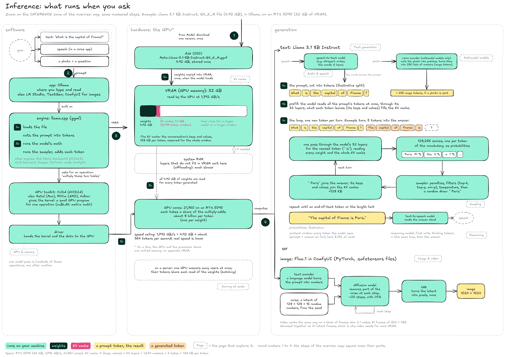

# Inference

**Inference** is every use of a finished model: loading it and computing an answer. This page follows one question to **Llama 3.1 8B Instruct**, in its Q4\_K\_M version (4.92 GB), run by [Ollama](https://ollama.com) on an RTX 5090 graphics card with 32 GB of VRAM. The steps are numbered as on the [overview map](../overview.md).


**The weights are read at every step.** The model's weights sit in the GPU's memory, and the GPU reads all of them for every token it writes. Memory size decides which models fit; memory speed decides how fast they answer.


### The map

<figure><figcaption></figcaption></figure>

1. **Download:** The version comes from the model's page on Hugging Face (see Model) and is stored on the disk once.
2. **Prompt:** Text, speech, or a photo with a question, typed in the **app**, here Ollama. The app is built on an **engine**, here [llama.cpp](https://github.com/ggml-org/llama.cpp), which loads the file, cuts the prompt into tokens, runs the model's math and the sampler; others exist, such as MLX on Macs, vLLM on servers and [PyTorch](https://pytorch.org) for images. Model and engine are independent: a version runs in any engine that reads its format (`.gguf` in llama.cpp, `.safetensors` in PyTorch).
3. **Use the hardware**, in two parts:
   * **3a, load:** The engine copies the weights from the disk into the **VRAM**, the GPU's own memory, once. It also reserves room for the [KV cache](text-generation/kv-cache.md), the keys and values of every token of the conversation: 128 KB per token, so 1.1 GB for an 8,192-token window. Layers that do not fit in VRAM can wait in the computer's **system RAM** (offloading), at a large cost in speed.
   * **3b, run:** For each operation of the model, such as "multiply these two tables", the engine calls a **kernel**, a small GPU program provided by the GPU's toolkit (CUDA on NVIDIA, Metal on Macs), and the driver hands it to the chip. The GPU's 21,760 cores each take a share of the work: about 8 billion multiply-adds per token, one per weight. See [GPU & memory](gpu-and-memory.md).
4. **Compute:** The results feed one of two loops.

**Text**, one token at a time. See [Text generation](text-generation/).

* **4a, tokens:** The prompt is cut into [tokens](text-generation/tokens.md) from the model's vocabulary, plus a few special tokens from the chat template that mark who is speaking.
* **4b, prefill:** The model reads all the prompt's tokens at once, through its 32 layers, and stores what each leaves behind, its keys and values, in the KV cache, so it is never computed again. A long pasted document makes this take a few seconds: the wait before the first word, the **time to first token**.
* **4c, the loop:** The answer is written one token per turn: the newest token goes through the 32 layers, the model scores all 128,256 tokens of the vocabulary, the **sampler** picks one (see [Sampling](text-generation/sampling.md)), and the token joins the answer and the KV cache, until an end-of-text token or the length limit. The map shows the sixth turn: after "The capital of France is", " Paris" comes out at 91 % (an illustrative figure). Reasoning models first write thinking tokens in this same loop (see **Reasoning**).

**Image**, in a fixed number of steps. See [Image & video](image-and-video.md).

* **Text encoder:** A language model turns the prompt into numbers that guide the image.
* **Noise:** A grid of random numbers, made from the **seed**, in the **latent space**: 128 × 128 × 16 numbers for a 1024 × 1024 image with Flux.1, 12 times fewer than the pixels.
* **Diffusion model:** Removes part of the noise at each step, about 20 steps, guided by the prompt with **CFG**.
* **VAE:** Turns the final latent into pixels, once. Video works the same way on a block of frames.

**Pictures and sound**, at both ends of the text loop:

* **Speech in:** A voice app passes the sound to a **speech-to-text** model, such as Whisper, which writes down the words it hears; they become the prompt, and the loop runs as for typed text. Whisper large-v3 reads 30 seconds of sound at a time. See **Audio & speech**.
* **Photo in:** A **multimodal** model has a **vision encoder**, a small model that cuts the picture into patches and turns each into a list of numbers; these lists enter where a text token's row of the token table would (see [how the tables connect](../model/inside-a-model.md)). They are called **image tokens**, but they are not in the vocabulary: Gemma 3 4B turns any photo into 256 of them, and prefill and the loop then run as for text. In llama.cpp the encoder is a separate small file (`mmproj`); Llama 3.1 8B has none and reads text only. See **Multimodal models**.
* **Speech out:** A **text-to-speech** model reads the answer aloud.

The prompt is everything the model reads before it answers, a photo included; some multimodal models also read video, as a series of pictures. Making a picture or a piece of music is a different job, done by generation models such as the image branch of the map.

On a Mac, the GPU and the processor share one **unified memory**, so there is no separate VRAM: the model sits in the same memory as everything else.

#### How fast it can go

Every token reads all the weights from VRAM, so the speed ceiling is the memory bandwidth divided by the size of the weights: 1,792 GB/s ÷ 4.92 GB = about 364 tokens per second for this example. Real speed is lower, since the KV cache is read too and the engine has other work. A version twice as small can go up to twice as fast, which is one reason to [quantize](../model/quantization/).

On a server, one GPU answers many users at once. Their tokens are processed together (**batching**), so each step still reads the weights once but writes one token for every user in the batch: the total output grows with the batch, until the GPU's arithmetic, rather than its memory, becomes the limit. This is how a provider spreads the cost of its hardware (see **Serving at scale**).

#### Resources

* GPU specs: [NVIDIA GeForce RTX 5090](https://www.nvidia.com/en-us/geforce/graphics-cards/50-series/rtx-5090/)
* Picture in: [Google, What's new in Gemma 3](https://developers.googleblog.com/en/gemma-explained-whats-new-in-gemma-3) (SigLIP encoder, 896 × 896, 256 tokens) | Sound: [OpenAI, Whisper large-v3 model card](https://huggingface.co/openai/whisper-large-v3) (128 frequency bands, 30-second windows)
