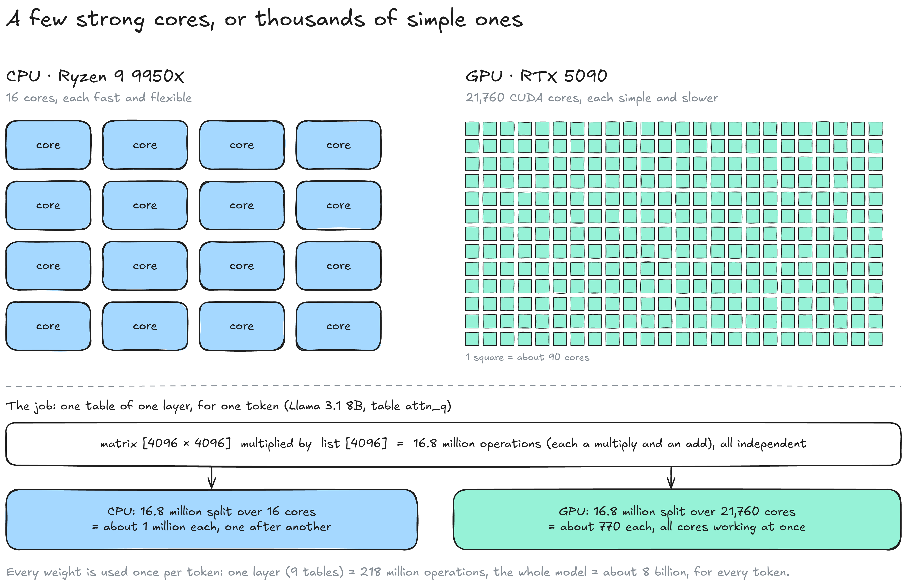
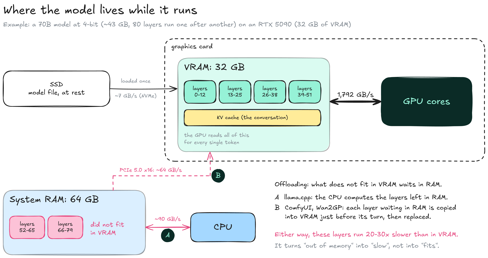
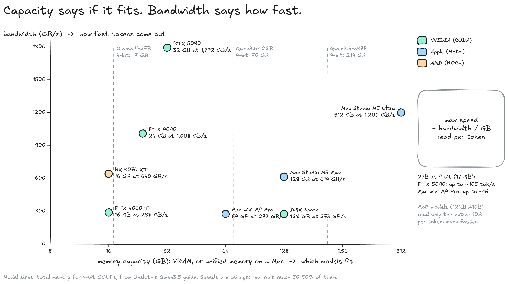
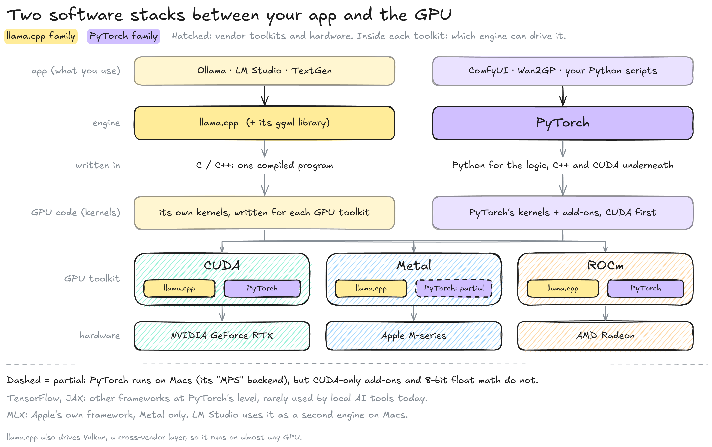
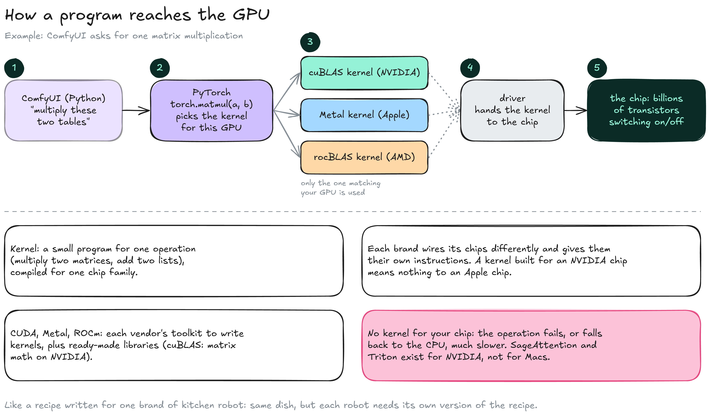

---
layout:
  width: default
  title:
    visible: true
  description:
    visible: false
  tableOfContents:
    visible: true
  outline:
    visible: true
  pagination:
    visible: true
  metadata:
    visible: true
  tags:
    visible: true
  actions:
    visible: true
  anchors:
    visible: true
---

# GPU & memory

A GPU is a processor built for thousands of identical calculations at once, with its own fast memory, the **VRAM**. For AI, the size and speed of that memory matter more than the number of cores. On the [Inference](./) map, this page zooms on step 3: loading the model into memory (3a) and running its math on the chip (3b).


**Capacity decides if a model fits. Bandwidth decides how fast it runs.** Both are fixed when you buy the machine.


### Why a GPU

Generating one token means multiplying large tables of numbers, and every multiplication is independent of the others. A GPU splits that work between thousands of simple cores; a CPU has a few complex ones.

<figure><figcaption></figcaption></figure>

* **CPU:** A few powerful, flexible cores (16 on a Ryzen 9 9950X), good at varied tasks that depend on each other.
* **GPU:** Thousands of simple cores (21,760 on an RTX 5090). They all run the same operation, each on its own share of the numbers.
* **The workload:** Each weight takes part in one operation (a multiply and an add) for every token. One table of one layer of Llama 3.1 8B, `attn_q` \[4096 × 4096] (see [Inside a model](../model/inside-a-model.md)), is 16.8 million operations: about a million per CPU core, done one after another, or about 770 per GPU core, all at the same time.
* **Per token:** One layer (9 tables) is about 218 million operations, and the whole model about 8 billion, for every token generated.

### Where the model lives

At startup (step 3a), the engine copies the weights from the disk into VRAM. During generation, the GPU reads them from there for every token, layer after layer.

<figure><figcaption></figcaption></figure>

* **SSD:** Stores the version you downloaded. It is read once, when the model loads.
* **VRAM:** The GPU's own memory, on the graphics card. Holds the weights and the [KV cache](text-generation/kv-cache.md). An RTX 5090 reads its 32 GB at 1,792 GB/s.
* **System RAM:** The computer's main memory. Larger, but much slower for the GPU to reach. Layers that do not fit in VRAM wait here.
* **Layers:** A model is a stack of layers, also called blocks (`blk.0` to `blk.31` in a `.gguf`), run one after another: 32 in Llama 3.1 8B, 80 in Llama 3.1 70B. This is why a model can be split by layer between VRAM and RAM.
* **Offloading:** Running a model that does not fit in VRAM by keeping some layers in RAM. [llama.cpp](https://github.com/ggml-org/llama.cpp) computes those layers on the CPU (A; `-ngl` sets how many layers stay on the GPU). [ComfyUI](https://github.com/Comfy-Org/ComfyUI) and [Wan2GP](https://github.com/deepbeepmeep/Wan2GP) copy each waiting layer into VRAM just before its turn, then replace it with the next one (B).

Offloading makes a too-large model run instead of failing, but on an RTX 5090 the layers outside VRAM run 20 to 30 times slower. A model that is mostly offloaded is unusably slow for chat. On a Mac there is no VRAM/RAM split: CPU and GPU share one pool of **unified memory**.

### Capacity and bandwidth

Memory **capacity** (GB) sets which models fit. Memory **bandwidth** (GB/s) sets how fast tokens come out, because the whole model is read from memory for every token.

<figure><figcaption></figcaption></figure>

* **Gaming GPUs:** The highest bandwidth, but limited capacity: 24 GB of VRAM on an RTX 4090, 32 GB on an RTX 5090.
* **Apple Silicon:** Up to 128 GB of unified memory on an M5 Max and 512 GB on an M5 Ultra, at lower bandwidth than a high-end GPU.
* **Speed ceiling:** Tokens per second ≈ bandwidth ÷ size of the version in memory. Llama 3.1 8B in Q4\_K\_M (4.92 GB) tops out around 364 tokens/s on an RTX 5090; Qwen3.5-27B at 4-bit (17 GB) around 105 tokens/s on the same card and 16 tokens/s on a Mac mini M4 Pro.
* **MoE models:** Mixture-of-experts models read only their active parameters for each token. Qwen3.5-122B-A10B needs memory for 122 B parameters but reads about 10 B per token, so it runs much faster than its size suggests.

Real speeds land below the ceiling, typically at 50 to 80 % of it. The conversation also takes memory and bandwidth, as detailed on the [KV cache](text-generation/kv-cache.md) page.


**TODO (author): interactive page.** A memory calculator: pick a model size, a quantization and a context length, see weights + KV cache against common cards and Macs, with the speed ceiling. Embed it here once hosted.


### Two software stacks

Between the app you use and the GPU sit two layers of software: an **engine** that does the model's math, and a vendor **GPU toolkit** that runs it on the chip. Local AI tools use one of two engine families, shown in yellow (llama.cpp) and violet (PyTorch); the hatched boxes are the vendors' toolkits and chips.

<figure><figcaption></figcaption></figure>

* **llama.cpp (+ ggml):** One compiled C/C++ program that ships its own GPU code for CUDA, Metal, ROCm and Vulkan. It runs text models, which all share the same structure (a stack of identical layers), so one compact engine covers nearly all of them.
* **PyTorch:** A [Python library](https://pytorch.org) used by almost all AI research. Python describes the steps; the heavy math runs in C++ and CUDA code underneath. Image and video pipelines combine several models that change with every release, and they arrive as PyTorch code, so ComfyUI and Wan2GP run that code directly.
* **Python:** The language of the tools and scripts, not the part that computes. A slow Python tool is rarely slow because of Python.
* **TensorFlow, JAX:** Google's frameworks, at PyTorch's level. They are rare in local AI tools today; Hugging Face's Transformers library dropped TensorFlow and Flax in version 5 to focus on PyTorch.
* **MLX:** Apple's own framework, Metal only. [LM Studio](https://lmstudio.ai) uses it as a second engine on Macs.

The split follows the tools, not the task: PyTorch also runs text models, and projects such as stable-diffusion.cpp run image models on ggml. The engine never changes the model: a version runs in any engine that reads its format (step 2 on the [Inference](./) map).

### How a program reaches the GPU

A GPU does not run Python or C++ (step 3b). It runs **kernels**: small programs that each do one operation, such as multiplying two matrices, compiled for one family of chips. **CUDA** (NVIDIA), **Metal** (Apple) and **ROCm** (AMD) are each vendor's toolkit for writing and running them.

<figure><figcaption></figcaption></figure>

1. **The app** asks for an operation, for example "multiply these two tables".
2. **The engine** picks the kernel that matches the GPU it detected.
3. **The kernel** comes from a vendor library (cuBLAS for matrix math on NVIDIA) or from the engine itself.
4. **The driver** hands the kernel and the data to the chip.
5. **The chip** runs it: billions of transistors switching on and off, every core working on its share.

Each brand designs its chips differently and gives them a different set of instructions, so a kernel built for an NVIDIA chip means nothing to an Apple chip. Software that only ships CUDA kernels does not run on a Mac until someone writes a Metal version.

This is the main reason NVIDIA leads. CUDA has existed since 2007, so nearly all research code, speed-ups and tutorials are written for it first; other vendors have to port each piece. When a tool has no kernel for your GPU, the operation fails or falls back to the CPU, much slower.

|                                               | NVIDIA                                   | Apple                                                       | AMD                                     |
| --------------------------------------------- | ---------------------------------------- | ----------------------------------------------------------- | --------------------------------------- |
| **GPU toolkit**                               | CUDA                                     | Metal                                                       | ROCm                                    |
| **Memory**                                    | VRAM on the card, up to 32 GB (RTX 5090) | Unified memory shared with the CPU, up to 512 GB (M5 Ultra) | VRAM on the card, 16 GB (RX 9070 XT)    |
| **llama.cpp (text)**                          | Full support                             | Full support                                                | Supported (ROCm or Vulkan)              |
| **PyTorch**                                   | Full support                             | "MPS" backend: most operations, no 8-bit float type         | ROCm builds, more setup                 |
| **Image (ComfyUI)**                           | Everything works                         | Works; fp8 files need a 16-bit model or a conversion        | Works, with more setup and fewer guides |
| **CUDA-only add-ons** (SageAttention, Triton) | Yes                                      | No                                                          | Partly (Triton supports AMD)            |

Text generation is limited mainly by memory bandwidth, where a Mac's large unified memory does well. Image and video generation is limited mainly by raw compute and by CUDA-only add-ons, where NVIDIA cards are much faster.

Version pins in install guides

A PyTorch build is compiled for one CUDA version: in `pip install torch --index-url https://download.pytorch.org/whl/cu130`, `cu130` means CUDA 13.0. An install guide that names a CUDA version assumes an NVIDIA card, and the NVIDIA driver must be recent enough for that version.

### Resources

* Specs: [NVIDIA RTX 5090](https://www.nvidia.com/en-us/geforce/graphics-cards/50-series/rtx-5090/) | [NVIDIA DGX Spark](https://www.nvidia.com/en-us/products/workstations/dgx-spark/) | [Mac Studio M5 Max and M5 Ultra (9to5Mac)](https://9to5mac.com/2026/08/25/apple-unveils-next-generation-mac-studio-with-m5-max-and-m5-ultra/)
* Model memory needs: [Unsloth, Qwen3.5 guide](https://unsloth.ai/docs/models/qwen3.5)
* Engines: [llama.cpp server README](https://github.com/ggml-org/llama.cpp/blob/master/tools/server/README.md) | [MLX](https://github.com/ml-explore/mlx) | [stable-diffusion.cpp](https://github.com/leejet/stable-diffusion.cpp)
* Mac limits: [ComfyUI-AppleSilicon-FP8 README](https://github.com/pawel-mazurkiewicz/ComfyUI-AppleSilicon-FP8) (fp8 on PyTorch's Mac backend)
* Frameworks: [Transformers v5 announcement](https://huggingface.co/blog/transformers-v5)
