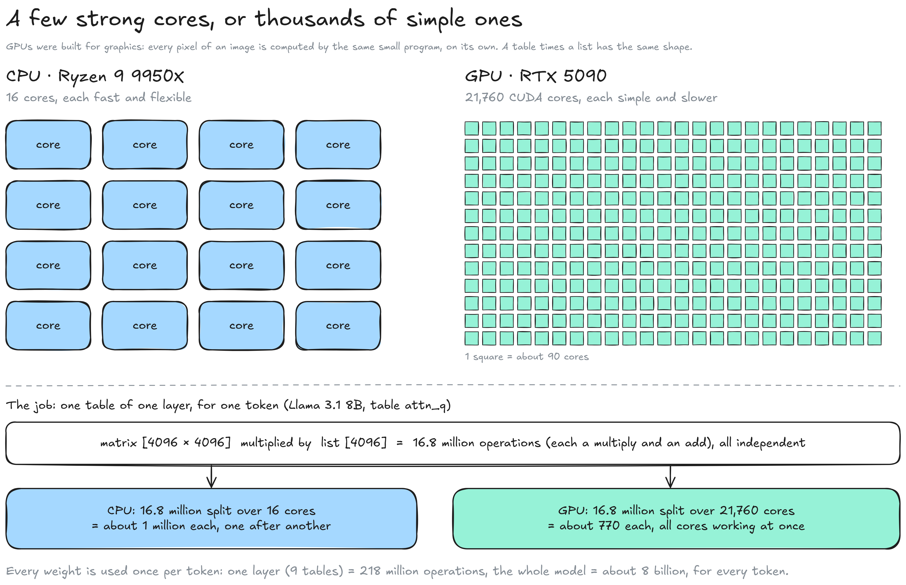
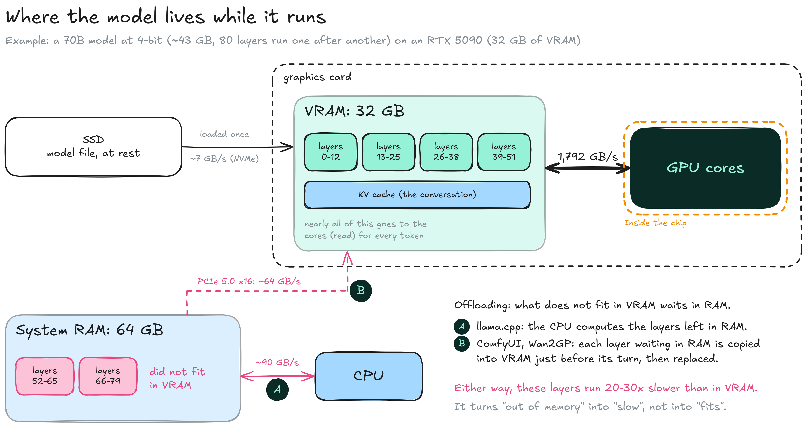
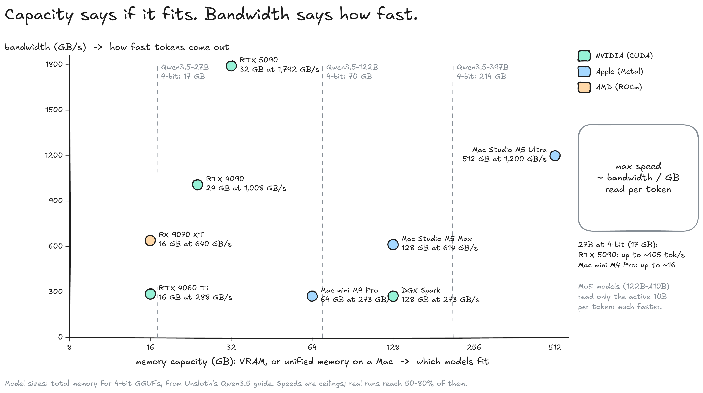
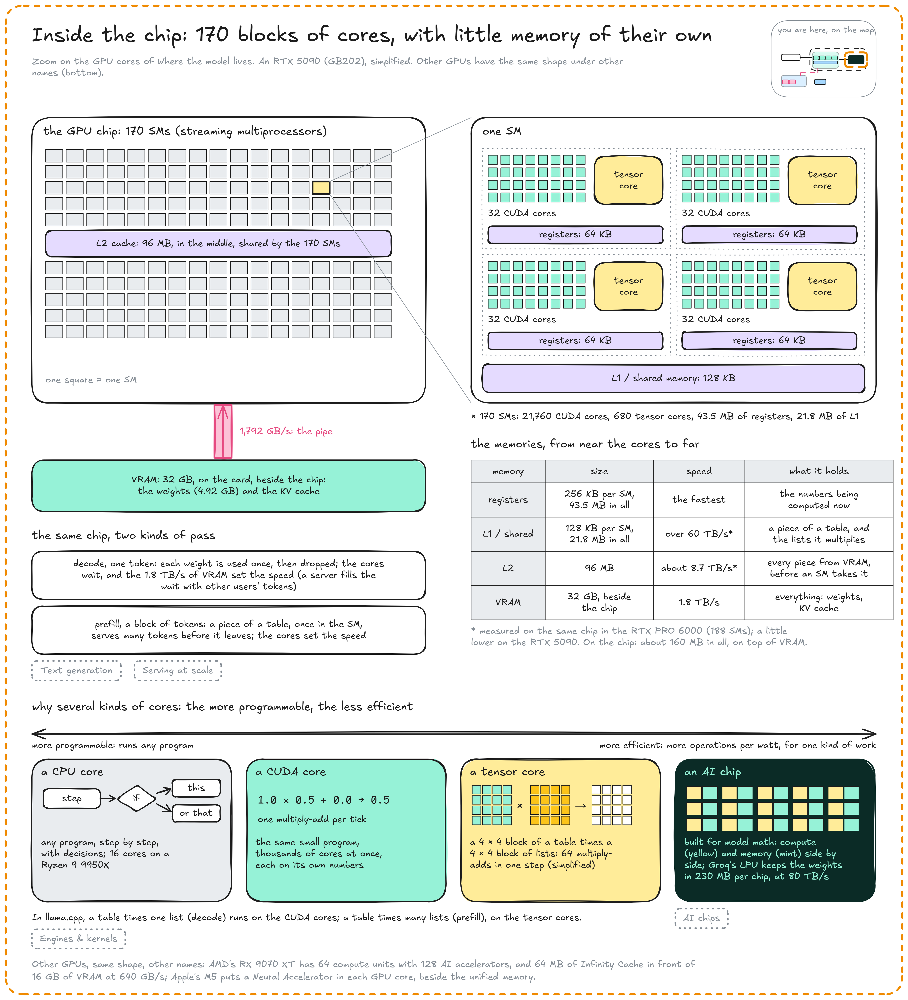

---
layout:
  width: default
  title:
    visible: true
  description:
    visible: false
  tableOfContents:
    visible: true
  outline:
    visible: true
  pagination:
    visible: true
  metadata:
    visible: true
  tags:
    visible: true
  actions:
    visible: true
  anchors:
    visible: true
---

# GPU & memory

A GPU is a processor built for thousands of identical calculations at once, with its own fast memory, the **VRAM**. For AI, the size and speed of that memory matter more than the number of cores. On the [Inference](../) map, this page zooms on step 3: loading the model into memory (3a) and running its math on the chip (3b). The software that drives the chip, from the app to the kernels, is on Engines & kernels.


**Capacity decides if a model fits. Bandwidth decides how fast it runs.** Both are fixed when you buy the machine.


### Why a GPU

Generating one token means multiplying large tables of numbers, and every multiplication is independent of the others. A GPU splits that work between thousands of simple cores; a CPU has a few complex ones.

<figure><figcaption></figcaption></figure>

* **CPU:** A few powerful, flexible cores (16 on a Ryzen 9 9950X), good at varied tasks that depend on each other.
* **GPU:** Thousands of simple cores (21,760 on an RTX 5090). They all run the same operation, each on its own share of the numbers.
* **Why graphics:** GPUs were designed to draw images, where every pixel is computed by the same small program, independently of the others. A table times a list has the same shape: each number of the result is one row times the list, independent of the other rows.
* **The workload:** Each weight takes part in one operation (a multiply and an add) for every token. One table of one layer of Llama 3.1 8B, `attn_q` \[4096 × 4096] (see [Inside a model](../../model/inside-a-model/)), is 16.8 million operations: about a million per CPU core, done one after another, or about 770 per GPU core, all at the same time.
* **Per token:** One layer (9 tables) is about 218 million operations, and the whole model about 8 billion, for every token generated.

### Where the model lives

At startup (step 3a), the engine copies the weights from the disk into VRAM. During generation, they travel from VRAM to the cores for every token, layer after layer.

<figure><figcaption></figcaption></figure>

* **SSD:** Stores the version you downloaded. It is read once, when the model loads.
* **VRAM:** The GPU's own memory, on the graphics card. Holds the weights and the [KV cache](../text-generation/kv-cache.md). An RTX 5090 reads its 32 GB at 1,792 GB/s.
* **System RAM:** The computer's main memory. Larger, but much slower for the GPU to reach. Layers that do not fit in VRAM wait here.
* **Layers:** A model is a stack of layers, also called blocks (`blk.0` to `blk.31` in a `.gguf`), run one after another: 32 in Llama 3.1 8B, 80 in Llama 3.1 70B. This is why a model can be split by layer between VRAM and RAM.
* **Offloading:** Running a model that does not fit in VRAM by keeping some layers in RAM. [llama.cpp](https://github.com/ggml-org/llama.cpp) computes those layers on the CPU (A; `-ngl` sets how many layers stay on the GPU). [ComfyUI](https://github.com/Comfy-Org/ComfyUI) and [Wan2GP](https://github.com/deepbeepmeep/Wan2GP) copy each waiting layer into VRAM just before its turn, then replace it with the next one (B).

Offloading makes a too-large model run instead of failing, but on an RTX 5090 the layers outside VRAM run 20 to 30 times slower. A model that is mostly offloaded is unusably slow for chat. On a Mac there is no VRAM/RAM split: CPU and GPU share one pool of **unified memory**.

### Capacity and bandwidth

Memory **capacity** (GB) sets which models fit. Memory **bandwidth** (GB/s) sets how fast tokens come out, because the weights travel from memory to the cores for every token.

<figure><figcaption></figcaption></figure>

* **Gaming GPUs:** The highest bandwidth, but limited capacity: 24 GB of VRAM on an RTX 4090, 32 GB on an RTX 5090.
* **Apple Silicon:** Up to 128 GB of unified memory on an M5 Max and 512 GB on an M5 Ultra, at lower bandwidth than a high-end GPU.
* **Speed ceiling:** Tokens per second ≈ bandwidth ÷ size of the version in memory. Llama 3.1 8B in Q4\_K\_M (4.92 GB) tops out around 364 tokens/s on an RTX 5090; Qwen3.5-27B at 4-bit (17 GB) around 105 tokens/s on the same card and 16 tokens/s on a Mac mini M4 Pro. This ceiling is for writing the answer (decode); reading the prompt (prefill) is limited by the cores instead (see [prefill and decode](../text-generation/#prefill-and-decode)). It is a slightly cautious estimate: the token table gives only one row per token, so a pass moves a little less than the whole file.
* **MoE models:** [Mixture-of-experts](../../model/inside-a-model/mixture-of-experts.md) models read only their active parameters for each token. Qwen3.5-122B-A10B needs memory for 122 B parameters but reads about 10 B per token, so it runs much faster than its size suggests.

Real speeds land below the ceiling, typically at 50 to 80 % of it. The conversation also takes memory and bandwidth, as detailed on the [KV cache](../text-generation/kv-cache.md) page.

### Inside the chip

The cores are grouped in 170 blocks, each with a little memory of its own: all the memory on the chip adds up to about 160 MB, on top of the 32 GB of VRAM beside it. The diagram zooms on the GPU cores of where the model lives.

<figure><figcaption></figcaption></figure>

* **SMs:** An RTX 5090's chip holds 170 streaming multiprocessors (SMs), the blocks the GPU hands work to. Each has four groups of 32 CUDA cores, each group with its tensor core and 64 KB of registers: 21,760 CUDA cores and 680 tensor cores in all.
* **Memories:** The nearer the cores, the faster and the smaller: registers hold the numbers being computed, L1 (128 KB per SM) a piece of a table and the lists it multiplies, and L2 (96 MB) every piece that comes from VRAM, before an SM takes it. VRAM, beside the chip, holds everything and is the slowest, at 1,792 GB/s; the L2 cache is part of the chip and has nothing to do with the KV cache, which sits in VRAM.
* **Two kinds of pass:** The model stays in VRAM; at each pass, each table comes into the SMs piece by piece. In decode, a piece serves one token's list and is dropped, so the cores wait for the next piece and VRAM sets the speed (see [prefill and decode](../text-generation/#prefill-and-decode)), a wait a server fills with other users' tokens (**Serving at scale**); in a prefill, the same piece serves the lists of many tokens before it leaves, and the cores set the speed.
* **Programmable or efficient:** A CPU core runs any program, step by step, with decisions; a CUDA core does one multiply-add per tick, the same small program as thousands of others; a tensor core multiplies a small block of a table by a block of lists in one step. The more specialised the unit, the more operations per watt. In llama.cpp, decode runs on the CUDA cores and prefill on the tensor cores (see [Engines & kernels](engines-and-kernels.md#one-pass-in-action)).

Other GPUs have the same shape under other names: AMD's RX 9070 XT has 64 compute units with 128 AI accelerators and a 64 MB Infinity Cache, and Apple's M5 puts a Neural Accelerator in each GPU core. Chips built only for model math go further and keep the weights on the chip: Groq's LPU holds 230 MB per chip, read at up to 80 TB/s, and Cerebras 44 GB on one wafer-sized chip, where an NVIDIA H100 has 0.05 GB, at the cost of many chips for one model (see **AI chips**).

### Resources

* Specs: [NVIDIA RTX 5090](https://www.nvidia.com/en-us/geforce/graphics-cards/50-series/rtx-5090/) | [NVIDIA DGX Spark](https://www.nvidia.com/en-us/products/workstations/dgx-spark/) | [Mac Studio M5 Max and M5 Ultra (9to5Mac)](https://9to5mac.com/2026/08/25/apple-unveils-next-generation-mac-studio-with-m5-max-and-m5-ultra/)
* Inside the RTX 5090's chip: [TechPowerUp, the architecture](https://www.techpowerup.com/review/msi-geforce-rtx-5090-suprim/2.html) (128 CUDA cores, 4 tensor cores and 128 KB of L1 per SM; 96 MB of L2) | [HotHardware](https://hothardware.com/reviews/nvidia-geforce-rtx-5090-review?page=1) (170 of 192 SMs; 256 KB of registers per SM) | [Chips and Cheese, Blackwell](https://old.chipsandcheese.com/?p=36790) (L1 and L2 speeds, measured on the RTX PRO 6000)
* Other chips: [AMD Radeon RX 9070 XT](https://www.amd.com/en/products/graphics/desktops/radeon/9000-series/amd-radeon-rx-9070xt.html) | [Apple M5](https://www.apple.com/newsroom/2025/10/apple-unleashes-m5-the-next-big-leap-in-ai-performance-for-apple-silicon/) (a Neural Accelerator in each GPU core) | [Groq, GroqChip product brief](https://groq.com/wp-content/uploads/2024/08/GroqChip%E2%84%A2-Processor-Product-Brief-v1.7.pdf) (230 MB, 80 TB/s) | [Cerebras, the wafer-scale engine](https://cerebras.net/chip/) (44 GB on the chip, 21 PB/s; H100: 0.05 GB)
* Model memory needs: [Unsloth, Qwen3.5 guide](https://unsloth.ai/docs/models/qwen3.5)
