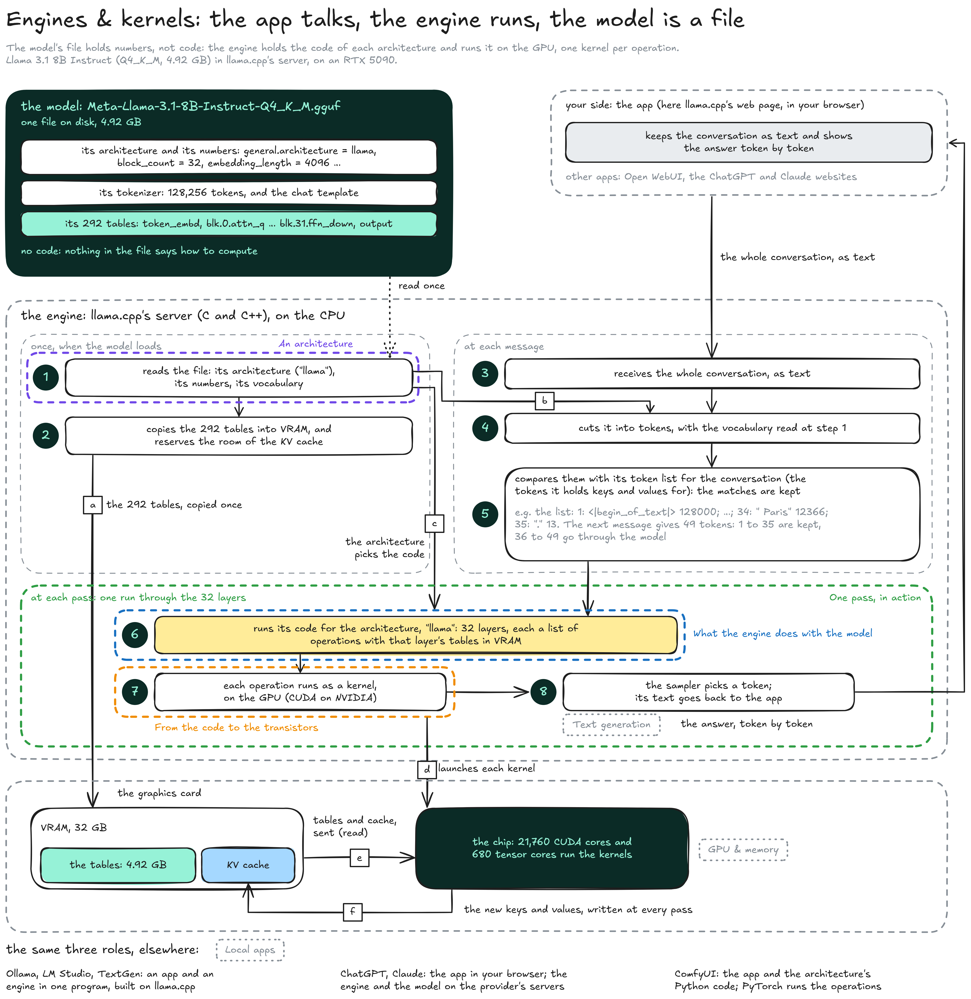
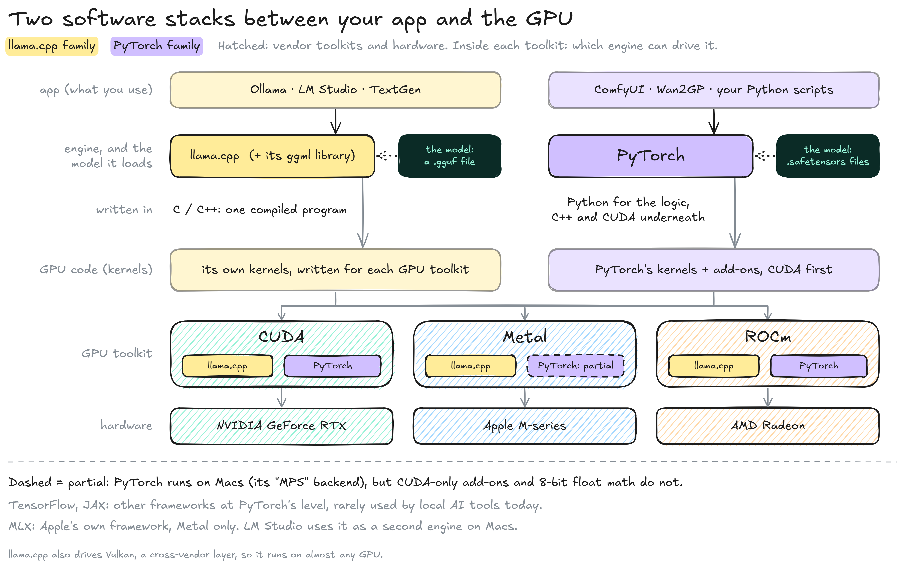
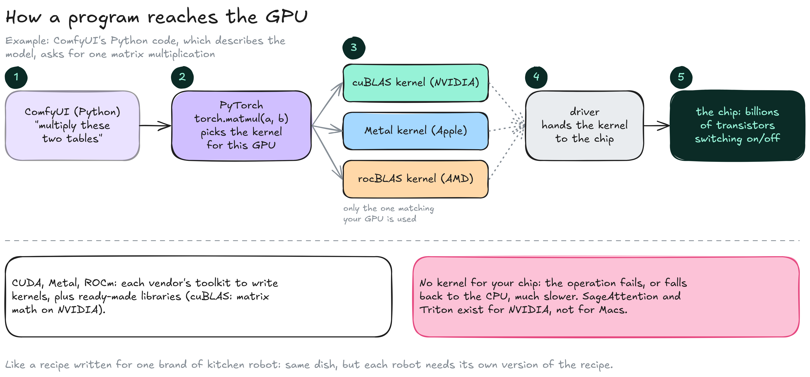
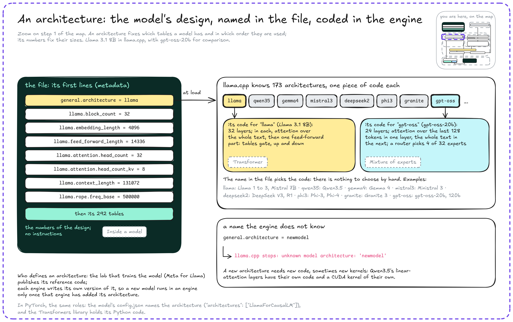
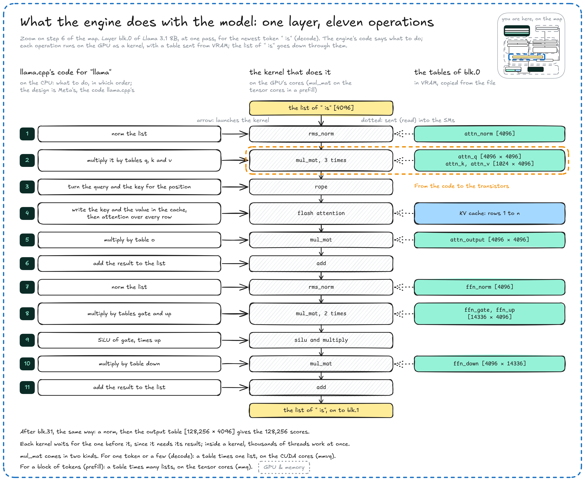
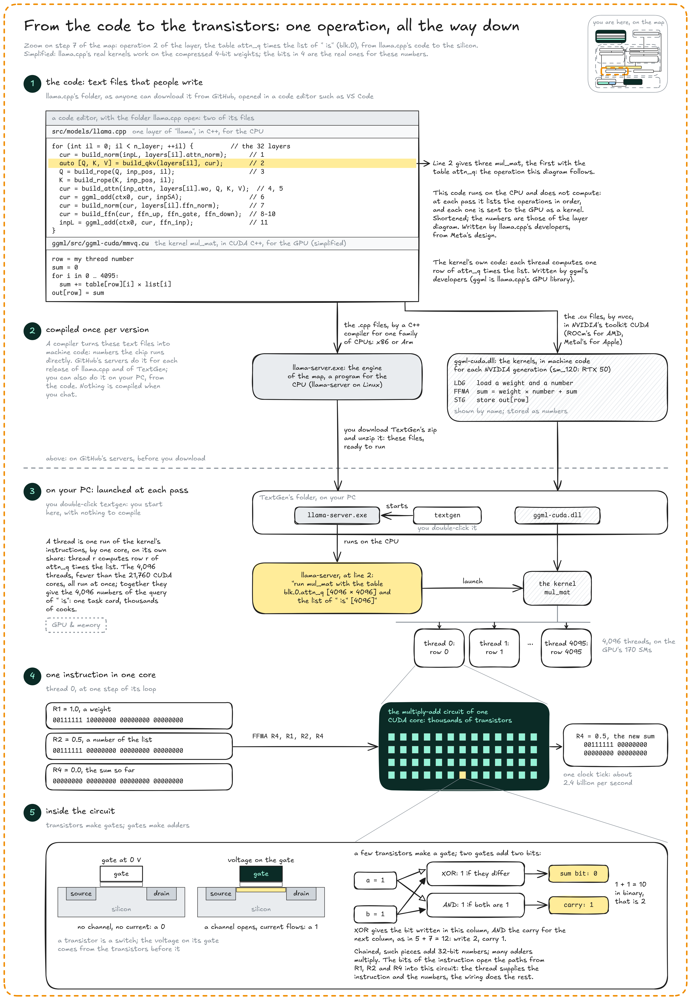
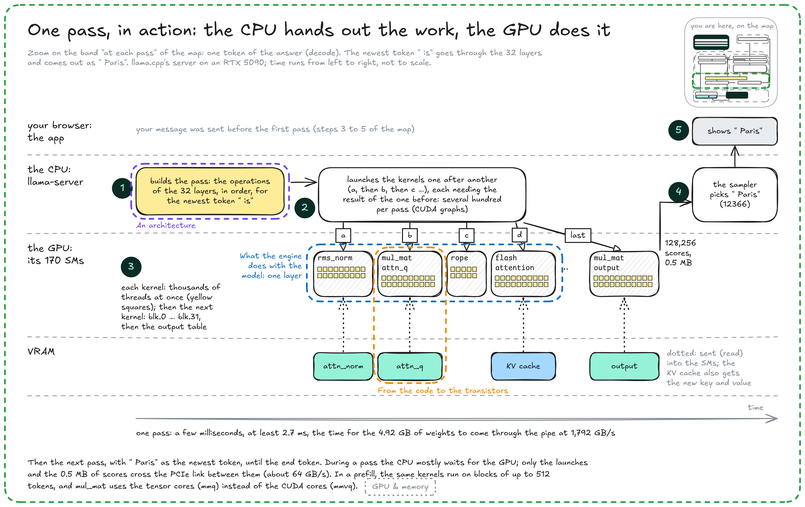

---
layout:
  width: default
  title:
    visible: true
  description:
    visible: false
  tableOfContents:
    visible: true
  outline:
    visible: true
  pagination:
    visible: true
  metadata:
    visible: true
  tags:
    visible: true
  actions:
    visible: true
  anchors:
    visible: true
---

# Engines & kernels

An **engine** is the program that loads a model and runs it; a **kernel** is one of the small programs it runs on the GPU, one per kind of operation (nothing to do with the kernel of an operating system such as Linux). On the [Inference](../) map, this page zooms on the software of steps 2 and 3b: the app, the engine and the model, and how an operation reaches the chip. The example is Llama 3.1 8B Instruct in llama.cpp's server, on an RTX 5090; the chip itself is on [GPU & memory](./).


**The model is numbers; the engine is code.** A model's file holds its tables and the numbers of its architecture, but no instructions: the engine holds the code of each architecture it knows and runs it, operation by operation, as kernels on the GPU.


### The map

Three roles, followed from start-up to one answer: the model's file, the engine that runs it at three moments (once when the model loads, at each message, at each pass), and the app you type in. Digits number the steps, letters what goes from one part to another; the coloured outlines mark the parts that later sections open.

<figure><figcaption></figcaption></figure>

1. **Reading the file (once):** At start-up, the engine reads the model's file: its architecture (`general.architecture = llama`), its numbers and its vocabulary (see [an architecture](engines-and-kernels.md#an-architecture), below).
2. **Loading (once):** It copies the 292 tables into VRAM and reserves room for the [KV cache](../text-generation/kv-cache.md). Both stay there until the model is unloaded.
3. **The message:** The app, here the web page that [llama.cpp](https://github.com/ggml-org/llama.cpp)'s server opens in your browser, keeps the conversation as text and sends all of it with each message (see [one conversation, message by message](../text-generation/kv-cache.md#one-conversation-message-by-message)).
4. **Tokens:** The engine cuts the text into tokens with the vocabulary read at step 1 (see [Tokens](../text-generation/tokens.md)).
5. **What is already done:** The engine keeps the conversation's token list, the token numbers it already holds keys and values for in the KV cache, and compares the new tokens with it: what matches is kept, and only the rest goes through the model, in the prefill. For the second message of the KV cache page, 49 tokens: 35 kept, 14 computed.
6. **The code of the architecture:** A pass is one run through the 32 layers: one for the new tokens together (the prefill), then one per token of the answer. At each pass, the engine runs its own code for the architecture, each layer a list of operations with that layer's tables in VRAM (see [what the engine does with the model](engines-and-kernels.md#what-the-engine-does-with-the-model)).
7. **Kernels:** Each operation runs on the GPU as a kernel, compiled for that make of chip (CUDA on NVIDIA; see [from the code to the transistors](engines-and-kernels.md#from-the-code-to-the-transistors)).
8. **The sampler:** It picks a token from the scores (see [Sampling](../text-generation/sampling.md)), and its text goes back to the app; the next pass starts (see [Text generation](../text-generation/) and [one pass, in action](engines-and-kernels.md#one-pass-in-action)).

The letters: **a** the 292 tables, copied once into VRAM; **b** the vocabulary, used at step 4; **c** the architecture, which picks the code run at step 6; **d** each kernel, launched on the chip; **e** the tables and the KV cache, sent (read) from VRAM to the cores at every pass; **f** the keys and values of the new tokens, written into the KV cache at every pass.

The three roles can sit in one program or far apart: Ollama, LM Studio and TextGen are an app and an engine in one program, built on llama.cpp; the ChatGPT and Claude websites are apps whose engine and model run on the provider's servers; ComfyUI holds the window and the architecture's Python code, and PyTorch runs it (see [two software stacks](engines-and-kernels.md#two-software-stacks)). The catalogue is on **Local apps**.

### Two software stacks

Between the app you use and the GPU sit two layers of software: an **engine** that does the model's math, and a vendor **GPU toolkit** that runs it on the chip. Local AI tools use one of two engine families, shown in yellow (llama.cpp) and violet (PyTorch); the hatched boxes are the vendors' toolkits and chips.

<figure><figcaption></figcaption></figure>

* **llama.cpp (+ ggml):** One compiled C/C++ program that ships its own GPU code for CUDA, Metal, ROCm and Vulkan. It runs text models, which all share the same structure (a stack of identical layers), so one compact engine covers nearly all of them.
* **PyTorch:** A [Python library](https://pytorch.org) used by almost all AI research. Python describes the steps; the heavy math runs in C++ and CUDA code underneath. Image and video pipelines combine several models that change with every release, and they arrive as PyTorch code, so ComfyUI and Wan2GP run that code directly.
* **The model:** A `.gguf` file for llama.cpp; `.safetensors` files for PyTorch, whose architecture comes as Python code in the app (ComfyUI) or in a library (Hugging Face Transformers, Diffusers). Neither file runs anything when it is loaded.
* **Python:** The language of the tools and scripts, not the part that computes. A slow Python tool is rarely slow because of Python.
* **TensorFlow, JAX:** Google's frameworks, at PyTorch's level. They are rare in local AI tools today; Hugging Face's Transformers library dropped TensorFlow and Flax in version 5 to focus on PyTorch.
* **MLX:** Apple's own framework, Metal only. [LM Studio](https://lmstudio.ai) uses it as a second engine on Macs.

The split follows the tools, not the task: PyTorch also runs text models, and projects such as stable-diffusion.cpp run image models on ggml. The engine never changes the model: a version runs in any engine that reads its format and knows its architecture (step 2 on the [Inference](../) map). Some engines, such as [ZML](https://github.com/zml/zml), compile one model for chips of several makers from a single code base, to escape the dependence on one toolkit.

### How a program reaches the GPU

A GPU does not run Python or C++ (step 3b): it runs kernels, compiled for its make. **CUDA** (NVIDIA), **Metal** (Apple) and **ROCm** (AMD) are each vendor's toolkit for writing and running them; [from the code to the transistors](engines-and-kernels.md#from-the-code-to-the-transistors) follows one kernel on NVIDIA.

<figure><figcaption></figcaption></figure>

1. **The code of the architecture** asks for an operation, for example "multiply these two tables": ComfyUI's Python code on the diagram, llama.cpp's own code for a `.gguf`.
2. **The engine** picks the kernel that matches the GPU it detected.
3. **The kernel** comes from a vendor library (cuBLAS for matrix math on NVIDIA) or from the engine itself.
4. **The driver** hands the kernel and the data to the chip.
5. **The chip** runs it: billions of transistors switching on and off, every core working on its share.

Each brand designs its chips differently and gives them a different set of instructions, so a kernel built for an NVIDIA chip means nothing to an Apple chip. Software that only ships CUDA kernels does not run on a Mac until someone writes a Metal version.

This is the main reason NVIDIA leads. CUDA has existed since 2007, so nearly all research code, speed-ups and tutorials are written for it first; other vendors have to port each piece. When a tool has no kernel for your GPU, the operation fails or falls back to the CPU, much slower.

|                                               | NVIDIA                                   | Apple                                                       | AMD                                     |
| --------------------------------------------- | ---------------------------------------- | ----------------------------------------------------------- | --------------------------------------- |
| **GPU toolkit**                               | CUDA                                     | Metal                                                       | ROCm                                    |
| **Memory**                                    | VRAM on the card, up to 32 GB (RTX 5090) | Unified memory shared with the CPU, up to 512 GB (M5 Ultra) | VRAM on the card, 16 GB (RX 9070 XT)    |
| **llama.cpp (text)**                          | Full support                             | Full support                                                | Supported (ROCm or Vulkan)              |
| **PyTorch**                                   | Full support                             | "MPS" backend: most operations, no 8-bit float type         | ROCm builds, more setup                 |
| **Image (ComfyUI)**                           | Everything works                         | Works; fp8 files need a 16-bit model or a conversion        | Works, with more setup and fewer guides |
| **CUDA-only add-ons** (SageAttention, Triton) | Yes                                      | No                                                          | Partly (Triton supports AMD)            |

Text generation is limited mainly by memory bandwidth, where a Mac's large unified memory does well. Image and video generation is limited mainly by raw compute and by CUDA-only add-ons, where NVIDIA cards are much faster.

Version pins in install guides

A PyTorch build is compiled for one CUDA version: in `pip install torch --index-url https://download.pytorch.org/whl/cu130`, `cu130` means CUDA 13.0. An install guide that names a CUDA version assumes an NVIDIA card, and the NVIDIA driver must be recent enough for that version.

### An architecture

A model's **architecture** is its design: which tables it has and in which order they are used, with numbers that give their sizes. The file names it; the engine holds its code. The diagram zooms on step 1 of the map, with gpt-oss-20b next to Llama 3.1 8B.

<figure><figcaption></figcaption></figure>

* **In the file:** The first lines of a `.gguf` name the architecture (`general.architecture = llama`) and give its numbers, such as 32 layers, 4096 wide; then come the 292 tables, and nothing says how to compute (see [the numbers of the design](../../model/inside-a-model/#the-numbers-of-the-design)).
* **In the engine:** llama.cpp knows 173 architectures, each with its own code, and at load the name in the file picks the code: there is nothing to choose by hand. A name covers a family of models: `llama` runs Llama 1 to 3 and Mistral 7B, `deepseek2` DeepSeek V3 and R1, `gpt-oss` gpt-oss-20b and 120b.
* **Two codes:** The code for `llama` runs 32 layers, each with attention over the whole text and one feed-forward part (see [Transformer](../../model/inside-a-model/transformer.md)). The code for `gpt-oss` runs 24 layers whose attention alternates between the last 128 tokens and the whole text, and whose feed-forward part is a router that picks 4 of 32 experts (see [Mixture of experts](../../model/inside-a-model/mixture-of-experts.md)).
* **An unknown name:** A file whose architecture the engine does not know does not load; llama.cpp stops with `unknown model architecture`. A new architecture needs new code, sometimes new kernels: the linear-attention layers of Qwen3.5 have their own code in llama.cpp and a CUDA kernel of their own.
* **Who defines it:** The lab that trains the model publishes its reference code (Meta for Llama). Each engine writes its own version, so a new model runs in an engine only once that engine has added its architecture.
* **In PyTorch:** The same roles. The model's `config.json` names the architecture (`"architectures": ["LlamaForCausalLM"]`), and the Transformers library holds its Python code.

### What the engine does with the model

Every layer runs the same list of operations, each with that layer's own tables. The diagram zooms on step 6 of the map, for the first layer, `blk.0`, and the newest token " is".

<figure><figcaption></figcaption></figure>

* **The code (left):** Eleven operations, in the order of the [Transformer](../../model/inside-a-model/transformer.md) page: norm, tables q, k and v, the position, attention over the cache, table o, add; then norm, tables gate and up, SiLU, table down, add. The design is Meta's; the code that lists these steps is llama.cpp's, runs on the CPU, and launches one kernel per operation.
* **The kernels (middle):** Each operation runs on the GPU's cores as a kernel, one after the other, and the list of " is" goes down through them, then on to `blk.1`. The table multiplications, steps 2, 5, 8 and 10, hold nearly all the layer's weights and use `mul_mat`: on the CUDA cores for one token or a few (decode, `mmvq`), on the tensor cores for a block of tokens (prefill, `mmq`), the chip's side of [prefill and decode](../text-generation/#prefill-and-decode).
* **The tables (right):** The 9 tables of the layer, as named in a `.gguf` (see [how the tables connect](../../model/inside-a-model/#how-the-tables-connect)), stay in VRAM; at every pass, each is sent (read) into the SMs for its kernel. The KV cache is not in the file: the engine fills it in VRAM as it goes.
* **The end:** After the 32nd layer, a final norm and the output table \[128,256 × 4096] give the 128,256 scores that the sampler reads.

Each kernel waits for the one before it, since it needs its result; the parallel work is inside a kernel, where thousands of threads run at once.

### From the code to the transistors

One operation of the layer, the table `attn_q` times the list of " is", followed from the code someone wrote to the transistors that compute it. The diagram zooms on step 7 of the map, on an NVIDIA RTX 50 GPU.

<figure><figcaption></figcaption></figure>

1. **The code:** Text files that people write: llama.cpp's folder, as anyone can download it from GitHub, opened in a code editor. `src/models/llama.cpp` holds the code for one layer of `llama`, in C++, written by llama.cpp's developers from Meta's design. It runs on the CPU and does not compute: at each pass it lists the operations in order, and each one is sent to the GPU as a kernel; line 2 gives three `mul_mat`, the first with `attn_q`. `ggml/src/ggml-cuda/mmvq.cu` holds that kernel's own code, in CUDA C++.
2. **Compiled once per version:** A **compiler** turns these text files into machine code, the numbers the chip runs directly. Nothing is compiled while you chat: GitHub's servers do it for each release of llama.cpp and of TextGen, and you can also do it on your PC, from the code. A C++ compiler turns the `.cpp` files into `llama-server.exe`, the engine of the map, a program for the CPU (x86 or Arm); `nvcc`, in NVIDIA's toolkit CUDA (an SDK: a compiler, libraries such as cuBLAS, tools), turns the `.cu` files into `ggml-cuda.dll`, the kernels in machine code for each NVIDIA generation.
3. **On your PC, launched at each pass:** TextGen's zip holds these files, ready to run. You unzip it and double-click `textgen`, which starts `llama-server.exe` when you load a model; at each pass, `llama-server` launches the kernel `mul_mat`, from `ggml-cuda.dll`, with the table and the list. A **thread** is one run of the kernel's instructions, by one core, on its own share: 4,096 threads, one per row, fewer than the 21,760 CUDA cores, so all run at once on the 170 SMs (see [inside the chip](./#inside-the-chip)), like one task card handed to thousands of cooks.
4. **One instruction:** In each thread, an `FFMA` instruction multiplies and adds in one CUDA core, the core NVIDIA names after its toolkit; the bits shown are the real ones for 1.0, 0.5 and 0.0.
5. **Transistors:** A transistor is a switch that a voltage on its gate turns on or off; a few make a gate (AND, XOR), and two gates add two bits: XOR gives the bit of the sum, AND the carry for the next column, as in 5 + 7 = 12 (write 2, carry 1). Chained adders add numbers, and many adders multiply. Nobody programs a transistor: the bits of the instruction open the paths from the registers into the circuit, and the wiring, fixed when the chip was made (92.2 billion transistors on the GB202), gives the result in one clock tick.

### One pass, in action

The CPU hands out the work and the GPU does it. The diagram zooms on the band "at each pass" of the map: one token of the answer, from " is" to " Paris", with time running from left to right; the coloured outlines are the parts the sections above opened.

<figure><figcaption></figcaption></figure>

1. **The CPU builds the pass:** `llama-server` lists the operations of the 32 layers, in order, for the newest token, with the code of the architecture.
2. **It launches the kernels:** One after another (a, then b, then c …), each needing the result of the one before: several hundred for one pass, recorded once and replayed (CUDA graphs).
3. **The GPU runs them:** Inside each kernel, thousands of threads (the yellow squares) work at once on the 170 SMs, with the tables sent (read) from VRAM; the KV cache also receives the new key and value.
4. **The scores come back:** The 128,256 scores of the output table go to the CPU, whose sampler picks " Paris" (12366).
5. **The app shows it:** The text goes to the app, and the next pass starts with " Paris" as the newest token.

One pass takes a few milliseconds, at least the 2.7 ms the 4.92 GB of weights need to come through the pipe; the CPU mostly waits, and only the launches and the 0.5 MB of scores cross the PCIe link between the two (see [where the model lives](./#where-the-model-lives)). In a prefill, the same kernels run on blocks of up to 512 tokens, and `mul_mat` uses the tensor cores (`mmq`) instead of the CUDA cores (`mmvq`).

### Resources

* Engines: [llama.cpp server README](https://github.com/ggml-org/llama.cpp/blob/master/tools/server/README.md) | [MLX](https://github.com/ml-explore/mlx) | [stable-diffusion.cpp](https://github.com/leejet/stable-diffusion.cpp) | [ZML](https://github.com/zml/zml)
* Architectures: [llama.cpp, the list of architectures](https://github.com/ggml-org/llama.cpp/blob/master/src/llama-arch.cpp) (173, counted in November 2026) | [llama.cpp, one file per architecture](https://github.com/ggml-org/llama.cpp/tree/master/src/models) | [gpt-oss model card](https://arxiv.org/abs/2508.10925) (24 layers for the 20b)
* Code and machine code: [NVIDIA, compute capability of each GPU](https://developer.nvidia.com/cuda/gpus) (12.0 for the RTX 50 series) | [llama.cpp releases](https://github.com/ggml-org/llama.cpp/releases) (compiled files for each system and GPU) | [TextGen releases](https://github.com/oobabooga/textgen/releases) (portable builds: download, unzip, double-click)
* Kernels: [ggml's operations](https://github.com/ggml-org/llama.cpp/blob/master/ggml/include/ggml.h) | [llama.cpp's CUDA kernels](https://github.com/ggml-org/llama.cpp/tree/master/ggml/src/ggml-cuda) (`mmvq`, `mmq`, `rope`, `norm`, flash attention) | [NVIDIA, CUDA C++ Programming Guide](https://docs.nvidia.com/cuda/cuda-c-programming-guide/)
* Mac limits: [ComfyUI-AppleSilicon-FP8 README](https://github.com/pawel-mazurkiewicz/ComfyUI-AppleSilicon-FP8) (fp8 on PyTorch's Mac backend)
* Frameworks: [Transformers v5 announcement](https://huggingface.co/blog/transformers-v5) | [safetensors](https://github.com/huggingface/safetensors) (a format that stores tables only)
