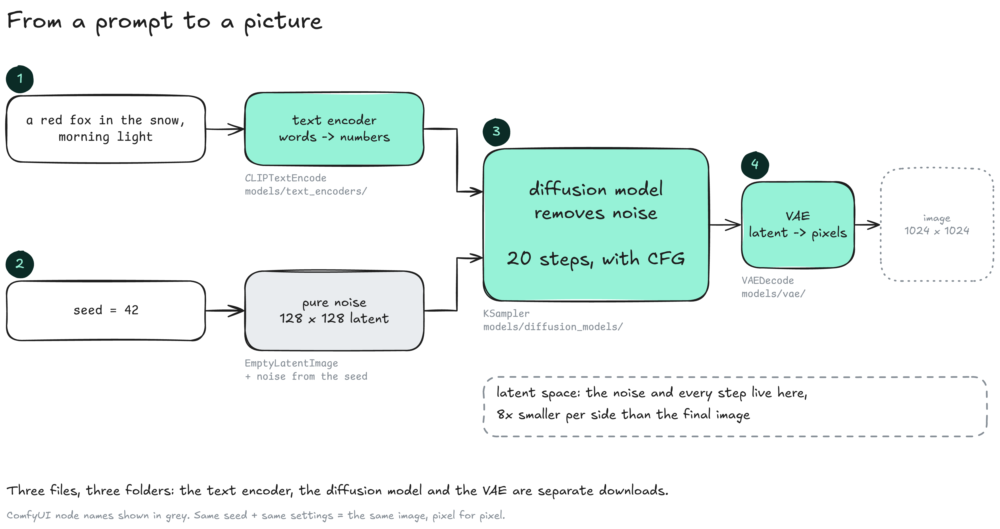
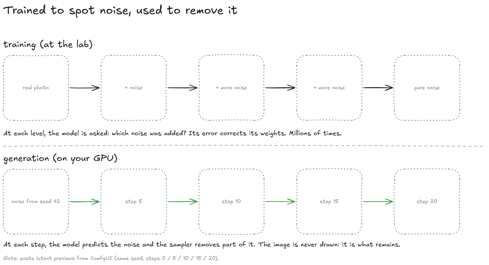
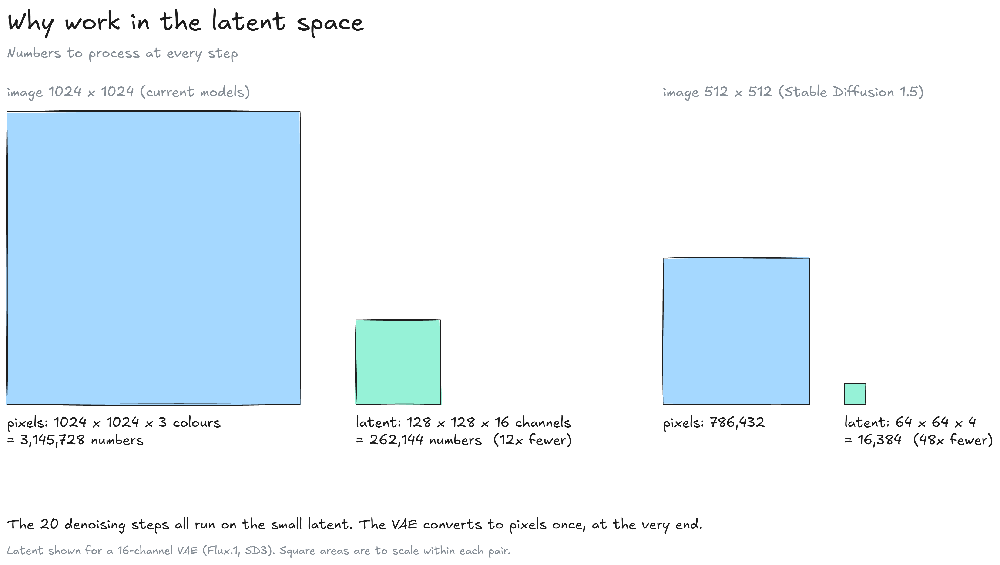
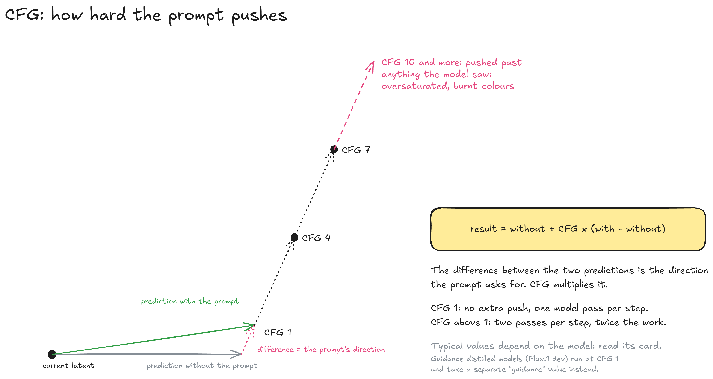
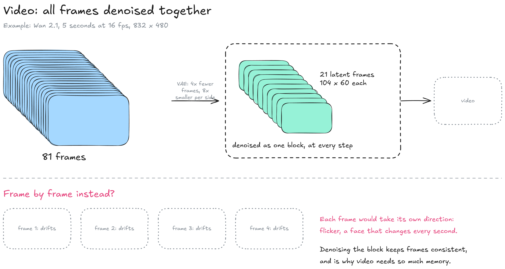

---
layout:
  width: default
  title:
    visible: true
  description:
    visible: false
  tableOfContents:
    visible: true
  outline:
    visible: true
  pagination:
    visible: true
  metadata:
    visible: true
  tags:
    visible: true
  actions:
    visible: true
  anchors:
    visible: true
---

# Image & video

Image and video models do not draw. A **diffusion model** starts from random noise and removes it step by step, guided by the prompt, until an image is left. On the [Inference](./) map, this page zooms on the image branch of step 4.


**Fix the seed and change one setting at a time.** With a random seed, two images differ in everything and no comparison means anything.


### The pipeline

Generating an image chains three separate models: a text encoder, a diffusion model and a VAE. In [ComfyUI](https://github.com/Comfy-Org/ComfyUI), each one is a file in its own folder and a node in the workflow.

<figure><figcaption></figcaption></figure>

1. **Text encoder:** Turns the prompt into numbers the diffusion model can use. Recent models use a language model for this (Flux 2 Klein uses Qwen3 4B). File in `models/text_encoders/`.
2. **Noise:** A grid of random values in the latent space, generated from the **seed**. Same seed, same starting noise.
3. **Diffusion model:** Predicts the noise to remove at each step, guided by the encoded prompt. File in `models/diffusion_models/`, run by the `KSampler` node.
4. **VAE:** Converts the final latent into pixels, once, at the end. File in `models/vae/`.

A missing file in any of the three folders stops the workflow: ComfyUI marks the node red until the file is in place.

### Trained to spot noise

During training, the model sees real images with known amounts of noise added and learns to predict that noise. At generation time, the same skill runs in reverse, starting from pure noise.

<figure><figcaption></figcaption></figure>

* **Training:** At each noise level, the model guesses which noise was added, and its error is used to correct its weights: the same loop as for text, with another right answer (see [How a model learns](../model/how-a-model-learns.md)).
* **Generation:** At each step, the model predicts the noise, and the sampler removes part of it. The image is what remains after the last step.
* **Content:** The model stores no images. It learned what makes an image look like its description, and rebuilds from that.

### The latent space

Diffusion runs on a compressed form of the image, the **latent**, not on pixels. The VAE translates between the two.

<figure><figcaption></figcaption></figure>

* **Size:** A 1024 × 1024 RGB image is 3.1 million numbers. Its latent, with a 16-channel VAE (Flux.1, SD3), is 128 × 128 × 16 = 262,144: 12 times fewer.
* **Why:** All the steps run on the latent. Working on full pixels at every step would multiply the compute.
* **VAE pairing:** Each model family expects its own VAE. The wrong one produces garbled colours or fails to load.

### Steps

A **step** is one pass of the diffusion model. More steps refine the image up to a point, then only change it without improving it.

| Model type                                                                      | Typical steps |
| ------------------------------------------------------------------------------- | ------------- |
| Recent models (Flux, SD3)                                                       | 20 to 30      |
| Older Stable Diffusion models                                                   | 20 to 40      |
| Distilled models (Flux 2 Klein distilled, Flux.1 schnell, "turbo", "lightning") | 1 to 8        |

Distilled models are retrained to reach a usable image in a few steps, at some cost in detail and prompt adherence. The model card gives the number of steps it was tuned for.

### CFG

**CFG** (classifier-free guidance) sets how strongly the prompt steers each step. At every step the model makes two predictions, one with the prompt and one without; the difference between them is the direction the prompt asks for, and CFG scales it.

<figure><figcaption></figcaption></figure>

* **Formula:** result = without + CFG × (with − without).
* **CFG 1:** The prediction with the prompt, used as is. One model pass per step.
* **CFG above 1:** Two passes per step, so twice the compute. The prompt is followed more strictly.
* **Too high:** The result is pushed past anything the model saw in training: oversaturated colours, harsh contrast.
* **Distilled guidance:** Some models (Flux.1 dev) are trained to run at CFG 1 and take a separate `guidance` value instead.

Good values depend on the model, so the model card is the starting point. When the prompt is ignored, raising CFG helps; when the image looks burnt, lowering it does.

### The seed

The seed sets the starting noise. With the same seed, model, prompt and settings, ComfyUI produces the same image.

* **Testing:** Fix the seed, change one setting (steps, CFG, prompt), compare. Then change the next one.
* **Exploring:** A random seed (randomize after each run) gives a new composition each time.

### Video

Video models use the same mechanism on a block of frames. All frames are denoised together, so they stay consistent with each other over time.

<figure><figcaption></figcaption></figure>

* **Example:** Wan 2.1 makes 5 seconds at 16 fps, 81 frames of 832 × 480.
* **Compression:** Its VAE reduces time by 4 and each side by 8: 21 latent frames of 104 × 60.
* **Why a block:** Denoised one by one, each frame would drift on its own: flicker, objects and faces changing between frames.
* **Cost:** The whole block sits in memory at every step, which is why video needs far more VRAM and time than images. Offloading tools such as [Wan2GP](https://github.com/deepbeepmeep/Wan2GP) exist mainly for video (see the [GPU & memory](gpu-and-memory.md) page).

Video LoRAs such as "lightning" variants cut the number of steps to 4 or so (see the [LoRA](../model/lora.md) page).

### Resources

* ComfyUI: [documentation](https://docs.comfy.org) | [Flux 2 Klein tutorial](https://docs.comfy.org/tutorials/flux/flux-2-klein)
* Papers: [DDPM, Ho et al. 2020](https://arxiv.org/abs/2006.11239) | [Latent diffusion, Rombach et al. 2022](https://arxiv.org/abs/2112.10752) | [Classifier-free guidance, Ho & Salimans 2022](https://arxiv.org/abs/2207.12598) | [Wan 2.1](https://arxiv.org/abs/2503.20314)
