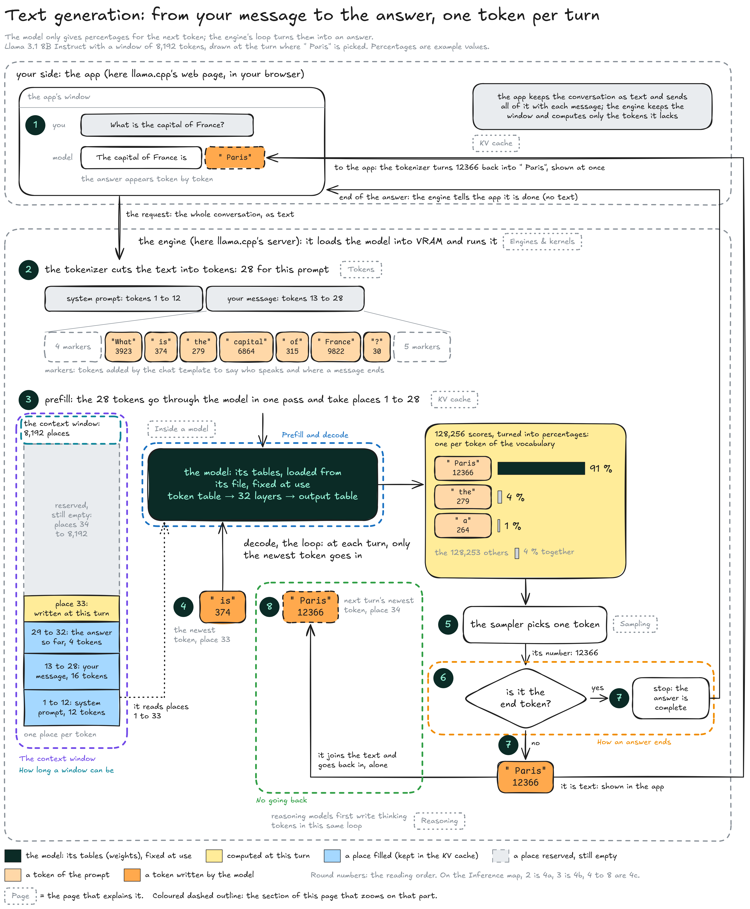
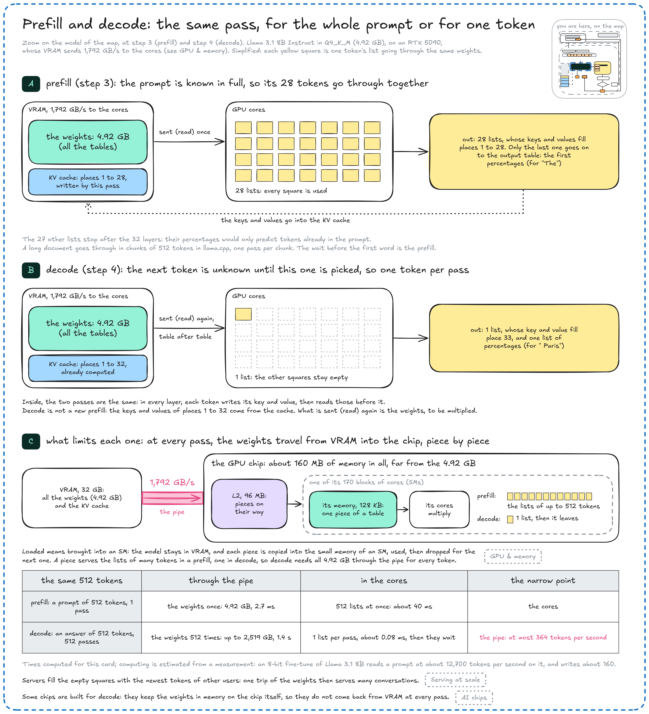
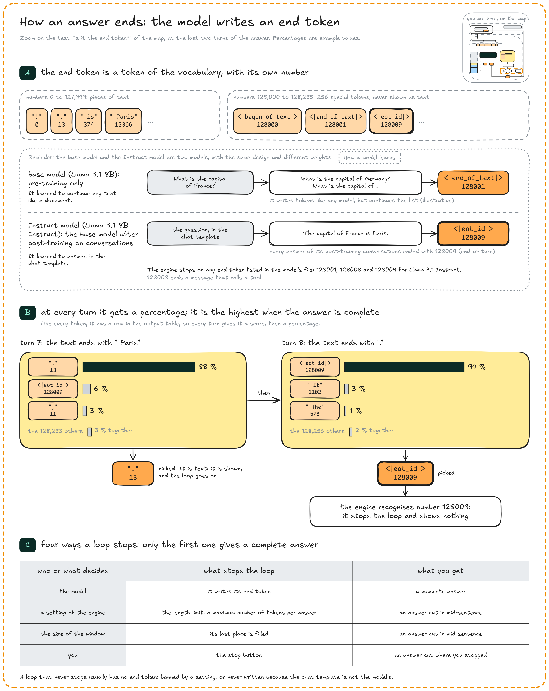
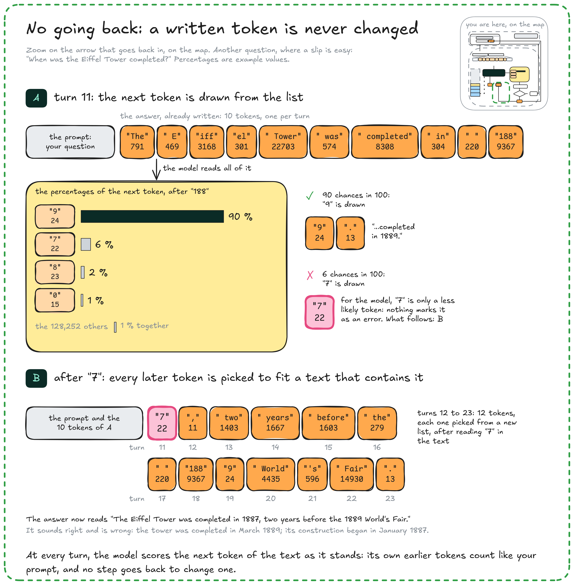
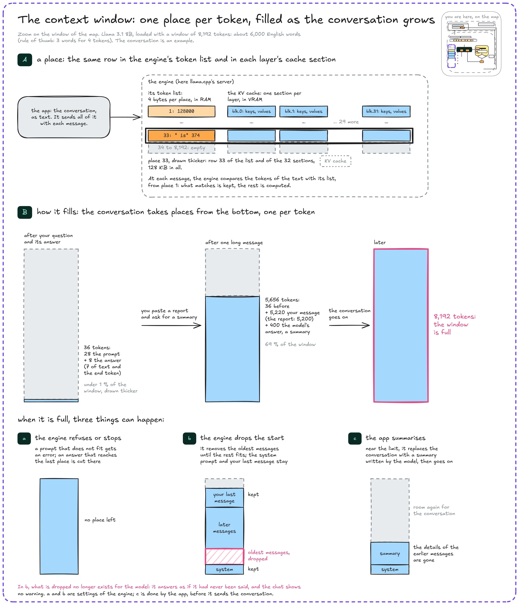
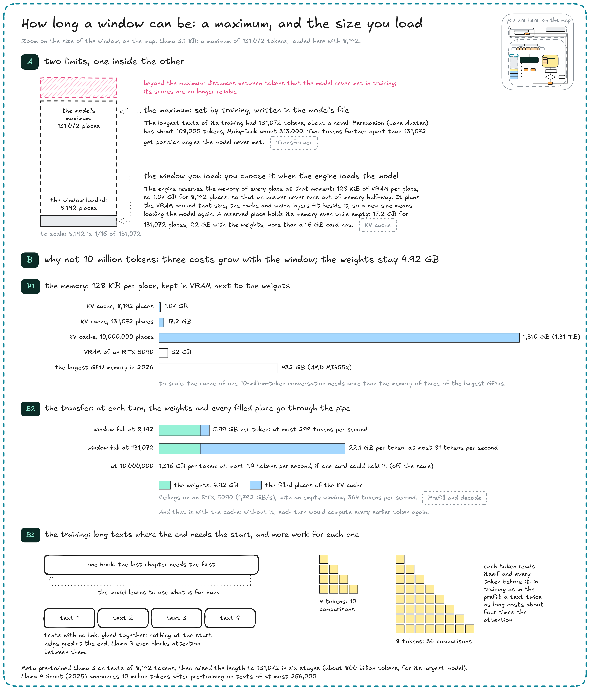

---
layout:
  width: default
  title:
    visible: true
  description:
    visible: false
  tableOfContents:
    visible: true
  outline:
    visible: true
  pagination:
    visible: true
  metadata:
    visible: true
  tags:
    visible: true
  actions:
    visible: true
  anchors:
    visible: true
---

# Text generation

A language model (LLM) does one thing: given a text, it gives every [token](tokens.md) of its vocabulary a percentage, its chance of coming next. Writing an answer means repeating that step in a loop, one token per turn. On the [Inference](../) map, this page zooms on step 4 for text: tokens (4a), prefill (4b) and the loop (4c), also called decode. The example is Llama 3.1 8B Instruct answering "What is the capital of France?".


**The model never writes a sentence.** One pass gives the percentages of one next token; the engine picks a token, adds it to the text and runs the model again, until the model writes its [end token](./#how-an-answer-ends).


### The map

One message, from the app's window to the answer. Steps 1 to 3 happen once per message; steps 4 to 8 are one turn of the loop, drawn at the turn where " Paris" is picked. Each coloured outline is a part that a later section opens.

<figure><figcaption></figcaption></figure>

1. **Your message:** You type in the app, here the web page that [llama.cpp](https://github.com/ggml-org/llama.cpp)'s server opens in your browser. It keeps the conversation as text and sends all of it with each message to the **engine**, the program that loads the model into VRAM and runs it, which computes only the tokens it does not hold yet (see [one conversation, message by message](kv-cache.md#one-conversation-message-by-message)). Ollama, LM Studio and TextGen are an app and an engine in one program, built on llama.cpp (see [two software stacks](../gpu-and-memory/engines-and-kernels.md#two-software-stacks)).
2. **Tokens (4a):** The tokenizer, a small program shipped with the model, cuts the text into tokens, pieces of text known by their number (see [Tokens](tokens.md)). The prompt has 28: 7 for the question, the others for the system prompt and the markers of the chat template, the conversation format the model was trained with (see **Context & prompt**).
3. **Prefill (4b):** The 28 tokens go through the model in one pass, which gives the first list of percentages. Each takes a place in the context window, where the engine keeps its keys and values, so that no token is computed twice (see [KV cache](kv-cache.md)).
4. **Decode (4c):** At each turn of the loop, only the newest token goes through the model: its row of the token table, the 32 layers, which read every earlier token from the places already filled, then the output table, which scores every token of the vocabulary (see [how the tables connect](../../model/inside-a-model/#how-the-tables-connect)). These tables are weights, loaded from the model's file: they do not change at use.
5. **The sampler picks:** The scores become percentages, and the **sampler**, a small program in the engine, picks one token from that list, following your settings (see [Sampling](sampling.md)): here " Paris", number 12366.
6. **End token?** The engine checks the token picked.
7. **Stop or go on:** If it is the end token, the engine stops the loop and tells the app that the answer is complete; nothing is shown. If not, the tokenizer turns its number back into text, and the app shows it at once.
8. **Next turn:** The token goes back in, alone, as the newest token, at place 34, and the loop starts again at step 4: the output table never becomes the input.

Reasoning models first write thinking tokens in this same loop, then the answer (see **Reasoning**).

### Prefill and decode

Prefill and decode run the same pass through the same weights. The prompt is known in full, so its tokens go through together; the answer is not, so each of its tokens waits for the one before. The diagram zooms on the model of the map, at step 3 and at step 4.

<figure><figcaption></figcaption></figure>

* **A, prefill:** The 28 tokens of the prompt go through each table together: the 4.92 GB of weights are sent from VRAM to the cores once for all 28 lists, whose keys and values fill places 1 to 28. Only the last list goes on to the output table; the others would only predict tokens already in the prompt. A long document goes through in chunks, 512 tokens per pass in llama.cpp. The wait before the first word, the **time to first token**, is the prefill.
* **B, decode:** The next token is unknown until the sampler picks this one, so each turn runs one token, and the weights are sent (read) from VRAM to the cores again for a single list, table after table, layer after layer: the tables are needed again to be multiplied. Nearly all 4.92 GB make the trip; the token table gives only the row of the newest token. Inside, the pass is the same: in each layer the token writes its key and value, then reads those of places 1 to 32, which come from the cache and are never computed again.
* **C, the limits:** The model stays in VRAM: the GPU chip holds about 160 MB of memory in all, too little for 4.92 GB of weights. At every pass, each table comes through a pipe of 1,792 GB/s into the chip's 170 blocks of cores (SMs), piece by piece; a piece serves the lists of up to 512 tokens in a prefill, one in decode, then leaves (see [inside the chip](../gpu-and-memory/#inside-the-chip)). For the same 512 tokens, a prefill sends the weights once (2.7 ms) and keeps the cores busy for about 40 ms; an answer sends them 512 times (1.4 s) while the cores work about 0.08 ms per pass and wait: at most 364 tokens per second. The computing time is estimated from a measurement with llama.cpp on that card: Tulu 3 8B (a fine-tune of Llama 3.1 8B, in 8 bits) reads a prompt at about 12,700 tokens per second and writes about 160, 80 times fewer.

Servers use the cores that decode leaves idle: they run the newest tokens of many conversations together, so that one trip of the weights serves all of them (batching, see **Serving at scale**). Chip makers split the two phases too: NVIDIA announced Rubin CPX (2025), a GPU for the prefill, and chips such as Groq's keep the weights in memory on the chip itself to decode faster (see **AI chips**).

### How an answer ends

The model does not decide to stop: stopping is a token like the others, with its own percentage at every turn. The diagram zooms on the end of the loop on the map, the test and the stop, at the last two turns of the answer.

<figure><figcaption></figcaption></figure>

* **A, a token of the vocabulary:** The last 256 numbers of Llama 3's vocabulary are special tokens, never shown as text (see [Tokens](tokens.md)). Number 128009, written `<|eot_id|>` (end of turn), ends each answer of Llama 3.1 Instruct; 128001, `<|end_of_text|>`, ends a document. The engine stops on any end token listed in the model's file: 128001, 128008 (which ends a message that calls a tool) and 128009 for Llama 3.1 Instruct.
* **Base and Instruct, a reminder:** Llama 3.1 8B, the base model, only went through [pre-training](../../model/how-a-model-learns.md#pre-training-and-post-training): it continues any text as a document, and after a question it may write more questions. Llama 3.1 8B Instruct is that model after post-training on conversations: it answers in the chat template and ends each answer with 128009. They are two models, with the same design and different weights, and both write tokens the same way.
* **B, a percentage at every turn:** Like every token, the end token has a row in the output table, so each turn gives it a percentage. After " Paris" it is low and "." is picked; after "." it is the highest. When the sampler picks it, the engine recognises its number, stops the loop and shows nothing.
* **C, other stops:** The engine also stops at a length limit, a maximum number of tokens per answer (`n_predict` in [llama.cpp](https://github.com/ggml-org/llama.cpp), unlimited by default), when the window is full, or when you press stop. In these three cases the answer is cut in mid-sentence.

A loop that does not stop usually means the end token is missing: banned by a setting (`--ignore-eos` in llama.cpp), or never written because the chat template is not the one the model was trained with.

### No going back

A token, once written, stays: the loop has no step that goes back to change one. The diagram zooms on the arrow that goes back in, with another question, "When was the Eiffel Tower completed?".

<figure><figcaption></figcaption></figure>

* **A, the draw:** A year is cut into several tokens, so at turn 11 the answer reads "The Eiffel Tower was completed in 188". "9" has 90 chances in 100 of being drawn and "7" has 6: a less likely token is sometimes picked, and nothing marks it as an error.
* **B, what follows:** Once "7" is written, each later token is picked to fit a text that contains it, and ", two years before the 1889 World's Fair" is a likely continuation. The error ends up inside a sentence that sounds right.
* **Why:** At every turn the model only scores the next token of the text as it stands. Its own earlier tokens count exactly like your prompt: it has no step to reread them and correct one.

This is one cause of hallucinations, the plausible but false statements a model can write: it is trained to write likely text, not checked text, and an early slip stays (see **Limits**). Reasoning models write thinking tokens first, where an error can be noticed and contradicted later in the text; the earlier tokens still cannot be changed.

### The context window

The **context window** is a number of places that the engine reserves when it loads the model, one per token: everything the model reads and writes in a conversation must fit in it. The diagram zooms on the window of the map.

<figure><figcaption></figcaption></figure>

* **A, a place:** A place is one row number: in the engine's token list, where it holds the token's number (4 bytes, in RAM), and in each of the 32 sections of the KV cache, where it holds the token's keys and values (128 KiB in all, in VRAM; see [what is stored, and where](kv-cache.md#what-is-stored-and-where)). The places are kept from turn to turn and from message to message: at each message, the engine compares the tokens of the text it receives with its list, from place 1, keeps the places that match and computes the rest.
* **B, how it fills:** Each token of the conversation takes a place, from the system prompt to the last answer, markers included. A long document fills most of an 8,192-token window at once.
* **a and b, the engine:** When the window is full, [llama.cpp](https://github.com/ggml-org/llama.cpp) by default refuses a prompt that does not fit and cuts an answer at the last place. [Ollama](https://ollama.com) removes the oldest messages until the rest fits, keeping the system prompt and your last message. What is dropped no longer exists for the model, and the chat shows no warning.
* **c, the app:** Some apps summarise before the window is full: [Claude Code](https://code.claude.com/docs/en/context-window) compacts automatically as it approaches the limit, replacing the conversation with a structured summary written by the model. The session goes on, without the details of the earlier messages (see **Memory**).

What is not in the window does not exist for the model. What an app puts in it, and in which order, is the subject of **Context & prompt**.

### How long a window can be

A window has two limits: the maximum the model was trained for, and the size the engine reserves when it loads the model. The diagram zooms on the size of the window, on the map.

<figure><figcaption></figcaption></figure>

* **The maximum:** 131,072 tokens for Llama 3.1, written in the model's file: the length of the longest texts of its training, about a novel (with this tokenizer, Jane Austen's _Persuasion_ is about 108,000 tokens and _Moby-Dick_ about 313,000). Beyond it, two tokens are farther apart than any pair the model has met, and its scores are no longer reliable (see [Position](../../model/inside-a-model/transformer.md#position), G).
* **The window you load:** You choose it when the engine loads the model (`--ctx-size` in llama.cpp, the context length in Ollama). The engine then reserves 128 KiB per place (see [how big it gets](kv-cache.md#how-big-it-gets)), so that an answer never runs out of memory half-way, and plans the VRAM around that size, so a new size means loading the model again. A reserved place holds its memory even while empty: 131,072 places take 17.2 GB, 22 GB with the weights, more than a 16 GB card. By default, llama.cpp takes the largest window that fits in memory, up to the maximum, and Ollama opens 4,096 tokens on a GPU with less than 24 GiB of VRAM.
* **B1, the memory:** The weights do not grow with the window; the cache does. With this model, 10 million tokens take 1.31 TB of cache, more than three of the largest GPUs of 2026 hold (432 GB each).
* **B2, the transfer:** At each turn the weights and every filled place go from VRAM to the cores, so writing slows down as the window fills: on an RTX 5090, the ceiling falls from 364 tokens per second with an empty window to 81 with 131,072 places filled, and to about 1.4 with 10 million, if one card could hold them (see [prefill and decode](./#prefill-and-decode)). That is with the cache; without it, each turn would compute every earlier token again (see [why a cache](kv-cache.md#why-a-cache)).
* **B3, the training:** A model learns to use distant tokens only from texts whose end needs their start, such as a book or a code repository. Texts with no link, glued together, teach nothing about distance, and Llama 3 even blocks attention between them. Each token reads every token before it, in training as in the prefill, so a text twice as long costs about four times the attention: cutting a long prompt into chunks does not help, since each chunk still reads all the places before it. The diagram gives the lengths Meta and Llama 4 Scout trained on.

### Resources

* Tokenizer: [llama3-tokenizer-js](https://github.com/belladoreai/llama3-tokenizer-js), used for the token numbers on this page and the book lengths (Project Gutenberg texts of _Persuasion_ and _Moby-Dick_, from the [NLTK corpus](https://www.nltk.org/nltk_data/))
* End tokens: [Meta, Llama 3.1 prompt format](https://www.llama.com/docs/model-cards-and-prompt-formats/llama3_1/) | [Meta, Llama 3.1 8B Instruct `generation_config.json`](https://huggingface.co/meta-llama/Llama-3.1-8B-Instruct/blob/main/generation_config.json) (the three end tokens)
* Prefill and decode: [TechPowerUp, RTX 5090 specifications](https://www.techpowerup.com/gpu-specs/geforce-rtx-5090.c4216) (96 MB of L2 cache, 680 tensor cores) | [llama.cpp server code](https://github.com/ggml-org/llama.cpp/tree/master/tools/server) (prompt reuse, output for the last prompt token only) | [NVIDIA, Rubin CPX](https://developer.nvidia.com/blog/nvidia-rubin-cpx-accelerates-inference-performance-and-efficiency-for-1m-token-context-workloads/) (context phase compute-bound, generation phase bandwidth-bound) | [Agrawal et al., SARATHI](https://arxiv.org/abs/2308.16369) (2023) | [OpenBenchmarking, llama.cpp on an RTX 5090](https://openbenchmarking.org/result/2501259-PTS-NVIDIALL46) (Tulu 3 8B, Q8\_0)
* Stops and a full window: [llama.cpp server README](https://github.com/ggml-org/llama.cpp/blob/master/tools/server/README.md) (`n_predict`, `--ignore-eos`, `--context-shift`, `--ctx-size`) | [Ollama, `server/prompt.go`](https://github.com/ollama/ollama/blob/main/server/prompt.go) (oldest messages removed first) | [Ollama, context length](https://docs.ollama.com/context-length) | [Claude Code, the context window](https://code.claude.com/docs/en/context-window) (compaction)
* Long windows: [The Llama 3 Herd of Models](https://arxiv.org/abs/2407.21783) (attention mask between documents, long-context stages) | [Hugging Face, Welcome Llama 4 Maverick & Scout](https://huggingface.co/blog/llama4-release) | [AMD Instinct MI455X](https://www.amd.com/en/products/accelerators/instinct/mi400.html) (432 GB)
