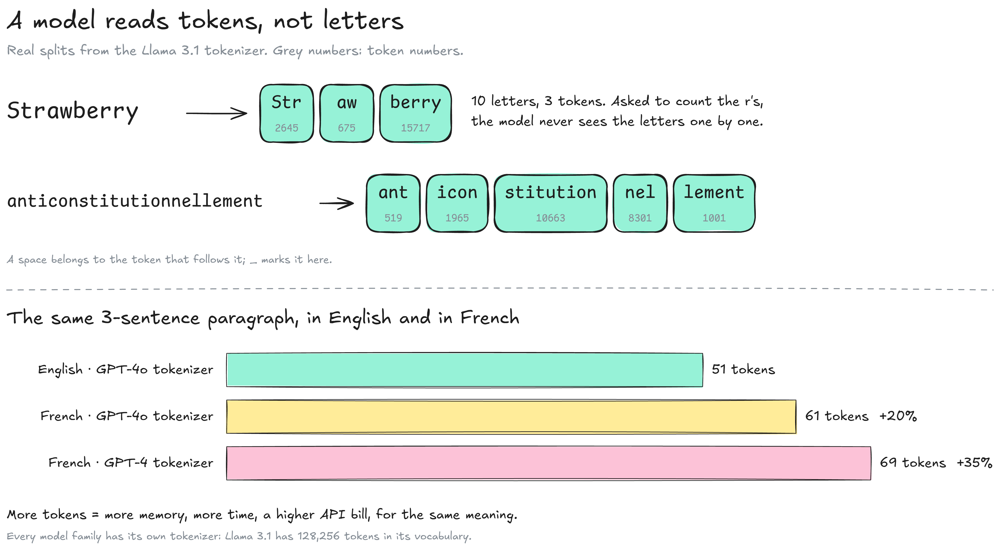
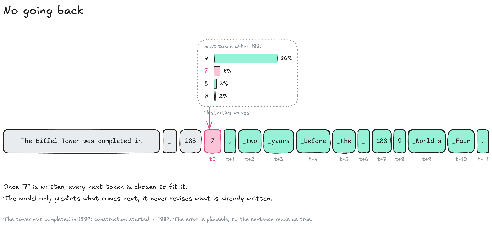
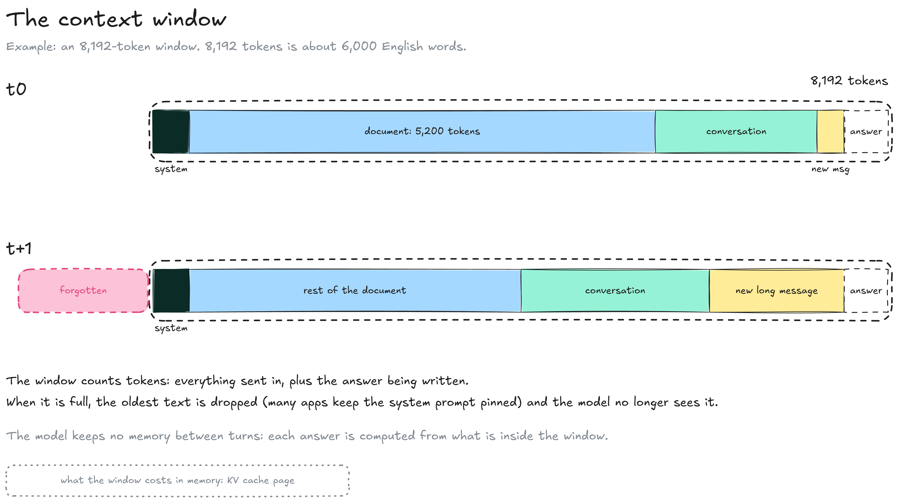

---
layout:
  width: default
  title:
    visible: true
  description:
    visible: false
  tableOfContents:
    visible: true
  outline:
    visible: true
  pagination:
    visible: true
  metadata:
    visible: true
  tags:
    visible: true
  actions:
    visible: true
  anchors:
    visible: true
---

# Text generation

A language model (LLM) does one thing: given a text, it scores every possible next token. Writing an answer means repeating that prediction, one token at a time. On the [Inference](../) map, this page zooms on step 4 for text: tokens (4a), prefill (4b) and the loop (4c).


**The model never plans a sentence.** It produces one token, appends it, and runs again on the longer text.


### Tokens

A **token** is a piece of text from a fixed vocabulary: a whole word, part of a word, a space plus a word, or punctuation. The model reads and writes tokens, never individual letters. The vocabulary is fixed before training, so the training texts, your prompt and the model's answers are all cut into the same tokens.

<figure><figcaption></figcaption></figure>

* **Vocabulary:** Each model family has its own list of tokens. Llama 3.1 has 128,256; OpenAI's GPT-4o tokenizer has about 200,000.
* **Numbers:** The model knows each token by its number, its row in the token table (see [how the tables connect](../../model/inside-a-model.md#how-the-tables-connect)). In Llama 3.1, "The" is token 791 and " Paris" token 12366.
* **Letters:** "Strawberry" is three tokens (`Str`, `aw`, `berry`), which is why models miscount letters while handling complex topics well.
* **Languages:** Tokenizers are built mostly from English text. The same paragraph took 51 tokens in English and 61 in French with the GPT-4o tokenizer (+20 %), 69 with the older GPT-4 tokenizer (+35 %).
* **Cost:** More tokens mean more memory, slower generation and a higher bill on paid APIs, for the same content.

### One token at a time

Each step runs the whole model once and returns one score per token of the vocabulary. A small program, the **sampler**, picks one of them; it is appended to the text and the next step starts. Before the first step, the prompt is read in one go (the prefill); after it, each step only has to compute the newest token, because what the earlier tokens leave behind is kept in the [KV cache](kv-cache.md).

<figure><figcaption></figcaption></figure>

1. **Context:** Everything the model sees: system prompt, conversation, and the answer so far.
2. **Model:** One full pass through its 32 layers, for the newest token.
3. **Scores:** One per possible token, converted to probabilities that add up to 100 %.
4. **Sampler:** Picks a token from that list, following your settings (see the [Sampling](sampling.md) page).
5. **Append:** The token joins the context, and the loop starts again until an end-of-text token or a length limit.

A 500-token answer means 500 passes through the model. The text appears progressively because it is produced progressively.

### No going back

A token, once written, stays. The model has no step that revisits or corrects earlier tokens, so every following token is chosen to be consistent with what is already there.

<figure><figcaption></figcaption></figure>

* **The branch:** Years are split into tokens too: `188` then `9`. A less likely digit can be drawn.
* **The follow-up:** Once `7` is written, ", two years before the 1889 World's Fair" is a likely continuation, so the error is wrapped in a consistent sentence.
* **Hallucinations:** The root cause is the objective itself: models are trained to produce plausible text, not verified text. The lack of backtracking makes an early mistake stick.

Reasoning models write intermediate "thinking" tokens before answering, which lets them notice and contradict an error later in the text. The earlier tokens still cannot be changed.

### The context window

The **context window** is the maximum number of tokens the model can take into account at once: the input plus the answer being written. A model keeps no memory between turns; each answer is computed only from what is inside the window.

<figure><figcaption></figcaption></figure>

* **Unit:** Tokens. 8,192 tokens are about 6,000 English words, fewer in French.
* **Full window:** The oldest text is dropped and the model no longer sees it. Many apps keep the system prompt pinned.
* **Model maximum vs setting:** Llama 3.1 supports 128k tokens (131,072, written in its metadata), but the engine uses the window you set. [Ollama](https://ollama.com) defaults to 4k tokens on GPUs under 24 GB, 32k up to 48 GB and 256k above; [llama.cpp](https://github.com/ggml-org/llama.cpp) starts from the model's maximum and shrinks it to fit memory.
* **Memory:** The window is not free. Its cost in GB is explained on the [KV cache](kv-cache.md) page.

A too-small window cuts long documents without warning: the model then answers from the part it received.

### Resources

* Tokenizers: [llama3-tokenizer-js](https://github.com/belladoreai/llama3-tokenizer-js), used for the token numbers on this page | [gpt-tokenizer (o200k\_base, cl100k\_base)](https://github.com/niieani/gpt-tokenizer), used for the English and French counts
* Context defaults: [Ollama, context length](https://docs.ollama.com/context-length) | [llama.cpp server README](https://github.com/ggml-org/llama.cpp/blob/master/tools/server/README.md)
