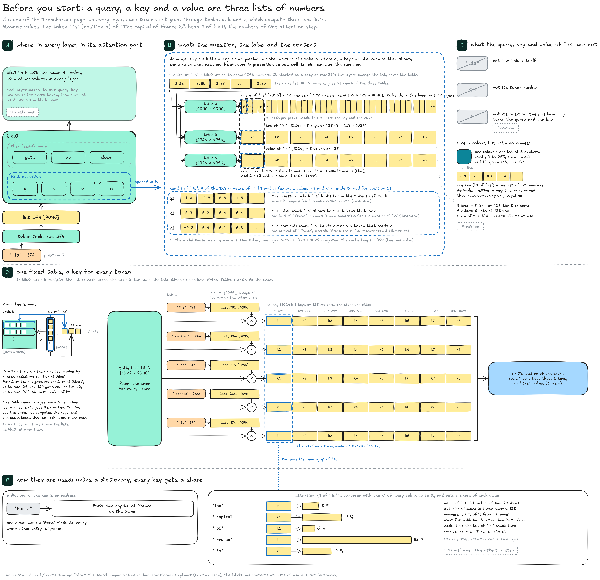
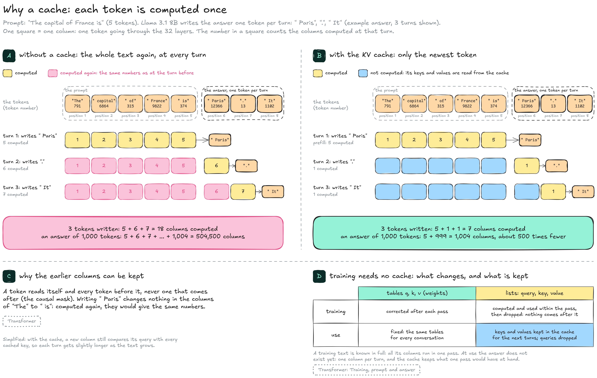
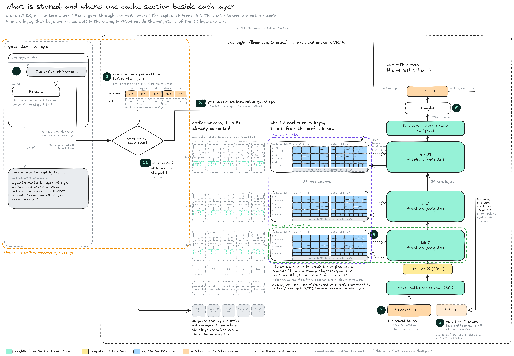
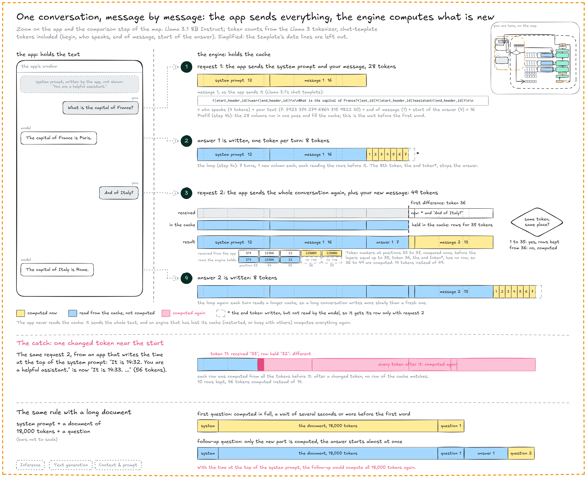
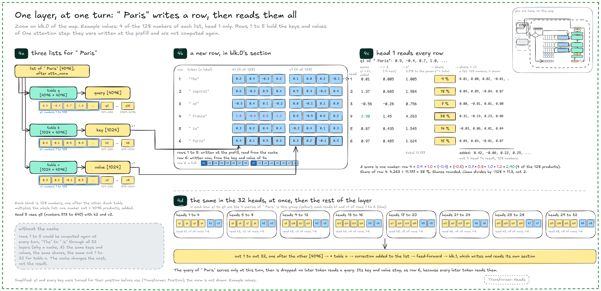
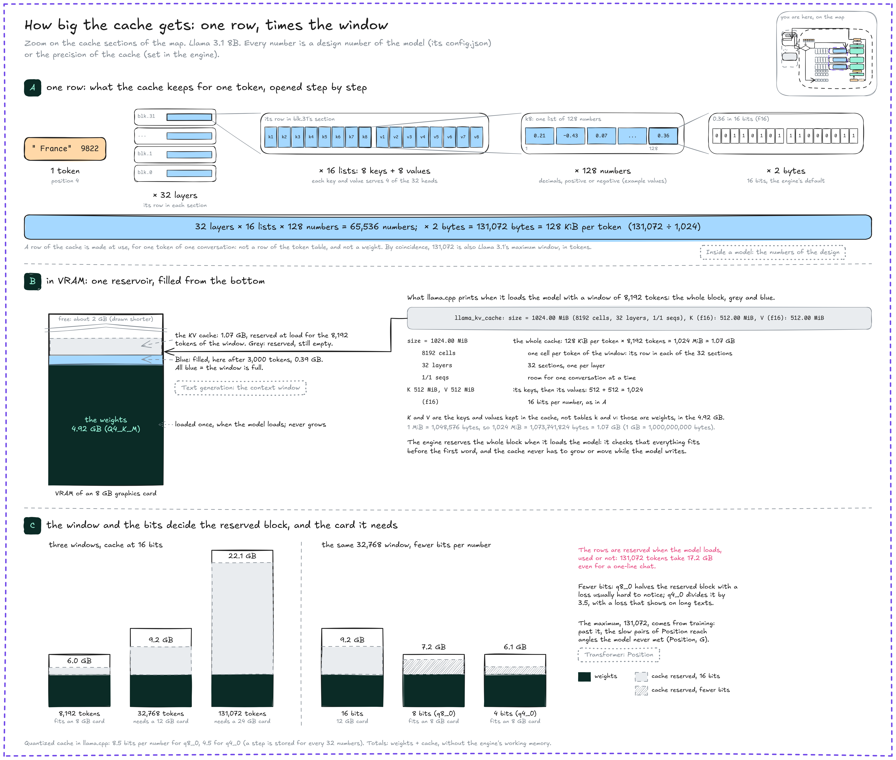

---
layout:
  width: default
  title:
    visible: true
  description:
    visible: false
  tableOfContents:
    visible: true
  outline:
    visible: true
  pagination:
    visible: true
  metadata:
    visible: true
  tags:
    visible: true
  actions:
    visible: true
  anchors:
    visible: true
---

# KV cache

Three words carry this page. The **KV cache** is where the engine keeps, for every token already read, its key and its value in each layer of the model, so that no token is computed twice: it is what makes writing fast. The **prefill** is the first pass over a prompt, all its tokens at once, which fills the cache. The **context window** is the number of tokens the cache can hold, set when the model loads. On the [Inference](../) map, the engine reserves the cache at 3a, the prefill fills it at 4b, and each turn of the loop reads it and adds a row at 4c. The example is Llama 3.1 8B continuing "The capital of France is".


**A key and a value for every token, in every layer.** The cache holds lists computed at use, not weights: tables q, k and v are in the model's file and never change at use; the keys and values they compute belong to one conversation, kept in VRAM while it lasts.


#### Before you start

The cache keeps lists that the attention part of every layer computes, as explained on the [Transformer](../../model/inside-a-model/transformer.md) page. The diagram recalls what they are.

<figure><figcaption></figcaption></figure>

* **A, where:** In each of the 32 layers, the attention part comes first, with tables q, k, v and o, then the feed-forward part. Each layer works on the token's list as it arrives there, so it makes its own query, key and value for every token. The list itself is not a weight: it starts as a copy of a row of the token table, and the layers change the list, never the table.
* **B, what:** As an image, simplified: the query is the question a token asks of the tokens before it, a key the label each of them shows, and a value what each one hands over. In words, " is" asks roughly "which country is this about?", the label of " France" says roughly "I am a country", which fits that question, and its content hands " is" the information "France"; in the model these are only numbers. Concretely, the whole list of 4096 numbers goes into each of tables q, k and v: the query, 4096 numbers, is cut into 32 queries of 128, one per head of the layer (32 heads, not 32 layers); the key and the value, 1024 numbers each, into 8 keys and 8 values of 128. Head 1 is q1 with k1 and v1, head 2 is q2 with the same k1 and v1, and heads 5 to 8 share k2 and v2 (see [Heads](../../model/inside-a-model/transformer.md#heads)). q1 and k1 are already turned for the token's position.
* **C, what they are not:** Not the token, its token number or its position, but lists of decimal numbers, positive or negative; the position only turns the query and the key (see [Position](../../model/inside-a-model/transformer.md#position)). Like the 3 numbers of a colour, the 128 numbers of a key describe something only together, but none of them has a name; 8 keys are 8 such lists, like 8 colours, and so are 8 values.
* **D, one fixed table, a key for every token:** In blk.0, each token's list, a copy of its row of the token table, is multiplied (×) by the same table k: number 1 of k1 is row 1 of table k times the whole list, number by number, added; row 2 gives number 2 of k1, row 129 number 1 of k2, up to row 1024, as table o does in One attention step. The lists differ, so the keys differ; table v gives the values the same way, and the cache keeps both, so each is computed once. A key's 1024 numbers are read as 8 keys of 128, one after the other: k1 is not one number but numbers 1 to 128, the part heads 1 to 4 read in E, and k2 is numbers 129 to 256. In blk.1, the same happens with its own tables and the lists as blk.0 returned them.
* **E, how they are used:** A dictionary finds the one entry whose key matches exactly. Attention gives every key a share: q1 of " is" is scored against k1 of every token up to it, and their v1 are mixed in those shares. What comes out is 128 numbers, 53 % of them from the value of " France"; with the 31 other heads, table o adds them to the list of " is", which now carries "France" and helps the output table give " Paris" (see [one attention step](../../model/inside-a-model/transformer.md#one-attention-step)).

#### Why a cache

To write a token, the model needs every token before it. Without a cache it would compute the whole text again at every turn; with it, each token goes through the layers once.

<figure><figcaption></figcaption></figure>

* **A, without a cache:** A column is one token going through the 32 layers, and the last column of a turn writes the next token. Each turn runs every column again: 5 to write " Paris", 6 for ".", 7 for " It", each time with the same numbers as at the turn before.
* **B, with the cache:** The 5 columns of the prompt run once, together: that pass is the prefill. Each later turn computes one column, the newest token, and reads the earlier ones' keys and values from the cache. An answer of 1,000 tokens costs 1,004 columns instead of 504,500.
* **C, why it is allowed:** A token reads itself and every token before it, never one that comes after (the causal mask, on [the map](../../model/inside-a-model/transformer.md#the-map) of the Transformer page). Text added later cannot change an earlier column.
* **D, not in training:** Training changes the tables and keeps no list; use keeps lists and changes no table. A training text is known in full, so all its columns run in one pass and nothing comes after it (see [Training, prompt and answer](../../model/inside-a-model/transformer.md#training-prompt-and-answer)). At use the answer is written one column per turn, and the cache keeps what a single pass would have at hand.

#### What is stored, and where

The cache is not a separate file: it sits in VRAM beside the weights, as one **section** per layer, with one row per token. The diagram is the map of this page. Steps 1 and 2 happen once per message; steps 3 to 6 happen at every turn of the answer, one turn per token, here the turn where " Paris" goes through the model.

<figure><figcaption></figcaption></figure>

1. **The request:** At each message, the app sends the text you see, the whole conversation, once. The app keeps that conversation as text: in your browser for the web page of [llama.cpp](https://github.com/ggml-org/llama.cpp), in files on your disk for [LM Studio](https://lmstudio.ai/docs/app/basics/chat), on the provider's servers for ChatGPT or Claude. It never sees the cache.
2. **Compare:** Once per message, before the layers, the engine cuts the text into tokens and compares their numbers, position by position from the first, with those of the rows it holds, one list for all 32 sections. This is code in the engine, not part of the model, and only token numbers are compared, never keys or values. At this first message the engine holds no row yet. **2a:** at a later message, the rows that match are kept. **2b:** from the first difference, here from position 1, the tokens go through the model in one pass, the **prefill**, which writes their rows in every section. Every new message has a prefill, over the tokens that have no row yet.
3. **The newest token:** During the answer, one token per turn enters the model: here " Paris", written at the previous turn. The five earlier columns are not run again: their keys and values, computed at the prefill, are already rows 1 to 5 of every section.
4. **Each layer writes, then reads:** In each layer, " Paris" adds its key and value as row 6 of that layer's section, then each of its 32 heads reads every row, 1 to 6. At each turn the newest query is compared with every key of the section again, so the reading grows with the conversation; the rows themselves are never computed again. The 32 sections differ, because each layer computes its keys and values from the list as it arrives there.
5. **Output:** After the 32 layers, the final norm and the output table score every token of the vocabulary, and the sampler picks "."; it goes to the app, after " Paris".
6. **Next turn:** "." goes straight back in as the newest token and becomes row 7 of every section. Each turn repeats steps 3 to 6 only: nothing is sent again and nothing is compared, until the model writes its end token.

A row holds only numbers, 8 keys and 8 values of 128 in each layer; the token names on the diagram are labels for the reader. The row number is the token's position: the engine keeps the rows in the order of the text. A row is not a row of the token table and holds no weight: the model learns nothing from it, and it is gone when the conversation is cleared or the model unloaded.

#### One conversation, message by message

A model keeps nothing between two messages, so the app sends the whole conversation every time; the cache makes this cheap, because the engine computes only the tokens it has not read yet. The diagram zooms on steps 1 and 2 of the map.

<figure><figcaption></figcaption></figure>

1. **Request 1, the prefill:** The system prompt and your message, 28 tokens. Your message counts 16: "What is the capital of France?" is 7, and the chat template adds 9 that mark who speaks, the end of the message and the start of the answer (written in full on the diagram). They go through the model in one pass and fill the cache; that pass is the wait before the first word, the **time to first token**.
2. **Answer 1, the loop:** One token per turn, each reading the rows before it and adding its own.
3. **Request 2:** The app sends 49 tokens, everything so far plus your new message. Once, before the layers, the engine compares their numbers with those of the 35 tokens it holds rows for: they are equal up to position 35 (" Paris" 12366, "." 13), and token 36, the end token 128009, has no row. So it computes 14 tokens, and every layer reads its own 35 kept rows.
4. **Answer 2:** The loop again. Each turn reads a longer cache, so a long conversation writes more slowly than a fresh one.

* **The catch:** Every row was computed from all the tokens before it. If one token changes near the start, such as a time written at the top of the system prompt (token 11 is now "33" where the row holds "32"), no row after it matches and all are computed again. This is why a prompt puts what never changes first (instructions, documents) and what changes last (date, user data).
* **Without the cache:** An engine that has lost its cache (restarted, or busy with other users) computes everything again: the answer starts later.
* **Paid APIs:** The same mechanism is sold as prompt caching. Anthropic bills cached input at 10 % of the normal input price on most models, down to 2.5 % on its newest, and keeps it 5 minutes, refreshed at each use.

#### One layer, at one turn

The diagram zooms on step 4 of the map, in blk.0: what " Paris" computes, writes and reads there, with example values for head 1.

<figure><figcaption></figcaption></figure>

* **4a, three lists:** Tables q, k and v turn the list of " Paris" into a query, a key and a value, each a row of blocks of 128 numbers: 32 blocks for the query (q1 is numbers 1 to 128, q2 129 to 256), 8 for the key and the value. Head 1 uses q1, k1 and v1, of which 4 numbers are shown; head 5 uses q5 with k2 and v2.
* **4b, a new row:** k1 and v1 join blk.0's section as row 6; the full row holds k1 to k8 and v1 to v8. Rows 1 to 5 were written at the prefill, with the keys and values of One attention step; they are read, not computed again.
* **4c, head 1 reads every row:** q1 is multiplied with each row's k1, number by number, and the 128 products are added: the score, one number per row. Each score is divided by 2 here (by √128 ≈ 11.3 in Llama), e = 2.718 is raised to that power, and each result divided by their total, 11.177, gives the shares: 9, 18, 7, 38, 14 and 15 % (rounded). Each row's v1, a list of 128 numbers, is multiplied by its share and the six results are added: out 1, 128 numbers, of which " France" weighs 38 %.
* **4d, all heads at once:** The 32 heads do the same at once, each reading the key and value of its group. out 1 to out 32, one after the other, make 4096 numbers again; table o turns them into a correction added to the list, which goes on to the feed-forward part and up to blk.1, which writes and reads its own section. The query is then dropped: it serves only at its own turn, while every later token reads the keys and values. Without the cache, rows 1 to 5 would be computed again at every turn, with the same result: the cache changes the cost, not the numbers.

#### How big it gets

Each section holds one row per token of **the context window**. The size of the cache is a multiplication, like the [size of a model](../../model/precision.md#how-big-a-model-is): how many numbers, times the bytes each one takes. Every count comes from [the design numbers of Llama 3.1 8B](../../model/inside-a-model/#the-numbers-of-the-design).

<figure><figcaption></figcaption></figure>

* **A, one row:** 32 layers × 16 lists (8 keys and 8 values) × 128 numbers = 65,536 numbers per token; at 2 bytes each, 131,072 bytes, which is 128 KiB (131,072 ÷ 1,024). Each number is stored in 16 bits, the f16 format by default, the same size as the BF16 of the weights with another split of the bits (see [Precision](../../model/precision.md)).
* **B, one reservoir:** In VRAM, the weights are loaded once and never grow; the cache sits above them, reserved when the model loads for every token of the window: 128 KiB × 8,192 tokens = 1,024 MiB = 1.07 GB, the size [llama.cpp](https://github.com/ggml-org/llama.cpp) prints at start-up for the whole block, filled or not. It calls a token's place a cell: its row in each of the 32 sections. The K and V of that line are the keys and values in the cache, not tables k and v, which are weights. Reserved up front, the block lets the engine check that everything fits before the first word; it fills one row per token, and when it is full, the window is full.
* **C, the window and the bits:** 4.3 GB for 32,768 tokens and 17.2 GB for the model's maximum of 131,072, which needs a 24 GB card even for a one-line chat: llama.cpp and Ollama reserve the rows used or not, while servers such as vLLM keep one shared pool and hand out rows as needed. Stored on 8 bits (`q8_0`), the cache halves with a loss that is usually hard to notice; on 4 bits (`q4_0`), it is divided by 3.5, with a loss that shows on long texts (`--cache-type-k`, `--cache-type-v` in llama.cpp).
* **Why a maximum:** Nothing in the arithmetic stops at 131,072 tokens, and the memory could hold more rows. The limit comes from training: past it, the slow pairs of [Position](../../model/inside-a-model/transformer.md#position) reach angles the model never met, and its scores are no longer reliable.

#### What labs do about it

Cache size limits how many users and how much context a server can handle, so recent designs shrink it.

| Technique                         | Principle                                                                                                               | Result                                                                                      |
| --------------------------------- | ----------------------------------------------------------------------------------------------------------------------- | ------------------------------------------------------------------------------------------- |
| GQA (grouped-query attention)     | Several attention heads share one set of keys and values (see [Heads](../../model/inside-a-model/transformer.md#heads)) | Llama 3.1 8B: 32 heads share 8 sets, 4× less cache per token than Llama 2 7B                |
| MLA (multi-head latent attention) | Keys and values are stored compressed and rebuilt when needed                                                           | DeepSeek-V2: 93.3 % less cache than DeepSeek 67B                                            |
| Hybrid layers                     | Most layers keep a small fixed-size state instead of a growing cache                                                    | Qwen3.5-122B-A10B: 36 of its 48 layers use linear attention; only the other 12 keep a cache |

What a window costs depends on the design, layers and keys per layer, not on the parameter count.

Two other things share the name only. TeaCache and MagCache, in video tools such as [Wan2GP](https://github.com/deepbeepmeep/Wan2GP), reuse results between denoising steps (see [Image & video](../image-and-video.md)) and keep no keys or values. A chat app's memory of earlier conversations is text kept in files and sent again in the context (see **Memory**).

#### Resources

* Query, key and value as a search: [Transformer Explainer](https://poloclub.github.io/transformer-explainer/) (Georgia Tech, interactive)
* Engine settings: [llama.cpp server README](https://github.com/ggml-org/llama.cpp/blob/master/tools/server/README.md) (`cache_prompt`, cache types, context size) | [Ollama, context length](https://docs.ollama.com/context-length)
* Prompt caching: [Anthropic documentation](https://platform.claude.com/docs/en/build-with-claude/prompt-caching)
* Tokenizer: [llama3-tokenizer-js](https://github.com/belladoreai/llama3-tokenizer-js), used for the token counts of the conversation
* Papers: [GQA, Ainslie et al. 2023](https://arxiv.org/abs/2305.13245) | [DeepSeek-V2 (MLA)](https://arxiv.org/abs/2405.04434) | [vLLM, Kwon et al. 2023](https://arxiv.org/abs/2309.06180) (rows handed out as needed) | [The Llama 3 Herd of Models](https://arxiv.org/abs/2407.21783) (context raised to 128K in six stages)
