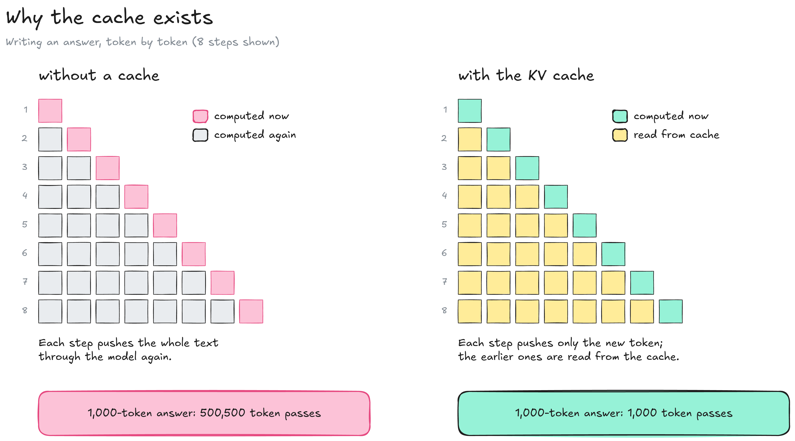
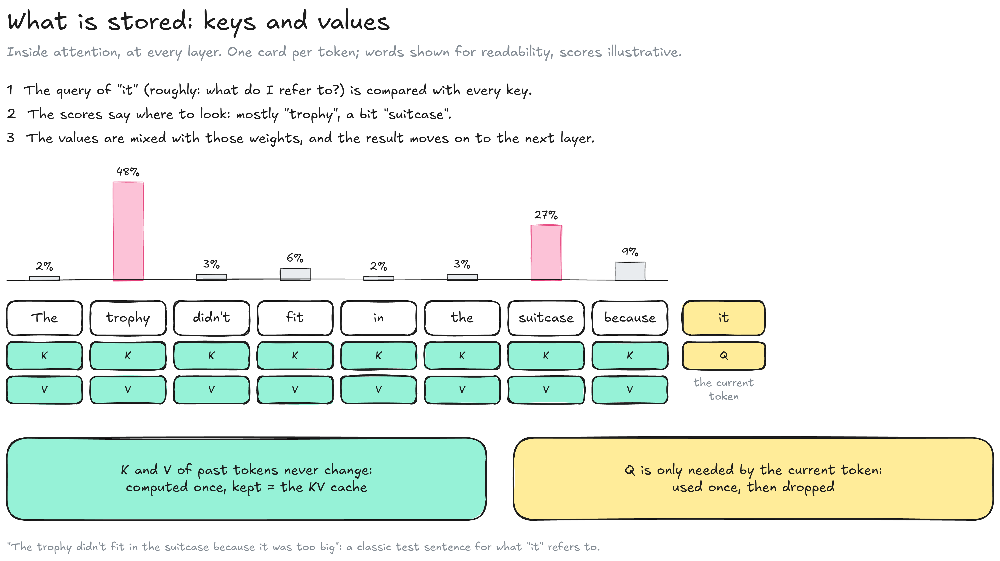
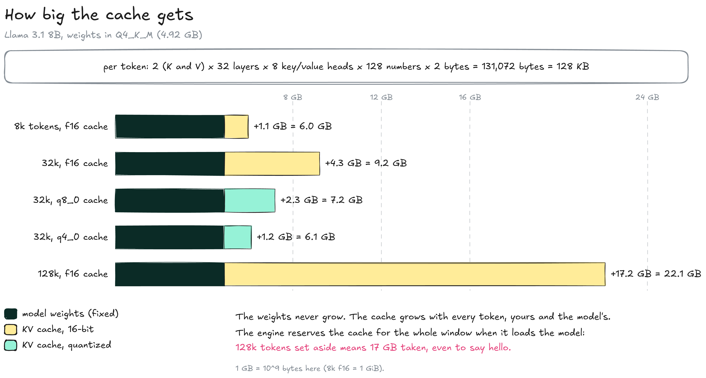
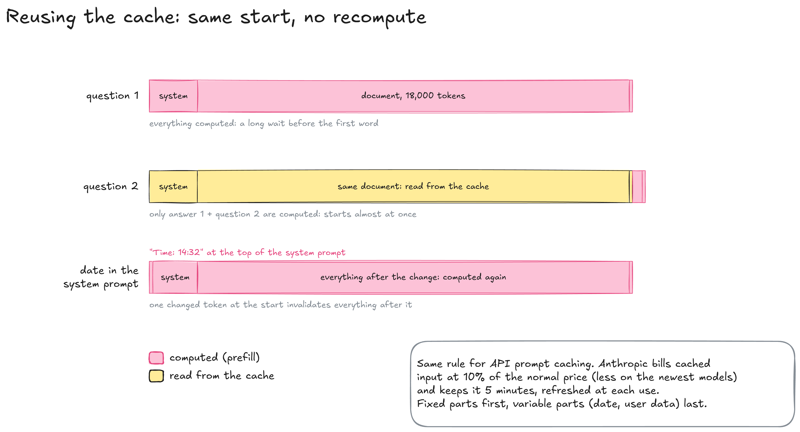

---
layout:
  width: default
  title:
    visible: true
  description:
    visible: false
  tableOfContents:
    visible: true
  outline:
    visible: true
  pagination:
    visible: true
  metadata:
    visible: true
  tags:
    visible: true
  actions:
    visible: true
  anchors:
    visible: true
---

# KV cache

The KV cache is where a language model keeps the work already done on every token of the conversation, so it never has to compute it again. It lives in GPU memory next to the weights, and it grows with every token. On the [Inference](../) map, the engine reserves it when it loads the model (3a), the prefill fills it (4b), and every turn of the loop reads it and adds one token to it (4c).


**Choosing a context length means choosing how much memory to give the conversation.** Open the window you need, not the one the model allows.


### Why a cache

Each new token depends on all the tokens before it. Without a cache, the model would push the whole text through all its layers again at every step.

<figure><figcaption></figcaption></figure>

* **Without a cache:** Step n processes n tokens. A 1,000-token answer costs 1 + 2 + … + 1,000 = 500,500 token passes.
* **With the cache:** Each token goes through the model once; what later tokens need from it is stored. The same answer costs 1,000 passes.

### What is stored

Inside each layer, **attention** lets the current token look back at the previous ones. For every token, the layer's `attn_q`, `attn_k` and `attn_v` tables compute three lists of numbers: a **query**, a **key** and a **value** (see [how the tables connect](../../model/inside-a-model.md#how-the-tables-connect)).

<figure><figcaption></figcaption></figure>

* **Query (Q):** What the current token looks for in the text before it.
* **Key (K):** What a token offers, used to decide how relevant it is to a query.
* **Value (V):** The information a token passes on when it is attended to.
* **What is kept:** Earlier tokens never change, so their keys and values stay valid: they are computed once and stored. The query only serves the current token and is dropped. Keys and values, stored for every token and every layer, make the KV cache.

### How big it gets

The cache size is a simple product, like the [size of a model](../../model/precision.md#how-big-a-model-is): number of elements × bytes per element. The difference is that the weights are fixed, while the cache grows with every token, read or written.

<figure><figcaption></figcaption></figure>

* **Per token:** 2 (K and V) × 32 layers × 8 key-value heads × 128 numbers × 2 bytes = 128 KB for Llama 3.1 8B. These sizes come from the model's metadata: 32 layers, and keys and values of 1024 numbers (8 × 128) per token, the output size of the `attn_k` and `attn_v` tables (see [what is inside a version](../../model/inside-a-model.md#what-is-inside-a-version)).
* **Per window:** 1.1 GB at 8k tokens, 4.3 GB at 32k, 17.2 GB at the model's maximum of 128k. At 128k the cache is three and a half times the Q4\_K\_M weights.
* **Reserved upfront:** Engines allocate the cache for the full window when they load the model. In [llama.cpp](https://github.com/ggml-org/llama.cpp) and [TextGen](https://github.com/oobabooga/textgen) this is `ctx-size`; 128k tokens takes 17 GB even for a one-line chat.
* **Quantized cache:** `q8_0` halves the cache (2.3 GB at 32k) with a loss that is usually hard to notice; `q4_0` divides it by 3.5, with a loss that shows on long contexts.

8k tokens is enough for an ordinary conversation. A long document needs a larger window, and the memory to match.

### Prefill and generation

Answering a prompt has two phases with different speeds, steps 4b and 4c on the map. Both read the cache, so both slow down as the conversation grows.

* **Prefill:** The model computes the cache for the whole input at once, in parallel. A long pasted document means a pause of a few seconds or more before the first word: the **time to first token**.
* **Generation (the loop):** Tokens come one at a time. Each one reads the weights and the whole cache, so a long conversation generates more slowly than a fresh one.

### Reusing the cache

Once computed, the cache stays in memory. A follow-up question only needs the new tokens computed, as long as everything before them is identical.

<figure><figcaption></figcaption></figure>

* **Same beginning:** The cached part is read, only the new part is computed, and the answer starts almost at once.
* **Changed beginning:** Every cache entry depends on all the tokens before it. Changing one early token, such as a date or time at the top of the system prompt, invalidates everything after it.
* **Paid APIs:** The same mechanism is billed as prompt caching. Anthropic charges cached input at 10 % of the normal input price (less on its newest models) and keeps it 5 minutes, refreshed at each use.
* **Prompt layout:** Fixed parts first (instructions, documents), variable parts last (date, user data).

### What labs do about it

Cache size limits how many users and how much context a server can handle, so recent architectures shrink it.

| Technique                         | Principle                                                            | Result                                                                       |
| --------------------------------- | -------------------------------------------------------------------- | ---------------------------------------------------------------------------- |
| GQA (grouped-query attention)     | Several attention heads share one set of keys and values             | Llama 3.1 8B: 32 heads share 8 sets, 4× less cache per token than Llama 2 7B |
| MLA (multi-head latent attention) | Keys and values are stored compressed and rebuilt when needed        | DeepSeek-V2: 93.3 % less cache than DeepSeek 67B                             |
| Hybrid layers                     | Most layers keep a small fixed-size state instead of a growing cache | Qwen3-Next: 3 of every 4 layers use linear attention                         |

A model's parameter count does not tell what its context will cost. Check its architecture (layers, key-value heads) before opening a large window.

### When it does not fit



#### Shrink the window

* [ ] Set the context length to what the task needs (8k for chat)



#### Quantize the cache

* [ ] Set the cache type to `q8_0` (`--cache-type-k` / `--cache-type-v` in llama.cpp)
* [ ] Keep `q4_0` for when nothing else works



#### Change the model

* [ ] Choose a smaller model, or one whose architecture keeps a smaller cache



Cache quantization usually requires Flash Attention, which llama.cpp turns on automatically when the hardware supports it. TeaCache and MagCache in video tools such as [Wan2GP](https://github.com/deepbeepmeep/Wan2GP) are unrelated: they reuse results between denoising steps (see [Image & video](../image-and-video.md)) and keep no keys or values.

### Resources

* Engine settings: [llama.cpp server README](https://github.com/ggml-org/llama.cpp/blob/master/tools/server/README.md) | [Ollama, context length](https://docs.ollama.com/context-length)
* Prompt caching: [Anthropic documentation](https://platform.claude.com/docs/en/build-with-claude/prompt-caching)
* Papers: [GQA, Ainslie et al. 2023](https://arxiv.org/abs/2305.13245) | [DeepSeek-V2 (MLA)](https://arxiv.org/abs/2405.04434)
