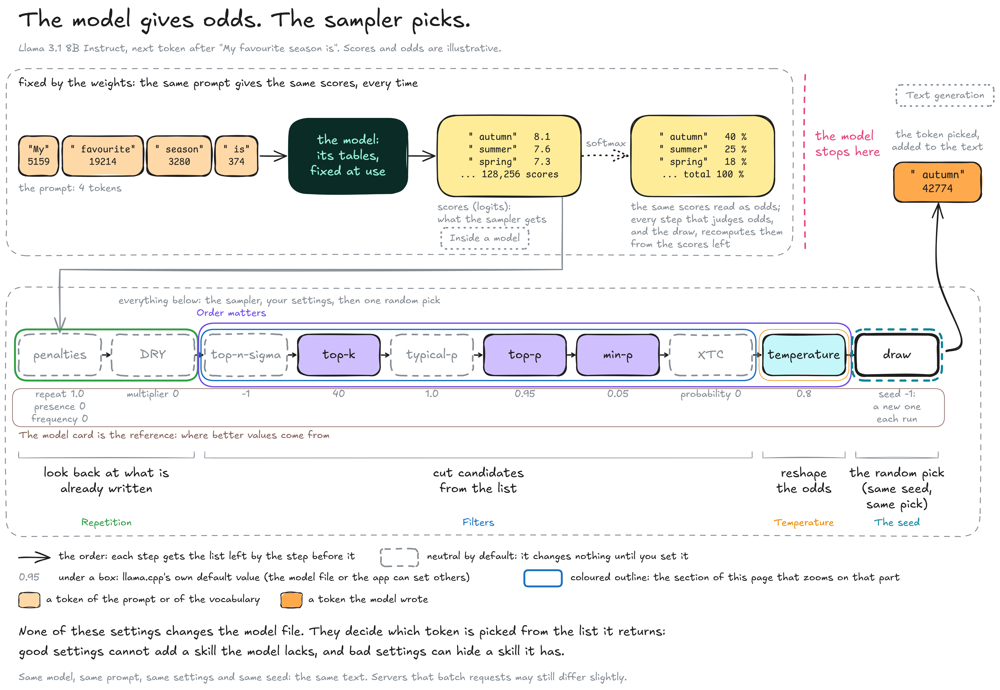
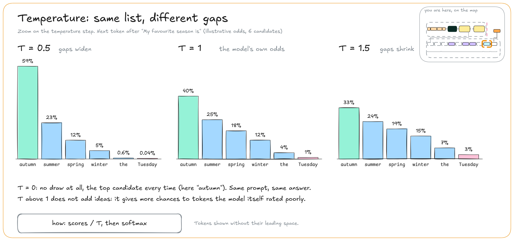
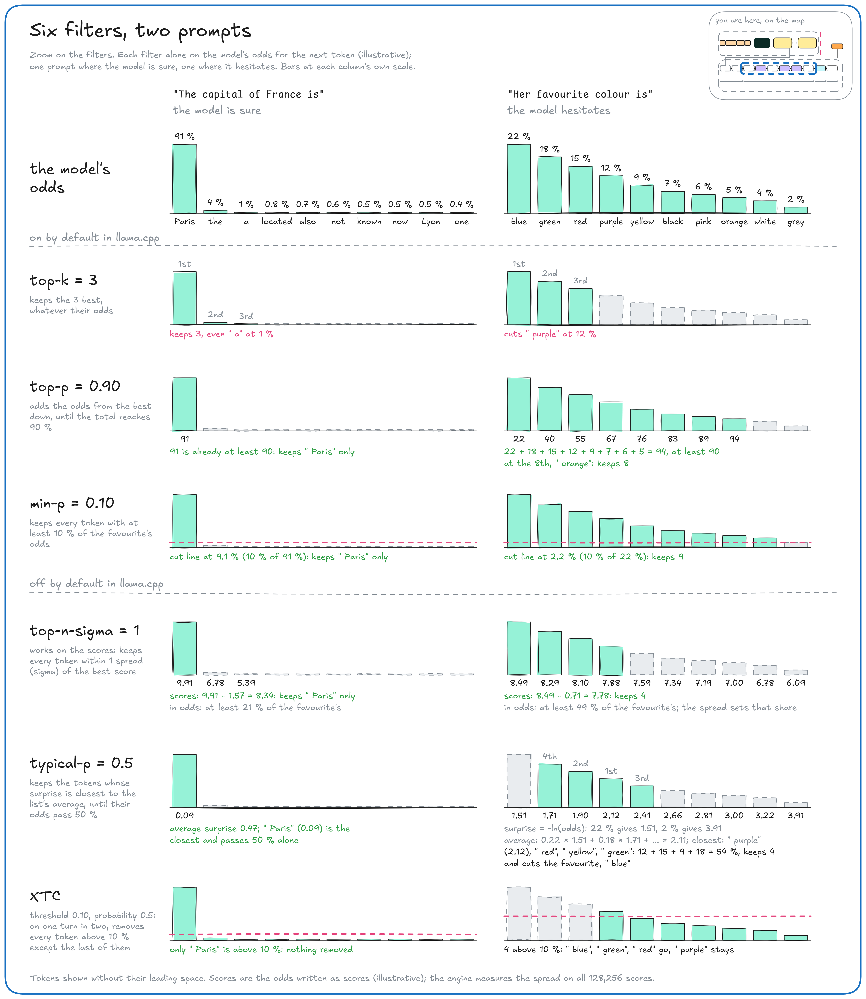
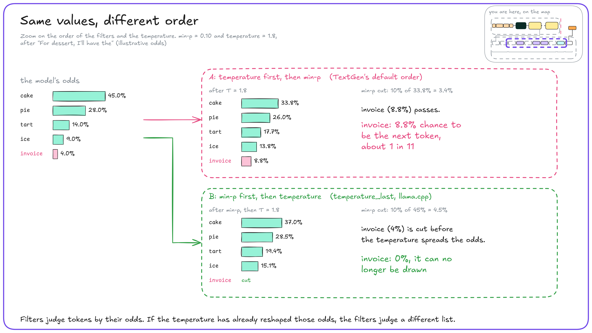
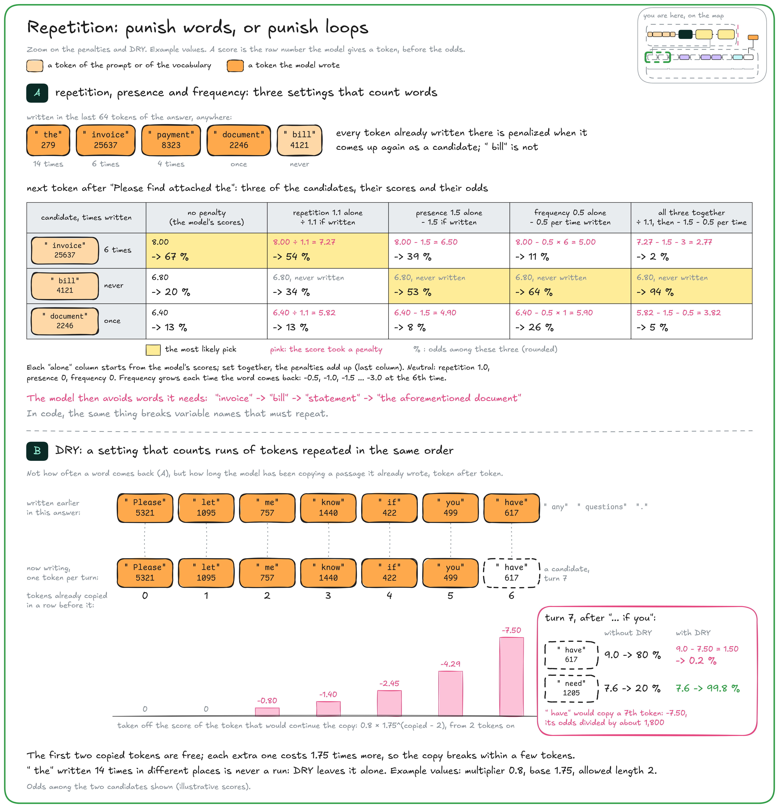
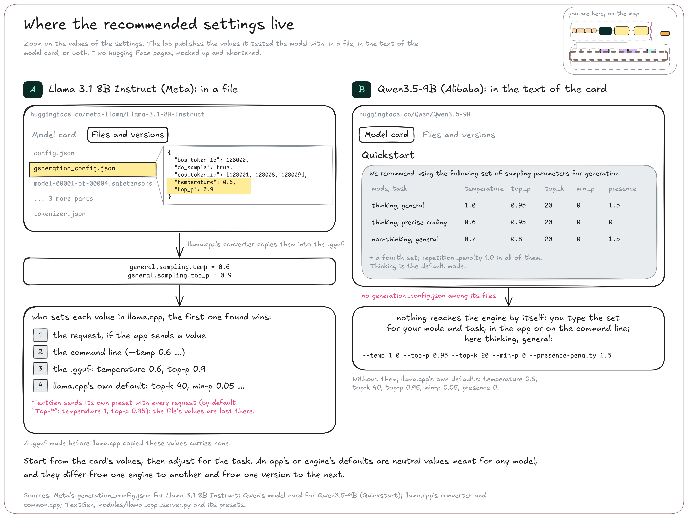
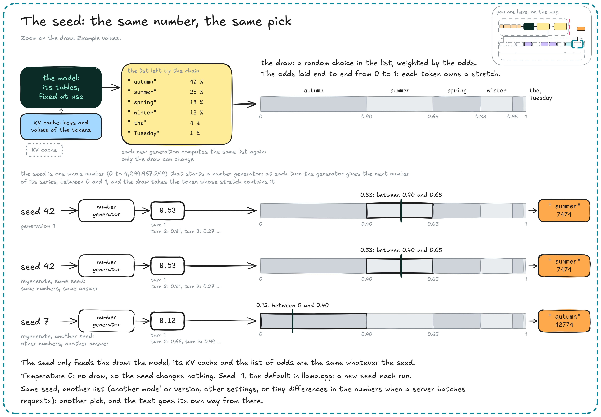

---
layout:
  width: default
  title:
    visible: true
  description:
    visible: false
  tableOfContents:
    visible: true
  outline:
    visible: true
  pagination:
    visible: true
  metadata:
    visible: true
  tags:
    visible: true
  actions:
    visible: true
  anchors:
    visible: true
---

# Sampling

The model returns a score for every token of its vocabulary; the **sampler** turns those scores into one chosen token. On the [Text generation](./#the-map) map, this page zooms on step 5, the sampler: a small program in the [engine](../gpu-and-memory/engines-and-kernels.md) that runs at every turn of the loop. The examples use Llama 3.1 8B Instruct in llama.cpp, with illustrative odds.


**The model gives the odds; the sampler picks one token from them.** Sampling settings change how that pick is made, never the model or its files: the same file writes differently with other settings.


### The sampler chain

The sampler is a chain of steps. Each step receives the list of candidates left by the step before it, changes it and passes it on; the last step draws one token at random.

<figure><figcaption></figcaption></figure>

* **Scores and odds:** The model's output table gives one score (a logit) to each of the 128,256 tokens of Llama 3.1's vocabulary; the softmax reads the scores as odds that add up to 100 % (both shown step by step in [from the final list to percentages](../../model/inside-a-model/#from-the-final-list-to-percentages)). The same prompt gives the same scores every time.
* **What the chain receives:** The scores. A step that judges odds, such as top-p or min-p, recomputes them with the softmax from the scores that are left, and the draw does it one last time; the odds in the diagrams are those recomputed odds.
* **Look back (penalties, DRY):** They lower the score of tokens that would repeat what is already written (see [Repetition](sampling.md#repetition)).
* **Cut (six filters):** They remove unlikely candidates; the candidates they keep share the odds in the same proportions as before.
* **Reshape (temperature):** It changes the gaps between the odds without removing any candidate.
* **Draw:** A random pick among what is left, weighted by the odds. The **seed** sets its random numbers, and those of XTC when it is on (see [The seed](sampling.md#the-seed)).

The arrows give the order, and the order changes the result (see [Order matters](sampling.md#order-matters)). A step at its neutral value, such as top-p 1.0 or a repetition penalty of 1.0, passes the list on unchanged: in llama.cpp, five of the nine steps sit at their neutral value by default. The values under the boxes are llama.cpp's own defaults; a model file or the app can bring others (see [The model card is the reference](sampling.md#the-model-card-is-the-reference)). Each coloured outline marks the part of the chain that a later section opens.

### Temperature

Temperature widens or narrows the gaps between candidates. Below 1 the favourite gets stronger; above 1 the odds even out and unlikely tokens gain ground.

<figure><figcaption></figcaption></figure>

* **T = 1:** The model's own odds, unchanged.
* **T = 0:** No draw: llama.cpp takes the top candidate every time, so the same prompt gives the same answer.
* **T > 1:** More varied text, because tokens the model rated as poor get picked more often. Past about 1.3, output degrades quickly without a filter.
* **How:** Every score is divided by T, then the softmax recomputes the odds. Below 1, the gaps between scores grow, and since the softmax turns gaps into ratios of odds, the favourite pulls ahead; above 1, the gaps shrink. The name comes from physics, where heat spreads particles over more states; here it is only that divisor.
* **Dynamic temperature:** Off by default. It sets the temperature at each turn between two bounds, higher when the list is flat and lower when one token dominates.

Tasks with one right answer (extraction, code, maths) are usually run at low temperatures, open writing higher. A model card's recommendation comes first: Qwen3.5 recommends 1.0 for general tasks in thinking mode and 0.6 for precise coding (see the model card's values below).

### Filters

Filters cut the list before the draw: the candidates they keep share the odds in the same proportions as before. They differ in how they decide where to cut, which matters most when the model hesitates. Three are on by default in llama.cpp, three off.

<figure><figcaption></figcaption></figure>

* **Two prompts:** After "The capital of France is", the model is sure (" Paris" at 91 %); after "Her favourite colour is", it hesitates (the favourite has 22 %). A filter that suits both keeps one token in the first case and many in the second.
* **top-k:** Keeps the k best, whatever their odds: when the model is sure it keeps tokens at 4 % and 1 %, and when it hesitates it cuts a fair answer at 12 %. 0 turns it off; llama.cpp uses 40 by default.
* **top-p (nucleus):** Adds up the odds from the best down and keeps tokens until the running total reaches p. It follows the model's confidence, but when the model is lost the total climbs slowly and a long tail of poor candidates gets in. 1.0 turns it off.
* **min-p:** Keeps every token with at least p times the odds of the favourite, so the cut line moves with the favourite: 9.1 % after "France", 2.2 % after "colour". 0 turns it off.
* **top-n-sigma:** Works on the scores: it keeps every token whose score is within n standard deviations (σ, the usual measure of spread) of the best score. Since a gap between two scores is a ratio of odds, that is a min-p whose share is set by the spread instead of by you: 49 % of the favourite's odds in the example, 21 % when the model is sure. Dividing every score by the temperature divides the spread too, so what it keeps does not change with the temperature ([Tang et al., 2024](https://arxiv.org/abs/2411.07641)). −1 turns it off.
* **typical-p:** A token's surprise is how unexpected it is, −ln of its odds: 1.51 for a token at 22 %, 3.91 at 2 %. The list's average surprise weights each surprise by its odds (2.11 for the colours). The filter takes first the tokens whose surprise is closest to that average, here " purple" at 2.12, then " red", " yellow", " green", until their odds pass p, so on a flat list it can cut the favourite as too predictable ([Meister et al., 2022](https://arxiv.org/abs/2202.00666)). 1.0 turns it off.
* **XTC (exclude top choices):** On a share of the turns set by its probability, it removes every token above its threshold except the least likely of them, to steer writing away from the most expected words. A sure answer is left alone, since a single token above the threshold is never removed. Probability 0 turns it off.

min-p, around 0.05 to 0.1, is a common single filter for local models because its one rule is tight when the favourite is strong and loose when the list is flat; its authors report better text than with top-p at high temperatures ([Nguyen et al., 2024](https://arxiv.org/abs/2407.01082)). Stacked filters make it hard to tell which one cut what. Two other samplers replace the draw instead of cutting the list, both off by default: **Mirostat** moves a cut at each turn to keep the text's surprise near a target ([Basu et al., 2020](https://arxiv.org/abs/2007.14966)), and in llama.cpp it then ignores top-k, top-p and typical-p; **adaptive-p** favours tokens whose odds are near a target, adjusted from the odds of the tokens picked before.

### Order matters

Filters judge candidates by their odds, and temperature changes those odds. Running temperature before or after the filters gives different results with the same values.

<figure><figcaption></figcaption></figure>

* **Temperature first:** The default in [TextGen](https://github.com/oobabooga/textgen). A high temperature lifts unlikely candidates above the filter's cut before the filter runs.
* **Temperature last:** The default order in [llama.cpp](https://github.com/ggml-org/llama.cpp), and what TextGen's `temperature_last` option does. The filter cuts on the model's own odds, then the temperature spreads what is left.
* **At T = 1:** The order makes no difference, since temperature changes nothing.

When two apps give different results with the same model and settings, the sampler order and the default values are the first things that differ.

### Repetition

Small models and long outputs tend to loop: a phrase, then a sentence, then a paragraph comes back. Two families of settings lower the score of what would repeat: penalties count words (A), DRY counts sequences (B).

<figure><figcaption></figcaption></figure>

* **A, three settings:** Repetition, presence and frequency penalty are three separate settings, each with its own value and its own neutral value (1.0, 0 and 0). Each looks at the tokens written anywhere in the last 64 tokens (`--repeat-last-n`) and lowers their scores when they come up again as candidates. Each "alone" column of the table starts from the model's scores; set together, the three add up, as in the last column.
* **A, repetition penalty:** Divides the score by the penalty (multiplies it when the score is below 0, so the token still loses), however often the token was written. A high score loses more: at 1.1, " invoice" goes from 8.00 to 7.27 and still leads.
* **A, presence penalty:** Takes the same amount off, whether the token was written once or 14 times: at 1.5, " bill" overtakes " invoice". Qwen3.5's card recommends 1.5 against endless repetition.
* **A, frequency penalty:** Takes the amount off once per time the token was written, so the penalty grows turn after turn as the word comes back: −3.00 for " invoice" after 6 times.
* **A, what they cost:** They hit every repeated word, including the ones the text needs: an invoice that must stay an invoice, a variable name in code.
* **B, DRY ("don't repeat yourself"):** Counts runs, not words: it penalizes a token only when it would extend a copy, in the same order, of a passage the answer already wrote, by multiplier × base^(tokens already copied − allowed length), taken off its score. A word repeated in different places is never a run. When the model starts the same sentence again, the penalty grows token after token until the next token of the copy drops from 80 % to 0.2 % and another token is picked. A sequence breaks at a new line, a colon, a quote mark or an asterisk. `dry_multiplier` 0 turns it off; 0.8 with base 1.75 and allowed length 2 are the values its author proposed.

Both families run first in llama.cpp's chain, so a penalized token can also fall below a filter's cut and disappear.

### The model card is the reference

The team that trained a model publishes the settings it tested the model with; an engine's defaults are neutral values meant for any model. Where those settings sit decides whether the engine finds them by itself.

<figure><figcaption></figcaption></figure>

* **A, in a file:** Meta's `generation_config.json` for Llama 3.1 8B Instruct sets temperature 0.6 and top-p 0.9. llama.cpp's converter copies these values into the `.gguf` (`general.sampling.temp`, `general.sampling.top_p`), and llama.cpp uses them for every setting the command line or the request leaves unset. A `.gguf` made before the converter did this carries none.
* **Who wins:** In llama.cpp, a value sent with the request comes first, then the command line, then the `.gguf`, then llama.cpp's own default. An app that sends its own values hides the file's: [TextGen](https://github.com/oobabooga/textgen) sends its preset with every request (by default "Top-P": temperature 1, top-p 0.95), so the values are set there by hand.
* **B, in the text:** Qwen3.5-9B has no such file; its card gives four sets of values, by mode (thinking or not) and task. No engine reads a card, so the values are typed in, and the same name can be applied differently or not at all from one engine to another.

| Setting             | llama.cpp's own default | Llama 3.1 8B Instruct (file) | Qwen3.5, thinking, general | Qwen3.5, non-thinking, general |
| ------------------- | ----------------------- | ---------------------------- | -------------------------- | ------------------------------ |
| temperature         | 0.8                     | 0.6                          | 1.0                        | 0.7                            |
| top\_p              | 0.95                    | 0.9                          | 0.95                       | 0.8                            |
| top\_k              | 40                      | not set                      | 20                         | 20                             |
| min\_p              | 0.05                    | not set                      | 0                          | 0                              |
| presence\_penalty   | 0                       | not set                      | 1.5                        | 1.5                            |
| repetition\_penalty | 1.0                     | not set                      | 1.0                        | 1.0                            |

Each app ships its own defaults, and the same name can hide different values: llama.cpp's penalties look back 64 tokens by default, TextGen's 1,024. A script that writes every value keeps its behaviour when an engine update changes a default.

Same setting, three spellings (TextGen, llama.cpp command line, API request)

| TextGen                    | Command line          | Request field                                                |
| -------------------------- | --------------------- | ------------------------------------------------------------ |
| temperature                | `--temp`              | `temperature`                                                |
| top\_k                     | `--top-k`             | `top_k`                                                      |
| top\_p                     | `--top-p`             | `top_p`                                                      |
| min\_p                     | `--min-p`             | `min_p`                                                      |
| top\_n\_sigma              | `--top-n-sigma`       | `top_n_sigma`                                                |
| typical\_p                 | `--typical`           | `typical_p`                                                  |
| xtc\_probability           | `--xtc-probability`   | `xtc_probability`                                            |
| repetition\_penalty        | `--repeat-penalty`    | `repeat_penalty`                                             |
| repetition\_penalty\_range | `--repeat-last-n`     | `repeat_last_n`                                              |
| presence\_penalty          | `--presence-penalty`  | `presence_penalty`                                           |
| frequency\_penalty         | `--frequency-penalty` | `frequency_penalty`                                          |
| dry\_multiplier            | `--dry-multiplier`    | `dry_multiplier`                                             |
| max\_new\_tokens           | `-n`, `--predict`     | `n_predict` (`max_tokens` on the OpenAI-compatible endpoint) |
| seed                       | `-s`, `--seed`        | `seed`                                                       |
| sampler priority           | `--samplers`          | `samplers`                                                   |

### The seed

The draw is a random choice in the list, weighted by the odds; the **seed** is the number its generator starts from (XTC, when it is on, uses it too). It decides which token comes out, and the same seed repeats the same choices.

<figure><figcaption></figcaption></figure>

* **How the draw picks:** The odds are laid end to end from 0 to 1, each token owning a stretch as long as its odds. A number generator gives a number between 0 and 1, and the draw takes the token whose stretch contains it: 0.53 falls between 0.40 and 0.65, " summer".
* **Same seed, same numbers:** The seed is one whole number (0 to 4,294,967,294 in llama.cpp) that starts the generator, a Mersenne Twister; the generator then gives the next number of its series at each turn. Regenerating the answer computes the same list again, so with the same seed the same numbers give the same tokens, turn after turn. Another seed gives other numbers: with seed 7, 0.12, between 0 and 0.40, " autumn".
* **Seed −1:** llama.cpp's default: a new seed, taken from the system, at each run. Any other number repeats the run.
* **Not the KV cache:** The seed only feeds the draw. The model, its [KV cache](kv-cache.md) and the list of odds are the same whatever the seed.
* **Temperature 0:** No draw, so the seed changes nothing.

Two outputs can differ for no other reason than the draw, so settings are compared at a fixed seed. Even then, a server may give a slightly different text: batching requests or reusing its cache can change the scores in their last digits, and once one token differs, the rest of the answer follows it (see [no going back](./#no-going-back)).

### Common symptoms

Most problems with output come from a few settings, or from outside the sampler.

| What you see                      | Likely cause                                               | First thing to try                                                                        |
| --------------------------------- | ---------------------------------------------------------- | ----------------------------------------------------------------------------------------- |
| Flat, repetitive phrasing         | Temperature too low or filter too tight                    | Raise temperature by 0.1, loosen the filter                                               |
| Odd words, sentences that drift   | Temperature too high, no filter                            | Lower temperature below 1, add min-p 0.05                                                 |
| The same sentence loops           | No repetition control                                      | DRY 0.8, then the model card's presence penalty                                           |
| Strange synonyms, broken code     | Repetition penalty too high                                | Set it back to 1.0, use DRY instead                                                       |
| Never stops                       | End token blocked (`--ignore-eos`), or wrong chat template | Allow the end token, check the template (see [how an answer ends](./#how-an-answer-ends)) |
| Off-topic, wrong length or format | Instructions, not sampling                                 | Rewrite the system prompt before any setting                                              |

### Resources

* Defaults, order and code: [llama.cpp server README](https://github.com/ggml-org/llama.cpp/blob/master/tools/server/README.md) | [llama.cpp samplers](https://github.com/ggml-org/llama.cpp/blob/master/src/llama-sampler.cpp) | [TextGen parameters](https://github.com/oobabooga/textgen/wiki/03-%E2%80%90-Parameters-Tab)
* Recommended settings: [Qwen3.5-9B model card](https://huggingface.co/Qwen/Qwen3.5-9B) | [Llama 3.1 8B Instruct repository](https://huggingface.co/meta-llama/Llama-3.1-8B-Instruct) (`generation_config.json`)
* Papers: top-k, [Fan et al. 2018](https://arxiv.org/abs/1805.04833) | top-p, [Holtzman et al. 2019](https://arxiv.org/abs/1904.09751) | min-p, [Nguyen et al. 2024](https://arxiv.org/abs/2407.01082) | typical-p, [Meister et al. 2022](https://arxiv.org/abs/2202.00666) | top-n-sigma, [Tang et al. 2024](https://arxiv.org/abs/2411.07641) | Mirostat, [Basu et al. 2020](https://arxiv.org/abs/2007.14966) | repetition penalty, [Keskar et al. 2019](https://arxiv.org/abs/1909.05858)
* DRY and XTC: [DRY pull request](https://github.com/oobabooga/text-generation-webui/pull/5677) and [paper](https://arxiv.org/abs/2608.22761) | [XTC pull request](https://github.com/oobabooga/text-generation-webui/pull/6335) and [paper](https://arxiv.org/abs/2608.22758)
