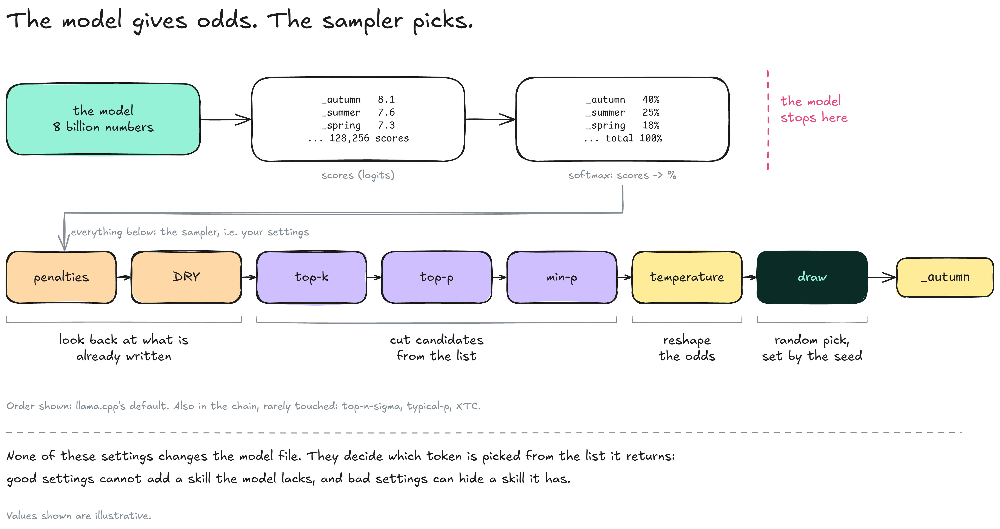
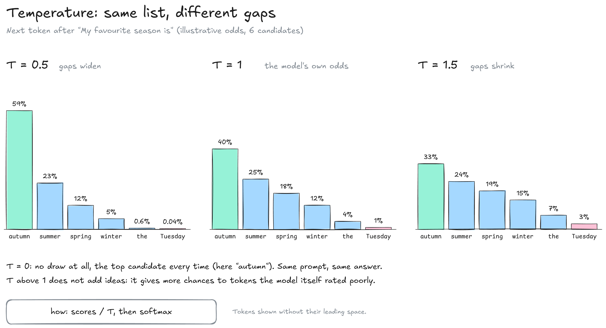
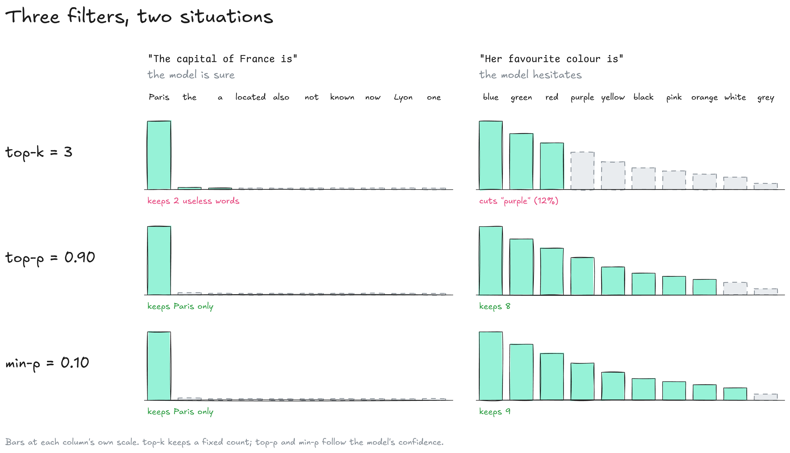
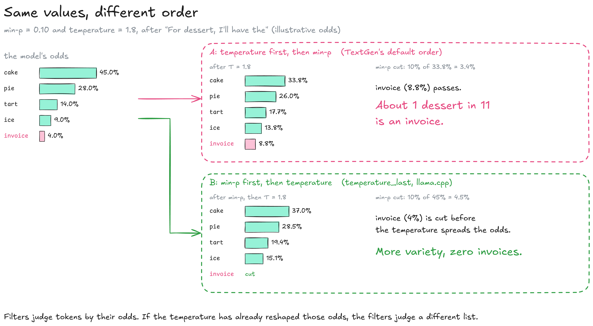
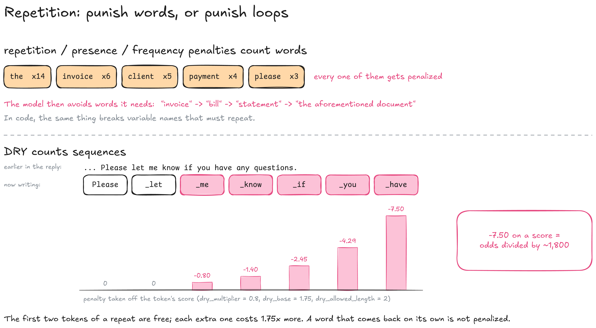

---
layout:
  width: default
  title:
    visible: true
  description:
    visible: false
  tableOfContents:
    visible: true
  outline:
    visible: true
  pagination:
    visible: true
  metadata:
    visible: true
  tags:
    visible: true
  actions:
    visible: true
  anchors:
    visible: true
---

# Sampling

The model returns odds for every possible next token; the **sampler** turns those odds into one chosen token. It runs inside the engine at every turn of the loop, step 4c on the [Inference](../) map. Every setting on this page is a sampler setting: none of them changes the model's files.


**Start from the model card's recommended values, write them explicitly, and change one setting at a time with a fixed seed.**


### The sampler chain

Sampling settings run as a chain. Each step receives the list of candidates from the previous one, changes it, and passes it on; the last step draws one token at random.

<figure><figcaption></figcaption></figure>

* **Logits:** The raw score the model gives each of the 128,256 tokens of Llama 3.1's vocabulary, computed by its output table. **Softmax** converts them into probabilities that add up to 100 %.
* **Penalties:** Lower the score of tokens that already appear in the text, to fight repetition.
* **Filters (top-k, top-p, min-p):** Remove unlikely candidates without changing the relative odds of the others.
* **Temperature:** Changes the odds themselves, without removing any candidate.
* **Draw:** A random pick among what is left, weighted by the odds. Its starting point is the **seed**.

Settings cannot add a skill the model lacks, but poor settings can make a capable model write badly.

### Temperature

Temperature widens or narrows the gaps between candidates. Below 1 the favourite gets stronger; above 1 the odds even out and unlikely tokens gain ground.

<figure><figcaption></figcaption></figure>

* **T = 1:** The model's own odds, unchanged.
* **T = 0:** No randomness: the top candidate every time, and the same answer for the same prompt.
* **T > 1:** More varied text, because tokens the model rated as poor get picked more often. Past about 1.3, output degrades quickly without a filter.
* **How:** Scores are divided by T before softmax.

| Task                                      | Typical temperature                      |
| ----------------------------------------- | ---------------------------------------- |
| Extraction, classification, code, maths   | 0 to 0.3                                 |
| Factual answers, summaries, assistant use | 0.6 to 0.8                               |
| Writing, rewording                        | 0.8 to 1.0                               |
| Brainstorming, fiction                    | above 1, with min-p and temperature last |

These ranges are starting points. A model card's recommendation takes precedence: Qwen3.5, for example, recommends 1.0 for general tasks in thinking mode.

### Filters

Filters cut the list before the draw. They differ in how they decide where to cut, and that matters most when the model is unsure.

<figure><figcaption></figcaption></figure>

* **top-k:** Keeps the k best candidates, whatever their odds. With k = 3 it keeps two useless words when the model is sure, and cuts valid ones when it hesitates. 0 disables it.
* **top-p (nucleus):** Keeps the best candidates until their odds add up to p. It adapts to confidence, but when the model is lost it can let a long tail of poor candidates through. 1.0 disables it.
* **min-p:** Keeps every candidate with at least p times the odds of the favourite. With 0.1 and a favourite at 22 %, the cut is at 2.2 %. 0 disables it.

Stacking all three filters makes it hard to know which one cut what. Use one, usually min-p around 0.05 to 0.1, unless the model card specifies otherwise.

### Order matters

Filters judge candidates by their odds, and temperature changes those odds. Running temperature before or after the filters gives different results with the same values.

<figure><figcaption></figcaption></figure>

* **Temperature first:** The default in [TextGen](https://github.com/oobabooga/textgen). High temperature lifts absurd candidates above the filter's threshold.
* **Temperature last:** The default order in [llama.cpp](https://github.com/ggml-org/llama.cpp), and what TextGen's `temperature_last` box does. Filters remove absurd candidates first, then temperature varies the rest.
* **Rule:** Above T = 1, temperature goes last. At T = 1 the order makes no difference, since temperature changes nothing.

When two apps give different results with the same model and settings, check the sampler order first, then the default values.

### Repetition

Small models and long outputs tend to loop: a phrase, then a sentence, then a paragraph comes back. Two families of settings fight this, and they do not work the same way.

<figure><figcaption></figcaption></figure>

* **repetition\_penalty:** Lowers the score of every token already present, by dividing it. Reasonable from 1.05 to 1.1; above 1.2 the text starts avoiding words it needs. 1 disables it.
* **presence\_penalty:** A fixed malus on any token already present, however often. 0 disables it.
* **frequency\_penalty:** A malus that grows with each occurrence. 0 disables it.
* **DRY:** Penalizes a token only if it extends a sequence already written, with a penalty that grows exponentially with the length of the repeat. `dry_multiplier` 0 disables it; 0.8 is the usual value.



#### When a model loops

* [ ] Set `dry_multiplier` to 0.8



#### If it still loops

* [ ] Add `presence_penalty` at the value the model card gives (1.5 for Qwen3.5)



#### Last resort

* [ ] Raise `repetition_penalty` to 1.05–1.1, never above 1.2, and check the text for odd synonyms



### The model card is the reference

The team that trained a model publishes the settings it was tuned for. App defaults are neutral values meant to work with any model, not optimal ones.

| Setting             | llama.cpp default (command line) | Qwen3.5, thinking mode, general | Qwen3.5, non-thinking mode, general |
| ------------------- | -------------------------------- | ------------------------------- | ----------------------------------- |
| temperature         | 0.8                              | 1.0                             | 0.7                                 |
| top\_p              | 0.95                             | 0.95                            | 0.8                                 |
| top\_k              | 40                               | 20                              | 20                                  |
| min\_p              | 0.05                             | 0                               | 0                                   |
| presence\_penalty   | 0                                | 1.5                             | 1.5                                 |
| repetition\_penalty | 1.0                              | 1.0                             | 1.0                                 |

Each app ships its own defaults, and the same name can hide different values: llama.cpp's repetition penalty looks back 64 tokens by default. In scripts and apps, write every value explicitly, even when it matches the default, so the behaviour does not change when an engine update changes a default.

```bash
llama-server -m Qwen3.5-9B-Q4_K_M.gguf \
  --temp 0.7 --top-p 0.8 --top-k 20 --min-p 0 \
  --presence-penalty 1.5 --repeat-penalty 1.0 \
  --seed 42
```

The values are Qwen3.5's non-thinking ones from the table, written out in full.

<details>

<summary>Same setting, three spellings (TextGen, llama.cpp command line, API request)</summary>

| TextGen                    | Command line          | Request field                                                |
| -------------------------- | --------------------- | ------------------------------------------------------------ |
| temperature                | `--temp`              | `temperature`                                                |
| top\_k                     | `--top-k`             | `top_k`                                                      |
| top\_p                     | `--top-p`             | `top_p`                                                      |
| min\_p                     | `--min-p`             | `min_p`                                                      |
| repetition\_penalty        | `--repeat-penalty`    | `repeat_penalty`                                             |
| repetition\_penalty\_range | `--repeat-last-n`     | `repeat_last_n`                                              |
| presence\_penalty          | `--presence-penalty`  | `presence_penalty`                                           |
| frequency\_penalty         | `--frequency-penalty` | `frequency_penalty`                                          |
| dry\_multiplier            | `--dry-multiplier`    | `dry_multiplier`                                             |
| max\_new\_tokens           | `-n`, `--predict`     | `n_predict` (`max_tokens` on the OpenAI-compatible endpoint) |
| seed                       | `-s`, `--seed`        | `seed`                                                       |
| sampler priority           | `--samplers`          | `samplers`                                                   |

</details>

### Testing settings

The draw is random, so two outputs can differ for no other reason than chance. A fixed **seed** makes the draw repeatable: same seed, same settings, same prompt, same text.



#### Fix the seed

* [ ] Set the seed to any number (`-1` means a new random seed each run)



#### Change one setting

* [ ] Regenerate a few times and compare
* [ ] Put the setting back before testing the next one



#### Use two test prompts

* [ ] One with a single right answer (a factual question)
* [ ] One with many good answers (a story opening, a list of ideas)



Settings that work well on one of these prompts often do worse on the other, so settings are chosen per task. Engines may still vary slightly at a fixed seed because of batching and caching.

| What you see                      | Likely cause                                     | First thing to try                              |
| --------------------------------- | ------------------------------------------------ | ----------------------------------------------- |
| Flat, repetitive phrasing         | Temperature too low or filter too tight          | Raise temperature by 0.1, loosen the filter     |
| Invented facts, odd words         | Temperature too high, no filter                  | Lower temperature below 1, add min-p 0.05       |
| The same sentence loops           | No repetition control                            | DRY 0.8, then the model card's presence penalty |
| Strange synonyms, broken code     | repetition\_penalty too high                     | Set it back to 1.0, use DRY instead             |
| Never stops                       | End-of-text token banned, or wrong chat template | Unban the EOS token, check the template         |
| Off-topic, wrong length or format | Instructions, not sampling                       | Rewrite the system prompt before any setting    |


**TODO (author): interactive page.** A sampling playground: one list of candidates, sliders for temperature, top-k, top-p and min-p, a switch for the order, and the bars updating live. Embed it here once hosted.


### Resources

* Defaults and order: [llama.cpp server README](https://github.com/ggml-org/llama.cpp/blob/master/tools/server/README.md) | [TextGen parameters](https://github.com/oobabooga/textgen/wiki/03-%E2%80%90-Parameters-Tab)
* Recommended settings: [Unsloth, Qwen3.5 guide](https://unsloth.ai/docs/models/qwen3.5) (from Qwen's model cards)
* Papers: top-k, [Fan et al. 2018](https://arxiv.org/abs/1805.04833) | top-p, [Holtzman et al. 2019](https://arxiv.org/abs/1904.09751) | min-p, [Nguyen et al. 2024](https://arxiv.org/abs/2407.01082)
