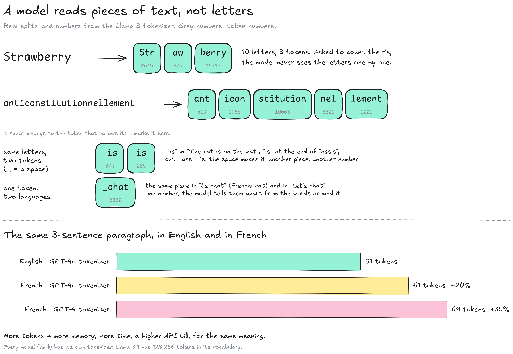
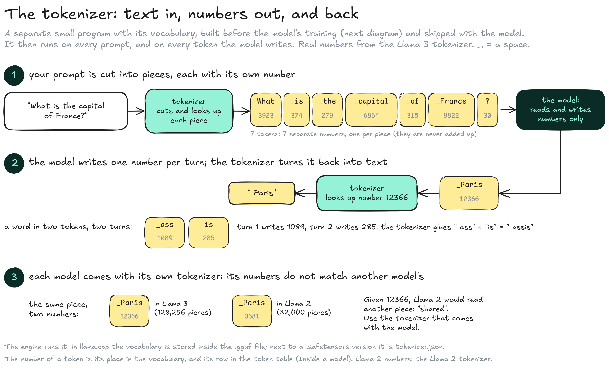
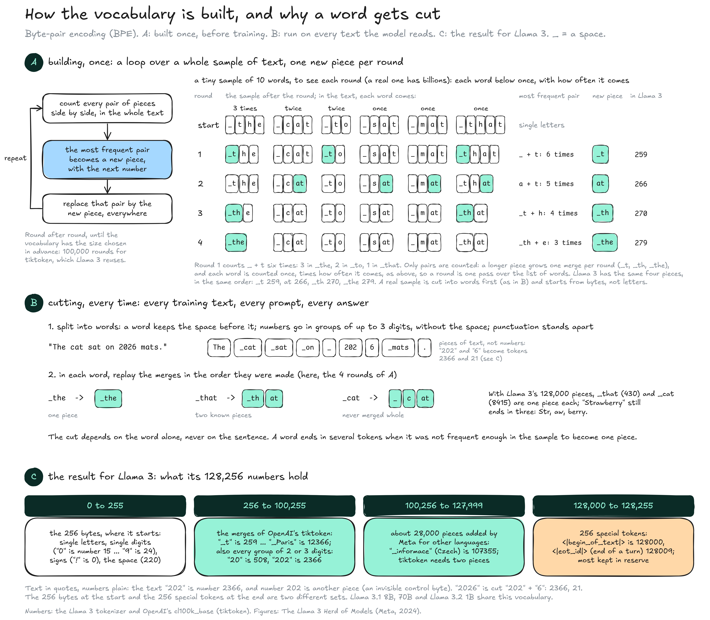
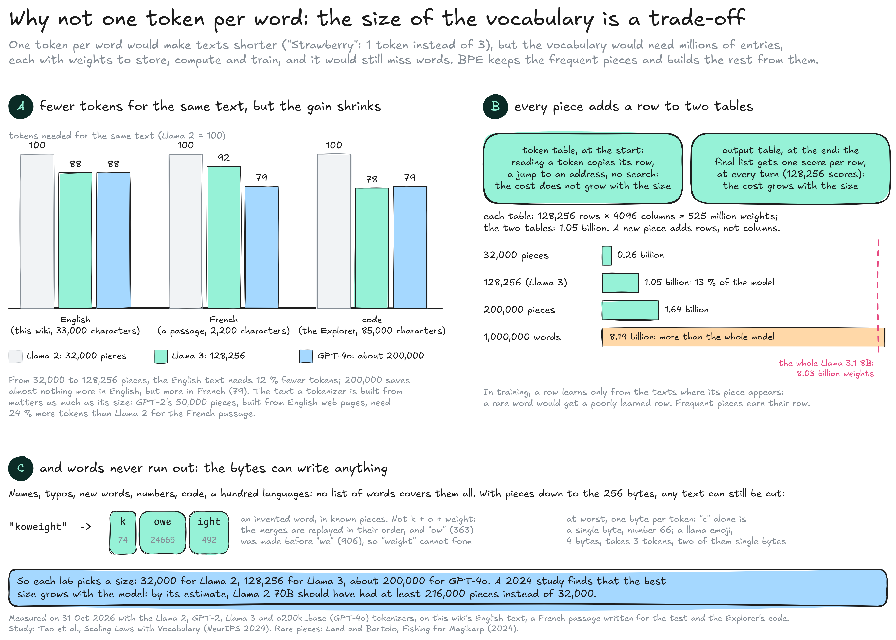

---
layout:
  width: default
  title:
    visible: true
  description:
    visible: false
  tableOfContents:
    visible: true
  outline:
    visible: true
  pagination:
    visible: true
  metadata:
    visible: true
  tags:
    visible: true
  actions:
    visible: true
  anchors:
    visible: true
---

# Tokens

A model never reads letters: text is cut into **tokens**, pieces of text with a number, before the model sees it. This page zooms on step 4a of the [Inference](../) map: what a token is, which program cuts the text, and what the numbers mean. The examples use the Llama 3 tokenizer, the one of Llama 3.1 8B Instruct.


**A token is a piece of text with a number.** The number is only an address in the vocabulary; what a token means is learned in the model's weights, from the text around it.


### Pieces of text

A token is a whole word, part of a word, a space plus a word, or punctuation. The vocabulary is fixed before training, so the training texts, your prompt and the model's answers are all cut into the same pieces.

<figure><figcaption></figcaption></figure>

* **Letters:** "Strawberry" is three tokens (`Str`, `aw`, `berry`), which is why models miscount letters while handling complex topics well.
* **Spaces:** A space belongs to the token that follows it: " is" (374) in "The cat is on the mat" and "is" (285) at the end of "assis" are two different tokens, with two different rows. In the diagrams, \_ draws that space; the real underscore is another character (62 in Llama 3, where the space alone is 220).
* **A word in several pieces:** The tokens of your prompt are read all at once (the prefill, step 4b of the Inference map), each taking in only the tokens before it; the answer then comes one token per turn. "Strawberry" arrives as "Str", "aw" and "berry": through attention, the last piece takes in the two before it, and research on Llama models finds that their early and middle layers rebuild the whole word there (see **Transformer**).
* **One piece, several meanings:** " chat" (6369) is the same token in "Le chat" and in "Let's chat". The model tells the French cat from the English verb by the tokens around it, which the attention part of each layer mixes in (see [how the tables connect](../../model/inside-a-model.md#how-the-tables-connect)).
* **Languages:** Nothing is translated: French is cut into pieces of French, and takes more tokens because tokenizers are built mostly from English. "The cat sat on the mat" takes 6 tokens, "Le chat est assis sur le tapis" 9; the same paragraph took 51 tokens in English and 61 in French with the GPT-4o tokenizer (+20 %).
* **Cost:** More tokens mean more memory, slower generation and a higher bill on paid APIs, for the same content.

### The tokenizer

The **tokenizer** is a separate small program with its vocabulary. It is built before the model's training (see [how the vocabulary is built](tokens.md#how-the-vocabulary-is-built)) and shipped with the model, and training never changes it. It then runs at every use: it cuts your prompt into tokens before the model runs, and turns each token the model writes back into text.

<figure><figcaption></figcaption></figure>

1. **Your prompt:** The engine runs the tokenizer on it. "What is the capital of France?" becomes 7 tokens, each with its own number: 3923, 374, 279, 6864, 315, 9822, 30. The numbers are labels, never added up. In llama.cpp the vocabulary is stored inside the `.gguf` file; next to a `.safetensors` version it is the `tokenizer.json` file.
2. **The answer:** The model writes one token per turn, as a number: 12366 is the number of " Paris" in the vocabulary, and the tokenizer turns it back into text. A word in two tokens takes two turns: " assis" comes out as 1089 (" ass"), then 285 ("is"), and the tokenizer glues them.
3. **Each model, its own tokenizer:** The numbers only make sense with the vocabulary they come from. " Paris" is 12366 for Llama 3 and 3681 for Llama 2, whose vocabulary has 32,000 pieces; given 12366, Llama 2 would read "shared". The engine always uses the tokenizer that comes with the model's files, never another one.

### How the vocabulary is built

The vocabulary is built once, before training, by **byte-pair encoding** (BPE), and the same process explains why a word can be cut into several tokens. In the diagram, \_ stands for a space.

<figure><figcaption></figcaption></figure>

* **A, building:** A loop over a large sample of text: each round counts every pair of pieces side by side, makes the most frequent pair a new piece and replaces it everywhere. The diagram runs four rounds on 10 words: " " + "t" (6 times) becomes " t", then "at", " th" and " the", the same four pieces, in the same order, as Llama 3's 259, 266, 270 and 279. Only pairs are counted, so a long piece grows one merge per round. A real tokenizer starts from the 256 bytes and runs about 100,000 rounds.
* **B, cutting:** Every text the model reads, in training or at use, is first split into words (a word keeps the space before it, numbers go in groups of up to 3 digits, punctuation stands apart), then the merges are replayed in order inside each word. The cut depends on the word alone, not on the sentence, and a word ends in several tokens when it was not frequent enough to become one piece: Llama 3 has " cat" whole, but "Strawberry" takes three.
* **C, the result for Llama 3:** 0 to 255 are the 256 bytes, from which any text can be written ("0" to "9" are 15 to 24); 256 to 100,255 are the merges of OpenAI's tiktoken, including every group of 2 or 3 digits (the text "202" is number 2366); 100,256 to 127,999 are about 28,000 pieces Meta added for other languages; 128,000 to 128,255 are special tokens, such as the start of a text.

### Why not one token per word

One token per word would make texts shorter ("Strawberry": 1 token instead of 3), so cheaper to run. But it would take millions of entries, each with its own weights, and still miss words. BPE keeps the frequent pieces and builds the rest from them.

<figure><figcaption></figcaption></figure>

* **A, fewer tokens, less and less:** On this wiki's English text, Llama 3's 128,256 pieces need 12 % fewer tokens than Llama 2's 32,000; GPT-4o's 200,000 save almost nothing more in English, but more in French. The text a tokenizer is built from matters as much as its size.
* **B, every piece adds a row to two tables:** One row in the token table, read at the start, and one in the output table, which scores every piece at every turn, so its cost grows with the vocabulary. In Llama 3.1 8B, 128,256 × 4096 × 2 tables = 1.05 billion weights, 13 % of the model; a million words would take 8.19 billion, more than the whole model. A rare word's rows would also learn from too few texts.
* **C, words never run out:** No list covers names, typos, new words and a hundred languages, while the 256 bytes can write anything: an invented word such as "koweight" becomes "k" + "owe" + "ight", and at worst a text is cut one byte per token.

Each lab picks a size: 32,000 for Llama 2, 128,256 for Llama 3, about 200,000 for GPT-4o. A 2024 study finds that the best size grows with the model.

### The vocabulary

* **Size:** Each model family has its own vocabulary, shared by all its sizes: 128,256 tokens for Llama 3, 32,000 for Llama 2, about 200,000 for OpenAI's GPT-4o tokenizer (see why, above).
* **Rows:** Each token is one row of the model's token table: 128,256 rows of 4096 numbers in Llama 3.1 8B (see [Inside a model](../../model/inside-a-model.md)). Llama 3.1 8B, 70B and Llama 3.2 1B share one vocabulary, so a bigger one can teach a smaller one token by token (see [distillation](../../model/how-a-model-learns.md#distillation)).
* **Meaning:** The number says nothing about the meaning: " is" (374) sits between "ame" (373) and "pe" (375). What a token means is in its row and, above all, in how the layers combine it with the tokens around it.

### Other kinds of tokens

Models that read pictures or sound also take in **image tokens** and **audio tokens**, which are not pieces of text and have no vocabulary of this kind. An image token is a list of numbers computed from one area of a picture: Gemma 3 makes 256 per image (see the photo input on the Inference map). An audio token is a code for a short slice of sound. See **Multimodal models** and **Audio & speech**.

### Resources

* Tokenizers: [llama3-tokenizer-js](https://github.com/belladoreai/llama3-tokenizer-js), used for the token numbers on this page | [llama-tokenizer-js](https://github.com/belladoreai/llama-tokenizer-js), for the Llama 2 numbers | [gpt-tokenizer (o200k\_base, cl100k\_base, r50k\_base)](https://github.com/niieani/gpt-tokenizer), used for the English, French and code counts (measured on 31 Oct 2026)
* Vocabulary: [The Llama 3 Herd of Models](https://arxiv.org/abs/2407.21783) (128K tokens, 100K from tiktoken, 28K for other languages, 3.17 → 3.94 characters per token in English) | Vocabulary size: [Tao et al., Scaling Laws with Vocabulary](https://huggingface.co/papers/2407.13623) (NeurIPS 2024; Llama 2 70B, at least 216K) | Words from pieces: [Kaplan et al., From Tokens to Words](https://arxiv.org/abs/2410.05864) (Llama 2 7B, Llama 3 8B: words rebuilt at their last piece, in early and middle layers) | Rare pieces: [Land and Bartolo, Fishing for Magikarp](https://huggingface.co/papers/2405.05417) (under-trained tokens) | Splitting into words: [torchtune, Llama 3 tokenizer](https://docs.pytorch.org/torchtune/0.2/_modules/torchtune/models/llama3/_tokenizer.html) (the pattern, numbers in groups of 1 to 3 digits, the special token numbers)
