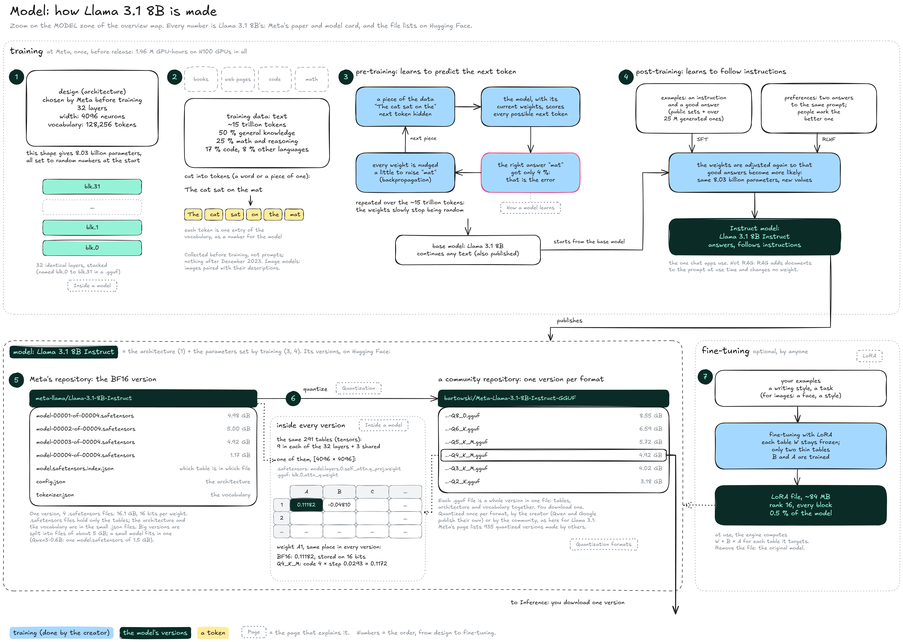

# Model

A model is made in two stages: its creator trains it, then publishes it in one or more versions. This page follows **Llama 3.1 8B Instruct** through both, using the figures from Meta's paper, Meta's model card and the file lists on [Hugging Face](https://huggingface.co).


**A model is an architecture plus learned numbers.** The architecture is chosen before training; training sets the 8.03 billion **parameters** (also called **weights**). Every version you can download holds the same model, with the weights stored at a different precision.


### The map

**Training**, at Meta, once. The whole training took 1.46 million GPU-hours on H100 GPUs.

<figure><figcaption></figcaption></figure>

1. **Design:** Meta chose the **architecture** before training: 32 layers, 4,096 neurons wide, a vocabulary of 128,256 tokens. This shape gives 8.03 billion parameters, all set to random numbers at the start.
2. **Data:** About 15 trillion tokens of text, mostly from the web: 50 % general knowledge, 25 % math and reasoning, 17 % code, 8 % other languages, nothing after December 2023. A **token** is a word or a piece of one, the unit the model reads and writes.
3. **Pre-training:** The model reads a piece of text with the next token hidden, scores every possible next token, and every weight is nudged a little toward the right answer. Repeated over the whole dataset, this turns random weights into a **base model** that continues any text. See [How a model learns](how-a-model-learns.md).
4. **Post-training:** The base model is trained again, on two kinds of data. **Examples** pair an instruction with a good answer (supervised fine-tuning, SFT). **Preferences** show two answers to the same prompt, with the better one marked by a person; training makes answers like the preferred one more likely (reinforcement learning from human feedback, RLHF). The result is the **Instruct** model. Post-training changes the weights once, at the lab; it is not the same as RAG, which changes no weight and adds documents to the prompt at each question.

**One family, many models.** Llama 3.1 is a family in three sizes: 8B, 70B and 405B, the number of parameters in billions. Meta publishes each size as two models: a **base** model, which only continues text, and an **Instruct** model, which answers. Chat apps, assistants and agents use the Instruct model. Other people then build new models from either one by changing their weights: **fine-tunes** (trained further on new data) and **merges** (the weights of several models combined); LoRA adapters add small corrections on top (step 7). A quantized file such as Q4\_K\_M is not a new model: it is a version of the same model, with the same weights stored on fewer bits (step 6). Labs name these variants differently; reading model names will be covered in the **Models** section.

**Versions**, on Hugging Face:

5. **BF16 version:** Meta's repository holds the weights at 16 bits each, 16.1 GB split into four `.safetensors` files of up to about 5 GB. `.safetensors` is the format of PyTorch and the Hugging Face libraries: it holds only tables of numbers, with an index (`model.safetensors.index.json`) saying which table is in which file. The architecture (`config.json`) and the vocabulary (`tokenizer.json`) sit in small separate files. See [Inside a model](inside-a-model.md).
6. **Quantized versions:** The BF16 weights converted to fewer bits per weight, once per format. `.gguf` is the format of [llama.cpp](https://github.com/ggml-org/llama.cpp): each file is a whole version on its own (tables, architecture and vocabulary), so you download a single file, 4.92 GB for Q4\_K\_M. Meta did not publish GGUF versions of Llama 3.1, so the community made them: its model page lists 935 quantized versions made by others. Other creators, such as Qwen and Google, publish their own. See [Quantization](quantization/).

Every version holds the same 291 tables (tensors), with the same names and shapes; only the number of bits per weight changes. Weight A1 of the first attention table is 0.11182 in the BF16 version and 0.1172 in the Q4\_K\_M version.

**Fine-tuning**, optional, by anyone:

7. **LoRA:** Training on your own examples, with the model's tables frozen. Only two thin extra tables per targeted table are trained, and they are saved as a small file (about 84 MB for Llama 3.1 8B) that the engine adds on top of the weights. LoRA works for text models as well as image models. See [LoRA](lora.md).

### Resources

* Model card: [Meta Llama 3.1 8B Instruct](https://huggingface.co/meta-llama/Llama-3.1-8B-Instruct) (GPU-hours, fine-tuning data, quantized versions) | Paper: [The Llama 3 Herd of Models](https://arxiv.org/abs/2407.21783) (data mix, post-training)
* File lists: [bartowski, Meta-Llama-3.1-8B-Instruct-GGUF](https://huggingface.co/bartowski/Meta-Llama-3.1-8B-Instruct-GGUF) | [Qwen3-0.6B](https://huggingface.co/Qwen/Qwen3-0.6B/tree/main)
