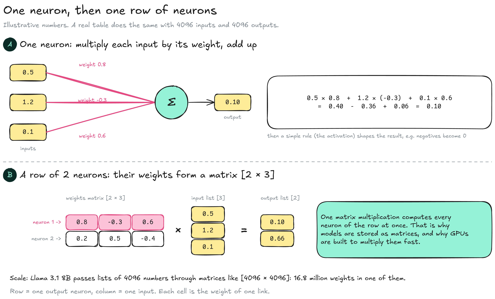
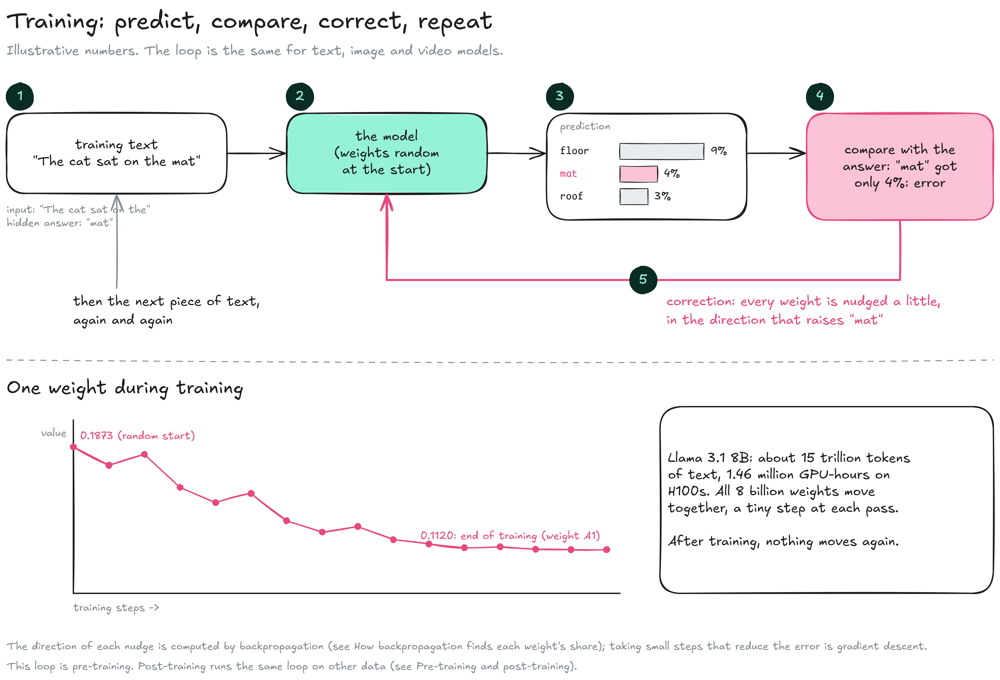
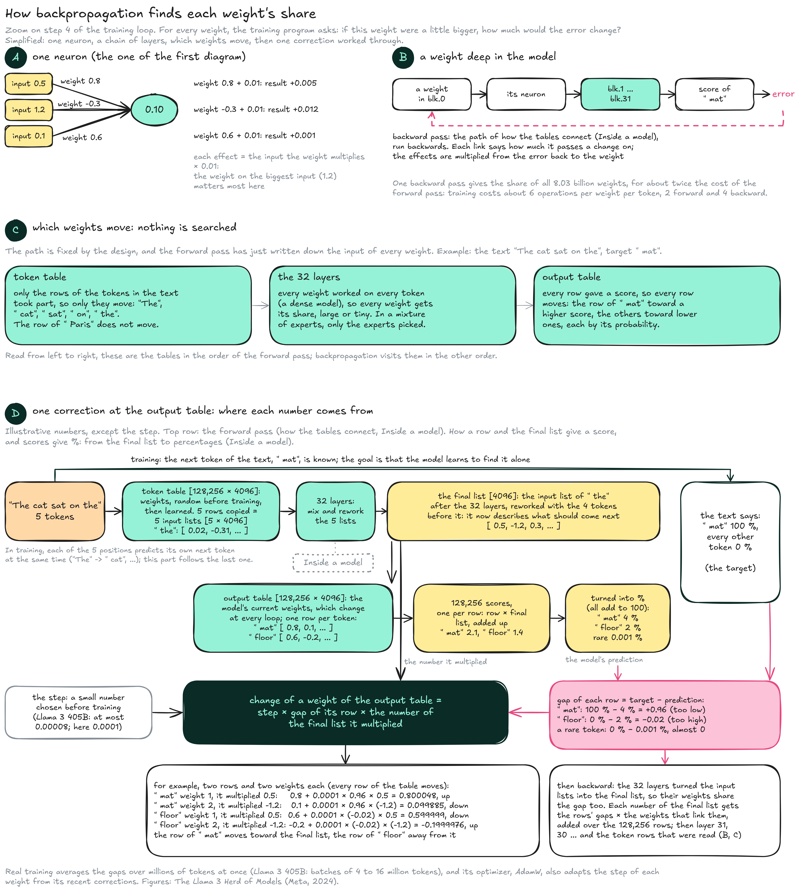
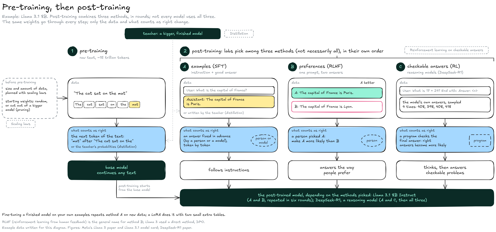
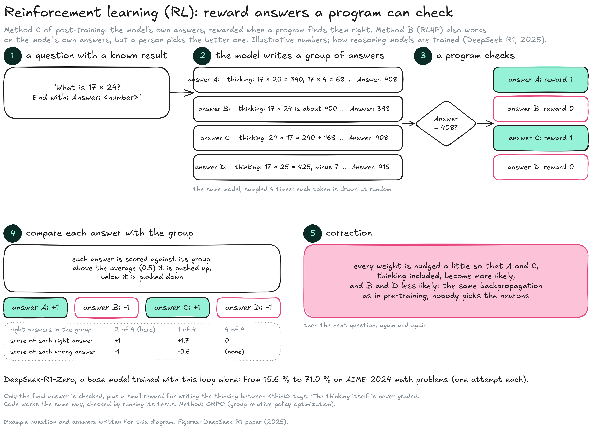
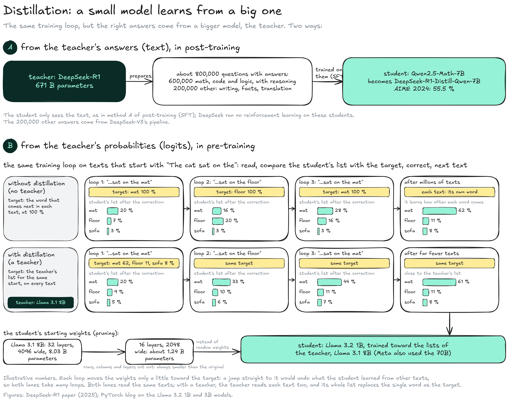
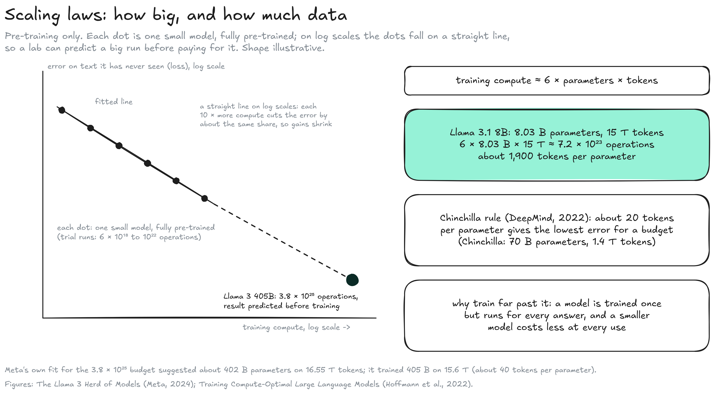

---
layout:
  width: default
  title:
    visible: true
  description:
    visible: false
  tableOfContents:
    visible: true
  outline:
    visible: true
  pagination:
    visible: true
  metadata:
    visible: true
  tags:
    visible: true
  actions:
    visible: true
  anchors:
    visible: true
---

# How a model learns

A model is a network of artificial neurons, and its weights are the strengths of the links between them (see [Inside a model](inside-a-model/)). Training starts from random weights and adjusts them, a little at a time, until the network predicts well. This page follows Llama 3.1 8B through pre-training and post-training, then the methods behind newer models: reinforcement learning on checkable answers, distillation, and the scaling laws that set a model's size.


**A model holds two kinds of numbers.** Its design (number of layers, width, vocabulary) is chosen by people before training. Its weights are set by training. Only the weights are learned.


### Neurons and matrices

An artificial neuron is a small calculation: multiply each input by the weight of its link, add the results, and pass the total on. A row of neurons reading the same inputs forms one table of weights, a matrix.

<figure><figcaption></figcaption></figure>

* **Neuron:** Each input is multiplied by the weight of its link, and the products are added: 0.5 × 0.8 + 1.2 × (−0.3) + 0.1 × 0.6 = 0.10.
* **Activation:** A simple rule then shapes the total, for example turning negative results into 0. Without it, stacking tables would add nothing.
* **Row of neurons:** Several neurons reading the same inputs, each with its own weights.
* **Matrix:** The weights of that row, one row of the matrix per neuron and one column per input. Computing every neuron at once is a single operation: the matrix multiplied by the list of inputs.
* **Why matrices matter:** Running a model is mostly matrix multiplications, and GPUs are built to do them fast (see [GPU & memory](../inference/gpu-and-memory.md)).

A real model chains many such matrices. In Llama 3.1 8B, each of the 32 layers holds 9 tables, and a token's list of 4096 numbers goes through them one after another; [how the tables connect](inside-a-model/#how-the-tables-connect) shows the path. Training uses the same path: the token goes through, the model predicts, and only then are the weights corrected.

### Training

Training is a loop: show the network a piece of real text, let it predict the next token, measure how wrong it was, and correct every weight slightly in the direction that would have made it less wrong. Then repeat, billions of times.

<figure><figcaption></figcaption></figure>

1. **Data:** A piece of training text, with the next token hidden: "The cat sat on the" → "mat".
2. **Prediction:** The network, with its current weights (random at the very start), scores every possible next token. In a transformer, every token of the text is predicted at once, in one pass (see [Training, prompt and answer](inside-a-model/transformer.md#training-prompt-and-answer)).
3. **Comparison:** The score of the right answer shows the error. Here "mat" got only 4 %.
4. **Correction:** Every weight is nudged a little in the direction that would raise the right answer. **Backpropagation** computes that direction for each weight; taking small steps that reduce the error is **gradient descent**. The steps are small because one text is only one example: a jump straight to its answer would undo what the other texts taught, so the weights move a little on each text and settle over many. No one talks to the model during training, and no weight is picked by hand: a training program runs the model on the text, compares its list with the target, and changes every weight by its own amount.
5. **Iteration:** The next piece of text, and again. Llama 3.1 was trained on about 15 trillion tokens; the 8B model took 1.46 million GPU-hours on H100s.

**How each weight's share is found**, a zoom on step 4:

<figure><figcaption></figcaption></figure>

* **A, one neuron:** Raising the weight 0.8 by 0.01 raises the result by 0.5 × 0.01, the input it multiplies: the effect of a weight is its input, known from the forward pass.
* **B, a chain:** A weight deep in the model reaches the score of " mat" through every later table, and each link passes a change on by a known factor. Backpropagation multiplies these factors backwards, along the path of how the tables connect, from the output table to the token table: one backward pass gives the share of all 8.03 billion weights, for about twice the cost of the forward pass.
* **C, which weights move:** Nothing is searched: the path is fixed and the forward pass recorded each weight's input. In the token table only the rows of the text's tokens move; in the 32 layers every weight gets a share; in the output table every row moves, " mat" up and the others down.
* **D, one correction:** The text gives the target (" mat" 100 %), the model its prediction (" mat" 4 %, see [from the final list to percentages](inside-a-model/#from-the-final-list-to-percentages)), and their difference is each row's gap: +0.96 for " mat", −0.02 for " floor". Each weight of the output table then moves by the step, a small number chosen before training, × its row's gap × the number of the final list it multiplied: weight 1 of " mat" goes from 0.8 to 0.800048. The gap then goes back through the 32 layers. Real training averages the gaps over millions of tokens, and its optimizer, AdamW, adapts each weight's step.

This is why training costs about 6 operations per weight for every token read, 2 forward and 4 backward (see [scaling laws](how-a-model-learns.md#scaling-laws)). Each weight settles where it best serves all the examples: weight A1 ends at 0.1120 and is saved as 0.11182 in the BF16 version (see [one weight in 32 and 16 bits](precision.md#one-weight-in-32-and-16-bits)). After training, no weight moves again.

The weights fix the list of scores: the same text in gives the same list out. The random part comes later, at use, when the sampler draws one token from the list (see [Sampling](../inference/text-generation/sampling.md)).

### Pre-training and post-training

A lab trains a model in two phases: pre-training, then post-training. The loop above is **pre-training**. Post-training runs the same kind of loop on the same weights, with other data and another idea of what a right answer is. The diagram places every training method of this page, each tagged with the section that details it.

<figure><figcaption></figcaption></figure>

1. **Pre-training:** Raw text, about 15 trillion tokens for Llama 3.1. The right answer is the next token of the text. The result is a **base model**, which continues any text: given a question, it may write more questions.
2. **Post-training:** Three methods, which labs combine and repeat in rounds; not every model uses all three.
   * **A, examples (supervised fine-tuning, SFT):** Conversations where an instruction is followed by a good answer, fixed in advance by a person or generated by a model. It is the same loop as pre-training on other data: the model reads the instruction, and only the answer's tokens count as right answers. Meta used public instruction sets plus over 25 million generated examples.
   * **B, preferences:** One prompt, two answers written by the model, the better one picked by a person. The weights are moved so that the preferred answer becomes more likely than the other. The general name is reinforcement learning from human feedback (**RLHF**); Llama 3 used a direct method called DPO.
   * **C, checkable answers:** The model learns from its own attempts, rewarded when a program finds the right result. This is how reasoning models are trained (see [reinforcement learning on checkable answers](how-a-model-learns.md#reinforcement-learning-on-checkable-answers)).

Llama 3.1 8B Instruct, the model chat apps use, went through A and B, repeated in six rounds (see [Model](./) for how the base and Instruct models are published). DeepSeek-R1 went through A and C, then all three.

Before pre-training, the lab plans the model's size and how much text it will read (see Scaling laws, below). The starting weights are random, or cut out of a bigger model. A bigger, finished model, the teacher, can also supply the target of pre-training or the examples of method A (see [distillation](how-a-model-learns.md#distillation)). Fine-tuning a finished model on your own examples repeats method A on new data; a [LoRA](lora.md) does it cheaply by training two small extra tables instead of the weights themselves.

### Reinforcement learning on checkable answers

This is method C of post-training. Like preferences (method B), it trains the model on its own answers, but a program checks each answer instead of a person: a math result, or code that must pass its tests. Both are **reinforcement learning**: the model tries, gets a reward, and its weights move toward what was rewarded. This is how **reasoning models**, which write a long chain of thinking before answering, are trained (see **Reasoning**).

<figure><figcaption></figcaption></figure>

1. **Question:** A problem with a known result, to be answered in a fixed form that a program can find.
2. **Group of answers:** The model writes several answers, each with its own thinking; they differ because each token is drawn at random, as at use.
3. **Check:** A program compares each final answer with the known result: reward 1 if right, 0 if wrong. No person grades them.
4. **Compare with the group:** Each answer's score is its reward minus the group's average, divided by the spread: +1 for A and C, −1 for B and D. A rare success gets a bigger push (+1.7 with 1 right answer out of 4), and a question that all answers get right, or all wrong, teaches nothing. This is **GRPO** (group relative policy optimization), DeepSeek's method: it needs no second model to judge.
5. **Correction:** Each token of the answers, thinking included, is pushed up or down in proportion to its answer's score, with the same backpropagation as in [training](how-a-model-learns.md#training). Then the next question.

Only the final answer is checked; the thinking is never graded. DeepSeek-R1-Zero, a base model trained with this loop alone, went from 15.6 % to 71.0 % on AIME 2024, a set of competition math problems. The general name is reinforcement learning with verifiable rewards (**RLVR**); for open questions, such as an essay, labs still rely on preferences.

### Distillation

**Distillation** trains a small model, the student, on the outputs of a bigger, finished one, the teacher. It is ordinary training, in the loop above: the student's weights change, and the result is a new model, not a version of the teacher like a quantized file. The teacher's outputs are better material than raw text: a 32-billion-parameter model distilled from DeepSeek-R1 scored 72.6 % on AIME 2024, against 47.0 % for the same base model trained with reinforcement learning on its own.

<figure><figcaption></figcaption></figure>

* **From the teacher's answers, in post-training:** The teacher writes answers and the student is [post-trained](how-a-model-learns.md#pre-training-and-post-training) on them, as in method A of post-training (SFT). DeepSeek trained smaller open models on 800,000 answers written with R1, with no reinforcement learning: Qwen2.5-Math-7B became DeepSeek-R1-Distill-Qwen-7B, at 55.5 % on AIME 2024.
* **From the teacher's probabilities, in pre-training:** The student reads the same texts, but its target is the teacher's whole list (" mat" 62 %, " floor" 11 %…) instead of the single next word at 100 %. Each text then teaches the whole spread of plausible words, so far fewer texts are needed; it is still many small corrections. Meta trained Llama 3.2 1B toward the lists of Llama 3.1 8B and 70B.
* **Pruning, a separate step:** Llama 3.2 1B did not start from random weights: Meta cut it out of Llama 3.1 8B (**pruning**), from 32 layers 4,096 wide to 16 layers 2,048 wide, so 1.24 billion parameters (about 2.5 GB in BF16) instead of 8.03 billion. Pruning gives the starting weights; distillation then trains them.

The first way needs only the teacher's text, so it works even with another lab's model behind an API, which labs forbid: in February 2026, Anthropic said that DeepSeek, Moonshot AI and MiniMax had used about 24,000 fraudulent accounts to train on Claude's answers. The second needs the teacher's full list and the same vocabulary, so it stays within one family. A distilled model rarely says so in its name; DeepSeek's "Distill" models are an exception.

### Design choices and learned values

<table data-search="false"><thead><tr><th>Chosen before training (design)</th><th>Llama 3.1 8B</th><th>Set by training</th></tr></thead><tbody><tr><td>Number of layers</td><td>32</td><td></td></tr><tr><td>Width (hidden size)</td><td>4096</td><td></td></tr><tr><td>Feed-forward width</td><td>14,336</td><td></td></tr><tr><td>Vocabulary</td><td>128,256 tokens</td><td></td></tr><tr><td>Context length</td><td>131,072 tokens</td><td></td></tr><tr><td>Feed-forward</td><td>dense (all weights used for every token)</td><td></td></tr><tr><td>Weights</td><td></td><td>8.03 billion values</td></tr></tbody></table>

The designers pick these sizes from experience and budget. The width is how many numbers describe each token; the layers are the successive steps that rework that description (see [how the tables connect](inside-a-model/#how-the-tables-connect), on Inside a model). More of either gives the model more room to learn, at the cost of memory and compute: Llama 3.1 has 32 layers 4,096 wide at 8B, 80 layers 8,192 wide at 70B, 126 layers 16,384 wide at 405B. Width alone does not make a model better: size, data and training work together (see Scaling laws, below). Sizes are usually powers of 2 or multiples of 128, which GPUs process best, and a [mixture of experts](inside-a-model/mixture-of-experts.md) is another design choice. They are written in the model's metadata (the `.gguf` file, or `config.json`), so an engine knows the shape of every table before reading it.

### Scaling laws

Before pre-training, the longest and most expensive step, a lab must choose how big the model will be and how much text it will read. **Scaling laws**, first measured at OpenAI in 2020, show that the error on unseen text falls smoothly as models, data and compute grow. Each dot of the chart is one small model, fully pre-trained; on log scales the dots fall on a straight line, which the lab extends to predict a big run before paying for it.

<figure><figcaption></figcaption></figure>

* **Compute:** About 6 operations per parameter for every token read: 6 × 8.03 billion × 15 trillion ≈ 7.2 × 10²³ for Llama 3.1 8B.
* **Prediction:** Meta fitted its laws on trial runs up to 10²² operations, then extrapolated to its budget of 3.8 × 10²⁵, which gave the largest Llama 3: 405 billion parameters trained on 15.6 trillion tokens.
* **Compute-optimal:** For a fixed budget, one size and one amount of data give the lowest error: about 20 tokens per parameter in DeepMind's Chinchilla study (2022), about 40 in Meta's own fit for its 405B model.
* **Past the optimum, on purpose:** Llama 3.1 8B read about 1,900 tokens per parameter. A model is trained once but runs for every answer, so labs train small models far past the optimum: they cost less at every use.

Each tenfold increase in compute cuts the error by about the same share, so each gain costs ten times more than the last. Scaling laws predict the error on text, not which skills a model will have.

### What the weights hold

Training does not copy texts into the model. It leaves regularities: which words tend to follow which, how sentences are built, which facts often appear together.

* **Spread out:** No single weight holds a fact. "Paris is the capital of France" is a pattern spread over many weights, and each weight takes part in many patterns.
* **Black box:** The mechanism is fully known: every operation, how each weight is used and how it is corrected, as on this page. What is hard to read is the meaning: which of the 8 billion values hold "Paris is the capital of France", and how they combine for one answer. Knowing how a neuron fires and how a synapse strengthens does not tell how a brain recognises a face. Interpretability research traces some of these steps (see the Dallas example in how the tables connect) and is still far from a full picture.
* **Not a database:** The model produces what is statistically likely, which is usually right but sometimes plausible and false (see [No going back](../inference/text-generation/#no-going-back)).
* **Brain analogy:** Writing down the strength of every synapse of a brain would give a file of the same kind: complete, yet unreadable as knowledge.

### Resources

* Visual introductions: [3Blue1Brown, Neural networks](https://www.3blue1brown.com/topics/neural-networks)
* Training data and compute: [Meta Llama 3.1 8B Instruct model card](https://huggingface.co/meta-llama/Llama-3.1-8B-Instruct) | Post-training and scaling laws: [The Llama 3 Herd of Models](https://arxiv.org/abs/2407.21783)
* Reinforcement learning and distilled models: [DeepSeek-R1 paper](https://arxiv.org/abs/2501.12948) (R1-Zero results, GRPO, 800,000 samples, distilled models)
* Distillation with logits: [PyTorch, Distilling Llama 3.1 8B into 1B in torchtune](https://pytorch.org/blog/llama-into-torchtune/) (Llama 3.2 1B and 3B) | Distillation through an API: [Computing, Chinese firms used distillation attacks to copy Claude](https://www.computing.co.uk/news/2026/ai/chinese-firms-used-distillation-copy-claude)
* Scaling laws: [Kaplan et al., Scaling Laws for Neural Language Models](https://arxiv.org/abs/2001.08361) | [Hoffmann et al., Training Compute-Optimal Large Language Models](https://arxiv.org/abs/2203.15556) (Chinchilla) | Llama 3 paper above (trial runs, 3.8 × 10²⁵ budget)
* Interpretability: [Anthropic, Mapping the mind of a large language model](https://www.anthropic.com/research/mapping-mind-language-model)
