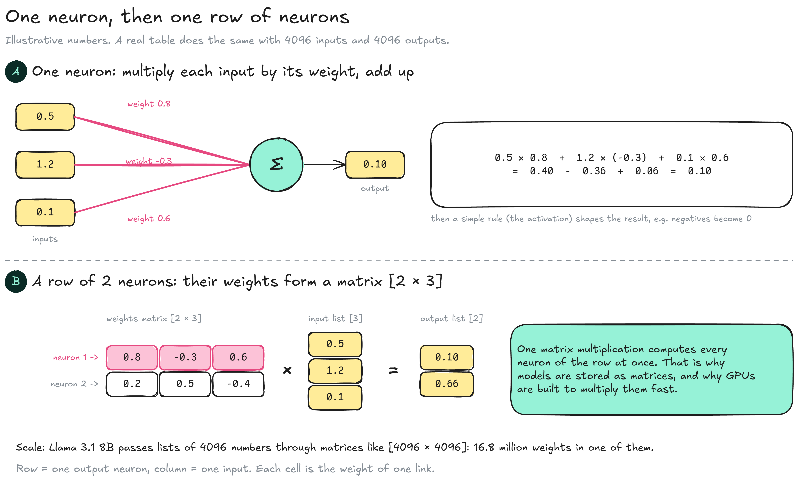
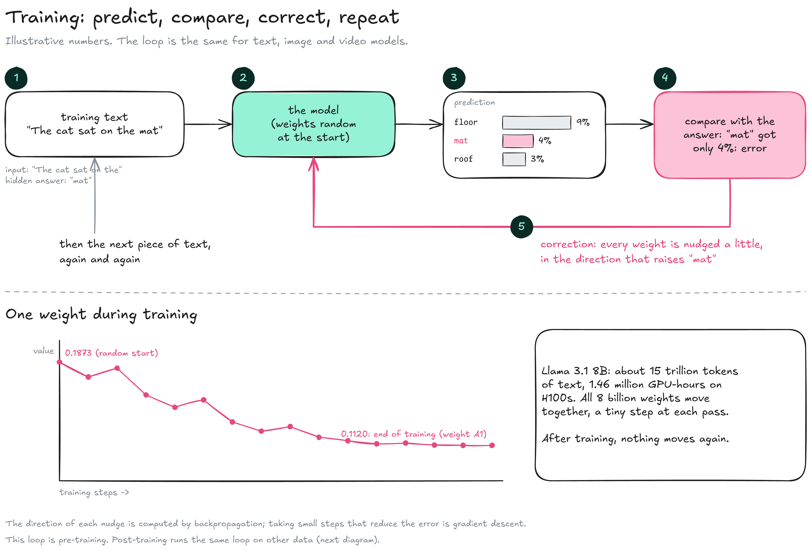
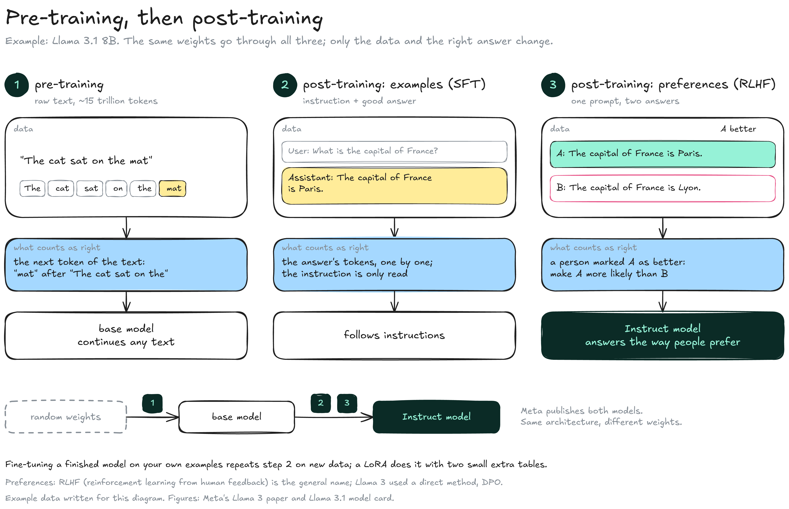

---
layout:
  width: default
  title:
    visible: true
  description:
    visible: false
  tableOfContents:
    visible: true
  outline:
    visible: true
  pagination:
    visible: true
  metadata:
    visible: true
  tags:
    visible: true
  actions:
    visible: true
  anchors:
    visible: true
---

# How a model learns

A model is a network of artificial neurons, and its weights are the strengths of the links between them (see [Inside a model](inside-a-model.md)). Training starts from random weights and adjusts them, a little at a time, until the network predicts well.


**A model holds two kinds of numbers.** Its design (number of layers, width, vocabulary) is chosen by people before training. Its weights are set by training. Only the weights are learned.


### Neurons and matrices

An artificial neuron is a small calculation: multiply each input by the weight of its link, add the results, and pass the total on. A row of neurons reading the same inputs forms one table of weights, a matrix.

<figure><figcaption></figcaption></figure>

* **Neuron:** Each input is multiplied by the weight of its link, and the products are added: 0.5 × 0.8 + 1.2 × (−0.3) + 0.1 × 0.6 = 0.10.
* **Activation:** A simple rule then shapes the total, for example turning negative results into 0. Without it, stacking tables would add nothing.
* **Row of neurons:** Several neurons reading the same inputs, each with its own weights.
* **Matrix:** The weights of that row, one row of the matrix per neuron and one column per input. Computing every neuron at once is a single operation: the matrix multiplied by the list of inputs.
* **Why matrices matter:** Running a model is mostly matrix multiplications, and GPUs are built to do them fast (see [GPU & memory](../inference/gpu-and-memory.md)).

A real model chains many such matrices. In Llama 3.1 8B, each of the 32 layers holds 9 tables, and a token's list of 4096 numbers goes through them one after another; [how the tables connect](inside-a-model.md#how-the-tables-connect) shows the path. Training uses the same path: the token goes through, the model predicts, and only then are the weights corrected.

### Training

Training is a loop: show the network a piece of real text, let it predict the next token, measure how wrong it was, and correct every weight slightly in the direction that would have made it less wrong. Then repeat, billions of times.

<figure><figcaption></figcaption></figure>

1. **Data:** A piece of training text, with the next token hidden: "The cat sat on the" → "mat".
2. **Prediction:** The network, with its current weights (random at the very start), scores every possible next token.
3. **Comparison:** The score of the right answer shows the error. Here "mat" got only 4 %.
4. **Correction:** Every weight is nudged a little in the direction that would raise the right answer. **Backpropagation** computes that direction for each weight; taking small steps that reduce the error is **gradient descent**.
5. **Iteration:** The next piece of text, and again. Llama 3.1 was trained on about 15 trillion tokens; the 8B model took 1.46 million GPU-hours on H100s.

Each weight drifts over training and settles where it best serves all the examples together. Weight A1 ends at 0.1120 (0.1120000035 in the 32-bit master copy), then is saved as 0.11182 in the BF16 version (see [one weight in 32 and 16 bits](precision.md#one-weight-in-32-and-16-bits)). After training, no weight moves again.

### Pre-training and post-training

The loop above is **pre-training**. Post-training runs the same kind of loop on the same weights, with other data and another idea of what a right answer is.

<figure><figcaption></figcaption></figure>

1. **Pre-training:** Raw text, about 15 trillion tokens for Llama 3.1. The right answer is the next token of the text. The result is a **base model**, which continues any text: given a question, it may write more questions.
2. **Examples (supervised fine-tuning, SFT):** Conversations where an instruction is followed by a good answer. The model reads the instruction, and only the answer's tokens count as right answers. Meta used public instruction sets plus over 25 million generated examples.
3. **Preferences:** One prompt, two answers, the better one marked by a person. The weights are moved so that the preferred answer becomes more likely than the other. The general name is reinforcement learning from human feedback (**RLHF**); Llama 3 used a direct method called DPO.

The result is the **Instruct** model, the one chat apps use (see [Model](./) for how both are published). Fine-tuning a finished model on your own examples repeats step 2 on new data; a [LoRA](lora.md) does it cheaply by training two small extra tables instead of the weights themselves.

### Design choices and learned values

| Chosen before training (design) | Llama 3.1 8B   | Set by training     |
| ------------------------------- | -------------- | ------------------- |
| Number of layers                | 32             |                     |
| Width (hidden size)             | 4096           |                     |
| Feed-forward width              | 14,336         |                     |
| Vocabulary                      | 128,256 tokens |                     |
| Context length                  | 131,072 tokens |                     |
| Weights                         |                | 8.03 billion values |

The designers pick these sizes from experience and budget: a wider or deeper network can learn more but costs more compute. Sizes are usually powers of 2 or multiples of 128, which GPUs process most efficiently. They are written in the model's metadata (in the `.gguf` file, or in `config.json` next to `.safetensors` files), so an engine knows the shape of every table before reading it.

### What the weights hold

Training does not copy texts into the model. It leaves regularities: which words tend to follow which, how sentences are built, which facts often appear together.

* **Spread out:** No single weight holds a fact. "Paris is the capital of France" is a pattern spread over many weights, and each weight takes part in many patterns.
* **Black box:** Nobody can read a model's knowledge by looking at its weights. Interpretability research tries to map which groups of neurons respond to which concepts, and it is still far from a full picture.
* **Not a database:** The model produces what is statistically likely, which is usually right but sometimes plausible and false (see [No going back](../inference/text-generation/#no-going-back)).
* **Brain analogy:** Writing down the strength of every synapse of a brain would give a file of the same kind: complete, yet unreadable as knowledge.

### Resources

* Visual introductions: [3Blue1Brown, Neural networks](https://www.3blue1brown.com/topics/neural-networks)
* Training data and compute: [Meta Llama 3.1 8B Instruct model card](https://huggingface.co/meta-llama/Llama-3.1-8B-Instruct) | Post-training: [The Llama 3 Herd of Models](https://arxiv.org/abs/2407.21783)
* Interpretability: [Anthropic, Mapping the mind of a large language model](https://www.anthropic.com/research/mapping-mind-language-model)
