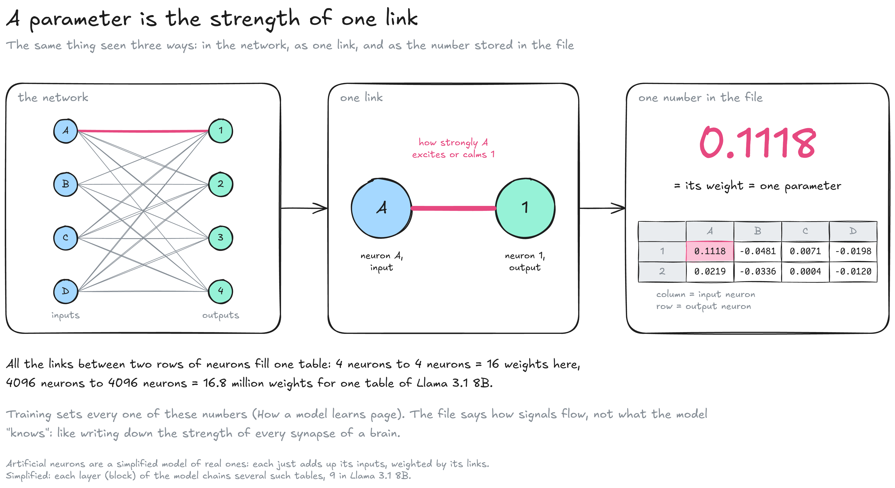
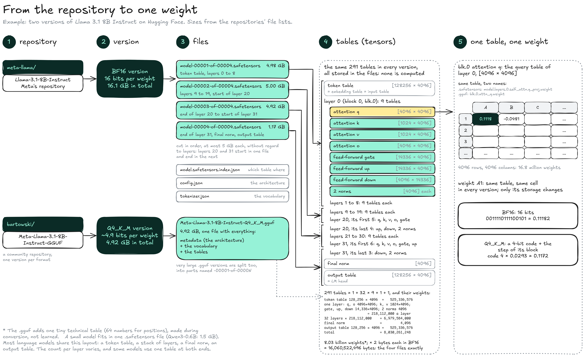
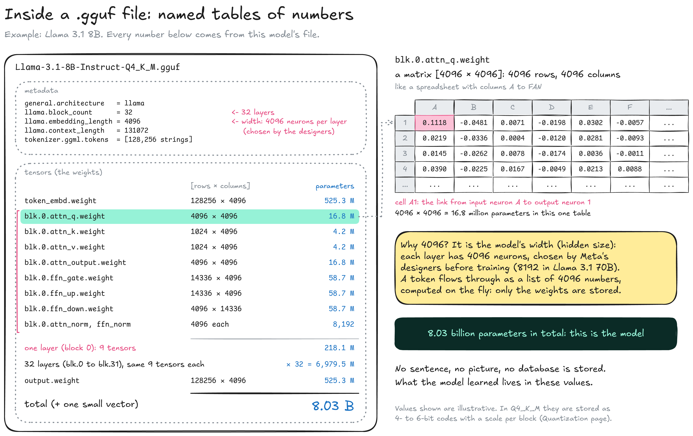
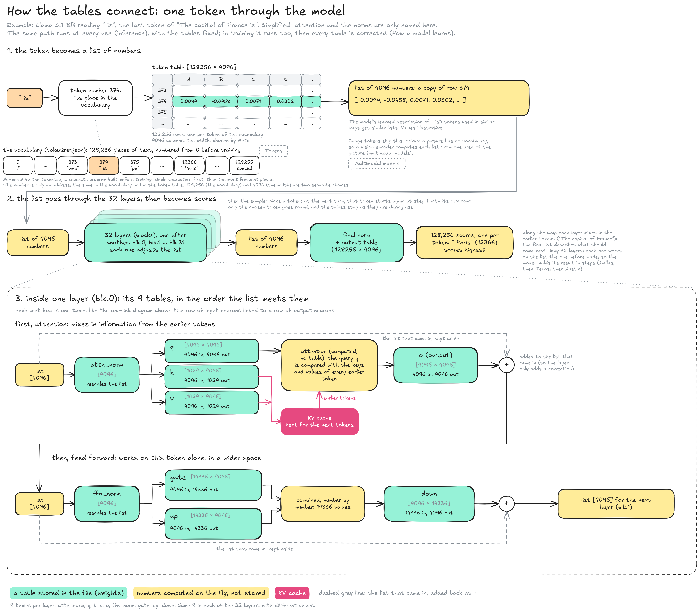
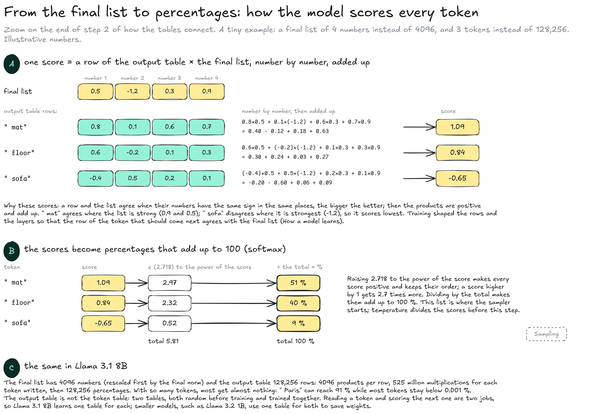

---
layout:
  width: default
  title:
    visible: true
  description:
    visible: false
  tableOfContents:
    visible: true
  outline:
    visible: true
  pagination:
    visible: true
  metadata:
    visible: true
  tags:
    visible: true
  actions:
    visible: true
  anchors:
    visible: true
---

# Inside a model

This page opens a model once it is saved: what its versions contain, how one number is stored, and how big the whole is. It uses **Llama 3.1 8B Instruct** as its example: every number in it comes from that model. Where the files come from is shown on the [Model](./) map; terms with several names are listed in the [Glossary](../../glossary.md).


**A model is stored as named tables of numbers.** Its size is the number of parameters times the space each one takes: 8.03 billion parameters at 2 bytes each = 16.1 GB in the BF16 version.


### A parameter is the strength of a link

A model is a network of artificial **neurons**. A row of input neurons is linked to a row of output neurons, every input to every output. Every link has a strength, and that strength is one number stored in the model.

<figure><figcaption></figcaption></figure>

* **Neuron:** A tiny calculation: it takes numbers in, multiplies each one by the strength of its link, and adds them up.
* **Weight:** The strength of one link: how much neuron A pushes neuron 1 up or down. A negative weight calms instead of excites.
* **Parameter:** Another name for a weight: one number set by training. Llama 3.1 8B has 8.03 billion of them.
* **Table:** All the links between two rows of neurons fill one table, with one column per input neuron and one row per output neuron. It reads like a spreadsheet, and this wiki draws it as one.

The diagram shows the simplest case: one table between two rows of neurons. A **layer** of the model, also called a **block**, chains several such tables: 9 in each of the 32 layers of Llama 3.1 8B (see below).

How training sets these numbers, and why the tables are multiplied rather than read, is explained on [How a model learns](how-a-model-learns.md). The files say how signals flow through the network, not what the model "knows": it is like writing down the strength of every synapse in a brain.

### From the repository to one weight

A model is published on [Hugging Face](https://huggingface.co) in one or more **versions**: the same model saved at different precisions. A version can be one file or several, but every version holds the same tables.

<figure><figcaption></figcaption></figure>

1. **Repository:** The model's page on Hugging Face. Meta's repository holds the BF16 version; community repositories hold quantized versions, one per format.
2. **Version:** The whole model at one precision: four `.safetensors` files for BF16 (16.1 GB), one `.gguf` file for Q4\_K\_M (4.92 GB).
3. **Files:** A `.safetensors` file holds only tables, cut in order into files of at most 5 GB without regard to layers (layers 20 and 31 are split between two files); `model.safetensors.index.json` says which table is where. The architecture (`config.json`) and the vocabulary (`tokenizer.json`) are separate files; a `.gguf` file packs all three together.
4. **Tables:** The same 291 tables in every version, all stored in the files: the token table, 9 tables in each of the 32 layers, a final norm and the output table. Their sizes add up to 8,030,261,248 weights, and at 2 bytes each to exactly the 16.06 GB of Meta's four files. Most language models share this layout; the number of tables per layer varies, and some models, such as Gemma and Llama 3.2 1B, use the token table again as the output table.
5. **Weight:** One cell of one table, at the same place in every version; only its storage changes (16 bits in BF16, a 4-bit code plus a step in Q4\_K\_M).

A small model works the same way with fewer files: Qwen3-0.6B fits in a single `model.safetensors` of 1.5 GB.

### What is inside a version

A version is like a spreadsheet workbook: a short description of the design (the **metadata**) and hundreds of named sheets of numbers (the **tensors**). Each sheet is one table; each cell is one weight. The BF16 version is the same workbook stored in four files. The diagram opens the Q4\_K\_M `.gguf` file, which holds the metadata and the tables together.

<figure><figcaption></figcaption></figure>

* **Metadata:** The model's design, written down: 32 layers, a width of 4096, a context length of 131,072 tokens, and the vocabulary of 128,256 tokens. In the BF16 version, the same information is in `config.json` and `tokenizer.json`.
* **Tensor:** A named table of weights. Most are **matrices**, written \[rows × columns]: `blk.0.attn_q.weight` is \[4096 × 4096], so 16.8 million weights. In a `.safetensors` file the same table is named `model.layers.0.self_attn.q_proj.weight`.
* **Layer (block):** The network is a stack of 32 identical layers, also called blocks: `blk.0` to `blk.31` in a `.gguf`, `model.layers.0` to `model.layers.31` in a `.safetensors` file. Each layer holds the same 9 tensors with different values.
* **Width (hidden size):** 4096 neurons per layer. Meta's designers chose it before training, like the number of layers; training only fills in the values. Llama 3.1 70B is wider (8192). Every version of Llama 3.1 8B has the same width and the same tensor shapes.
* **Token vs parameter:** A token is a piece of text from the model's fixed vocabulary; training texts, your prompt and the model's answers are all cut into tokens. While the model reads a token, it copies the token's row of the token table (the embedding table): a list of 4096 numbers, its **embedding**, which the layers then rework. Only the weights are stored in the file; the lists are computed as the model runs and then discarded.
* **No stored content:** The files hold no sentences, pictures or database. The only words in them are the metadata and the vocabulary.

Where 8.03 billion parameters come from (Llama 3.1 8B)

| Part                        | \[rows × columns]       | Parameters        |
| --------------------------- | ----------------------- | ----------------- |
| Attention: query and output | \[4096 × 4096], twice   | 33.6 M per layer  |
| Attention: key and value    | \[1024 × 4096], twice   | 8.4 M per layer   |
| Feed-forward: gate and up   | \[14336 × 4096], twice  | 117.4 M per layer |
| Feed-forward: down          | \[4096 × 14336]         | 58.7 M per layer  |
| Two small tables (norms)    | \[4096], twice          | 8,192 per layer   |
| One layer: 9 tables         |                         | 218.1 M           |
| 32 layers                   |                         | 6.98 B            |
| Token table + output table  | \[128256 × 4096], twice | 1.05 B            |
| Final norm                  | \[4096]                 | 4,096             |
| **Total: 291 tables**       |                         | **8.03 B**        |

Every size here is a design choice: 4096 is the width, 1024 the size of keys and values (8 groups of 128, see the [KV cache](../inference/text-generation/kv-cache.md) page), 14336 the width of the feed-forward part, and **128,256 the number of tokens in the vocabulary.**

### How the tables connect

The tables are used in a fixed order. The diagram follows " is", the last token of "The capital of France is". The same path runs at every use, with the tables fixed, and in training, where a correction of every table follows (see How a model learns).


**The token table and the output table are two different tables.** "Input" and "output" only say where they sit, at the two ends of the model. Both are stored in the file (`model.embed_tokens.weight` and `lm_head.weight` in a `.safetensors` version, `token_embd.weight` and `output.weight` in a `.gguf`), both start random and are trained together, and neither turns into the other. The token table is also called the embedding table; the output table, the LM head.


<figure><figcaption></figcaption></figure>

1. **The token becomes a list:** The tokenizer gives each piece of text a number (see Tokens): " is" is 374. The number is only an address: the model copies row 374 of the token table, which has one row per token of the vocabulary (128,256) and 4096 columns (the width), and gets a list of 4096 numbers, such as \[0.0094, −0.0458, 0.0071, …]. Training set these numbers so that tokens used in similar ways get similar lists: the list is the model's learned description of the token. A picture has no row to copy: a vision encoder computes each list from one area of the picture (image tokens, on the [Inference](../inference/) map).
2.  **The list goes through the 32 layers, then becomes scores:** Each layer adjusts the list using the earlier tokens of the text, so that by the end it describes what should come next. The output table turns it into one score per token, and the scores into percentages (see [from the final list to percentages](inside-a-model.md#from-the-final-list-to-percentages), below); here " Paris" (12366) scores highest, and the sampler picks a token (see [Inference](../inference/)). The lists are computed and discarded; only the tables are stored. At the next turn, the chosen token starts again at step 1 with its own row: only the token goes round the loop.

    Why 32 layers: each layer works on the list the previous one made, so the model builds its result in steps. Anthropic traced this in Claude 3.5 Haiku: to complete "the capital of the state containing Dallas is", the model first represents Texas, then combines it with "capital" to give Austin. The layers are steps of one computation, not compartments for storage; in training, [backpropagation](how-a-model-learns.md#training) goes back through them from the last to the first.
3. **Inside one layer:** The list meets the layer's 9 tables in two parts. Each table works like the [one-link diagram](inside-a-model.md#a-parameter-is-the-strength-of-a-link): a row of input neurons linked to a row of output neurons.
   * **Attention (q, k, v, o):** Mixes in information from the earlier tokens: the token's query (q) is compared with the keys (k) and values (v) of every earlier token, kept in the KV cache so they are computed only once (see **Transformer**).
   * **Feed-forward (gate, up, down):** Works on this token alone: the list is widened from 4096 to 14,336 numbers, then brought back to 4096.
   * **Norms:** The two small tables rescale the list before each part, to keep its numbers in a stable range.
   * **Added back:** Each part's result is added to the list that came in, so a layer adjusts the list instead of replacing it.

### From the final list to percentages

At the end of step 2, the final list becomes one percentage per token of the vocabulary. The diagram shrinks the sizes so that every number can be seen: a final list of 4 numbers and 3 tokens.

<figure><figcaption></figcaption></figure>

* **A, one score per row:** A token's score is its row of the output table times the final list, number by number, added up: for " mat", 0.8 × 0.5 + 0.1 × (−1.2) + 0.6 × 0.3 + 0.7 × 0.9 = 1.09. A row and the list agree when their numbers have the same sign in the same places, the bigger the better: the products are then positive and add up, while " sofa" disagrees where the list is strongest (−1.2) and scores lowest. Training shapes the rows and the layers so that the row of the right next token agrees with the final list. These raw scores are also called **logits**.
* **B, scores into percentages (softmax):** Each score becomes 2.718 (the number e) to the power of the score, which makes it positive and keeps the order; dividing by the total makes them add up to 100 %: " mat" 51 %, " floor" 40 %, " sofa" 9 %. This list, the probabilities, is where the sampler starts; temperature divides the scores before this step (see [Sampling](../inference/text-generation/sampling.md)).
* **C, at full size:** In Llama 3.1 8B the final list has 4096 numbers and the output table 128,256 rows: about 525 million multiplications for each token written, and most tokens get almost nothing (" Paris" can reach 91 %, most tokens stay below 0.001 %). Reading a token and scoring the next one are two different jobs, so Llama 3.1 8B learns a table for each; smaller models, such as Llama 3.2 1B, use one table for both to save weights.

### Precision and size

Each weight is written in the files as a row of bits: 16 per weight in the BF16 version, about 4.9 in the Q4\_K\_M version. How a number is written in bits, and why it sets the size of a model (8.03 billion weights × 2 bytes = 16.1 GB), is explained on the [Precision](precision.md) page.

### Resources

* Model card: [Meta Llama 3.1 8B Instruct](https://huggingface.co/meta-llama/Llama-3.1-8B-Instruct) (architecture, BF16 release)
* Formats: [GGUF specification](https://github.com/ggml-org/ggml/blob/master/docs/gguf.md) | [safetensors documentation](https://huggingface.co/docs/safetensors)
