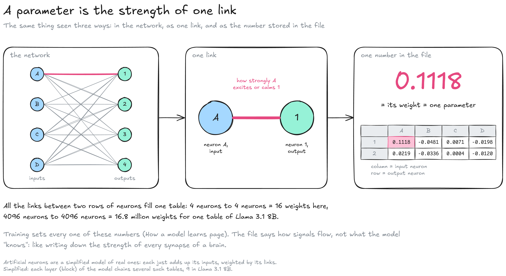
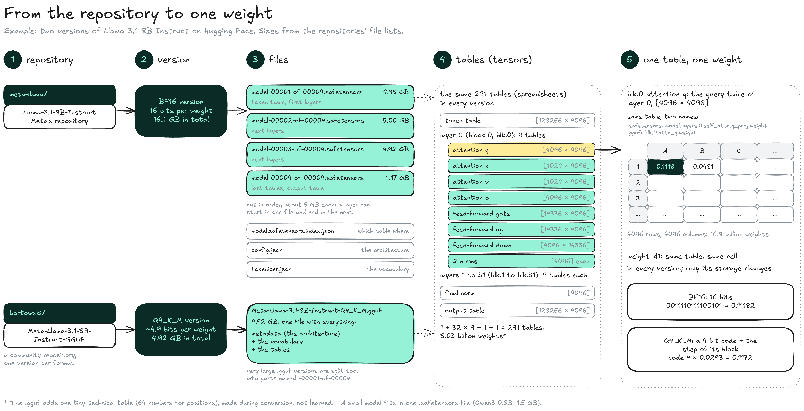
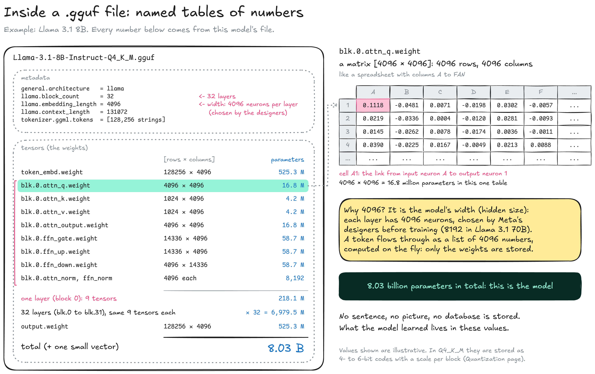

---
layout:
  width: default
  title:
    visible: true
  description:
    visible: false
  tableOfContents:
    visible: true
  outline:
    visible: true
  pagination:
    visible: true
  metadata:
    visible: true
  tags:
    visible: true
  actions:
    visible: true
  anchors:
    visible: true
---

# Inside a model

This page opens a model once it is saved: what its versions contain, how one number is stored, and how big the whole is. It uses **Llama 3.1 8B Instruct** as its example: every number in it comes from that model. Where the files come from is shown on the [Model](./) map; terms with several names are listed in the [Glossary](../../glossary.md).


**A model is stored as named tables of numbers.** Its size is the number of parameters times the space each one takes: 8.03 billion parameters at 2 bytes each = 16.1 GB in the BF16 version.


### A parameter is the strength of a link

A model is a network of artificial **neurons**. A row of input neurons is linked to a row of output neurons, every input to every output. Every link has a strength, and that strength is one number stored in the model.

<figure><figcaption></figcaption></figure>

* **Neuron:** A tiny calculation: it takes numbers in, multiplies each one by the strength of its link, and adds them up.
* **Weight:** The strength of one link: how much neuron A pushes neuron 1 up or down. A negative weight calms instead of excites.
* **Parameter:** Another name for a weight: one number set by training. Llama 3.1 8B has 8.03 billion of them.
* **Table:** All the links between two rows of neurons fill one table, with one column per input neuron and one row per output neuron. It reads like a spreadsheet, and this wiki draws it as one.

The diagram shows the simplest case: one table between two rows of neurons. A **layer** of the model, also called a **block**, chains several such tables: 9 in each of the 32 layers of Llama 3.1 8B (see below).

How training sets these numbers, and why the tables are multiplied rather than read, is explained on [How a model learns](how-a-model-learns.md). The files say how signals flow through the network, not what the model "knows": it is like writing down the strength of every synapse in a brain.

### From the repository to one weight

A model is published on [Hugging Face](https://huggingface.co) in one or more **versions**: the same model saved at different precisions. A version can be one file or several, but every version holds the same tables.

<figure><figcaption></figcaption></figure>

1. **Repository:** The model's page on Hugging Face. Meta's repository holds the BF16 version; community repositories hold quantized versions, one per format.
2. **Version:** The whole model at one precision. The BF16 version is four `.safetensors` files (16.1 GB); the Q4\_K\_M version is one `.gguf` file (4.92 GB).
3. **Files:** A `.safetensors` file holds only tables. Large versions are cut into files of about 5 GB, in order, without regard to layers, and `model.safetensors.index.json` says which table is in which file. The architecture (`config.json`) and the vocabulary (`tokenizer.json`) are separate. A `.gguf` file packs the tables, the architecture and the vocabulary together.
4. **Tables:** The same 291 tables (spreadsheets) in every version: the token table, 9 tables in each of the 32 layers, a final small table, and the output table. Only their names change with the format. The `.gguf` conversion adds one tiny technical table (64 numbers used for positions), computed during conversion, not learned.
5. **Weight:** One cell of one table. Weight A1 sits at the same place in every version; only the way its value is stored changes (16 bits in BF16, a 4-bit code plus a step in Q4\_K\_M).

A small model works the same way with fewer files: Qwen3-0.6B fits in a single `model.safetensors` of 1.5 GB.

### What is inside a version

A version is like a spreadsheet workbook: a short description of the design (the **metadata**) and hundreds of named sheets of numbers (the **tensors**). Each sheet is one table; each cell is one weight. The BF16 version is the same workbook stored in four files. The diagram opens the Q4\_K\_M `.gguf` file, which holds the metadata and the tables together.

<figure><figcaption></figcaption></figure>

* **Metadata:** The model's design, written down: 32 layers, a width of 4096, a context length of 131,072 tokens, and the vocabulary of 128,256 tokens. In the BF16 version, the same information is in `config.json` and `tokenizer.json`.
* **Tensor:** A named table of weights. Most are **matrices**, written \[rows × columns]: `blk.0.attn_q.weight` is \[4096 × 4096], so 16.8 million weights. In a `.safetensors` file the same table is named `model.layers.0.self_attn.q_proj.weight`.
* **Layer (block):** The network is a stack of 32 identical layers, also called blocks: `blk.0` to `blk.31` in a `.gguf`, `model.layers.0` to `model.layers.31` in a `.safetensors` file. Each layer holds the same 9 tensors with different values.
* **Width (hidden size):** 4096 neurons per layer. Meta's designers chose it before training, like the number of layers; training only fills in the values. Llama 3.1 70B is wider (8192). Every version of Llama 3.1 8B has the same width and the same tensor shapes.
* **Token vs parameter:** A token is a piece of text from the model's fixed vocabulary. Training texts, your prompt and the model's answers are all cut into tokens. While the model reads a token, it becomes a list of 4096 numbers, one per neuron, computed on the fly and then discarded. Only the weights are stored.
* **No stored content:** The files hold no sentences, pictures or database. The only words in them are the metadata and the vocabulary.

Where 8.03 billion parameters come from (Llama 3.1 8B)

| Part                        | \[rows × columns]       | Parameters        |
| --------------------------- | ----------------------- | ----------------- |
| Attention: query and output | \[4096 × 4096], twice   | 33.6 M per layer  |
| Attention: key and value    | \[1024 × 4096], twice   | 8.4 M per layer   |
| Feed-forward: gate and up   | \[14336 × 4096], twice  | 117.4 M per layer |
| Feed-forward: down          | \[4096 × 14336]         | 58.7 M per layer  |
| Two small tables (norms)    | \[4096], twice          | 8,192 per layer   |
| One layer: 9 tables         |                         | 218.1 M           |
| 32 layers                   |                         | 6.98 B            |
| Token table + output table  | \[128256 × 4096], twice | 1.05 B            |
| Final norm                  | \[4096]                 | 4,096             |
| **Total: 291 tables**       |                         | **8.03 B**        |

Every size here is a design choice: 4096 is the width, 1024 the size of keys and values (8 groups of 128, see the [KV cache](../inference/text-generation/kv-cache.md) page), 14336 the width of the feed-forward part, and **128,256 the number of tokens in the vocabulary.**

### How the tables connect

The tables are used in a fixed order. The diagram follows one token, " is", the last token of "The capital of France is".

<figure><figcaption></figcaption></figure>

1. **The token becomes a list:** A token is a piece of text from the model's vocabulary, known by its number: " is" is token 374 of 128,256. The token table has one row per token (128,256 rows, the vocabulary) and 4096 columns (the width, a design choice), and the model copies row 374: a list of 4096 numbers, such as \[0.0094, −0.0458, 0.0071, …] (illustrative values). Training set these numbers so that tokens used in similar ways get similar lists: the list is the model's learned description of the token.
2. **The list goes through the 32 layers, then becomes scores:** Each layer adjusts the list, using the earlier tokens of the text, so that by the end it describes what should come next. The output table then turns it into one score per token of the vocabulary; here " Paris" (token 12366) scores highest, and the sampler picks a token (see [Inference](../inference/)). The lists are computed for each token and discarded: only the tables are stored.
3. **Inside one layer:** The list meets the layer's 9 tables in two parts. Each table works like the [one-link diagram](inside-a-model.md#a-parameter-is-the-strength-of-a-link): a row of input neurons linked to a row of output neurons.
   * **Attention (q, k, v, o):** Mixes in information from the earlier tokens. The token's query (q) is compared with the keys (k) and values (v) of every earlier token; keys and values are kept in the KV cache so they are computed only once. How this comparison works will be explained on a **Transformer** page.
   * **Feed-forward (gate, up, down):** Works on this token alone. The list is widened from 4096 to 14,336 numbers, then brought back to 4096, which is where the 14,336 in the table sizes comes from.
   * **Norms:** The two small tables rescale the list before each part, to keep its numbers in a stable range.
   * **Added back:** Each part's result is added to the list that came in, so a layer adjusts the list instead of replacing it.

### Precision and size

Each weight is written in the files as a row of bits: 16 per weight in the BF16 version, about 4.9 in the Q4\_K\_M version. How a number is written in bits, and why it sets the size of a model (8.03 billion weights × 2 bytes = 16.1 GB), is explained on the [Precision](precision.md) page.

### Resources

* Model card: [Meta Llama 3.1 8B Instruct](https://huggingface.co/meta-llama/Llama-3.1-8B-Instruct) (architecture, BF16 release)
* Formats: [GGUF specification](https://github.com/ggml-org/ggml/blob/master/docs/gguf.md) | [safetensors documentation](https://huggingface.co/docs/safetensors)
