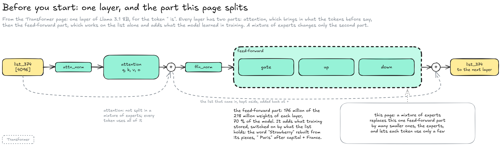
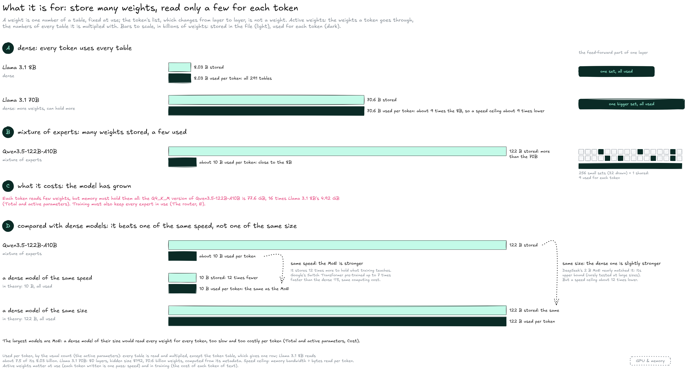
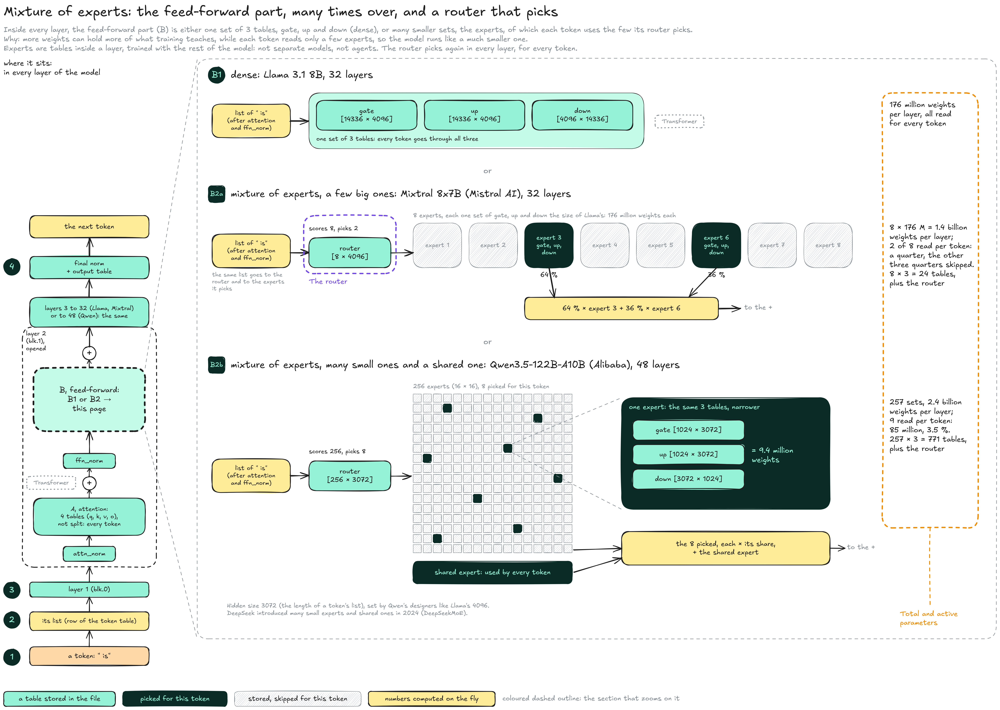
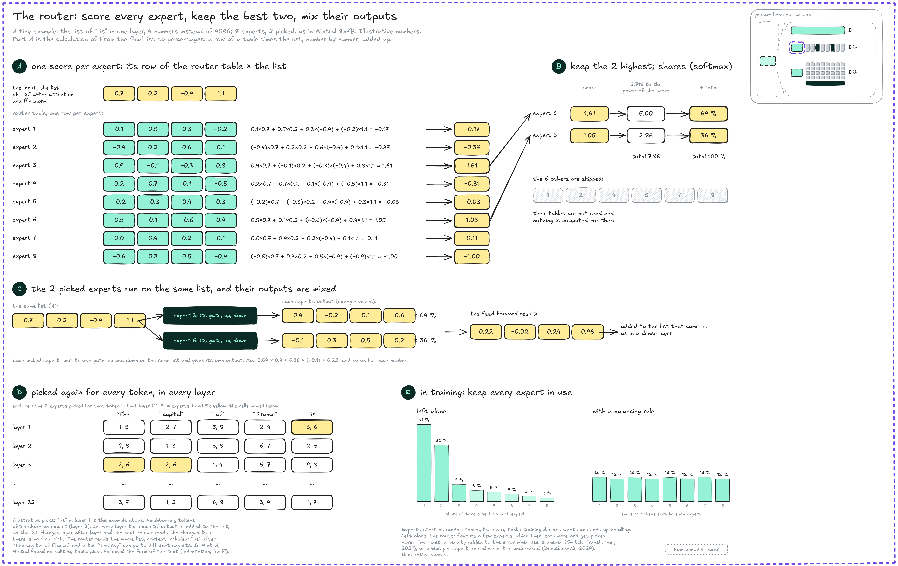
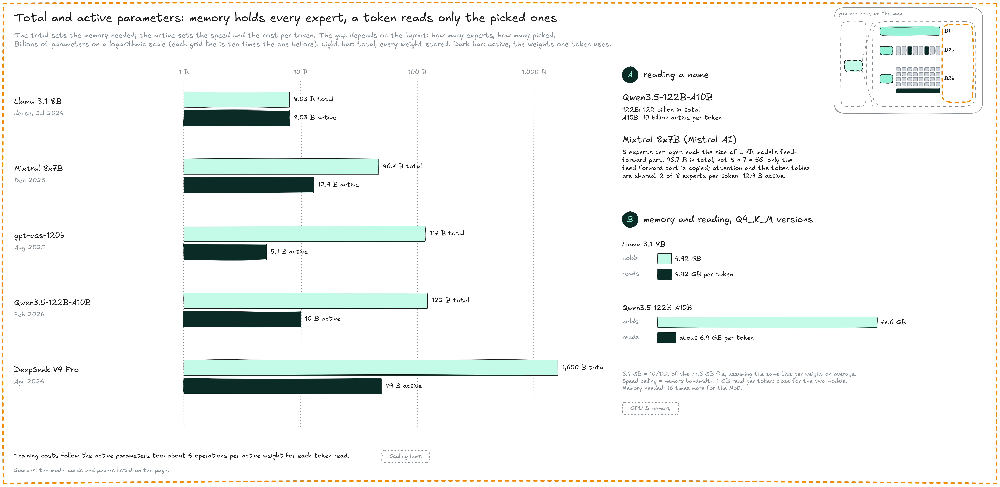

# Mixture of experts

A **mixture of experts** (MoE) replaces the [feed-forward](transformer.md#feed-forward) part of each layer by many smaller copies of it, the **experts**, each with its own gate, up and down tables, and adds a small table, the **router**, that sends each token to a few of them. This page zooms on the feed-forward step of [how the tables connect](./#how-the-tables-connect), part B2 of the Model map, and compares Llama 3.1 8B, Mixtral 8x7B (Mistral AI, December 2023) and Qwen3.5-122B-A10B (Alibaba, February 2026).

Experts are tables inside a layer, not separate models or agents. The name comes from a 1991 paper where each small network was meant to handle one kind of input ([Jacobs et al.](https://doi.org/10.1162/neco.1991.3.1.79)); in language models, experts do not split by topic (see [the router](mixture-of-experts.md#the-router), D). Google brought the idea to large networks ([Shazeer et al., 2017](https://arxiv.org/abs/1701.06538)) and to transformers (GShard, 2020; Switch Transformer, 2021); Mixtral 8x7B made it common in open-weight models, and DeepSeek introduced many small experts plus shared ones (2024), the layout Qwen3.5 uses.


**A mixture-of-experts model is large to store and light to run.** Memory must hold every expert; each token uses only the few its router picks, again in every layer.


#### Before you start

Every layer has two parts, and a mixture of experts changes only the second one.

<figure><figcaption></figcaption></figure>

* **Attention:** Brings in what the tokens before say. Every token uses all of it, in a mixture of experts too.
* **Feed-forward:** Three tables, gate, up and down, work on each list alone and add what the model learned in training, switched on by what the list holds: the word "Strawberry" rebuilt from its pieces, " Paris" after capital and France (see [feed-forward](transformer.md#feed-forward)). In Llama 3.1 8B they hold 176 million of the 218 million weights of each layer, 70 % of the model.

#### What it is for

More weights can hold more of what training teaches, but the time to write a token follows the weights used for it. A mixture of experts stores many weights and uses only a few for each token.

<figure><figcaption></figcaption></figure>

A weight is one number of a table, fixed at use; the token’s list, which changes from layer to layer, is not a weight. The **active weights** are the weights a token goes through: for each token computed, the numbers of every table it is multiplied with. In a dense model, that is every table; in a mixture of experts, attention, the norms, the output table and only the experts the router picks. At use, writing one token is one pass through the model, so fewer active weights means faster; in training, it means a cheaper token of text.

* **A, dense:** Every token uses every table, so a dense model that grows to hold more also uses more per token: Llama 3.1 70B uses 70.6 billion weights per token, about 9 times Llama 3.1 8B, and its [speed ceiling](../../inference/gpu-and-memory.md#capacity-and-bandwidth) is about 9 times lower.
* **B, mixture of experts:** The feed-forward weights are split into many experts, and each token uses only the few its router picks: Qwen3.5-122B-A10B stores 122 billion weights, more than Llama 3.1 70B, and uses about 10 billion per token, close to Llama 3.1 8B. A dense model of the same 122 billion would use all of them for every token (dashed bar).
* **C, the cost:** The model has grown: each token uses few weights, but memory must hold them all, 77.6 GB for the Q4\_K\_M version against 4.92 GB for Llama 3.1 8B. Training must also keep every expert in use (see [the router](mixture-of-experts.md#the-router), E).
* **D, compared with dense models:** A mixture of experts is not smarter than a dense model of the same total size, but than a dense model of the same speed. A dense model that uses all its weights for every token stays the stronger one: DeepSeek found its 2-billion-parameter MoE nearly matched a dense model with the same total parameters, which it calls the upper bound of MoE models ([DeepSeekMoE](https://arxiv.org/abs/2401.06066), 2024): few labs train both at large sizes to compare. At equal computation, MoE wins: Google’s Switch Transformer pre-trained up to 7 times faster with the same computing resources. A dense model the size of the largest MoE models would be too slow and too costly per token, which is why those are MoE.

#### The map

The map follows one token through the whole model and opens one layer: attention is not split, and the feed-forward part has one of three layouts. The coloured outlines are opened by the next two sections.

<figure><figcaption></figcaption></figure>

* **1 to 4, where it sits:** A token's list goes through every layer; in each, attention first, used by every token as in a dense model, then the feed-forward part. The router picks again in every layer: 8 experts in each of the 48 layers of Qwen3.5-122B-A10B.
* **The input:** The router and the experts read the same list, the token's list after attention and ffn\_norm, which by now carries information from the earlier tokens.
* **B1, dense (Llama 3.1 8B):** One set of 3 tables (gate, up, down), \[14336 × 4096] each: 176 million weights per layer, all used for every token.
* **B2a, a few big experts (Mixtral 8x7B):** 8 sets of the same size in each of its 32 layers, each with its own gate, up and down (not copies: each starts from random numbers and learns its own): 24 tables plus the router, instead of 3. The router picks 2 per token, so a token reads a quarter of the experts' weights and skips the other three quarters.
* **B2b, many small experts (Qwen3.5-122B-A10B):** 256 sets of narrower tables, 9.4 million weights each, in each of its 48 layers. The router picks 8, and a **shared expert** is used by every token: 9 sets of 257, 3.5 % of the experts' weights.

Many small experts can be combined in more ways than a few big ones, and the shared expert holds what every token needs. DeepSeek introduced this layout in 2024 (DeepSeekMoE).

#### The router

The router is one more learned table, with one row per expert. It reads the token's list, scores the experts the way the output table scores tokens, keeps the best few and mixes their outputs.

<figure><figcaption></figcaption></figure>

* **A, scores:** Each row of the router table is multiplied number by number with the token's list, and the products are added: one score per expert, the calculation of [from the final list to percentages](./#from-the-final-list-to-percentages).
* **B, the picks:** The 2 highest scores are kept and turned into shares (softmax): 64 % for expert 3, 36 % for expert 6. The other 6 experts are skipped: their tables are not read.
* **C, the mix:** Each picked expert runs its own gate, up and down on the same list, the list of A, and gives its own output (example values in the diagram). The outputs are multiplied by their shares and added, then added to the list that came in.
* **D, every token, every layer:** The picks change from token to token and from layer to layer. In every layer the experts' output is added to the list, so the list changes layer after layer and the next router reads the changed list: there is no final pick. The router reads the whole list, context included, so " is" after "The capital of France" and after "The sky" can go to different experts. In Mixtral, Mistral found no split of experts by topic, one for biology and one for code: picks followed the form of the text more, such as the indentation of code.
* **E, in training:** Experts start as random tables, like every table, and the router is trained with them and with the rest of the model, by [backpropagation](../how-a-model-learns.md#training); training decides what each expert ends up handling. Left alone, it favours a few experts, which then learn more and get picked more; labs add a penalty to the error when use is uneven, or a bias per expert, raised while it is under-used (DeepSeek-V3).

#### Total and active parameters

A mixture-of-experts model has two sizes: its **total parameters**, every weight stored, and its **active parameters**, the weights one token uses. The total sets the memory needed; the active sets the speed and the cost per token. The gap depends on the layout: how many experts, and how many the router picks.

<figure><figcaption></figcaption></figure>

* **Reading a name:** In Qwen3.5-122B-A10B, `122B` is the total and `A10B` the active count, 10 billion (see **Families & names**). Names give both because they answer two questions: will it fit in memory, and how fast will it run. Mixtral 8x7B has 46.7 billion parameters, not 8 × 7 = 56: only the feed-forward part is copied 8 times, while attention and the token tables are shared.
* **Memory:** The whole model must fit. The Q4\_K\_M version of Qwen3.5-122B-A10B is 77.6 GB, 16 times Llama 3.1 8B's 4.92 GB.
* **Speed:** A token reads only its active weights, about 6.4 GB at the same bits per weight, so its [speed ceiling](../../inference/gpu-and-memory.md#capacity-and-bandwidth) is close to Llama 3.1 8B's. Large unified memory, as on a Mac, suits these models; on a PC, llama.cpp can keep the experts in system RAM and the rest in VRAM (`--cpu-moe`), since each token reads only a few of them.
* **Cost:** Training and running cost about as much per token as a dense model of the active size, so the largest open-weight models are MoE: DeepSeek V4 Pro (April 2026) stores 1.6 trillion parameters and uses 49 billion per token.
* **Closed models:** Google described Gemini 2.5 (2025) as sparse mixture-of-experts transformers, without giving sizes ([Gemini 2.5 report](https://arxiv.org/abs/2507.06261)). OpenAI and Anthropic do not publish the design of GPT or Claude; OpenAI's open-weight gpt-oss is a mixture of experts.

#### Resources

* Papers: [Jacobs et al., Adaptive Mixtures of Local Experts](https://doi.org/10.1162/neco.1991.3.1.79) (1991: the first mixture of experts) | [Shazeer et al., Outrageously Large Neural Networks](https://arxiv.org/abs/1701.06538) (Google, 2017: the sparsely-gated layer) | [Mixtral of Experts](https://arxiv.org/abs/2401.04088) (Mistral AI, 2024: 8 experts, 2 per token, routing analysis) | [DeepSeekMoE](https://arxiv.org/abs/2401.06066) (2024: many small experts, shared experts) | [Switch Transformers](https://arxiv.org/abs/2101.03961) (Fedus et al., 2021: the balancing penalty) | [DeepSeek-V3 Technical Report](https://arxiv.org/abs/2412.19437) (balancing with a bias per expert)
* Models: [Mistral, Mixtral 8x7B model card](https://ai.azure.com/catalog/models/mistralai-Mixtral-8x7B-v01) (46.7 B total, 12.9 B per token) | Qwen3.5-122B-A10B: [Vultr model page](https://docs.vultr.com/models/alibaba-qwen-35/qwen3.5-122b-a10b/nvidia) (hidden size 3,072, 48 layers, 8 routed + 1 shared experts) and [ApX](https://apxml.com/models/qwen35-122b-a10b) (experts 1,024 wide) | [bartowski, Qwen3.5-122B-A10B GGUF](https://huggingface.co/bartowski/Qwen_Qwen3.5-122B-A10B-GGUF) (77.62 GB in Q4\_K\_M) | [gpt-oss model card](https://arxiv.org/abs/2508.10925) (116.8 B total, 5.1 B active, 128 experts, 4 per token) | [vLLM recipes, DeepSeek V4 Pro](https://recipes.vllm.ai/deepseek-ai/DeepSeek-V4-Pro) (1.6 T total, 49 B active)
* Engine: [llama-server options](https://manpages.debian.org/unstable/llama.cpp-tools/llama-server.1.en.html) (`--cpu-moe`, `--n-cpu-moe`)
