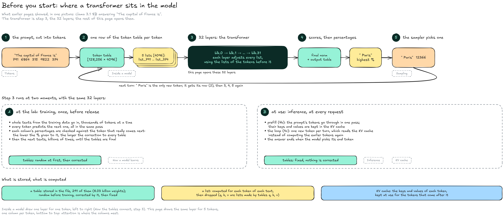
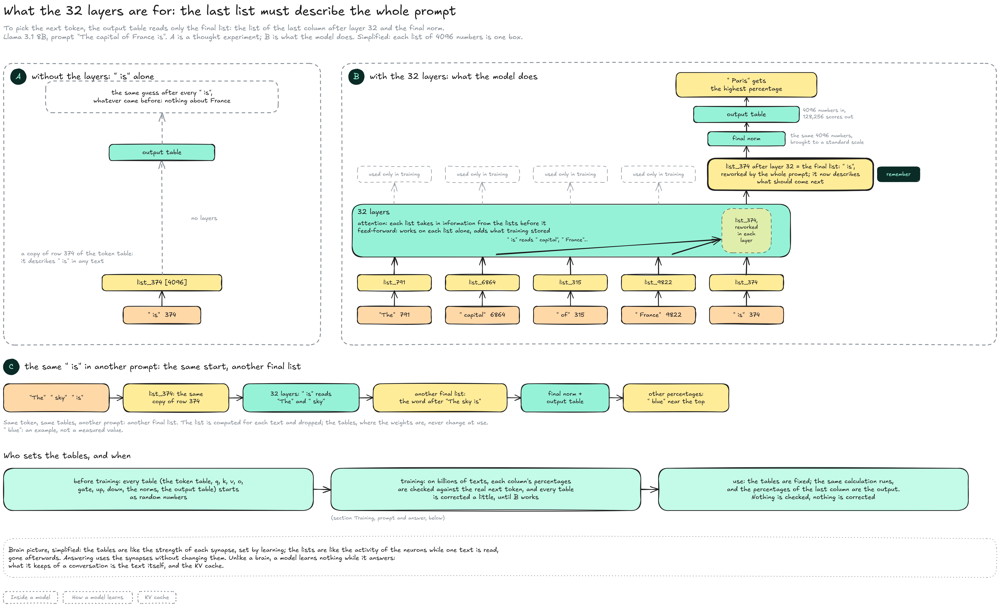
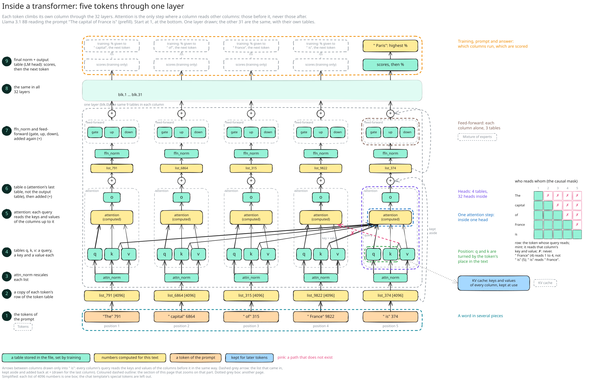
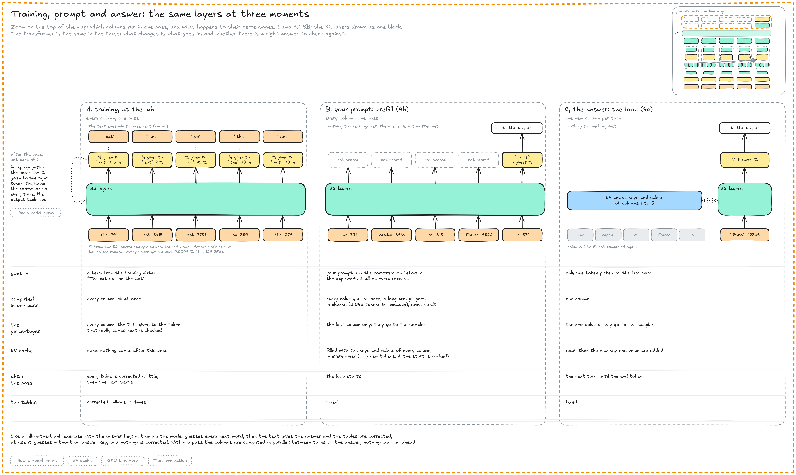
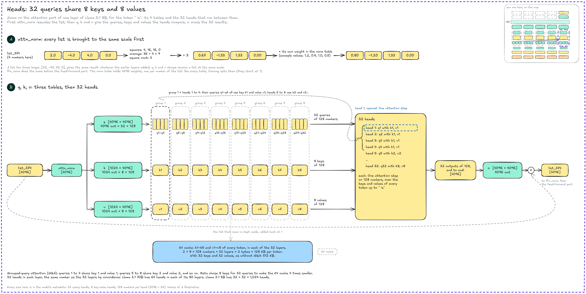
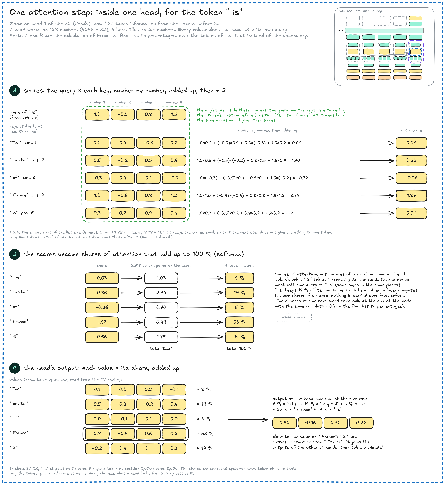
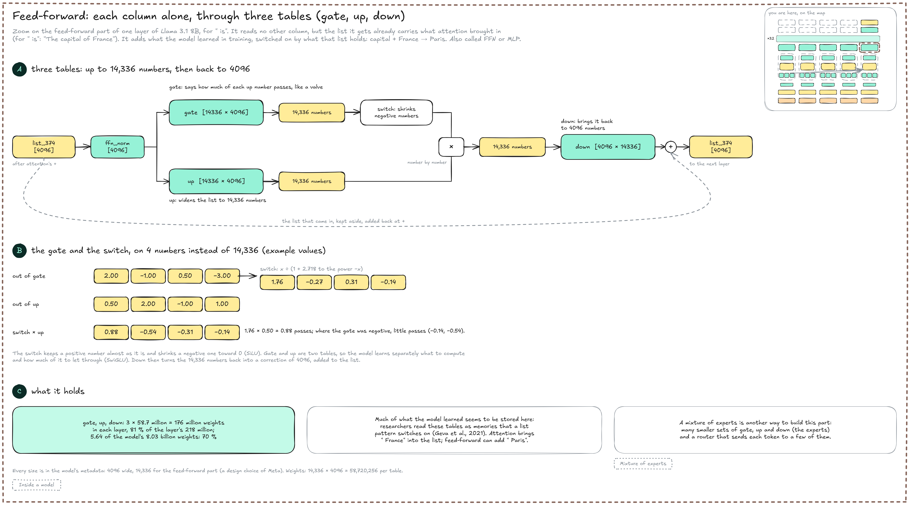
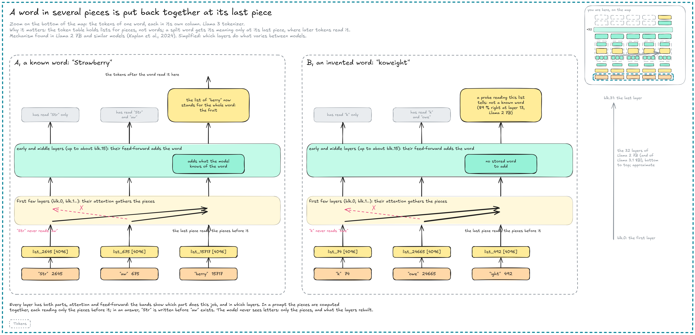

# Transformer

A **transformer** is the design of almost every current language model: a stack of identical layers, each with an attention part and a feed-forward part (the T of GPT, from the 2017 paper _Attention Is All You Need_). This page zooms on step 3 of [how the tables connect](./#how-the-tables-connect), the inside of a layer, with Llama 3.1 8B reading "The capital of France is". Before 2017, models read a text one word after another; [History › Transformers](../../../history/overview/transformers-2017-2021.md) shows what changed.


**A transformer is the shape of the model, not a training method.** The same 32 layers run when the lab trains the model and every time you use it. Inside each layer, attention is the only step where tokens exchange information, and a token reads itself and every token before it, never one that comes after.


#### Before you start

The notions this page relies on, from earlier pages, in one picture. Step 3, the 32 layers, is what a transformer is.

<figure><figcaption></figcaption></figure>

* **Steps 1 to 5:** Each token's number selects its row of the token table, a list of 4096 numbers; the 32 layers rework the lists; the output table scores every token of the vocabulary; the sampler picks one, and only that token goes round to the next turn (see [Inside a model](./) and [Text generation](../../inference/text-generation/)).
* **A, training:** The lab feeds whole texts; at every token, the percentage given to the real next token is checked, and the gaps correct the tables, billions of times; then the tables are final (see [How a model learns](../how-a-model-learns.md)).
* **B, use:** The tables are fixed. The prompt is read in one pass (prefill), then the answer comes one token per turn, and the [KV cache](../../inference/text-generation/kv-cache.md) keeps each token's keys and values so that earlier tokens are not computed again.
* **Stored or computed:** Tables are stored in the file: random before training, corrected by it, then fixed. Lists are computed for each text and dropped; the query, key and value are lists made by the tables q, k and v, and at use the keys and values are kept in the KV cache.

#### What the layers are for

To pick the next token, the output table reads only the **final list**: the list of the last column after layer 32 and the final norm. The 32 layers are there to bring the whole prompt into that list.

<figure><figcaption></figcaption></figure>

* **A, without the layers:** `list_374` is a copy of row 374 of the token table: it describes " is" in any text. Sent straight to the output table, it would give the same guess after every " is", whatever came before.
* **B, with the layers:** In each layer, attention brings information from the earlier tokens into the list (here " capital" and " France"), and the feed-forward part adds what training stored. After layer 32, `list_374` is the final list: still the list of " is", reworked by the whole prompt, so that it describes what should come next. The final norm brings its 4096 numbers to a standard scale without changing how many there are; the output table (also called the LM head; not table o, which sits inside each layer) turns them into 128,256 scores, and " Paris" gets the highest percentage.
* **C, another prompt:** In "The sky is", " is" starts from the same row 374 and goes through the same tables, but reads other tokens, so its final list differs and so do the percentages. The list is computed for each text and dropped; the weights are in the tables, which do not change at use.
* **Who sets the tables:** They start as random numbers. Training corrects them on billions of texts until B works (see [Training, prompt and answer](transformer.md#training-prompt-and-answer)); at use they are fixed, and the same calculation gives the percentages.

In a brain, the tables would be the strength of the synapses, set by learning, and the lists the activity of the neurons while one text is read. Unlike a brain, a model learns nothing while it answers: it keeps only the text of the conversation and its KV cache.

#### The map

One layer, drawn for the five tokens of the prompt: each token climbs its own column, from 1 at the bottom to 9 at the top. Each coloured outline is a part that a later section opens.

<figure><figcaption></figcaption></figure>

1. **Tokens:** One column per token, in order: "The" is position 1, " is" position 5.
2. **Lists:** Each column starts as a copy of its token's row of the token table: `list_791` for "The", `list_374` for " is", 4096 numbers each.
3. **attn\_norm:** Brings each list to the same scale (see [Heads](transformer.md#heads)).
4. **q, k, v:** Three tables turn each list into a **query** (what the token looks for), a **key** (what it offers) and a **value** (what it passes on).
5. **Attention:** Each column compares its query with the keys of every column up to it, from “The” to itself, and takes a mix of their values (see [One attention step](transformer.md#one-attention-step)). It is the only step where columns read each other, and none reads a later one: " France" (4) never reads " is" (5), while " is" reads " France". This rule is the **causal mask** (grid on the right).
6. **o, +:** Table o, the last table of the attention part, turns the mix into a correction, added to the list that came in (dashed grey arrow): a layer adds, it does not replace. Table o is not the output table, which comes once, after the last layer.
7. **Feed-forward, +:** ffn\_norm, then three tables (gate, up, down) work on each column alone, and the result is added again (see [Feed-forward](transformer.md#feed-forward)). Some models split this part into experts (see [Mixture of experts](mixture-of-experts.md)).
8. **32 layers:** The 31 other layers repeat 3 to 7, each with its own tables.
9. **Scores:** After the final norm, the output table (LM head) scores the last column, and " Paris" gets the highest percentage. The other columns are scored only in training, against the token that follows them in the text.

#### Training, prompt and answer

The same layers run at three moments: when the lab trains the model, when the model reads your prompt, and when it writes the answer. What changes is what goes in, how many columns run in one pass, and whether there is a right answer to check the percentages against.

<figure><figcaption></figcaption></figure>

* **A, training:** The text is known, so all its columns run in one pass, and each column's percentages are checked against the token that really follows: "The cat sat on the mat" gives 5 checks at once. The correction is not part of the pass: after it, **backpropagation** goes back from the gaps and corrects every table, the output table and the token table included, all in the same step; the lower the percentage given to the right token, the larger the correction (see [training](../how-a-model-learns.md#training)). The lists are not kept: the next pass recomputes them with the corrected tables. Before training the tables are random, so every token gets about 1 chance in 128,256; across texts "The" is followed by many words, so its column ends up spreading its percentages.
* **B, prefill:** Your prompt has no answer to check against: its columns run in one pass, and only the last one's percentages are used, by the sampler. Their keys and values fill the KV cache; if the engine still holds the cache for the same beginning of the conversation, only the new tokens are computed. A long prompt is read in chunks (2,048 tokens by default in llama.cpp), with the same result.
* **C, the loop:** The next token does not exist until the sampler picks it, so each turn adds one column: " Paris" reads the cached keys and values of the five columns before it and its own, then adds its own to the cache.

Training works like a fill-in-the-blank exercise with the answer key; use is the same guess without the key, so nothing is corrected. Within a pass the columns are computed in parallel (see [GPU & memory](../../inference/gpu-and-memory.md)); at position 100,000, a token's query meets 100,000 keys, in each head of each layer.

#### Heads

The attention part of a layer has 4 tables, q, k, v and o, after its norm. Between them run 32 **heads**, each comparing its own query with the keys, so that one layer can follow several relations at once.

<figure><figcaption></figcaption></figure>

* **A, attn\_norm:** The list is divided by the typical size of its numbers (the square root of the average of their squares), then each number is multiplied by its own weight in the norm table, set by training like every table. The list keeps its 4096 numbers; only their scale changes, so every list reaches q, k and v at the same scale, whatever the earlier layers added. ffn\_norm does the same before the feed-forward part, and the final norm before the output table.
* **B, q, k, v:** q gives 4096 numbers, cut into 32 queries of 128; k and v give 1024 each, 8 keys and 8 values of 128. This is why `attn_k` and `attn_v` are \[1024 × 4096] while `attn_q` is \[4096 × 4096] (see [what is inside a version](./#what-is-inside-a-version)). The 128 numbers describe something only together, like the three numbers of a colour code, except that no single one has a name: training settles what they mean.
* **Groups:** Heads 1 to 4 compare their queries with key 1 and mix value 1, heads 5 to 8 use key 2 and value 2, and so on: **grouped-query attention** (GQA). The KV cache then keeps 8 keys and 8 values per token and layer instead of 32, 4 times less memory.
* **o:** The 32 outputs of 128 numbers are put end to end, 4096 numbers, and table o mixes them into one list, added to the list that came in.

32 heads in each of 32 layers is a coincidence of this model: Llama 3.1 70B has 64 heads in each of its 80 layers. Nobody decides what a head looks for: training settles it. Researchers have found heads that follow the previous token, and heads that find an earlier occurrence of the current token and copy what came after it (induction heads); most are harder to name.

#### One attention step

Inside one head, " is" compares its query with the keys of the tokens up to it, turns the scores into shares and mixes the tokens' values. Every column does the same with its own query; the diagram shrinks 128 numbers to 4. The name comes from translation models of 2014, where these shares showed which words of the source sentence the model paid attention to while writing each word ([Bahdanau et al.](https://arxiv.org/abs/1409.0473)).

<figure><figcaption></figcaption></figure>

* **A, scores:** The query of " is" is multiplied number by number with the key of each token up to it, and the products are added: the calculation of a score in [from the final list to percentages](./#from-the-final-list-to-percentages). The angles are inside these numbers: the query and the keys were turned by their positions before (see [Position](transformer.md#position)), so the same words 500 tokens apart would give other scores. Dividing by the square root of the list size (√128 ≈ 11.3 in Llama 3.1 8B) keeps the scores small.
* **B, shares:** Softmax turns the 5 scores into shares of attention that add up to 100 %: how much of each token's value " is" takes. They are not chances of a word, which come only at the end of the model. " France" gets 53 %: its key agrees most with the query of " is".
* **C, the mix:** Each token's value is multiplied by its share, and the five results are added. The output is close to the value of " France": the list of " is" now carries information about France.

At use, the [KV cache](../../inference/text-generation/kv-cache.md) keeps the keys and values of earlier tokens, so only the new token's query, key and value are computed; no query is kept, since only the new token asks. The shares are computed again, from zero, in every head of every layer.

#### Position

The attention score of [One attention step](transformer.md#one-attention-step), the query of " is" × the key of " France" in each head of each layer, compares what they say, not where their tokens are, yet the distance between two words matters. A token's **position** is its place in the text: "The" is 1, " France" 4, " is" 5 (not its token number, 9822 for " France"). Llama turns each query and key according to its position before the scores, so that the score knows how far apart the two tokens are: **rotary position embedding** (RoPE).

<figure><figcaption></figcaption></figure>

* **A, the problem, and what turning changes:** Without turning, the same query and the same key give the same score whether " France" is just before " is" or 500 tokens back, yet some heads look for the token just before (see [Heads](transformer.md#heads)). Turned, the same pair gives 0.87 at 1 token apart and −0.50 at 500 apart in the diagram: the score now depends on the distance.
* **B, the idea:** The 128 numbers of a query or a key (4096 ÷ 32 heads) are grouped two by two into 64 **pairs**, each drawn as a point on a dial; a pair is two numbers of one query or key, not two tokens. Each pair is turned like a clock hand, by an angle that grows with its token's position: " France" (4) by 120° and " is" (5) by 150° in the diagram, so pair 1 of the query of " is", (0.8, 0.6), becomes (−0.99, −0.12). What a score sees is the gap between the two hands, 30° for tokens 1 apart, at positions 4 and 5 as at 104 and 105: the gap is the distance.
* **C, why the gap changes the score:** Turning a pair keeps what it says (its length) and changes only its direction, and the product of two pairs depends only on the angle between them: 1.0 at the same angle, 0 at 90° for the pairs of the diagram. Training sets tables q and k so that a head scores high at the gaps it needs.
* **D, where it happens:** Every token makes a query and a key, and turns both by the angle of its own position. Its query is used when it reads (" France" reading " capital"), its key when it is read (" is" reading " France"); any two tokens are compared this way, "The" (1) and " is" (5) too. The 3.74 of One attention step, before ÷ 2, is the turned query of " is" times the turned key of " France": the positions are not added to the sum, they turned the query and the key before it, in every layer. The KV cache keeps the keys already turned; values are never turned.
* **E, 64 speeds at once:** Nothing is chosen: every score adds the products of all 64 pairs. The fastest pair turns 57° per token and tells neighbours apart; the slowest needs 2.6 million tokens for a full turn and keeps track of long distances. All the speeds come from one design number in the metadata, the base: 500,000 in Llama 3.
* **F, the 64-number table:** A Llama 3.1 `.gguf` holds one more table, `rope_freqs.weight`, with one number per pair, how much slower that pair turns: 1 for the 29 fastest, 8 for the 29 slowest, in between for the 6 in the middle. Meta set this scaling when it extended the context from 8,192 tokens (Llama 3) to 131,072 (Llama 3.1). It is not learned: the converter computes it from `config.json`, so the `.gguf` holds 292 tables. The other diagrams of the wiki count the 291 tables of weights, the model itself; this one is a constant stored for convenience.

#### Feed-forward

The second part of each layer works on each column alone: it reads no other token, but the list it gets already carries what attention brought in (for " is", "The capital of France"). Feed-forward adds what the model learned in training, switched on by what that list holds (a word, a fact), with three tables, gate, up and down (also called the FFN or MLP).

<figure><figcaption></figcaption></figure>

* **A, three tables:** After ffn\_norm, tables gate and up each turn the 4096 numbers into 14,336; down brings the result back to 4096, a correction added to the list that came in. Up widens the list; gate says how much of each of up's numbers passes, like a valve.
* **B, the gate and the switch:** Gate's numbers first go through a switch (SiLU) that keeps positive numbers almost as they are and shrinks negative ones toward 0; the result is multiplied number by number with up's. Where the gate is strongly positive, up's number passes; where it is negative, little does. This design is called SwiGLU.
* **C, what it holds:** Gate, up and down hold 176 million of the 218 million weights of each layer, 70 % of the whole model. Much of what the model learned seems to be stored there: researchers read these tables as memories that a pattern in the list switches on (Geva et al., 2021).

A **mixture of experts** is another way to build this part: many smaller sets of gate, up and down tables, the experts, and a router that sends each token to a few of them (see [Mixture of experts](mixture-of-experts.md)).

#### A word in several pieces

A word cut into several tokens enters the model as several columns. The token table holds lists for pieces, not for words, so the model puts the word back together at its last piece, where the tokens after it read it.

<figure><figcaption></figcaption></figure>

* **One piece at a time:** In "Strawberry", cut into "Str", "aw" and "berry" (see [Tokens](../../inference/text-generation/tokens.md)), the column of "Str" never reads "aw". In a prompt the pieces are computed together, each reading only the pieces before it; in an answer, "Str" is written before "aw" exists.
* **Gathered at the last piece:** "Strawberry" is not a token, so there is no column for the whole word; "berry" is the only column that has read all three pieces, since no column reads a later one. Every layer has both parts, but each does this job in different layers: in the first few, the attention of "berry" puts a large share on "Str" and "aw"; in the early and middle layers, the feed-forward part adds what the model knows about the whole word. Researchers measured this in Llama 2 7B and similar models.
* **Known or invented:** An invented word such as "koweight" ("k", "owe", "ight") is gathered the same way; the feed-forward parts still run, but find no stored word to add, and the list keeps what its pieces and the context say. A typo sits in between: its pieces differ from the real word's, yet models often recover it from the pieces and the context (GPT-4 restored sentences whose letters were shuffled in every word, [Cao et al., 2023](https://arxiv.org/abs/2311.18805)). A probe, a small classifier the researchers trained on these lists, tells real words from invented ones 89 % of the time at layer 13 of Llama 2 7B.

The model never sees letters, only pieces and what its layers rebuild from them, which is why counting the r's of "Strawberry" is hard for it (see **Limits**).

#### Other designs

Most current models change the details of this plan, not the plan itself.

* **Encoder-decoder:** The 2017 design, built for translation, had two stacks: an **encoder** that read the sentence to translate without a mask, and a **decoder** that wrote the translation with it. Llama and GPT models keep only the decoder (**decoder-only**); models built only to read text, such as BERT, keep the encoder. In the paper's figure, reused in many articles, the output table is labelled Linear.
* **Experts:** The feed-forward part split into experts, a few used per token (Mixture of experts).
* **Lighter attention:** Keys and values stored compressed (MLA, DeepSeek), attention limited to recent tokens in some layers (gpt-oss), or replaced in most layers by a mechanism with a fixed-size state (36 of the 48 layers of Qwen3.5-122B-A10B). All shrink the KV cache (see [what labs do about it](../../inference/text-generation/kv-cache.md#what-labs-do-about-it)).
* **Pictures:** Image models such as Flux and Stable Diffusion 3 use a transformer in place of the older U-Net, working on patches of the latent (a diffusion transformer, DiT; see [Image & video](../../inference/image-and-video.md)). The vision encoder of a multimodal model is a transformer too (see **Multimodal models**).

#### Resources

* Papers: [Attention Is All You Need](https://arxiv.org/abs/1706.03762) (Vaswani et al., 2017) | [Bahdanau et al., Neural Machine Translation by Jointly Learning to Align and Translate](https://arxiv.org/abs/1409.0473) (2014: attention, added to translation models) | [Shazeer, GLU Variants Improve Transformer](https://arxiv.org/abs/2002.05202) (2020: SwiGLU, the gate of the feed-forward part) | [GQA](https://arxiv.org/abs/2305.13245) (Ainslie et al., 2023) | [RoFormer](https://arxiv.org/abs/2104.09864) (Su et al., 2021: rotary position embedding) | [Scalable Diffusion Models with Transformers](https://arxiv.org/abs/2212.09748) (Peebles and Xie: DiT)
* Llama 3.1: [The Llama 3 Herd of Models](https://arxiv.org/abs/2407.21783) (32 heads, 8 key-value heads, RoPE base 500,000, context raised from 8K to 128K in six stages) | [llama.cpp, Llama converter](https://github.com/ggml-org/llama.cpp/blob/master/conversion/llama.py) (`rope_freqs` computed from `rope_scaling`)
* Inside the layers: [Geva et al., Transformer Feed-Forward Layers Are Key-Value Memories](https://arxiv.org/abs/2012.14913) (EMNLP 2021: what feed-forward parts store) | [Kaplan et al., From Tokens to Words](https://arxiv.org/abs/2410.05864) (words rebuilt at their last piece; probe at layer 13) | [Olsson et al., In-context Learning and Induction Heads](https://transformer-circuits.pub/2022/in-context-learning-and-induction-heads/index.html) (Anthropic, 2022)
* Videos: [3Blue1Brown, Transformers, the tech behind LLMs](https://www.3blue1brown.com/lessons/gpt) (chapter 5: the whole model, visually) | [3Blue1Brown, Attention in transformers](https://www.youtube.com/watch?v=eMlx5fFNoYc) (chapter 6: queries, keys and values, visually) | [Andrej Karpathy, Let's build GPT](https://www.youtube.com/watch?v=kCc8FmEb1nY) (2023: a small transformer written in code, two hours)
