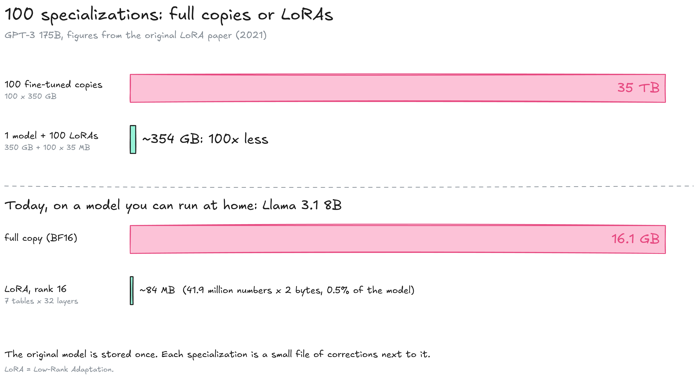
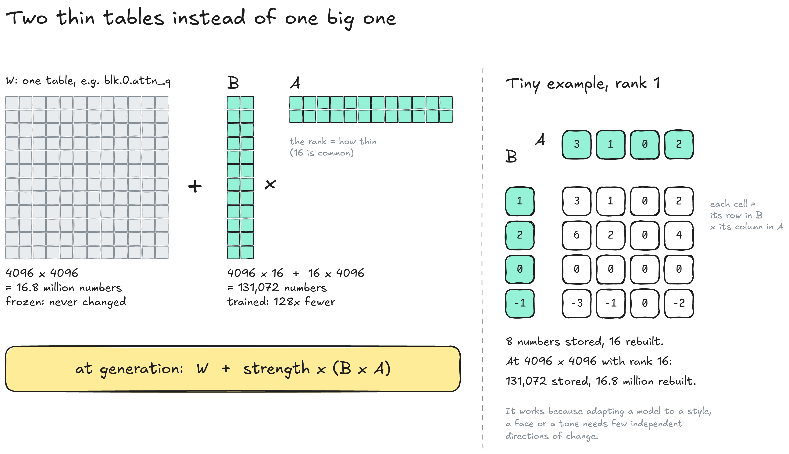
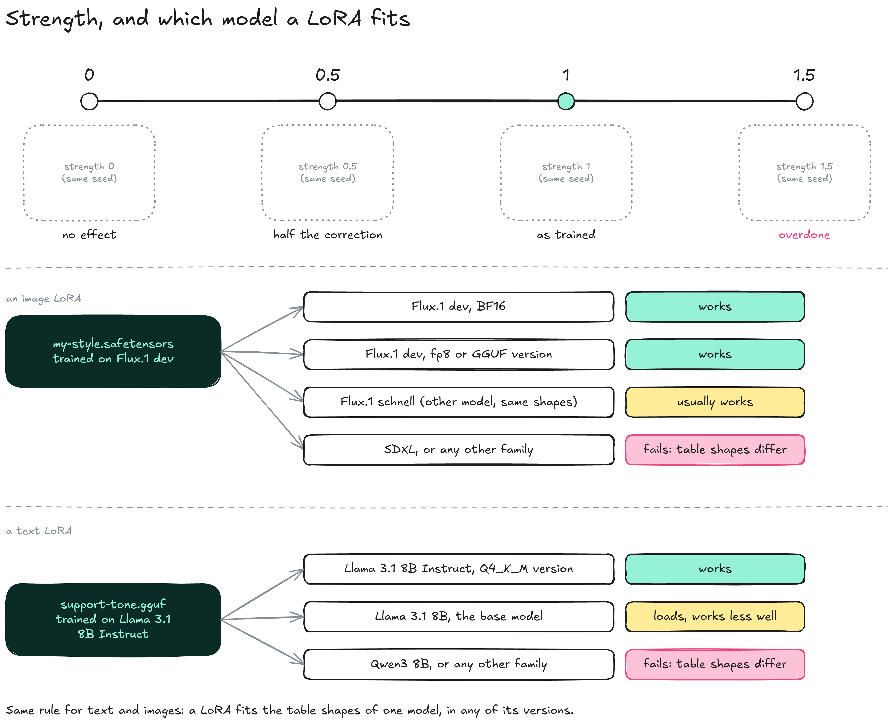

---
layout:
  width: default
  title:
    visible: true
  description:
    visible: false
  tableOfContents:
    visible: true
  outline:
    visible: true
  pagination:
    visible: true
  metadata:
    visible: true
  tags:
    visible: true
  actions:
    visible: true
  anchors:
    visible: true
---

# LoRA

A **LoRA** (Low-Rank Adaptation) is a small file of corrections trained for one specific model. Loaded on top of that model, it teaches an image model a face, a product or a style, and a text model a tone, a vocabulary or a task, without changing the model's own files. It is step 7 on the [Model](./) map: fine-tuning, optional, done by anyone after the model is published.


**A LoRA only works on top of the model it was trained for.** It is a set of corrections, not a model: on its own, it generates nothing.


### Copies or corrections

Fine-tuning a model on your own examples used to mean training all its parameters again (a **full fine-tune**) and saving a complete new copy. A LoRA freezes the model and trains a small separate file instead.

<figure><figcaption></figcaption></figure>

* **Full fine-tune:** Every specialization is a complete new model. 100 specialized copies of GPT-3 (175B) would take 35 TB.
* **LoRA:** The original model is stored once, plus one small file per specialization: about 354 GB for the same 100 specializations, figures from the original LoRA paper.
* **At home:** A rank-16 LoRA on the 7 matrices of each of the 32 layers of Llama 3.1 8B (q, k, v, o, gate, up, down) holds about 42 million numbers, 0.5 % of the model: roughly 84 MB at 16 bits.
* **Reversible:** Removing the file gives back the original model, unchanged.

### How it works

Adapting a model to a style, a face or a task changes its behaviour along few independent directions, so the correction can be described with far fewer numbers than the table it corrects. A LoRA stores it as two thin tables whose product has the full size.

<figure><figcaption></figcaption></figure>

* **W:** One table of the model, for example `blk.0.attn_q` (see [Inside a model](inside-a-model.md)): 4096 × 4096 = 16.8 million weights. Frozen during training.
* **B and A:** Two thin tables of 4096 × 16 and 16 × 4096: 131,072 numbers, 128 times fewer. Only these are trained, with the same loop as any training (see [How a model learns](how-a-model-learns.md)).
* **Rank:** The thin dimension (16 here). Higher ranks capture more detail and make bigger files; 8 to 64 is common.
* **At generation:** The engine uses W + strength × (B × A). Each table the LoRA targets has its own pair of thin tables.

**QLoRA** combines this with [quantization](quantization/): the model is loaded in a 4-bit version and the LoRA trains on top of it. It made it possible in 2023 to fine-tune a 65B model on a single 48 GB GPU.

### Using a LoRA

A LoRA is loaded after the model, with a **strength** that scales its correction.

<figure><figcaption></figcaption></figure>

* **Images:** In [ComfyUI](https://github.com/Comfy-Org/ComfyUI), a LoRA loader node placed after the model loader, with one strength slider.
* **Text:** [llama.cpp](https://github.com/ggml-org/llama.cpp) takes `--lora` (strength 1) or `--lora-scaled` (your strength), with the LoRA converted to `.gguf`; [Ollama](https://ollama.com) adds it with an `ADAPTER` line in a Modelfile.
* **Strength 0:** The LoRA is loaded but has no effect.
* **Strength 1:** The correction as it was trained. The starting point.
* **Above 1:** The effect is exaggerated and the output degrades quickly. A weak effect at 1 usually comes from the LoRA or the prompt, not the strength.
* **Below 1:** Useful to tone down a LoRA or combine two of them.

A LoRA's tables have the shapes of one model's tables, so it fits every version of that model (BF16, fp8, GGUF), and often another model of the same family with the same architecture, such as Flux.1 schnell, a distilled model with the shapes of Flux.1 dev. On another family the shapes differ, and loading fails or does nothing. A LoRA trained on Llama 3.1 8B Instruct also loads on the base model, since the shapes are the same, but its corrections were learned on the Instruct weights and work best there.

Download pages call the model a LoRA was trained on its "base model", whatever that model is, Instruct models included. On the [Model](./) page, base model has a narrower meaning: the model before post-training.



#### Before downloading

* [ ] Check the model named on the LoRA's page: the same family and size as yours
* [ ] Prefer `.safetensors` files (or `.gguf` for llama.cpp), like for models



#### Loading

* [ ] Load the model first, then the LoRA
* [ ] Start at strength 1, with a fixed seed



#### Adjusting

* [ ] Compare outputs at the same seed while changing only the strength



### What LoRAs are used for

| Domain | Typical LoRA                                                                                         |
| ------ | ---------------------------------------------------------------------------------------------------- |
| Image  | A face, a character, a product, a graphic style that comes back in every generation                  |
| Video  | Speed LoRAs ("lightning") that generate in about 4 steps instead of dozens                           |
| Text   | A tone, a domain vocabulary, an imposed answer format, a narrow task such as sorting support tickets |

### Resources

* Papers: [LoRA, Hu et al. 2021](https://arxiv.org/abs/2106.09685) | [QLoRA, Dettmers et al. 2023](https://arxiv.org/abs/2305.14314)
* Loading: [llama.cpp server README](https://github.com/ggml-org/llama.cpp/blob/master/tools/server/README.md) (`--lora`, `--lora-scaled`) | [Ollama Modelfile reference](https://docs.ollama.com/modelfile) (`ADAPTER`)
