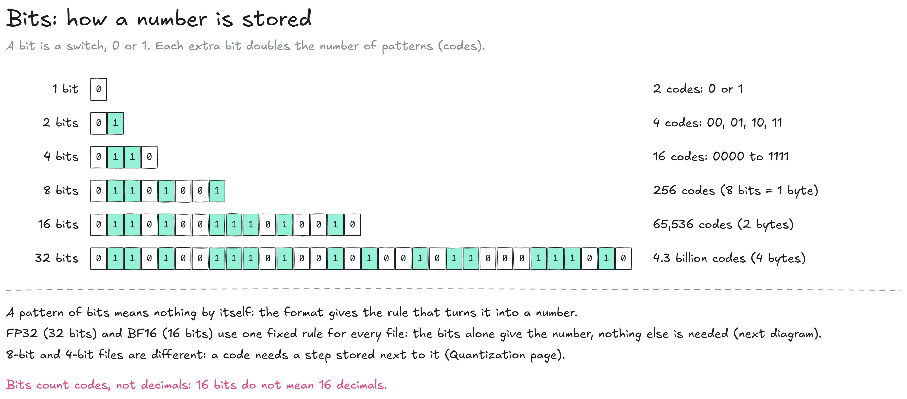

---
layout:
  width: default
  title:
    visible: true
  description:
    visible: false
  tableOfContents:
    visible: true
  outline:
    visible: true
  pagination:
    visible: true
  metadata:
    visible: true
  tags:
    visible: true
  actions:
    visible: true
  anchors:
    visible: true
---

# Precision

A model's weights are numbers, and a computer writes every number as a row of bits. **Precision** is the number of bits given to each weight: 32 during training, 16 in the version a lab publishes, 8 or 4 in quantized versions. This page follows weight A1 of Llama 3.1 8B from its 32 bits to its 16 bits, then shows what precision means for the size of a model.


**Precision sets the size.** A weight in 16 bits takes 2 bytes, so the 8.03 billion weights of Llama 3.1 8B take 16.1 GB in BF16. Fewer bits per weight make a smaller and faster model, slightly less exact: that is [quantization](quantization/).


### Bits and bytes

A computer stores every number as a row of **bits**, switches that are either 0 or 1. The number of bits given to each weight is its **precision**. In the BF16 version every weight has 16 bits; quantized versions can give a few sensitive tables more bits than the others (see [S, M and L mixes](quantization/quantization-formats.md#s-m-and-l-mixes)).

<figure><figcaption></figcaption></figure>

* **Codes:** N bits make 2^N different patterns, called codes: 4 bits give 16 codes, 16 bits give 65,536, 32 bits about 4.3 billion.
* **Format:** The rule that turns a pattern of bits into a number. FP32, BF16 or INT8 are format names; the digits are the number of bits. FP means floating point; the B of BF16 stands for Brain (Google Brain designed it for AI).
* **Byte:** 8 bits. A weight stored on 16 bits takes 2 bytes, on 8 bits 1 byte, on 4 bits half a byte.
* **Bits are not decimals:** 16 bits do not mean 16 decimals. They mean 65,536 possible numbers, and a weight is stored as the closest one.
* **Why 16 bits:** Training computes in 16 bits with a 32-bit master copy of the weights. The finished model works as well in 16 bits as in 32, for half the space, so labs publish it in BF16: Meta's version of Llama 3.1 8B takes 16.1 GB. In local AI, "full precision" usually means this original 16-bit version; strictly, 32 bits is full precision and 16 bits is half precision.

### One weight in 32 and 16 bits

FP32 and BF16 write a number the way scientific notation does, in powers of 2. The rule is fixed by the format and the same for every model, so the bits alone are enough to know the number: no step or other value is stored next to them. Example: weight A1 of the first attention table of Llama 3.1 8B (an illustrative value, see [Inside a model](inside-a-model.md)), from the end of training to the published BF16 version.

<figure><figcaption></figcaption></figure>

<figure><figcaption></figcaption></figure>

**Reading binary.** Binary is read from right to left, like decimal (units, tens, hundreds), but each place is worth twice the one on its right instead of ten times: 2^0 = 1, 2^1 = 2, 2^2 = 4, then 8, 16, 32, 64, 128 (2^7). A number in binary is the sum of the places whose bit is 1.

* `01111011` = 64 + 32 + 16 + 8 + 2 + 1 = **123**
* `1100101` = 64 + 32 + 4 + 1 = **101**

**Sign (1 bit).** 0 for positive, 1 for negative. A1's sign bit is 0.

**Zone (8 bits, called the exponent).** The range the number falls in. Zones run from one power of 2 to the next, each twice as wide as the one before:

| Zone bits | Minus 127 | Zone                |
| --------- | --------- | ------------------- |
| 122       | −5        | 0.03125 to 0.0625   |
| **123**   | **−4**    | **0.0625 to 0.125** |
| 124       | −3        | 0.125 to 0.25       |
| 127       | 0         | 1 to 2              |
| 128       | 1         | 2 to 4              |

* **Why minus 127:** 8 bits can only count from 0 to 255, never below 0, but the power of 2 must be able to be negative as well as positive. Subtracting 127, the middle of that range, centres the powers on 0: zone bits below 127 give negative powers (numbers under 1), 127 gives power 0 (the zone 1 to 2), above 127 positive powers. Weights are mostly small numbers, so they use negative powers. (Zone bits 0 and 255 are kept for special values such as zero and infinity.)
* **A1:** zone bits 123, minus 127 = −4. 2^−4 = 1/2 × 1/2 × 1/2 × 1/2 = 1/16 = **0.0625**: the start of the zone.
* **End of the zone:** the next power of 2, 2^−3 = 1/8 = **0.125**, twice the start. So A1 is between 0.0625 and 0.125.

**Position (the other bits, called the mantissa).** Where the number sits inside its zone, counted in equal marks from the start of the zone. FP32 has 23 position bits, so 2^23 = 8,388,608 marks per zone; BF16 has 7, so 128 marks.

**Value.** Start of the zone + the position's share of the zone's width (here the width is 0.125 − 0.0625 = 0.0625).

* **FP32, at the end of training:** mark 6,643,778 of 8,388,608 = 0.79200006 of the way, so 0.0625 + 0.79200006 × 0.0625 = **0.1120000035**.
* **BF16, in the published version:** BF16 keeps the first 16 bits of FP32, rounded: the same sign, the same zone, and the first 7 position bits, `1100101` = mark 101 of 128. 0.0625 + (101 / 128) × 0.0625 = **0.11181640625**.
* **What BF16 costs:** 0.00018 on this weight, with half the space. Models work as well in BF16 as in FP32, which is why they are published in it.

**Precision follows the size.** Every zone has the same number of marks, so marks are closer together for small numbers. In A1's zone, BF16 marks are 0.0005 apart; in the zone 0.125 to 0.25, 0.001 apart.

Other diagrams of this wiki round A1 to 0.1118 or 0.112 for display. No file holds exactly 0.112: like 1/3 in decimal, 0.112 cannot be written exactly in binary.

8-bit and 4-bit versions work differently. 256 or 16 codes cannot cover every zone this way, so the codes are spread over each block of weights, with a step stored next to them: that is quantization.

### How big a model is

When every weight takes the same space, the size of a version is a multiplication: number of parameters × bytes per parameter. Quantized versions come close to it.

<figure><figcaption></figcaption></figure>

* **Example:** 8.03 billion parameters × 2 bytes (16 bits) = 16.1 billion bytes = 16.1 GB.
* **16 bits:** How most models are published. A 70B model takes 140 GB.
* **8 and 4 bits:** Quantized versions of the same model: about 70 GB and 35 GB for a 70B model.
* **Real versions:** A little bigger than the formula. Quantized versions also store one step per block of weights, as explained in [what 4 bits means](quantization/#what-4-bits-means): Llama 3.1 8B at Q4\_K\_M is 4.92 GB, not 4 GB.
* **Memory to plan:** The version must fit in the GPU's VRAM, or in a Mac's unified memory, with 1 to 3 GB more for the conversation, which grows with its length. Where that memory sits is covered on the [GPU & memory](../inference/gpu-and-memory.md) page.

### Resources

* BF16: [Google Cloud, bfloat16](https://cloud.google.com/tpu/docs/bfloat16) (the format and why it suits AI)
* Model card: [Meta Llama 3.1 8B Instruct](https://huggingface.co/meta-llama/Llama-3.1-8B-Instruct) (BF16 release)
