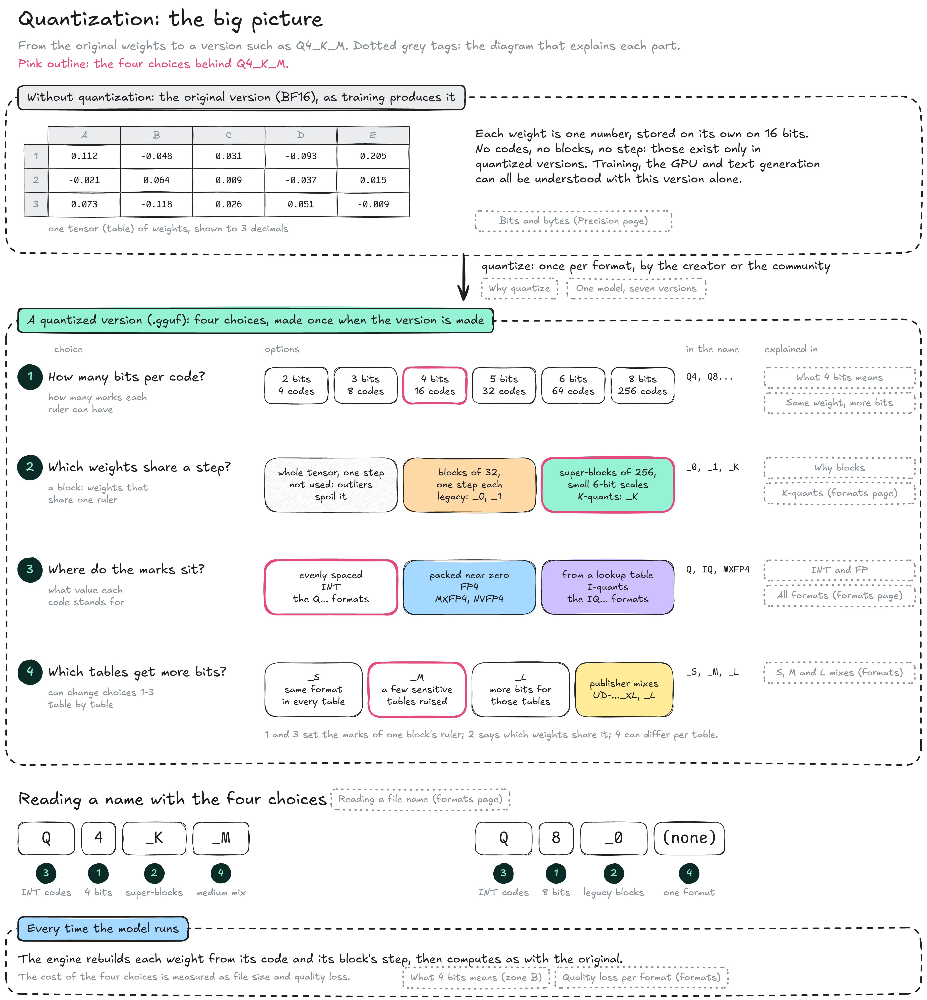
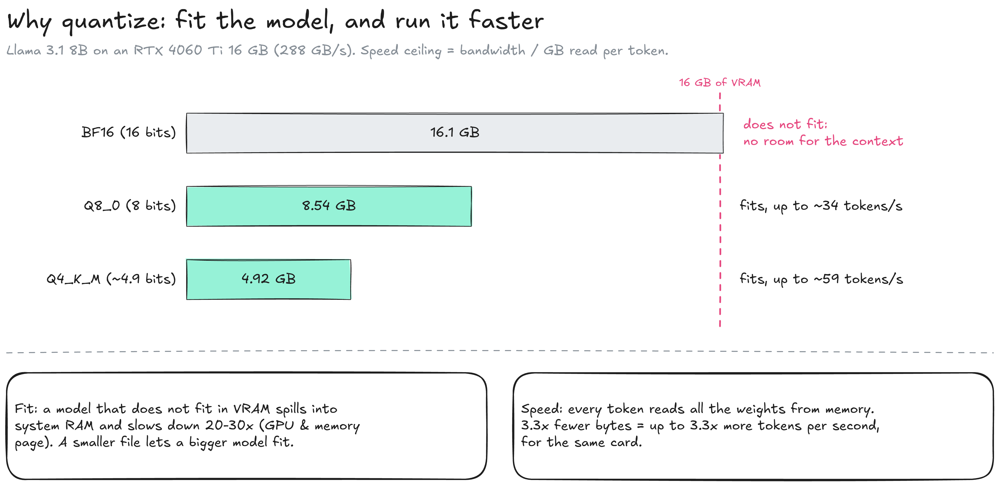
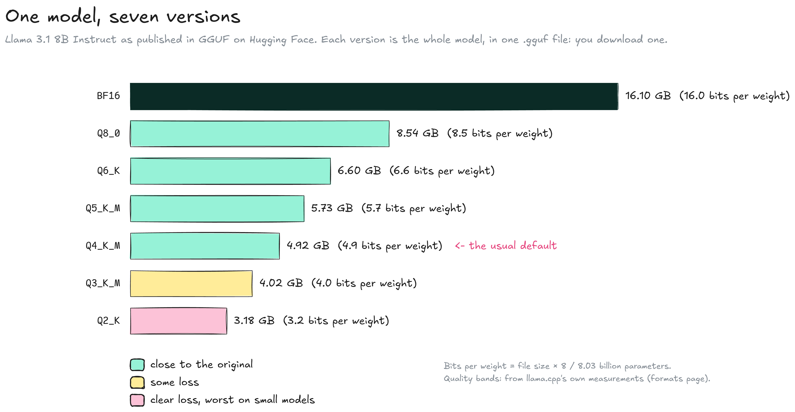
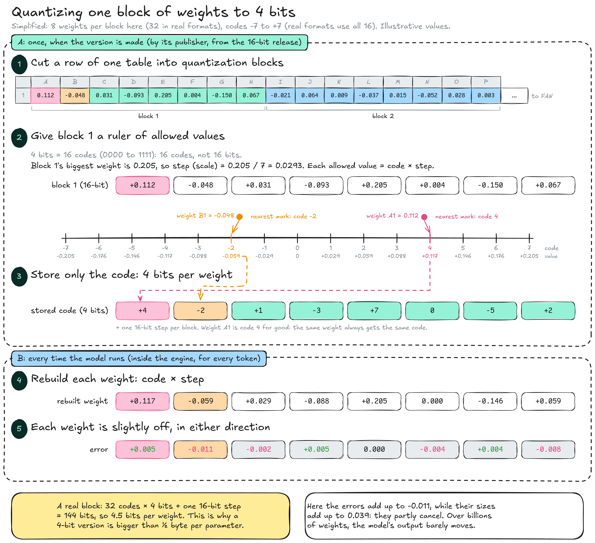
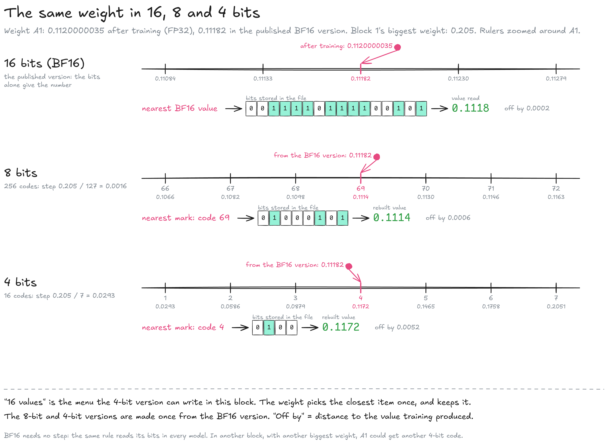
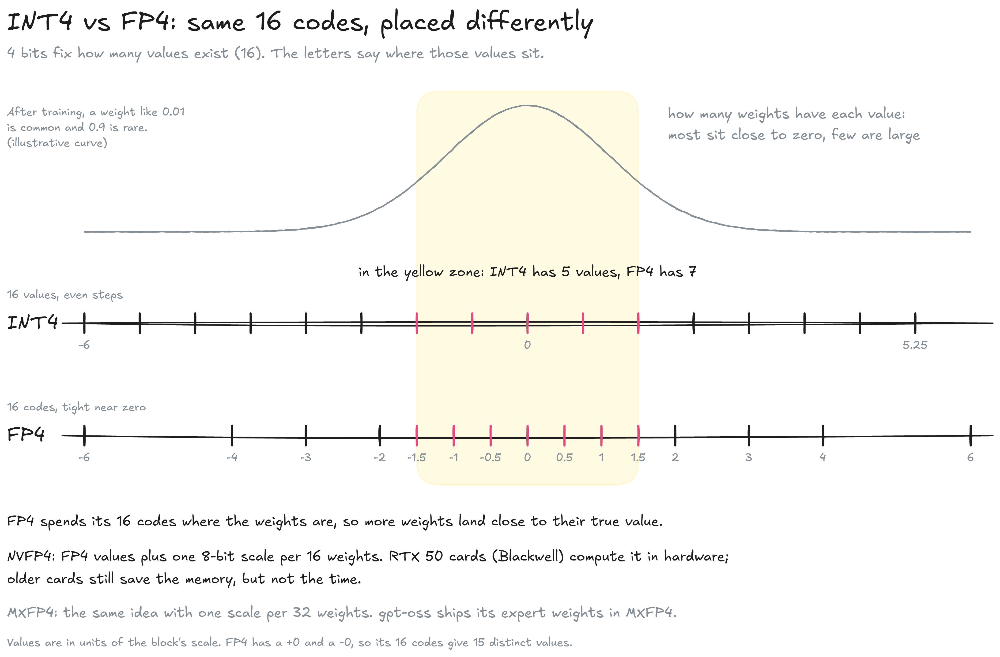

---
layout:
  width: default
  title:
    visible: true
  description:
    visible: false
  tableOfContents:
    visible: true
  outline:
    visible: true
  pagination:
    visible: true
  metadata:
    visible: true
  tags:
    visible: true
  actions:
    visible: true
  anchors:
    visible: true
---

# Quantization

Quantization stores each weight of a model with fewer bits, so the model takes less memory and runs faster. Models are published in 16 bits (see [bits and bytes](../precision.md#bits-and-bytes)); from 16 to 8 bits almost nothing is lost, around 4 to 5 bits a little, below 4 bits clearly, and big models tolerate it best. How to read the format names (Q4\_K\_M, IQ3\_M…) is on the [Quantization formats](quantization-formats.md) page.


**Choose the biggest model whose Q4\_K\_M version fits in your memory (VRAM, or a Mac's unified memory), with 2 to 3 GB to spare for the** [**context**](../../inference/text-generation/kv-cache.md#how-big-it-gets)**.** A bigger model at 4 bits beats a smaller model at 16 bits.


### The big picture

A quantized version is the original weights plus four choices. This map places every notion of this page and of the formats page, and tags each part with the diagram that explains it.

<figure><figcaption></figcaption></figure>

* **Without quantization:** The original version (BF16) stores every weight as its own 16-bit number. Codes, blocks and steps do not exist in it: they belong to quantized versions only, so training, the GPU and text generation can be understood without them.
* **1. Bits per code:** How many values a weight can choose from: 16 with 4 bits, 256 with 8 bits. It is the digit in Q4\_K\_M (see [the same weight in 16, 8 and 4 bits](./#the-same-weight-in-16-8-and-4-bits)).
* **2. Blocks:** Which weights share one step. A quantization block (also called a group) is a run of neighbouring weights in one row of one table. It is much smaller than the model's blocks, its 32 layers (`blk.0` to `blk.31`), and unrelated to them. Legacy formats use blocks of 32 with one step each (`_0`, `_1`); K-quants are another way to organize blocks, with 8 blocks grouped into a super-block (`_K`).
* **3. Where the values sit:** Evenly spaced (INT, the `Q` formats), packed near zero (FP4), or taken from a lookup table (I-quants, the `IQ` formats). See [INT and FP](./#int-and-fp).
* **4. Which tables get more bits:** The same format in every table (`_S`), or a few sensitive tables raised (`_M`, `_L`). See [S, M and L mixes](quantization-formats.md#s-m-and-l-mixes).

Two names read with these choices:

* **Q4\_K\_M:** INT codes (3), 4 bits each (1), in K-quant super-blocks (2), with a medium mix (4).
* **Q8\_0:** INT codes (3), 8 bits each (1), in legacy blocks of 32 with one step (2), the same format in every table (4).

All four choices are made once, when the version is made. Every time the model runs, the engine only rebuilds each weight from its code and its block's step.

### Why quantize

A smaller version does two things: it fits in memory that the original would overflow, and it runs faster, because generating a token means reading every weight from memory.

<figure><figcaption></figcaption></figure>

* **Fit:** The 16-bit release of Llama 3.1 8B (16.1 GB) does not fit on a 16 GB card once the context is added; the 4-bit version (4.92 GB) leaves room to spare.
* **Speed:** The speed ceiling is the memory bandwidth divided by the size of the version, so 3.3 times fewer bytes allows up to 3.3 times more tokens per second (see [capacity and bandwidth](../../inference/gpu-and-memory.md#capacity-and-bandwidth)).
* **Cost:** A small loss of quality, measured on the formats page. Nothing is removed: Llama 3.1 8B keeps its 8.03 billion parameters, and every table its shape.

### One model, seven versions

The same model is usually published in several versions, one per precision. Each version is the complete model with its weights stored at a different precision: you download one of them. In GGUF, each version is a single file; a version too big for one file is split into parts that all work together (see [reading a file name](quantization-formats.md#reading-a-file-name)).

<figure><figcaption></figcaption></figure>

* **BF16:** The original precision, 16 bits per weight: 16.1 GB for Llama 3.1 8B.
* **Q8\_0 to Q5\_K\_M:** 8.5 to 5.7 bits per weight. Output is very close to the original. Q8\_0 is twice the size of Q4\_K\_M: with the same memory, a model twice as large at 4 bits usually answers better.
* **Q4\_K\_M:** 4.9 bits per weight, 4.92 GB. The usual default, and the one [llama.cpp](https://github.com/ggml-org/llama.cpp) downloads when no quantization is specified.
* **Q3 and Q2:** Smaller again, with a loss that becomes clear, especially on small models.

### What 4 bits means

A version does not store decimals: it stores each weight as a code with a fixed number of bits. With 4 bits there are only 16 codes, so quantizing means choosing which 16 values those codes stand for, then replacing every weight by the closest one. It happens in two moments, shown as zones A and B.

<figure><figcaption></figcaption></figure>

**A: once, when the version is made.** Quantization is a conversion of the finished 16-bit version, not part of training, and takes minutes to hours on an ordinary computer. It is done by whoever publishes the quantized version: the creator (Qwen and Google publish their own) or community uploaders such as bartowski or Unsloth, with llama.cpp's quantize tool. Meta released Llama 3.1 in 16 bits only.

1. **Blocks:** Each row of each tensor is cut into **blocks** of neighbouring weights: 32 in real formats, 8 in the diagram. Each block is handled on its own (see [why blocks](./#why-blocks)).
2. **Ruler:** 4 bits give 16 codes, 0000 to 1111 (16 codes, not 16 bits). The block's biggest weight sets the **step**, also called the scale: 0.205 / 7 = 0.0293. The allowed values are code × step: −0.205, −0.176 … 0 … +0.176, +0.205. The diagram uses codes −7 to +7 so that 0 stays exact; real formats use all 16.
3. **Code:** Each weight moves to the nearest mark, and only the mark's code is written in the file, on 4 bits, plus one 16-bit step per block. Weight A1 (0.112, rounded from 0.11182 in the BF16 version) is nearest to mark 4, so the file stores `4`. This 4 is the mark's number on the ruler, unrelated to the "4" of 4 bits: the second weight, B1 = −0.048, is stored as `−2`.

**B: every time the model runs.** The engine never sees 0.112 again; it only has the code and the step. The weight itself never changes: the engine rebuilds the same value every time it uses it.

4. **Rebuild:** Just before using a weight, the engine computes code × step: 4 × 0.0293 = 0.117.
5. **Error:** Each rebuilt weight is slightly off, in either direction. Over billions of weights, most of these errors cancel out instead of adding up.

A real block stores 32 codes of 4 bits plus one 16-bit step: 144 bits, or 4.5 bits per weight. This is why a 4-bit version is bigger than half a byte per parameter.

### Why blocks

One ruler for a whole tensor would have to reach its largest weight, which can be far from the others. Small weights would then fall between two distant marks and collapse onto 0.

<figure><figcaption></figcaption></figure>

* **One ruler (A):** If the tensor's biggest weight is 0.9, the step is 0.129. Three of the eight weights become 0, and the average error is 0.034.
* **One ruler per block (B):** The block's biggest weight is 0.205, so the step is 0.029. The average error drops to 0.005.
* **Outliers:** A few unusually large weights are common in trained models. Blocks keep them from spoiling the precision of all the others.
* **Cost:** Each block stores its own 16-bit step: with blocks of 32 weights, that adds 0.5 bit per weight. K-quants reduce this cost by nesting blocks (see [K-quants](quantization-formats.md#k-quants)).

### The same weight in 16, 8 and 4 bits

The starting point is the published BF16 version, where every weight is read directly from its 16 bits (see [one weight in 32 and 16 bits](../precision.md#one-weight-in-32-and-16-bits)). The 8-bit and 4-bit versions are made from it, once. The number of bits sets the length of the menu: 65,536 values in BF16, 256 per block at 8 bits, 16 per block at 4 bits.

<figure><figcaption></figcaption></figure>

Training left weight A1 at 0.1120000035 (FP32); the diagrams show it as 0.112. Each row works the same way: find the nearest mark, store it as bits, read or rebuild the value. "Off by" is the distance to the training value.

* **16 bits (BF16):** No block and no step: the 16 bits alone give the number. Near A1 the BF16 values are 0.0005 apart (0.11133, 0.11182, 0.11230…); the nearest is 0.11182, stored as `0011110111100101`. Off by 0.0002.
* **8 bits:** 256 codes per block, so the marks are 0.205 / 127 = 0.0016148 apart. 0.11182 falls between mark 69 (0.1114) and mark 70 (0.1130), closer to 69. The file stores `01000101` (69 in binary) plus the block's step; the engine rebuilds 69 × 0.0016148 = 0.1114. Off by 0.0006.
* **4 bits:** 16 codes per block, marks 0.0293 apart. 0.11182 falls between mark 3 (0.0879) and mark 4 (0.1172), closer to 4. The file stores `0100` (4 in binary) plus the step; the engine rebuilds 4 × 0.0293 = 0.1172. Off by 0.005.
* **Another weight, same block:** B1 (−0.048) at 4 bits falls between −0.0586 (code −2) and −0.0293 (code −1), closer to −2: stored as code −2, rebuilt −0.059, off by 0.011.
* **Always the same code:** Quantization is a fixed rule, so weight A1 in this block is code 4 every time the version is made. In a block with another biggest weight, the same value could get another code.

"A 4-bit weight can take 16 values" means: the format offers 16 possible values for that weight. The weight takes one of them when the version is made, and keeps it.

### INT and FP

With 4 bits, every format has the same 16 codes. What differs is where the values they stand for are placed, and the letters in a format name say how: **INT** spaces them evenly, **FP** (floating point) packs them close to zero.

<figure><figcaption></figcaption></figure>

* **Two ways to place the values:** INT and FP are two methods for the same job, choosing what the 16 codes mean. Neither changes how many codes there are.
* **Why zero matters:** In a trained model, most weights are small numbers close to zero, and large weights are rare: 0.01 is common, 0.9 is rare. Values placed near zero are the ones most weights will use.
* **INT4:** 16 evenly spaced values. Simple, and the basis of most GGUF formats, with a scale per block.
* **FP4 (E2M1):** The values 0, 0.5, 1, 1.5, 2, 3, 4 and 6, positive and negative. More values near zero, fewer at the extremes, so more weights land close to their true value.
* **NVFP4:** FP4 plus one 8-bit scale per 16 weights. RTX 50 cards (Blackwell) compute it in hardware, so they gain speed as well as memory; older cards only save memory.
* **MXFP4:** The same idea with one scale per 32 weights. OpenAI's gpt-oss models ship their expert weights in MXFP4.

This is where most quantization research happens: where to place the values (INT, FP4, NF4), how to choose each block's scale (super-blocks, importance data such as llama.cpp's imatrix), which tables to keep at more bits (the S, M and L mixes), and training directly in low precision (see [quantized from the start](./#quantized-from-the-start)).

### Choosing a version



#### Measure the memory

* [ ] Note the VRAM (GPU) or unified memory (Mac) available
* [ ] Keep 2 to 3 GB free for the context and buffers



#### Pick the model

* [ ] Take the biggest model whose Q4\_K\_M version fits in what is left
* [ ] With spare room, move up to Q5\_K\_M or Q6\_K



#### When nothing fits

* [ ] Shrink the context or quantize the KV cache first (see [when it does not fit](../../inference/text-generation/kv-cache.md#when-it-does-not-fit))
* [ ] Then switch to a smaller model, rather than going below 4 bits



### Quantized from the start

Quantization is usually applied after training. Recent models are increasingly trained or released directly in low precision.

* **DeepSeek-V3:** Trained with an FP8 mixed-precision framework and published with FP8 weights.
* **gpt-oss:** OpenAI quantized the mixture-of-experts weights, over 90 % of the parameters, to MXFP4, which lets the 120B model run on a single 80 GB GPU.
* **NVFP4 pretraining:** NVIDIA trained a 12B model on 10 trillion tokens in NVFP4, with loss and accuracy close to an FP8 baseline.

### Resources

* File sizes: [bartowski, Meta-Llama-3.1-8B-Instruct-GGUF](https://huggingface.co/bartowski/Meta-Llama-3.1-8B-Instruct-GGUF)
* Formats: [GGUF specification](https://github.com/ggml-org/ggml/blob/master/docs/gguf.md)
* Papers: [DeepSeek-V3 technical report](https://arxiv.org/abs/2412.19437) | [gpt-oss model card](https://arxiv.org/abs/2508.10925) | [Pretraining LLMs with NVFP4](https://arxiv.org/abs/2509.25149)
