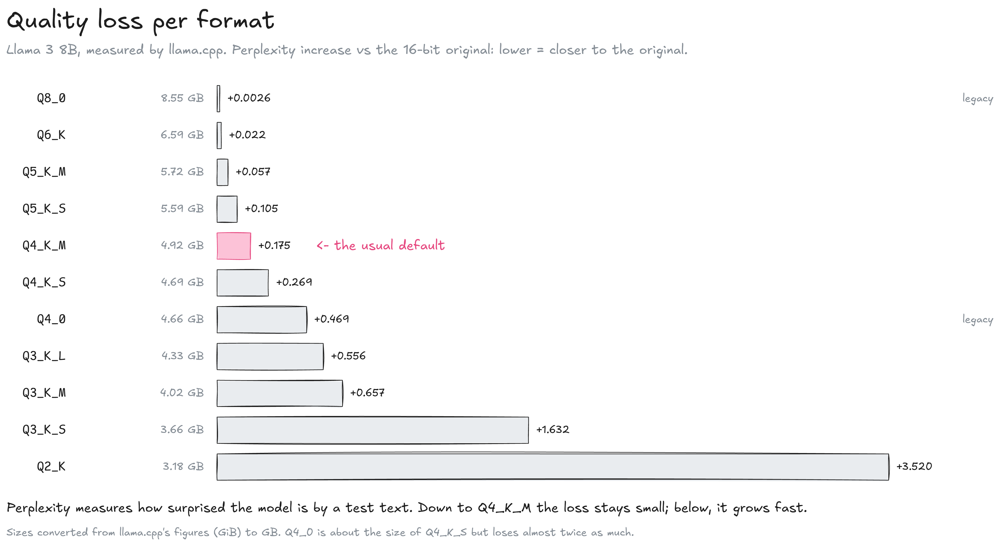
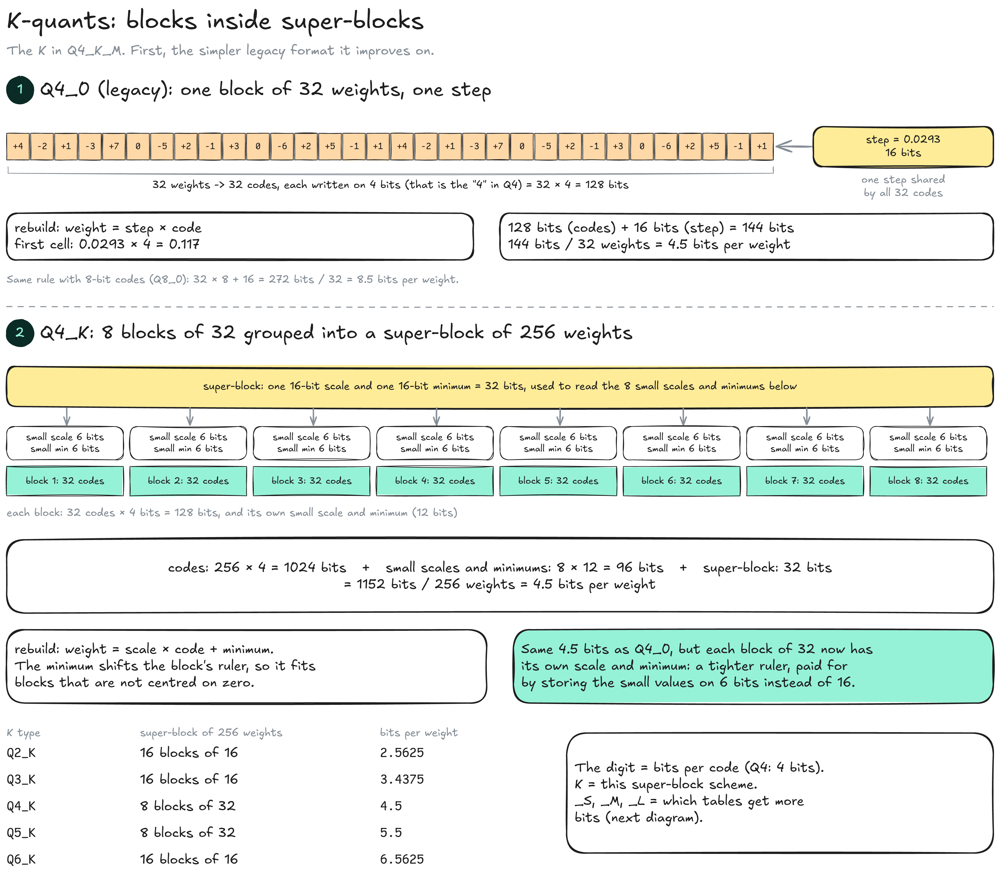
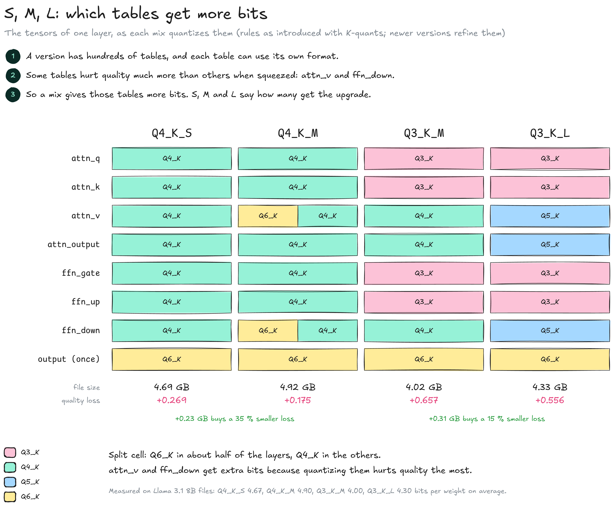
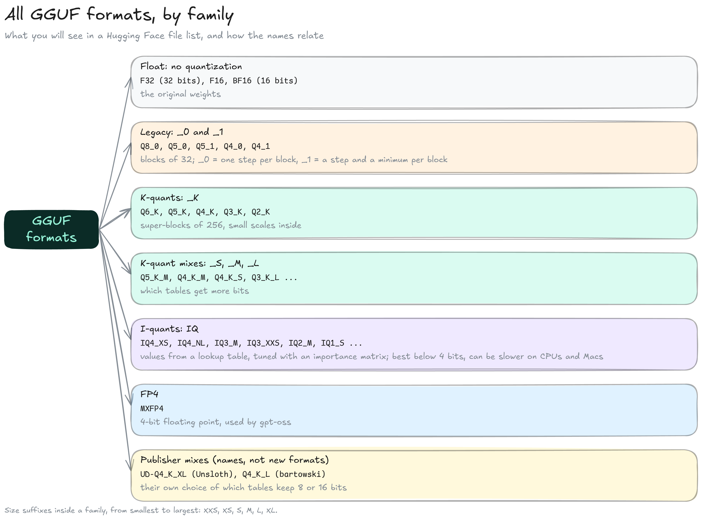
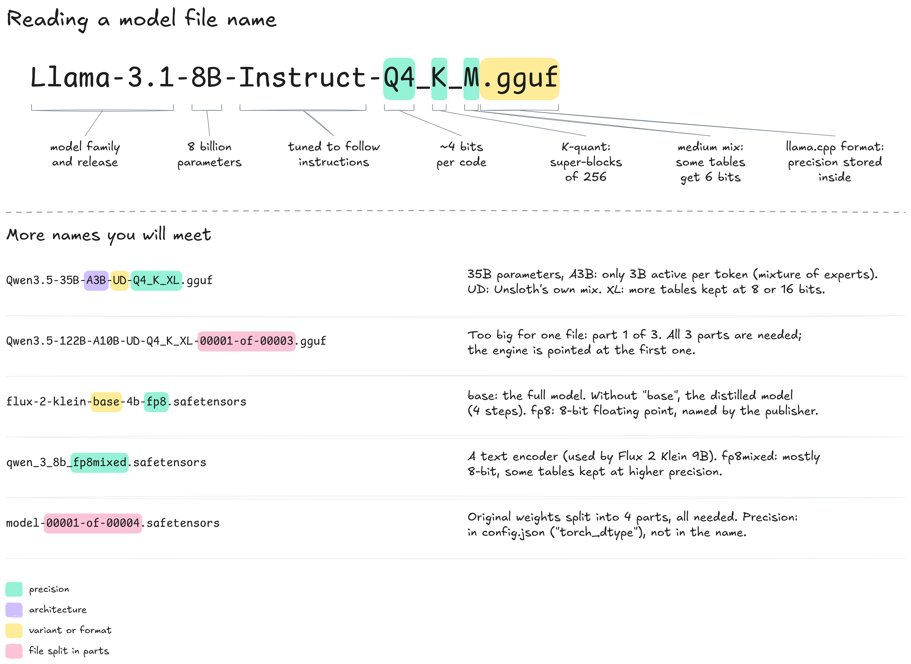

# Quantization formats

GGUF file name tells exactly how the weights were quantized. This page decodes those names and compares what each format costs in quality. It builds on [Quantization](./), which explains codes, steps and blocks.


**Q4\_K\_M = 4-bit codes (Q4), in super-blocks (K), with a medium mix of tables kept at more bits (M).** For most models it is the best balance of size and quality.


### Quality loss per format

The usual measure of what quantization costs is **perplexity**: how surprised the model is by a test text it did not train on. The lower, the better; the loss is the increase over the 16-bit original. Example: a loss of +0.175 means the Q4\_K\_M version is very slightly more surprised by the text than the original, a difference hard to notice in use; +3.5 (Q2\_K) is a clearly worse model.

<figure><figcaption></figcaption></figure>

* **Q8\_0 to Q5\_K\_M:** Below +0.06: hard to tell from the original.
* **Q4\_K\_M:** +0.175 for a version three times smaller than 16 bits. The usual default.
* **Below 4 bits:** The loss grows fast: +0.66 for Q3\_K\_M, +1.63 for Q3\_K\_S, +3.52 for Q2\_K.
* **Format matters, not only size:** Q4\_0 (legacy) is about the size of Q4\_K\_S but loses almost twice as much.

Figures are llama.cpp's own measurements on Llama 3 8B. Larger models lose less at the same format.

### K-quants

The **K** in Q4\_K\_M names the block scheme. To see what it changes, start from the legacy format it improves on, where each block of 32 weights has one step.

<figure><figcaption></figcaption></figure>

**1. Q4\_0, the legacy format.** A block holds 32 weights.

* **Codes:** Each weight becomes a code written on 4 bits (the "4" in Q4): 32 × 4 = 128 bits.
* **Step:** One 16-bit step, shared by the whole block. To rebuild a weight, the engine multiplies: step × code. With a step of 0.0293, code 4 gives 0.117 and code −2 gives −0.059.
* **Size:** 128 + 16 = 144 bits for 32 weights, so 144 / 32 = 4.5 bits per weight.
* **Second example, Q8\_0:** Same rule with 8-bit codes: 32 × 8 + 16 = 272 bits, so 8.5 bits per weight. That is why the 8-bit version of Llama 3.1 8B is 8.54 GB and not 8.03 GB.

**2. Q4\_K, the K-quant.** Eight blocks of 32 are grouped into a **super-block** of 256 weights.

* **Codes:** Still 4 bits per weight: 256 × 4 = 1024 bits.
* **Small scales:** Each block gets its own scale and its own minimum, but written on 6 bits each instead of 16: 8 × 12 = 96 bits.
* **Super-block values:** One 16-bit scale and one 16-bit minimum (32 bits) tell the engine how to read those small 6-bit values.
* **Size:** 1024 + 96 + 32 = 1152 bits for 256 weights, so again 4.5 bits per weight.
* **Minimum:** Weight = scale × code + minimum. The minimum shifts the block's ruler: a block whose weights all sit between 0.02 and 0.30 gets marks between 0.02 and 0.30, instead of a ruler centred on zero that wastes half its marks on negative values. (Formats with a minimum are called "type-1"; Q4\_0 is "type-0".)

For the same 4.5 bits, every block now has its own scale and minimum: a tighter ruler, paid for by storing the small values on 6 bits instead of 16.

| K type | Super-block of 256 weights | Bits per weight |
| ------ | -------------------------- | --------------- |
| Q2\_K  | 16 blocks of 16 weights    | 2.5625          |
| Q3\_K  | 16 blocks of 16 weights    | 3.4375          |
| Q4\_K  | 8 blocks of 32 weights     | 4.5             |
| Q5\_K  | 8 blocks of 32 weights     | 5.5             |
| Q6\_K  | 16 blocks of 16 weights    | 6.5625          |

### S, M and L mixes

A version holds hundreds of tables (9 per layer in Llama 3.1 8B, see [what is inside a version](../inside-a-model.md#what-is-inside-a-version)), and each table can use its own format. Some tables hurt quality much more than others when squeezed, so a version can give those few tables more bits. The suffix **S**, **M** or **L** says how many get the upgrade.

<figure><figcaption></figcaption></figure>

* **Sensitive tables:** `attn_v` (attention values) and `ffn_down` (the last feed-forward table) lose the most quality when quantized, so mixes protect them first. `attn_output` comes next.
* **S (small):** One format for every table: Q4\_K everywhere in Q4\_K\_S, Q3\_K everywhere in Q3\_K\_S.
* **M (medium):** A few tables are raised. Q4\_K\_M puts `attn_v` and `ffn_down` in Q6\_K in about half of the layers; Q3\_K\_M puts them, and `attn_output`, in Q4\_K.
* **L (large):** More bits again. Q3\_K\_L raises the same three tables to Q5\_K.
* **Output table:** Kept at Q6\_K in all of them.

Two examples of what the upgrade buys, on Llama 3 8B:

* **Q4\_K\_S → Q4\_K\_M:** 4.69 GB → 4.92 GB (+5 %), quality loss +0.269 → +0.175: a third smaller.
* **Q3\_K\_M → Q3\_K\_L:** 4.02 GB → 4.33 GB (+8 %), quality loss +0.657 → +0.556: 15 % smaller. Q4\_K\_S, only 0.36 GB bigger than Q3\_K\_L, does much better (+0.269): more bits everywhere beat a few protected tables.

These are the rules introduced with K-quants; llama.cpp has refined them since, and the name of a mix stays the same.

### All formats

Every GGUF format belongs to one of a few families. Within a family, the digit is the number of bits per code, and the suffix gives the variant.

<figure><figcaption></figcaption></figure>

* **Float:** F32, F16 and BF16 store the original numbers; nothing is quantized.
* **Legacy (`_0`, `_1`):** Blocks of 32 with one step (`_0`) or a step and a minimum (`_1`). Q8\_0 is still the usual 8-bit choice.
* **K-quants (`_K`):** Super-blocks with small scales inside; most GGUF files use them.
* **I-quants (`IQ`):** The codes point into a lookup table of well-chosen values, and the scales are tuned with an **importance matrix** (imatrix): statistics from sample text showing which weights matter most. They give the best quality below 4 bits, and can run slower on CPUs and Macs.
* **FP4:** MXFP4, the 4-bit floating-point format of gpt-oss (see [INT and FP](./#int-and-fp)).
* **Publisher mixes:** Names chosen by the people who make the files, not new formats. Unsloth's `UD-…_XL` ("Dynamic") and bartowski's `_L` keep some tables (such as the token and output tables) at 8 or 16 bits.

<table data-search="false"><thead><tr><th>Format</th><th>Family</th><th>Bits per weight</th><th>Note</th></tr></thead><tbody><tr><td>BF16, F16</td><td>float</td><td>16</td><td>the original release</td></tr><tr><td>Q8_0</td><td>legacy</td><td>8.5</td><td>nearly lossless</td></tr><tr><td>Q6_K</td><td>K-quant</td><td>6.56</td><td></td></tr><tr><td>Q5_K_M / Q5_K_S</td><td>K-quant mix</td><td>~5.7 / ~5.6</td><td></td></tr><tr><td>Q5_1 / Q5_0</td><td>legacy</td><td>6.0 / 5.5</td><td>superseded by Q5_K</td></tr><tr><td>Q4_K_M / Q4_K_S</td><td>K-quant mix</td><td>~4.9 / ~4.7</td><td>Q4_K_M: the usual default</td></tr><tr><td>Q4_1 / Q4_0</td><td>legacy</td><td>5.0 / 4.5</td><td>superseded by Q4_K</td></tr><tr><td>IQ4_NL / IQ4_XS</td><td>I-quant</td><td>4.5 / 4.25</td><td></td></tr><tr><td>MXFP4</td><td>FP4</td><td>4.25</td><td>gpt-oss</td></tr><tr><td>Q3_K_L / Q3_K_M / Q3_K_S</td><td>K-quant mix</td><td>~4.3 / ~4.0 / ~3.65</td><td></td></tr><tr><td>IQ3_M / IQ3_S / IQ3_XXS</td><td>I-quant</td><td>3.66 / 3.44 / 3.06</td><td></td></tr><tr><td>Q2_K</td><td>K-quant mix</td><td>~3.2</td><td>large loss</td></tr><tr><td>IQ2_M / IQ2_S / IQ2_XS / IQ2_XXS</td><td>I-quant</td><td>2.7 / 2.5 / 2.31 / 2.06</td><td>for very large models only</td></tr><tr><td>IQ1_M / IQ1_S</td><td>I-quant</td><td>1.75 / 1.56</td><td>experimental</td></tr></tbody></table>

Mixes (\~) are averages measured on Llama 3.1 8B versions; the others are the nominal values from llama.cpp. Size suffixes go from smallest to largest: XXS, XS, S, M, L, XL.

### Reading a file name

A GGUF file name states two separate choices: which model, and which version of it. A safetensors file name only says what its publisher chose to write.

<figure><figcaption></figcaption></figure>

* **`Llama-3.1-8B-Instruct`:** The model: family and release (Llama 3.1), size in billions of parameters (8B), and the post-trained model rather than the base model (`Instruct`, see Model). Labs mark these variants differently; model names will be covered in the **Models** section.
* **`Q4_K_M`:** The version: 4-bit codes (`Q4`), K-quant super-blocks (`K`), medium mix (`M`).
* **`.gguf`:** The llama.cpp format. The quantization is stored in the file and repeated in its name.
* **`.safetensors`:** A container for tensors that, unlike older pickle files, runs no code when loaded. It can hold 16-bit, 8-bit or 4-bit weights; `fp8` in a name is the publisher's label, and for an original model the precision is in `config.json` (`torch_dtype`).
* **`A3B`:** A mixture-of-experts model with 3 B parameters active per token, out of 35 B in total.
* **`UD`, `XL`:** Unsloth's "Dynamic" mix, with more tables kept at 8 or 16 bits.
* **`00001-of-00003`:** A version too big for one file, split into parts. All parts are needed; the engine is pointed at the first one.
* **`base`:** In Flux 2 Klein, the full model; the name without `base` is the distilled model, trained to work in 4 steps. Two models, not two versions: their weights differ.

### Resources

* K-quants: [llama.cpp pull request #1684](https://github.com/ggml-org/llama.cpp/pull/1684) (block structure, mixes)
* Quality figures: [llama.cpp quantize tool](https://github.com/ggml-org/llama.cpp/blob/master/tools/quantize/quantize.cpp)
* File lists: [bartowski, Meta-Llama-3.1-8B-Instruct-GGUF](https://huggingface.co/bartowski/Meta-Llama-3.1-8B-Instruct-GGUF) | [Unsloth, Qwen3.5 guide](https://unsloth.ai/docs/models/qwen3.5) | [ComfyUI, Flux 2 Klein](https://docs.comfy.org/tutorials/flux/flux-2-klein)
* Formats: [safetensors documentation](https://huggingface.co/docs/safetensors)
