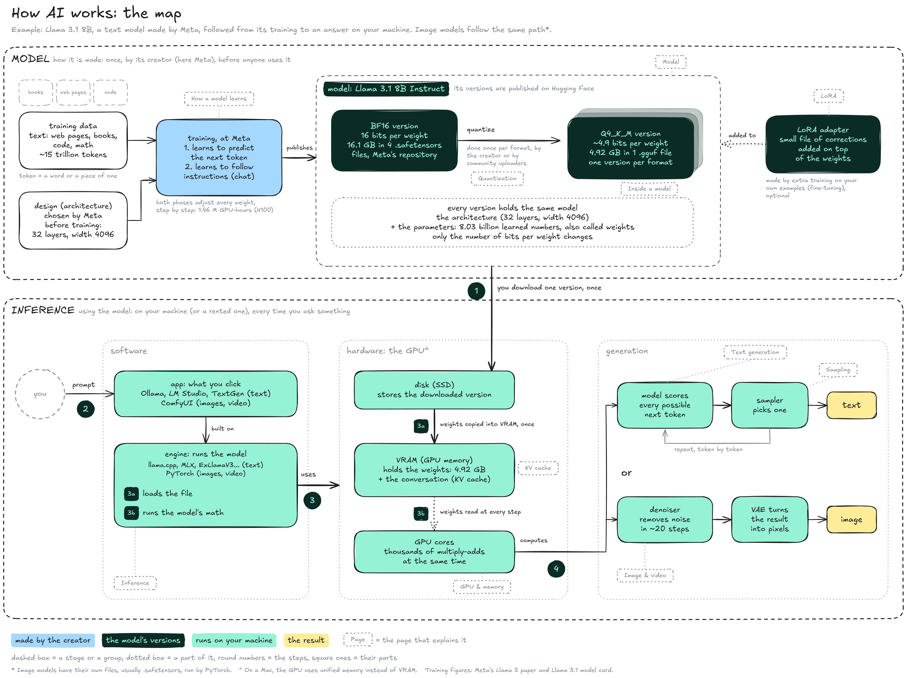

# Overview

This section explains how AI models work, from how they are made to how they produce text and images on your own machine. This page is the map: every other page of the section zooms into one part of it. The running example is **Llama 3.1 8B Instruct**, a text model made by Meta.


**A model is made once and used many times.** Its creator trains it and publishes its files. Every use, called **inference**, loads one of those files into the GPU's memory and computes an answer from it.


### The map

The map has two stages. **Model** is how the model is made, once, by its creator. **Inference** is what happens on your machine every time you ask something.

<figure><figcaption></figcaption></figure>

**Model**, made once. See [Model](model/) for the detailed map.

* **Training data:** Text collected before training, not prompts: web pages, books, code and math. Meta used about 15 trillion **tokens** (words or pieces of words) for Llama 3.1. Image models are trained on images paired with their descriptions.
* **Design:** Before training, Meta chose the model's **architecture**, its shape: 32 layers, 4,096 neurons wide. Training never changes it.
* **Training:** Meta adjusted every weight, step by step, in two phases: first to predict the next token of the training text, then to follow instructions, which gives the **Instruct** model that chat apps use. It took 1.46 million GPU-hours.
* **Model:** The result: the architecture plus 8.03 billion learned numbers, the **parameters** (also called **weights**).
* **Versions:** The same model saved at different precisions, the number of bits per weight. Models are published on [Hugging Face](https://huggingface.co). Meta publishes the **BF16** version (16 bits per weight, 16.1 GB in four `.safetensors` files). Smaller **quantized** versions store each weight on fewer bits: the Q4\_K\_M version takes 4.92 GB in a single `.gguf` file. They are made once per format, by the creator or by community uploaders.
* **LoRA:** A small extra file of corrections added on top of a model's weights to specialise it, made by extra training on your own examples (fine-tuning).

**Inference**, every use. See [Inference](inference/) for the detailed map. The numbers follow the badges:

1. **Download:** You download one version of the model, once. It stays on your disk.
2. **Prompt:** You type in an **app** such as [Ollama](https://ollama.com), [LM Studio](https://lmstudio.ai), [TextGen](https://github.com/oobabooga/textgen) or [ComfyUI](https://github.com/Comfy-Org/ComfyUI). The app is built on an **engine**, the program that runs the model: [llama.cpp](https://github.com/ggml-org/llama.cpp) for most local text models, [PyTorch](https://pytorch.org) for images and video. A few others exist, such as MLX on Macs.
3. **Use the hardware:** The engine drives the GPU in two parts.
   * **3a, load:** The weights are copied from the disk into the GPU's own memory, the **VRAM**, once. For text, VRAM also holds the **KV cache**, the model's memory of the conversation.
   * **3b, run:** The GPU's cores do the model's math, reading the weights from VRAM at every step. A disk would be far too slow for that.
4. **Compute:** The GPU's results feed one of two loops, text or image.
   * **Text:** The model gives a score to each of the 128,256 tokens of its vocabulary, a **sampler** picks one, the token is added to the answer, and the loop repeats until the answer is complete.
   * **Image:** A **diffusion** model starts from random noise and removes part of it at each step, about 20 steps with common settings. A **VAE** (a small decoder model) then turns the result into pixels.

On a Mac, the GPU has no separate VRAM: it uses the same **unified memory** as the processor. A rented GPU works the same way, with the machine in a data centre instead of on your desk.

### Pages in this section

* **Model**: how a model is made, what its versions contain, and how they are changed.
  * [Inside a model](model/inside-a-model.md): parameters, tables, the files of a version, and how the tables connect.
  * [How a model learns](model/how-a-model-learns.md): neurons, matrices, and the training that sets the weights (pre-training, post-training).
  * [Precision](model/precision.md): how a weight is written in bits (FP32, BF16), and how precision sets the size of a model.
  * [Quantization](model/quantization/): why and how a 16 GB model becomes a 5 GB version, block by block. Its sub-page, [Quantization formats](model/quantization/quantization-formats.md), reads names like Q4\_K\_M or IQ3\_M.
  * [LoRA](model/lora.md): specialising a model with a small file instead of a full copy.
* **Inference**: what runs on your machine when you use a model.
  * [GPU & memory](inference/gpu-and-memory.md): why AI runs on GPUs, why memory matters more than raw power, and how software reaches the chip.
  * [Text generation](inference/text-generation/): tokens, the generation loop and the context window, with [Sampling](inference/text-generation/sampling.md) (the settings that pick each token) and [KV cache](inference/text-generation/kv-cache.md) (the memory of a conversation).
  * [Image & video](inference/image-and-video.md): diffusion, the latent space, CFG and video.
* [Glossary](../glossary.md): every term of the section, with its other names (parameter and weight, VRAM and GPU memory…).

### Resources

* Model card: [Meta Llama 3.1](https://huggingface.co/meta-llama/Llama-3.1-8B) (GPU-hours, BF16 release) | Paper: [The Llama 3 Herd of Models](https://arxiv.org/abs/2407.21783) (training data)
