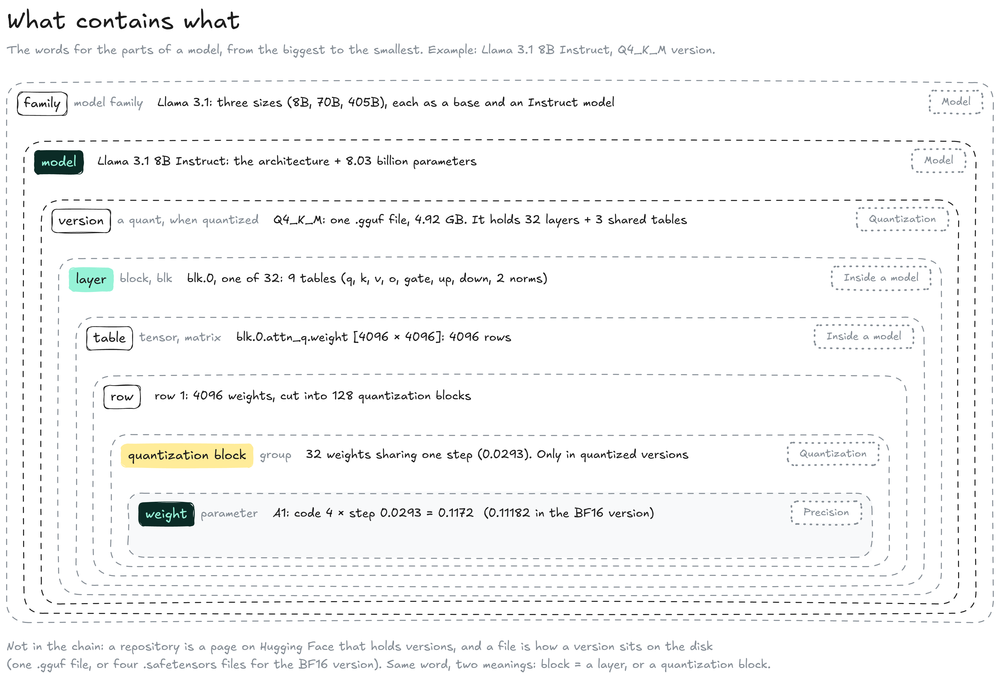

# Glossary

The same idea often goes by several names: a tool's settings, a paper and a forum post may each use a different one. This table lists each term once, its other names, and the page that explains it.


**Parameter and weight are the same thing.** So are VRAM and GPU memory, or context window and context length: when two words mean the same, they are on the same row below. Two words have two meanings: **block** is a layer in a model's files (`blk.0`) and a small group of weights in quantization; **base model** is the model before post-training, but on a LoRA's download page it is the model the LoRA was trained on.


<figure><figcaption></figcaption></figure>

| Term                    | Also called                                                          | Meaning                                                                                                                                                                      | Explained in                                                                                                         |
| ----------------------- | -------------------------------------------------------------------- | ---------------------------------------------------------------------------------------------------------------------------------------------------------------------------- | -------------------------------------------------------------------------------------------------------------------- |
| **Activation**          | hidden state                                                         | The list of numbers a token becomes as it goes through the layers: 4096 numbers in Llama 3.1 8B. Computed for each token, never stored in the files.                         | [Inside a model](foundations/model/inside-a-model.md)                                                                |
| **App**                 | front-end, interface                                                 | The program you type in, such as Ollama, LM Studio, TextGen or ComfyUI. It is built on an engine.                                                                            | [Inference](foundations/inference/)                                                                                  |
| **Architecture**        | design, hyperparameters                                              | The shape of a model, chosen before training: number of layers, width, vocabulary. Training never changes it.                                                                | [How a model learns](foundations/model/how-a-model-learns.md)                                                        |
| **Attention**           | self-attention                                                       | The part of each layer (tables q, k, v, o) that lets a token use the earlier tokens of the text.                                                                             | [Inside a model](foundations/model/inside-a-model.md), [KV cache](foundations/inference/text-generation/kv-cache.md) |
| **Bandwidth**           | memory bandwidth                                                     | How many GB per second the processor can read from its memory. Sets the speed of text generation.                                                                            | [GPU & memory](foundations/inference/gpu-and-memory.md)                                                              |
| **Base model**          | pretrained model                                                     | The model after pre-training only: it continues any text. Published next to the Instruct model.                                                                              | [How a model learns](foundations/model/how-a-model-learns.md)                                                        |
| **BF16, FP16, FP32**    | bfloat16; half precision (16-bit), single or full precision (32-bit) | Floating-point formats with 16 or 32 bits per number: a sign, a zone and a position. BF16 is the usual format of a published version.                                        | Precision                                                                                                            |
| **Bit**                 |                                                                      | A 0 or a 1. N bits give 2 to the power N codes.                                                                                                                              | Precision                                                                                                            |
| **Byte**                | octet                                                                | 8 bits.                                                                                                                                                                      | Precision                                                                                                            |
| **CFG**                 | classifier-free guidance, guidance scale                             | How strongly the prompt steers each denoising step.                                                                                                                          | Image & video                                                                                                        |
| **Code**                | quantized value                                                      | In a quantized version, the small whole number stored for a weight; code × step rebuilds the weight.                                                                         | Quantization                                                                                                         |
| **Context window**      | context length, context size, `ctx-size`, `num_ctx`, `n_ctx`         | The maximum number of tokens the model sees at once, input and answer together.                                                                                              | Text generation                                                                                                      |
| **CUDA, Metal, ROCm**   | GPU toolkit, GPU backend                                             | Each vendor's toolkit to write and run kernels on its GPUs: NVIDIA, Apple, AMD.                                                                                              | GPU & memory                                                                                                         |
| **Diffusion model**     | denoiser, UNet, DiT                                                  | The image or video model that removes noise step by step.                                                                                                                    | Image & video                                                                                                        |
| **Distilled model**     | turbo, lightning, schnell                                            | A model trained to imitate another one, such as an image model that gives a usable result in a few steps. A different model, not a version.                                  | Image & video                                                                                                        |
| **DPO**                 | direct preference optimization                                       | A direct way to train on preferences, used for Llama 3's post-training.                                                                                                      | How a model learns                                                                                                   |
| **Driver**              | GPU driver                                                           | The vendor's program that hands each kernel and its data to the GPU.                                                                                                         | GPU & memory                                                                                                         |
| **Engine**              | inference engine, runtime, backend                                   | The program that loads a version and does the math, such as llama.cpp, MLX or PyTorch.                                                                                       | Inference, GPU & memory                                                                                              |
| **Family**              | model family                                                         | Models from one creator that share a design and a name, in several sizes: Llama 3.1 8B, 70B and 405B.                                                                        | Model                                                                                                                |
| **File**                |                                                                      | What sits on the disk. A version is one file (`.gguf`) or several (`.safetensors`, up to about 5 GB each).                                                                   | Inside a model                                                                                                       |
| **Fine-tuning**         | full fine-tune                                                       | Further training of a finished model on new examples. A full fine-tune changes every weight and gives a new model; a LoRA trains a small file instead.                       | How a model learns, LoRA                                                                                             |
| **GGUF**                | `.gguf`                                                              | llama.cpp's format: one file holds a whole version (tables, architecture, vocabulary), and the quantization format is in its name.                                           | Quantization formats                                                                                                 |
| **Hidden size**         | width, embedding length, model dimension, `d_model`                  | The number of neurons per layer, so the length of the list each token becomes. 4096 in Llama 3.1 8B.                                                                         | Inside a model                                                                                                       |
| **I-quants**            | IQ formats (IQ4\_XS, IQ3\_M…)                                        | Quantization formats whose codes point into a lookup table, tuned with an importance matrix. Best below 4 bits.                                                              | Quantization formats                                                                                                 |
| **Importance matrix**   | imatrix                                                              | Statistics from sample text showing which weights matter most, used to choose steps when quantizing.                                                                         | Quantization formats                                                                                                 |
| **Inference**           | generation, running a model                                          | Every use of a finished model: loading a version and computing an answer.                                                                                                    | Inference                                                                                                            |
| **Instruct model**      | chat model; `-Instruct`, `-it` in a name                             | The model after post-training: it answers and follows instructions. The one chat apps use.                                                                                   | How a model learns                                                                                                   |
| **Kernel**              | GPU kernel                                                           | A small program for one operation, compiled for one family of chips.                                                                                                         | GPU & memory                                                                                                         |
| **K-quants**            | `_K` formats (Q4\_K, Q6\_K…)                                         | Quantization formats with super-blocks of 256 weights and a small step per quantization block (6 bits in Q4\_K).                                                             | Quantization formats                                                                                                 |
| **KV cache**            | key-value cache; prompt cache (on APIs)                              | The keys and values of every past token, kept in memory so they are computed only once.                                                                                      | KV cache                                                                                                             |
| **Latent**              | latent image, latent space                                           | The compressed form of an image in which diffusion works.                                                                                                                    | Image & video                                                                                                        |
| **Layer**               | block, transformer block, `blk.0`…                                   | One of the identical stages a token goes through, made of 9 tables. 32 in Llama 3.1 8B. Not a quantization block.                                                            | Inside a model                                                                                                       |
| **Logits**              | scores                                                               | The model's raw score for each possible next token, before conversion to percentages.                                                                                        | Sampling                                                                                                             |
| **LoRA**                | adapter                                                              | A small file of corrections trained for one specific model, added on top of its weights.                                                                                     | LoRA                                                                                                                 |
| **Matrix**              | table, 2D tensor                                                     | A grid of numbers, written \[rows × columns].                                                                                                                                | How a model learns                                                                                                   |
| **Merge**               | merged model                                                         | A new model made by combining the weights of several models with the same architecture, without training.                                                                    | Model                                                                                                                |
| **Metadata**            | `config.json`, `tokenizer.json`                                      | The design written down next to the tables: layers, width, context length, vocabulary. Inside the file in a `.gguf`.                                                         | Inside a model                                                                                                       |
| **Model**               |                                                                      | An architecture plus the parameters set by training, such as Llama 3.1 8B Instruct. Published as one or more versions.                                                       | Model                                                                                                                |
| **MoE**                 | mixture of experts; `A10B` in a name                                 | A model that uses only part of its weights for each token.                                                                                                                   | GPU & memory                                                                                                         |
| **Neuron**              | unit                                                                 | A small calculation: inputs multiplied by the weights of their links, then added.                                                                                            | How a model learns                                                                                                   |
| **Offloading**          | CPU offload                                                          | Running a model that does not fit in VRAM by keeping some of its layers in system RAM.                                                                                       | GPU & memory                                                                                                         |
| **Parameter**           | weight                                                               | One number of the model: the strength of one link between two neurons, set by training. 8.03 billion in Llama 3.1 8B.                                                        | Inside a model                                                                                                       |
| **Perplexity**          | PPL                                                                  | How surprised a model is by a test text; used to measure what quantization costs. Lower is better.                                                                           | Quantization formats                                                                                                 |
| **Position**            | mantissa, significand, fraction                                      | In FP32 and BF16, the bits that place a number inside its zone: 7 bits (128 marks) in BF16, 23 in FP32.                                                                      | Precision                                                                                                            |
| **Post-training**       |                                                                      | The training that turns a base model into an Instruct model: examples (SFT), then preferences (RLHF).                                                                        | How a model learns                                                                                                   |
| **Precision**           | bit width, data type, `dtype`                                        | The number of bits used to store each weight.                                                                                                                                | Precision                                                                                                            |
| **Prefill**             | prompt processing                                                    | Reading the whole prompt at once and filling the KV cache, before the first word appears.                                                                                    | KV cache                                                                                                             |
| **Pre-training**        | pretraining                                                          | The first and longest training: predicting the next token of a huge collection of text. Gives the base model.                                                                | How a model learns                                                                                                   |
| **Q4\_K\_M**            |                                                                      | The usual quantization format: 4-bit codes, K-quant super-blocks, medium mix.                                                                                                | Quantization formats                                                                                                 |
| **Quantization**        | quant                                                                | Storing the weights with fewer bits, once, after training. Gives a smaller version of the same model, not a new model.                                                       | Quantization                                                                                                         |
| **Quantization block**  | block, group                                                         | A run of neighbouring weights in one row of a table (32 in Q4\_K\_M) that share one step. Not a layer.                                                                       | Quantization                                                                                                         |
| **Repository**          | repo, model page                                                     | A model's page on Hugging Face: the files of one or more versions, plus the model card.                                                                                      | Model                                                                                                                |
| **RLHF**                | reinforcement learning from human feedback, preference tuning        | Training on preferences: two answers to one prompt, the better one marked by a person. The second part of post-training; DPO is one way to do it.                            | How a model learns                                                                                                   |
| **Safetensors**         | `.safetensors`                                                       | The format of PyTorch and Hugging Face: tables only, and no code runs when it is loaded. Says nothing about precision.                                                       | Inside a model                                                                                                       |
| **Sampler**             | sampling settings                                                    | The step that picks the next token from the model's scores.                                                                                                                  | Sampling                                                                                                             |
| **Seed**                | random seed                                                          | The starting point of the random draw; the same seed repeats the same result.                                                                                                | Sampling, Image & video                                                                                              |
| **SFT**                 | supervised fine-tuning, instruction tuning                           | The first part of post-training: examples of an instruction followed by a good answer.                                                                                       | How a model learns                                                                                                   |
| **Step (quantization)** | scale, block scale                                                   | The spacing of the allowed values in one quantization block.                                                                                                                 | Quantization                                                                                                         |
| **Step (image)**        | denoising step                                                       | One pass of the diffusion model.                                                                                                                                             | Image & video                                                                                                        |
| **Super-block**         |                                                                      | In K-quants, a group of 256 weights made of 8 or 16 quantization blocks, with one shared 16-bit scale that sets the blocks' small steps.                                     | Quantization formats                                                                                                 |
| **Temperature**         |                                                                      | A setting that widens or narrows the gaps between candidate tokens.                                                                                                          | Sampling                                                                                                             |
| **Tensor**              | table, weight tensor                                                 | A named table of weights in a version, such as `blk.0.attn_q.weight`; most are matrices. 291 in Llama 3.1 8B.                                                                | Inside a model                                                                                                       |
| **Time to first token** | TTFT                                                                 | The wait before the first word appears, mostly the prefill.                                                                                                                  | KV cache                                                                                                             |
| **Token**               |                                                                      | A piece of text from the model's fixed vocabulary, known to the model by its number.                                                                                         | Text generation                                                                                                      |
| **Tokenizer**           | vocabulary, `tokenizer.json`                                         | The fixed list of tokens of a model family and the rule that cuts text into them: 128,256 tokens for Llama 3.1.                                                              | Text generation                                                                                                      |
| **top-k, top-p, min-p** | filters; top-p is also nucleus sampling                              | Settings that cut unlikely candidates before the draw.                                                                                                                       | Sampling                                                                                                             |
| **Training**            |                                                                      | Adjusting the weights from data until the model predicts well: pre-training, then post-training.                                                                             | How a model learns                                                                                                   |
| **Unified memory**      |                                                                      | One pool of memory shared by CPU and GPU, on Apple Silicon Macs.                                                                                                             | GPU & memory                                                                                                         |
| **VAE**                 |                                                                      | The part of an image pipeline that converts between latent and pixels.                                                                                                       | Image & video                                                                                                        |
| **Version**             | checkpoint, weights; a quant (when quantized)                        | The same model saved at one precision or in one format, as one or several files: the BF16 version, the Q4\_K\_M version. Base and Instruct are two models, not two versions. | Model, Quantization                                                                                                  |
| **VRAM**                | video memory, GPU memory, dedicated GPU memory                       | The GPU's own memory, on the graphics card.                                                                                                                                  | GPU & memory                                                                                                         |
| **Zone**                | exponent                                                             | In FP32 and BF16, the bits that say which range a number falls in (0.0625 to 0.125, 0.125 to 0.25…).                                                                         | Precision                                                                                                            |
