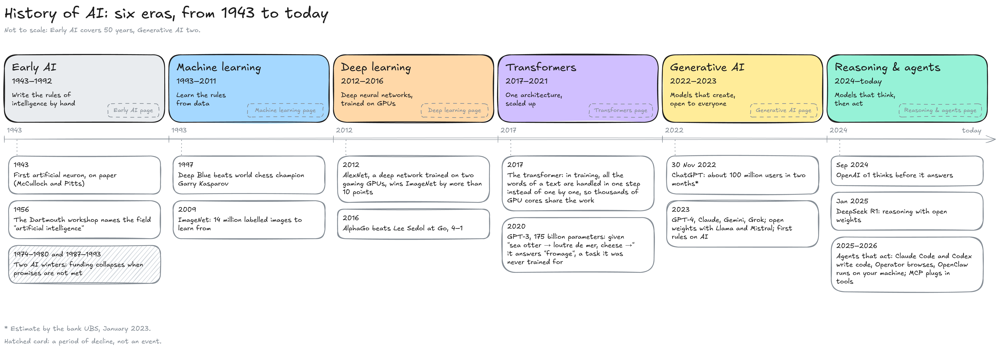

---
layout:
  width: default
  title:
    visible: true
  description:
    visible: false
  tableOfContents:
    visible: true
  outline:
    visible: true
  pagination:
    visible: true
  metadata:
    visible: true
  tags:
    visible: true
  actions:
    visible: true
  anchors:
    visible: true
---

# Overview

This section tells how AI got where it is: when each turning point happened, and why it happened then. It splits 80 years into six eras, one page each. How each technique works is explained in [Foundations](https://app.gitbook.com/s/iUMPfk400nthXXrIMRa7/foundations).


**Day-to-day news goes to the Tokens to Agents Telegram channel** (coming soon). History keeps what lasts.


#### Six eras

The map puts the six eras side by side, each with the idea it bet on and its main milestones.

<figure><figcaption></figcaption></figure>

<a href="https://explorer-vxv3.vercel.app/timeline" class="button secondary">Every event, filtered by topic ↗</a>

* **Early AI** **(1943–1992):** Researchers try to write intelligence down as rules. It works on narrow problems (logic, chess, configuring computers) and fails when the world is too large to describe by hand. Promises run ahead of results twice, and funding collapses twice: the two AI winters.
* **Machine learning** **(1993–2011):** Programs learn their rules from examples instead of being given them: spam filters, recommendations, statistical translation. Data, computing power and learning methods grow through the era.
* **Deep learning** **(2012–2016):** A deep neural network trained on two gaming GPUs wins the 2012 ImageNet contest by more than 10 points. The same recipe then wins in vision, translation and the game of Go.
* **Transformers** **(2017–2021):** A new architecture handles all the words of a text in one step during training, so the work spreads over thousands of GPU cores. Language models grow 1,500-fold in two years.
* **Generative AI** **(2022–2023):** Image generators and ChatGPT bring generative models to the public. Closed labs, open-weight models and the first rules race each other.
* **Reasoning & agents** **(2024–today):** Models learn to think before they answer, then to act through tools. Spending reaches hundreds of billions of dollars a year.

Each boundary is the year of a turning point: 1993 is the conventional end of the second AI winter rather than a single event, 2012 is AlexNet, 2017 the transformer, 2022 ChatGPT (30 November) and 2024 OpenAI's o1 (September). The eras match the nested boxes of What is AI: each box became the main thread of the field in one era, and kept going after it.

The map keeps only the milestones that changed the course of the field. Every dated event, with its source and its topic (research, models, products, companies, funding, compute, policy, safety), is in the timeline of the Explorer, the interactive companion of this wiki.

#### Pages in this section

* Early AI: the Turing test, rules against neurons, and why the field had two winters.
* Machine learning: from writing rules to learning them, and the three ingredients that met in 2012.
* Deep learning: the ImageNet turning point, and one recipe applied everywhere.
* Transformers: why handling every word at once mattered for training, and how fast models grew.
* Generative AI: what ChatGPT added, and the race between closed models, open weights and rules.
* Reasoning & agents: thinking at answer time, agents, and the models, money and rules of 2024–2026.

#### Resources

* Overviews: [History of artificial intelligence](https://en.wikipedia.org/wiki/History_of_artificial_intelligence) | [Timeline of artificial intelligence](https://en.wikipedia.org/wiki/Timeline_of_artificial_intelligence) | [Timeline of machine learning](https://en.wikipedia.org/wiki/Timeline_of_machine_learning) (Wikipedia)
* ChatGPT's growth: [ChatGPT may be the fastest-growing consumer app](https://gizmodo.com/chatgpt-apps-ai-microsoft-google-1850065429) (Gizmodo, citing UBS)
