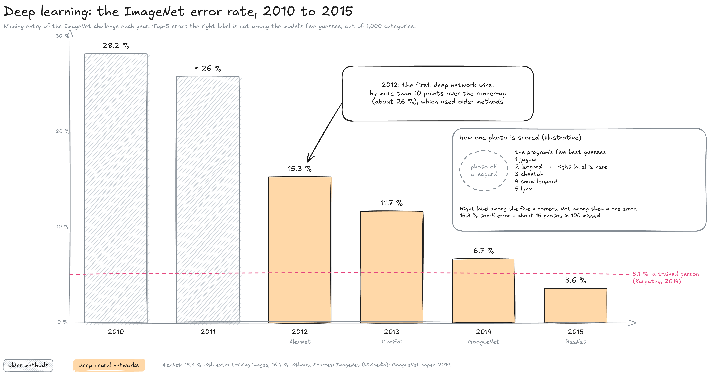
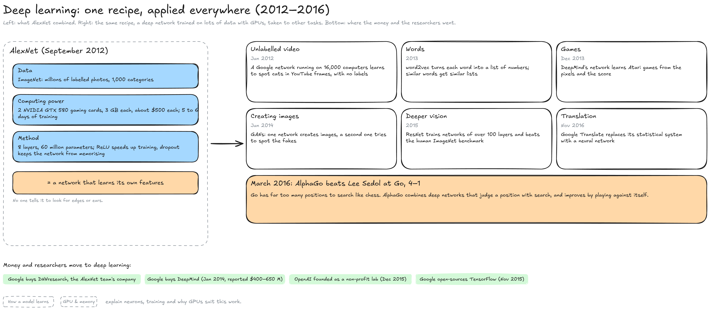

---
layout:
  width: default
  title:
    visible: true
  description:
    visible: false
  tableOfContents:
    visible: true
  outline:
    visible: true
  pagination:
    visible: true
  metadata:
    visible: true
  tags:
    visible: true
  actions:
    visible: true
  anchors:
    visible: true
---

# Deep learning (2012–2016)

This page zooms on the third band of the History map, from AlexNet in 2012 to AlphaGo in 2016. In five years, deep neural networks trained on GPUs went from a minority bet to the main method of the field, and the largest tech companies bought the researchers who built them.


**In 2012, a deep neural network trained on two gaming GPUs beat every other method at recognising images, by more than 10 points.** The recipe, a deep network plus a large labelled dataset plus GPUs, then won in vision, translation and games, because the network learns for itself what to look for.


#### The ImageNet turning point

The ImageNet challenge asked programs to label photos among 1,000 categories. The chart shows the winning error rate each year.

<figure><figcaption></figcaption></figure>

* **How a photo is scored:** For each test photo, the program gives its five best guesses among the 1,000 categories, for example "jaguar, leopard, cheetah, snow leopard, lynx". If the right label ("leopard") is among the five, the photo counts as correct; if not, it is an error. The **top-5 error** is the share of photos missed: 15.3 % means about 15 photos in 100.
* **2010 and 2011:** The winners used older methods: features designed by researchers (edges, textures) fed to a classifier. They erred on 28.2 % and about 26 % of photos.
* **2012:** AlexNet, by Alex Krizhevsky, Ilya Sutskever and Geoffrey Hinton of the University of Toronto, submitted on 30 September, erred on 15.3 %. The runner-up, using older methods, was more than 10.8 points behind.
* **2013 to 2015:** Every winner was a deep network, each one deeper: Clarifai (11.7 %), Google's GoogLeNet (6.7 %), then Microsoft's ResNet (3.6 %).
* **The human line:** Andrej Karpathy labelled a set of test photos himself in 2014 and estimated a trained person's error at 5.1 %. ResNet went below it in 2015. The figure is one careful person's score, not a measure of humanity.

#### Why it worked, and where it went

AlexNet combined the three ingredients that the Machine learning era had prepared. The same combination then spread to one task after another.

<figure><figcaption></figcaption></figure>

* **Data:** ImageNet supplied enough labelled photos for a network with 60 million parameters to learn without simply memorising them.
* **Computing power:** Two NVIDIA GTX 580 gaming cards, with 3 GB of memory each and sold for about $500 each, trained the network in five to six days. The network did not fit on one card, so it was split across both (see GPU & memory for why GPUs suit this work).
* **Method:** Eight layers of neurons, trained by backpropagation (see How a model learns), with two techniques that made a deep network practical: ReLU, a simple neuron function that trains faster, and dropout, which switches neurons off at random during training so the network cannot memorise.
* **What changed:** Nobody told AlexNet to look for edges, eyes or wheels; its layers learned those features from the photos. Every new task now needed data and computing power, not years of feature design by specialists.

The recipe reached one field after another:

* **Unlabelled video (June 2012):** A Google network running on 16,000 computers learned to recognise cats in YouTube frames that nobody had labelled.
* **Words (2013):** Google's word2vec turned each word into a list of numbers, with similar words getting similar lists; the token table of today's models works on the same idea (see Inside a model).
* **Games (December 2013):** A DeepMind network learned to play Atari video games from the screen's pixels and the score alone, beating human players at games such as Pong and Breakout.
* **Creating images (June 2014):** Ian Goodfellow and colleagues introduced generative adversarial networks (GANs): one network creates images while a second learns to tell them from real ones, and each improves against the other.
* **Deeper vision (2015):** ResNet, from Microsoft researchers, added shortcuts between layers so that networks of over 100 layers could be trained without getting worse.
* **Translation (November 2016):** Google Translate replaced the statistical system it had used since 2007 with a neural network.

In March 2016, DeepMind's AlphaGo beat Lee Sedol, one of the strongest Go players, by four games to one. Go has far too many possible positions to search the way Deep Blue searched chess; AlphaGo combined deep networks that judge a position and choose promising moves with a search, and improved by playing against itself.

#### Money and researchers

Companies moved fast. Google bought DNNresearch, the company the AlexNet team had formed, and in January 2014 it bought DeepMind, a London lab founded in 2010, for a reported $400 to $650 million. In November 2015, Google released TensorFlow, its software for training networks, as open source. In December 2015, OpenAI was founded in San Francisco as a non-profit research lab. Geoffrey Hinton later shared the 2024 Nobel Prize in Physics with John Hopfield, for work that enables machine learning with artificial neural networks.

#### What came next

The networks of this era still read text one word after another, which made them slow to train on long texts. In 2017, a Google team proposed an architecture that reads a whole text at once: the Transformers era starts there.

#### Resources

* ImageNet: [ImageNet](https://en.wikipedia.org/wiki/ImageNet) | [AlexNet](https://en.wikipedia.org/wiki/AlexNet) (Wikipedia) | [Going Deeper with Convolutions](https://arxiv.org/abs/1409.4842) (GoogLeNet, 2014, with the results of earlier winners) | [Time for AI to cross the human range in ImageNet](https://aiimpacts.org/time-for-ai-to-cross-the-human-performance-range-in-imagenet-image-classification/) (AI Impacts)
* The recipe spreads: [A massive Google network learns to identify cats](https://www.wkms.org/2012-06-26/a-massive-google-network-learns-to-identify-cats) (NPR, 2012) | [Generative adversarial network](https://en.wikipedia.org/wiki/Generative_adversarial_network) | [Residual neural network](https://en.wikipedia.org/wiki/Residual_neural_network) | [Google Neural Machine Translation](https://en.wikipedia.org/wiki/Google_Neural_Machine_Translation) (Wikipedia)
* Companies: [Google DeepMind](https://en.wikipedia.org/wiki/Google_DeepMind) (Wikipedia) | [TensorFlow, open sourced for everyone](https://research.google/blog/tensorflow-googles-latest-machine-learning-system-open-sourced-for-everyone/) (Google Research, 2015)
