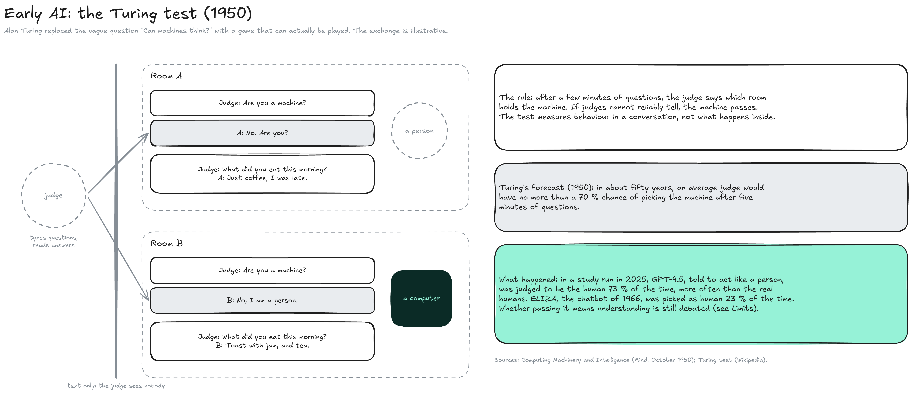
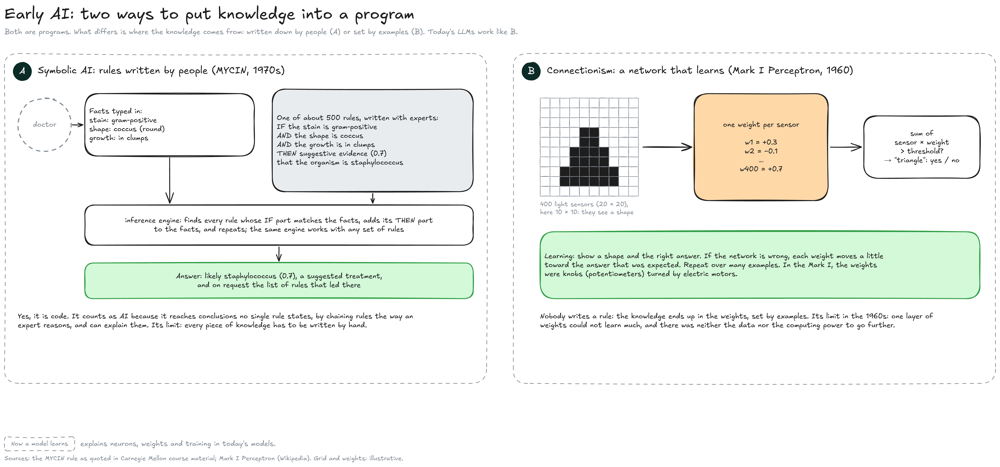
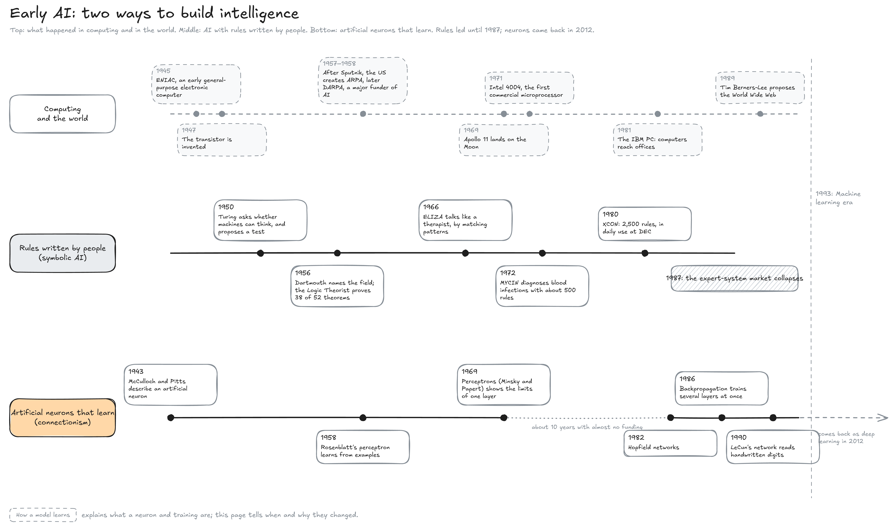
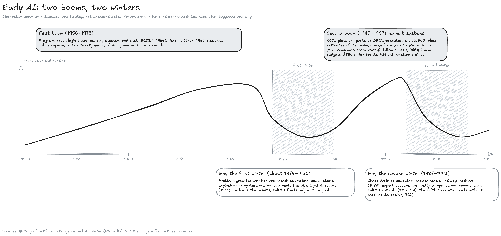

---
layout:
  width: default
  title:
    visible: true
  description:
    visible: false
  tableOfContents:
    visible: true
  outline:
    visible: true
  pagination:
    visible: true
  metadata:
    visible: true
  tags:
    visible: true
  actions:
    visible: true
  anchors:
    visible: true
---

# Early AI (1943–1992)

This page zooms on the first band of the History map, from the first artificial neuron in 1943 to the end of the second AI winter. It covers the question that started the field (the Turing test), the two ways of building intelligence (rules written by people and networks that learn), and why the field twice promised more than it delivered.


**Early AI bet on writing intelligence down as rules.** The bet worked on narrow problems such as logic, chess or configuring a computer, and failed when the world was too large to describe by hand. Each time the gap became visible, funding collapsed: the two AI winters.


#### Before 1943

In 1843, Ada Lovelace wrote that Charles Babbage's Analytical Engine, a mechanical computer that was never finished, might be seen as "a thinking or … reasoning machine", while warning against "exaggerated ideas" about its powers. In 1936, Alan Turing described the Turing machine, a simple model of a computer that manipulates symbols by rules. Both ideas, a machine that follows rules and the question of whether that is thinking, run through the whole era.

#### The Turing test

In October 1950, Alan Turing published _Computing Machinery and Intelligence_. He judged the question "Can machines think?" too vague to answer, and replaced it with a game that can be played.

<figure><figcaption></figcaption></figure>

* **The game:** A judge exchanges typed messages with two hidden players, a person and a machine, and has to say which is which. If judges cannot reliably tell, the machine passes. The test looks only at behaviour in a conversation, not at what happens inside the machine.
* **Turing's forecast:** In about fifty years, he wrote, an average judge would have no more than a 70 % chance of picking the machine after five minutes of questions.
* **What happened:** In a study run in 2025, GPT-4.5, told to behave like a person, was judged to be the human 73 % of the time, more often than the real people it was compared with. ELIZA, the chatbot of 1966, was picked 23 % of the time. Whether passing the test means understanding is still debated (see **Limits**).

#### Two ways to put knowledge into a program

From the start, two approaches competed. Both are computer programs; what separates them is where the program's knowledge comes from. The diagram shows one famous system of each kind.

<figure><figcaption></figcaption></figure>

* **A, symbolic AI (rules written by people):** Knowledge is written as rules that a person can read. MYCIN, started at Stanford in 1972, held about 500 rules written with infectious-disease experts, such as: "IF the stain of the organism is gram-positive, AND its shape is coccus, AND it grows in clumps, THEN there is suggestive evidence (0.7) that it is staphylococcus". A doctor typed in the facts about a patient's infection, and a general-purpose **inference engine** applied every rule whose IF part matched, added the conclusion to the facts, and repeated, until it reached a likely organism and a treatment.
* **Is that not just code?** It is code, and so is every AI. What made MYCIN count as AI is that it reached conclusions no single rule contained, by chaining rules the way an expert reasons, and that it could show which rules led to its answer. Its limit is the same as its strength: every piece of knowledge had to be found, written and checked by people.
* **B, connectionism (a network that learns):** Knowledge is stored as numbers that no one writes by hand. The Mark I Perceptron, built by Frank Rosenblatt's team in 1959–1960, looked at an image through 400 light sensors arranged in a 20 × 20 grid. Each sensor had a weight; the machine added up sensor × weight and answered yes or no (for example, "this is a triangle"). When it was wrong, each weight was moved a little toward the right answer, and the process repeated over many examples. In the Mark I, the weights were knobs turned by electric motors.
* **What B could not yet do:** One layer of weights can learn only simple distinctions, and the data and computing power for anything larger did not exist. How weights and training work in today's models is explained on How a model learns; LLMs work like B.

#### Rules and neurons, 1943 to 1992

The timeline follows both approaches through the era, under a lane of events in computing and in the world that sets the scene.

<figure><figcaption></figcaption></figure>

* **The world around AI:** The first electronic computers (ENIAC, operational in December 1945) and the transistor (1947) made programs possible at all. After the Soviet Sputnik satellite of 1957, the US created ARPA in February 1958; renamed DARPA, it became a major funder of AI research. The microprocessor (Intel 4004, 1971) and the IBM PC (1981) put computers in offices, and the cheap desktop computers of the 1980s helped end the market for specialised AI machines.
* **Rules:** In 1956, the Dartmouth workshop, organised by John McCarthy and Marvin Minsky, gave the field its name, "artificial intelligence". The same year, the Logic Theorist of Allen Newell and Herbert Simon proved 38 of the first 52 theorems of _Principia Mathematica_. Expert systems followed: MYCIN from 1972, then XCON, in daily use at Digital Equipment Corporation (DEC) from 1980, which picked the parts of each computer order with about 2,500 rules.
* **Programs that seemed to understand:** ELIZA, written by Joseph Weizenbaum between 1964 and 1967 and published in January 1966, imitated a therapist by turning the user's sentences into questions. A conversation from Weizenbaum's paper starts: "Men are all alike." / "IN WHAT WAY" / "They're always bugging us about something or other." / "CAN YOU THINK OF A SPECIFIC EXAMPLE". ELIZA understood nothing, yet Weizenbaum's secretary reportedly asked him to leave the room so she could talk to it in private. Attributing understanding to a program that only matches patterns is still called the **ELIZA effect**.
* **Neurons:** In 1943, Warren McCulloch and Walter Pitts described networks of idealised neurons, the first description of a neural network. Rosenblatt's perceptron followed in 1958; he predicted it "may eventually be able to learn, make decisions, and translate languages". In 1969, Minsky and Seymour Papert's book _Perceptrons_ showed that a single layer cannot learn some simple functions; nobody yet knew how to train several layers, and almost no research on neural networks was funded for about ten years.
* **The comeback:** In 1982, John Hopfield showed a network that stores and recalls patterns. In 1986, David Rumelhart, Geoffrey Hinton and Ronald Williams popularised backpropagation, the method that trains several layers at once and still trains neural networks today. Around 1990, Yann LeCun's network at Bell Labs read handwritten digits.

Rules dominated the field and its funding until 1987. Neurons stayed a minority bet until 2012, when they came back as Deep learning.

#### Two booms, two winters

The field went through two cycles of enthusiasm and collapse. The curve is drawn by hand to show the shape of the story: it is not measured data.

<figure><figcaption></figcaption></figure>

* **First boom (1956–1973):** Programs proved theorems, played checkers and held conversations, and forecasts followed. Herbert Simon wrote in 1965 that machines would be capable, "within twenty years, of doing any work a man can do"; in 1970, Minsky told _Life_ magazine that a machine with the general intelligence of an average person was three to eight years away.
* **First winter (about 1974–1980):** The programs worked on small, clean problems and broke on real ones. The number of possibilities to search grows explosively with the size of a problem (the **combinatorial explosion**), and computers were millions of times too weak, as the roboticist Hans Moravec argued in 1976. In the UK, the Lighthill report (1973) condemned the results and research funding was largely cut. In the US, a 1969 law (the Mansfield Amendment) pushed the defence agency DARPA towards projects with military goals, and by 1974 it had cancelled large programmes such as a $3 million-a-year speech-understanding contract.
* **Second boom (1980–1987):** Expert systems brought AI into companies. XCON saved DEC an estimated $25 to $40 million a year, depending on the source. By 1985 corporations spent over a billion dollars a year on AI, and Japan's government set aside $850 million in 1981 for its Fifth Generation computer project.
* **Second winter (1987–1993):** In 1987, cheaper desktop computers from Sun, Apple and IBM matched the specialised Lisp machines built to run AI programs, and a half-billion-dollar industry disappeared within a year. Expert systems proved costly to update, could not learn, and failed on cases their rules did not foresee. DARPA cut its AI funding in 1987–88, and the Fifth Generation project ended in June 1992 without reaching its goals.

Both winters had the same cause: results that held on demonstrations and broke in the real world, after forecasts that set expectations far higher. Whether today's spending repeats that pattern is a live debate (see **Investment**).

#### What came next

The field did not restart with a single breakthrough. Through the early 1990s, researchers turned to statistics and to programs that learn from data. The Machine learning era starts in 1993, the conventional end of the second winter.

#### Resources

* Overviews: [History of artificial intelligence](https://en.wikipedia.org/wiki/History_of_artificial_intelligence) | [AI winter](https://en.wikipedia.org/wiki/AI_winter) | [Timeline of artificial intelligence](https://en.wikipedia.org/wiki/Timeline_of_artificial_intelligence) (Wikipedia)
* The Turing test: [Turing test](https://en.wikipedia.org/wiki/Turing_test) | [Computing Machinery and Intelligence](https://en.wikipedia.org/wiki/Computing_Machinery_and_Intelligence) (Wikipedia)
* Programs: [ELIZA](https://en.wikipedia.org/wiki/ELIZA) | [XCON](https://en.wikipedia.org/wiki/Xcon) | [Perceptron](https://en.wikipedia.org/wiki/Perceptron) (Wikipedia) | [MYCIN](https://www.britannica.com/technology/MYCIN) (Britannica) | [ELIZA, part 1](https://www.filfre.net/2011/06/eliza-part-1) (The Digital Antiquarian, with Weizenbaum's transcript)
* Computing: [History of computing hardware](https://en.wikipedia.org/wiki/History_of_computing_hardware) | [DARPA](https://en.wikipedia.org/wiki/DARPA) | [History of personal computers](https://en.wikipedia.org/wiki/History_of_personal_computers) (Wikipedia)
* Papers: [Learning representations by back-propagating errors](https://www.nature.com/articles/323533a0) (Rumelhart, Hinton and Williams, _Nature_, 1986)
