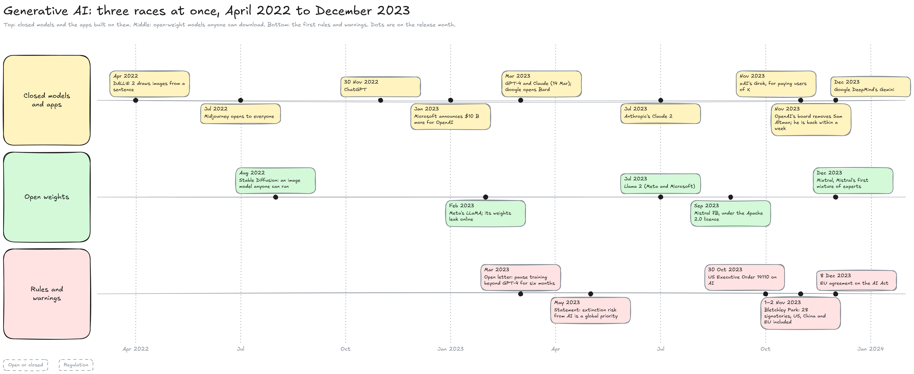

---
layout:
  width: default
  title:
    visible: true
  description:
    visible: false
  tableOfContents:
    visible: true
  outline:
    visible: true
  pagination:
    visible: true
  metadata:
    visible: true
  tags:
    visible: true
  actions:
    visible: true
  anchors:
    visible: true
---

# Generative AI (2022–2023)

This page zooms on the fifth band of the History map: the two years in which generative models reached the public. Image generators came first, in 2022; ChatGPT followed in November 2022; and 2023 became a race between closed labs, open-weight models and the first rules.


**ChatGPT did not bring a new kind of model: it brought a model trained to follow instructions, in a free chat window.** About 100 million people used it within two months, and the whole industry reorganised around chat assistants.


#### What ChatGPT added

The diagram reads from left to right: a model that existed since 2020, the training that made it follow instructions, and the interface that opened it to everyone.

<figure><figcaption></figcaption></figure>

1. **GPT-3 (May 2020):** A model trained only to continue text (see Transformers). It was reachable through an API, mostly by developers.
2. **Post-training (January 2022):** With InstructGPT, OpenAI trained GPT-3 further on human judgements, in three steps. People first wrote good answers to many requests, and the model was trained to imitate them. Then, for the same request, the model wrote several answers and people ranked them, from best to worst. A second, smaller model, the **reward model**, learned from these rankings to give any answer a score that predicts what people would prefer. Finally, the language model was trained to write answers that get high scores. The last two steps are **RLHF**, reinforcement learning from human feedback (see pre-training and post-training). People preferred the answers of a 1.3-billion-parameter InstructGPT model to those of the 175-billion-parameter GPT-3.
3. **A free chat window (30 November 2022):** ChatGPT ran on a model of the GPT-3.5 series, trained the same way on conversations, where trainers played both the user and the assistant. Anyone with a browser could use it, for free.

The lower half of the diagram shows the difference on one request. A model that only continues text takes "Write a polite email declining Thursday's meeting" for the first line of a list and continues the list; the post-trained model writes the email (both answers illustrative).

The result: one million users in five days, enough to crash the service, and about 100 million monthly users two months after launch according to an estimate by the bank UBS, the fastest growth of any consumer app until then. The model was two years old; following instructions and a free interface were what changed.

#### Images came first

Generative images reached the public a few months before chat. OpenAI announced DALL·E 2 in April 2022; Midjourney opened its image generator to everyone in July 2022, and an image made with it won first place in a digital art competition at the 2022 Colorado State Fair. In August 2022, Stability AI released Stable Diffusion with **open weights**: anyone could download the model and run it on a gaming GPU. How these diffusion models turn noise into an image is explained on Image & video.

#### Three races at once

After ChatGPT, three races ran in parallel. The diagram puts them on three lanes, from April 2022 to December 2023.

<figure><figcaption></figcaption></figure>

* **Closed models and apps:** Microsoft announced a further $10 billion investment in OpenAI in January 2023. Google, which had invented the transformer, answered with Bard (announced in February, opened in March) and merged its two AI labs, Google Brain and DeepMind, into Google DeepMind in April. On 14 March 2023, OpenAI released GPT-4, which also reads images, and Anthropic released Claude, followed by Claude 2 in July. In November, xAI, Elon Musk's company, launched Grok for paying users of X, and OpenAI's board removed its chief executive, Sam Altman, who was back within a week. In December, Google DeepMind introduced Gemini.
* **Open weights:** In February 2023, Meta released LLaMA to researchers, and its weights soon leaked online, which let anyone run and modify a strong language model. Llama 2 followed in July 2023. Mistral AI, founded in Paris in April 2023, released Mistral 7B in September under the Apache 2.0 licence, then Mixtral in December. Whether a model's weights are published shapes who can use, study and change it (see **Open or closed**).
* **Rules and warnings:** In March 2023, an open letter signed by more than 30,000 people asked labs to pause for at least six months the training of systems more powerful than GPT-4. In May, hundreds of AI experts and public figures signed a one-sentence statement placing the risk of extinction from AI among global priorities. On 30 October, the US president signed an executive order on AI; on 1–2 November, 28 signatories, including the US, China and the EU, signed the Bletchley Declaration on AI safety in the UK; in December, EU institutions reached a political agreement on the AI Act (see **Regulation** and **Risks**).

The same three lanes run through the next era: closed labs, open-weight labs, and governments setting rules while both move.

#### What came next

The models of 2023 answered instantly, without checking their own reasoning, and could only write text. Teaching them to think before answering, and then to act through tools, defines the Reasoning & agents era.

#### Resources

* ChatGPT: [Aligning language models to follow instructions](https://openai.com/index/instruction-following/) (OpenAI, InstructGPT, 2022) | [ChatGPT](https://en.wikipedia.org/wiki/ChatGPT) (Wikipedia) | [ChatGPT may be the fastest-growing consumer app](https://gizmodo.com/chatgpt-apps-ai-microsoft-google-1850065429) (Gizmodo, citing UBS)
* Images: [DALL-E](https://en.wikipedia.org/wiki/DALL-E) | [Midjourney](https://en.wikipedia.org/wiki/Midjourney) (Wikipedia)
* The year 2023: [2023 in artificial intelligence](https://en.wikipedia.org/wiki/2023_in_artificial_intelligence) | [Mistral AI](https://en.wikipedia.org/wiki/Mistral_AI) | [OpenAI](https://en.wikipedia.org/wiki/OpenAI) | [Grok](https://en.wikipedia.org/wiki/Grok_\(chatbot\)) (Wikipedia)
* Rules and warnings: [Pause Giant AI Experiments: An Open Letter](https://en.wikipedia.org/wiki/Pause_Giant_AI_Experiments:_An_Open_Letter) | [AI Safety Summit 2023](https://en.wikipedia.org/wiki/AI_Safety_Summit_2023) (Wikipedia)
