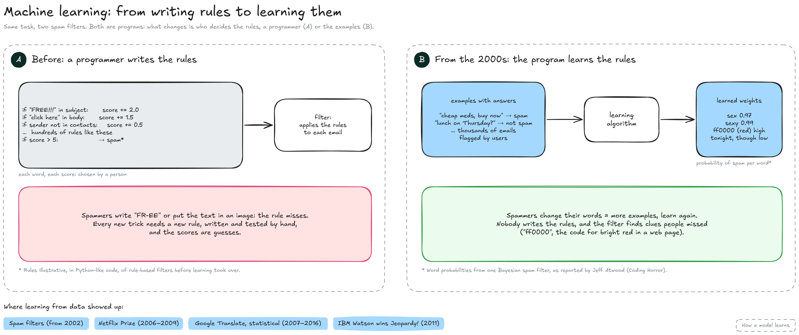
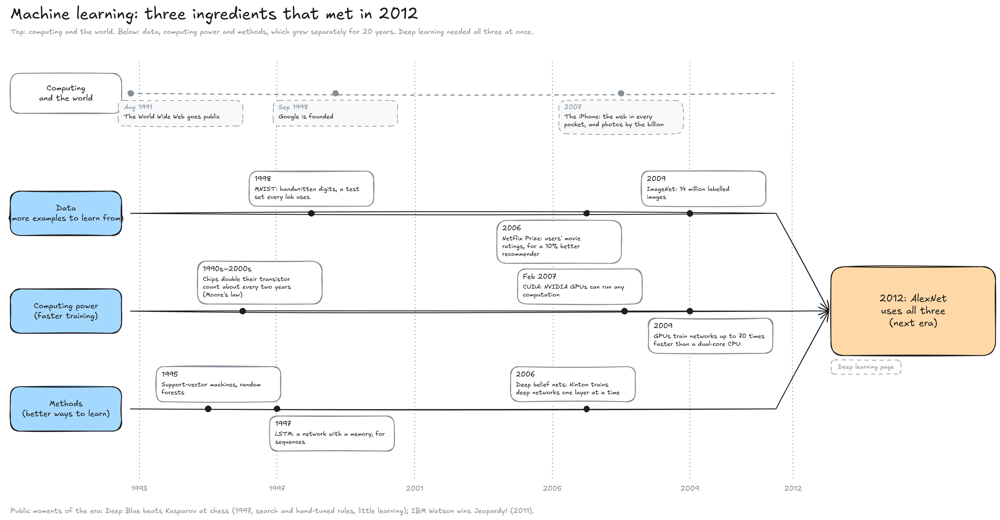

---
layout:
  width: default
  title:
    visible: true
  description:
    visible: false
  tableOfContents:
    visible: true
  outline:
    visible: true
  pagination:
    visible: true
  metadata:
    visible: true
  tags:
    visible: true
  actions:
    visible: true
  anchors:
    visible: true
---

# Machine learning (1993–2011)

This page zooms on the second band of the History map, from the end of the second AI winter to the eve of deep learning. It covers the switch from rules written by people to rules learned from data, and the three ingredients that grew through the era until they met in 2012.


**From the 1990s, the machine learns its rules from examples instead of being given them.** Progress then depends on three things: how much data there is to learn from, how much computing power is available, and how good the learning methods are. All three grew through the era.


The era's name is not the end of the field. Machine learning did not stop in 2011: deep learning and today's language models are machine learning too (see What is AI). This era is the one in which learning from data, mostly without deep networks, replaced hand-written rules.

#### From writing rules to learning them

The diagram shows one task, sorting spam from normal email, done two ways. Both are programs; what changes is who decides the rules: a programmer (A) or the examples (B).

<figure><figcaption></figcaption></figure>

* **A, a programmer writes the rules:** The filter is a list of tests written in code, such as "if the subject contains FREE!!!, add 2 points", with a threshold above which the email is spam. Each word and each score is chosen by a person. Spammers then write "FR-EE" or put their text in an image, and the rule misses: every new trick needs a new rule, written and tested by hand. This is the same brittleness that ended the expert systems of the 1980s (see Early AI).
* **B, the program learns the rules:** The input is examples with their answers: emails that users flagged as spam or not spam. A learning algorithm computes, for each word, how strongly it signals spam; one filter described by Jeff Atwood gave "sexy" a probability of 0.99 and also picked up clues no one had listed, such as "ff0000", the code for bright red in a web page. When spammers change their wording, the filter learns again from new examples. Bayesian filters of this kind spread from 2002.
* **What changes:** Nobody writes the rules any more; people collect and label examples (here, by clicking "spam"). The learned rules weigh thousands of clues at once, and a better filter comes from more or better examples instead of more hand-written rules. How training sets the numbers is explained on How a model learns.

The same approach spread through the era. In 2006, Netflix offered a prize to whoever improved its film recommendations by 10 %; a team won it in 2009. From October 2007, Google Translate used statistical translation, learned from texts already translated by people, until a neural network replaced it in 2016.

The era's two most public wins tell the story in a different way. In May 1997, IBM's Deep Blue beat world chess champion Garry Kasparov by examining 200 million positions per second, with chess knowledge programmed by its team and grandmaster advisers: search and rules, not learning. In February 2011, IBM's Watson won the quiz show _Jeopardy!_ against champions Ken Jennings and Brad Rutter, scoring $77,147 against $24,000 and $21,600.

#### Three ingredients that met in 2012

Learning from data is only as good as the data, the computers and the methods. The diagram follows the three through the era, under a lane of events in computing and in the world.

<figure><figcaption></figcaption></figure>

* **The world around:** The World Wide Web opened to the public in August 1991, Google was founded in September 1998, and the iPhone (2007) put a camera and the web in millions of pockets. People started producing, every day, the text and photos that learning programs need.
* **Data:** The web and digital photos produced examples on a scale no lab could have collected before. MNIST (1998), a set of handwritten digits, became the test every lab used. ImageNet, started by Fei-Fei Li in 2006 and presented in 2009, labelled over 14 million images in more than 21,000 categories; its yearly contest, from 2010, used 1,000 categories and became the benchmark of computer vision.
* **Computing power:** Processors kept improving, but the decisive change came from graphics cards (GPUs), built for video games, which do thousands of small calculations at once (see GPU & memory). In February 2007, NVIDIA released CUDA, which lets any program use its GPUs. In 2009, Rajat Raina, Anand Madhavan and Andrew Ng showed that a GPU trained some neural networks up to 70 times faster than a dual-core processor.
* **Methods:** Support-vector machines (Corinna Cortes and Vladimir Vapnik, 1995) and random forests (Tin Kam Ho, 1995) were the standard tools of the era, with no deep network needed. Neural networks were out of fashion, but work continued: LSTM (Sepp Hochreiter and Jürgen Schmidhuber, 1997) gave networks a memory for sequences, and in 2006 Geoffrey Hinton, Simon Osindero and Yee-Whye Teh showed how to train deep networks one layer at a time, which revived interest in deep networks.

By 2011 the three ingredients existed separately: a large labelled dataset, cheap parallel computing, and methods to train deep networks. Nobody had yet combined them at full scale.

#### What came next

In September 2012, a team from the University of Toronto entered a deep network trained on two gaming GPUs in the ImageNet contest and won by a wide margin. That result opens the Deep learning era.

#### Resources

* Overview: [Timeline of machine learning](https://en.wikipedia.org/wiki/Timeline_of_machine_learning) (Wikipedia)
* The world around: [World Wide Web](https://en.wikipedia.org/wiki/World_Wide_Web) | [Google](https://en.wikipedia.org/wiki/Google) | [iPhone (1st generation)](https://en.wikipedia.org/wiki/IPhone_\(1st_generation\)) (Wikipedia)
* Spam filters: [Some Plan(s) for Spam](https://blog.codinghorror.com/some-plans-for-spam/) (Jeff Atwood, Coding Horror)
* Public moments: [Deep Blue](https://www.ibm.com/history/deep-blue) (IBM) | [IBM Watson](https://en.wikipedia.org/wiki/IBM_Watson) (Wikipedia)
* Ingredients: [ImageNet](https://en.wikipedia.org/wiki/ImageNet) | [CUDA](https://en.wikipedia.org/wiki/CUDA) (Wikipedia) | [Large-scale deep unsupervised learning using graphics processors](https://andrewng.org/publications/large-scale-deep-unsupervised-learning-using-graphics-processors/) (Raina, Madhavan and Ng, 2009) | [A fast learning algorithm for deep belief nets](https://www.cs.utoronto.ca/~hinton/absps/ncfast.pdf) (Hinton, Osindero and Teh, 2006)
