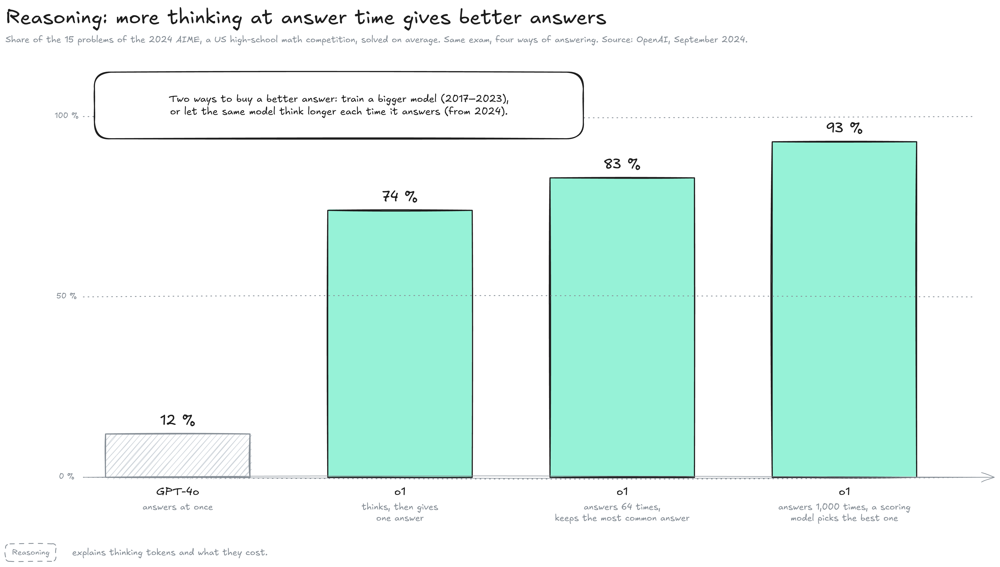
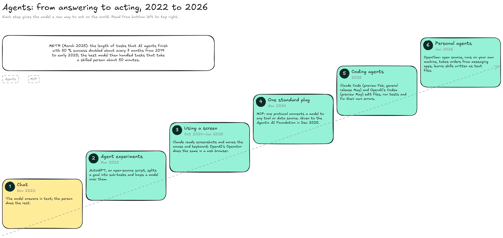
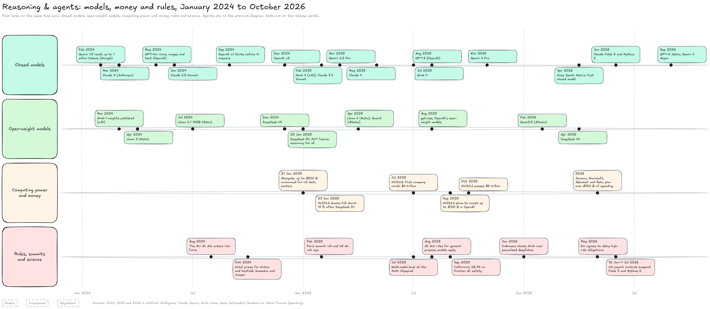

---
layout:
  width: default
  title:
    visible: true
  description:
    visible: false
  tableOfContents:
    visible: true
  outline:
    visible: true
  pagination:
    visible: true
  metadata:
    visible: true
  tags:
    visible: true
  actions:
    visible: true
  anchors:
    visible: true
---

# Reasoning & agents (2024–today)

This page zooms on the last band of the History map, the era still under way. It covers two turning points, models that think before they answer (from September 2024) and models that act through tools (2025–2026), and the money and rules that grew around them. This page is updated when the era changes; every dated event, with its source, is in the [timeline of the Explorer](https://explorer-vxv3.vercel.app/timeline).


**Since 2024, a better answer can come from two sources: a bigger training run, or more thinking each time the model answers.** Models also learned to act: by 2026, agents edit code, use computers and run on personal machines, and the money spent on the infrastructure reaches hundreds of billions of dollars a year.


#### Thinking before answering

Until 2024, models were trained to answer directly, token after token. The chart shows what changed on the same math exam when the model was trained to think first.

<figure><figcaption></figcaption></figure>

* **How o1 was trained:** OpenAI used reinforcement learning, training by trial and reward, on problems whose answers can be checked. The model learned to write out a chain of reasoning, spot its mistakes and try another approach before answering. OpenAI presented it on 12 September 2024.
* **The exam:** The AIME is a US high-school math competition of 15 problems. GPT-4o solved 12 % of them on average; o1 solved 74 % with one answer per problem, 83 % when it answered 64 times and kept the most common answer, and 93 % when a scoring model picked the best of 1,000 answers.
* **A second axis:** Results improved both with more training and with more thinking at answer time. Until then, a better model meant a bigger training run; from now on, a lab could also spend more computing power on each answer. How thinking tokens work, and what they cost, will be explained on a **Reasoning** page.

On 20 January 2025, the Chinese lab DeepSeek released R1, a reasoning model with open weights under the MIT licence, which matched o1 on math and code according to DeepSeek. It was reported to have cost far less to train than comparable models. On 27 January, NVIDIA's shares fell about 17 %, the largest one-day loss of market value of any US company. Spending on chips nevertheless kept rising (see below).

#### From answering to acting

An **agent** is a model that uses tools in a loop: it reads a file, runs code or clicks on a screen, looks at the result, and decides the next step. The diagram shows the steps that took models from answering to acting.

<figure><figcaption></figcaption></figure>

1. **Chat (November 2022):** The model answers in text; the person does everything else.
2. **Agent experiments (March 2023):** AutoGPT, an open-source script, split a goal into sub-tasks and looped a model over them.
3. **Using a screen (October 2024 to January 2025):** Anthropic's Claude learned to read screenshots and move the mouse and keyboard, like a person in front of a computer. In January 2025, OpenAI's Operator did the same inside a web browser, carrying out web tasks for its user.
4. **One standard plug (November 2024):** Anthropic published the Model Context Protocol (**MCP**), one way for any app to connect a model to tools and data. In December 2025 it was given, with OpenAI's AGENTS.md and Block's goose, to the new Agentic AI Foundation of the Linux Foundation.
5. **Coding agents (2025):** Claude Code (preview in February, generally available in May) and OpenAI's Codex (preview in May) edit the files of a project, run its tests and fix their own errors; a Codex task typically takes 1 to 30 minutes. In February 2025, Andrej Karpathy named the practice of letting the model write the code "vibe coding".
6. **Personal agents (January 2026):** OpenClaw, an open-source agent first released in November 2025 and renamed in January 2026, runs on the user's own machine, takes orders from messaging apps such as Telegram, and learns skills written as text files. Its creator joined OpenAI in February 2026, and a foundation now looks after the project.

The research group METR measured in March 2025 that the length of tasks agents complete with 50 % success had doubled about every seven months since 2019; the best model then handled tasks that take a skilled person about 50 minutes. The agent loop itself will be explained on the **Agents** pages of Foundations, and its security risks on **Agent security**.

#### Models, money and rules

The last diagram puts four lanes on the same time axis, from January 2024 to October 2026: closed models, open-weight models, computing power and money, and rules, summits and science.

<figure><figcaption></figcaption></figure>

* **Closed models:** Every large lab released a new model every few months. OpenAI: GPT-4o (May 2024, voice, images and text), o1 and o3 (September and December 2024), GPT-5 (August 2025), GPT-6 Astra (September 2026). Anthropic: Claude 3 (March 2024), Claude 3.5 Sonnet (June 2024), Claude 4 (May 2025), Claude Fable 5 and Mythos 5 (June 2026). Google: Gemini 1.5, which reads up to a million tokens (February 2024), Gemini 2.5 (March 2025), Gemini 3 (November 2025), Gemini 4 Argon (September 2026). xAI: Grok 3 (February 2025) and Grok 4 (July 2025). In April 2026, Meta released Muse Spark, its first closed model, while saying it hopes to open future versions.
* **Open-weight models:** Meta's Llama 3 (April 2024), Llama 3.1 405B (July 2024) and Llama 4 (April 2025); DeepSeek V3 (December 2024), R1 (January 2025) and V4 (April 2026); Alibaba's Qwen3 (April 2025) and Qwen3.5 (February 2026); and gpt-oss, OpenAI's open-weight models (August 2025). Current models are compared in the **Models** section.
* **Computing power and money:** On 21 January 2025, OpenAI, SoftBank, Oracle and MGX announced Stargate, with up to $500 billion for US data centers. NVIDIA became the first company worth $4 trillion in July 2025, then $5 trillion in October, and in September 2025 announced plans to invest up to $100 billion in OpenAI. For 2026, Amazon, Microsoft, Alphabet and Meta plan more than $700 billion of spending, mostly on data centers (see **Investment** and **Data centers**).
* **Rules:** The EU AI Act entered into force on 1 August 2024, and its rules for general-purpose models applied from 2 August 2025; in May 2026, EU institutions agreed to delay its high-risk obligations. At the Paris AI Action Summit in February 2025, the US and the UK did not sign the final declaration. In June 2026, the US government suspended foreign access to Claude Fable 5 and Mythos 5 under export controls, from 12 June to 1 July (see **Regulation** and **Geopolitics**).
* **Science:** In October 2024, the Nobel Prize in Physics went to John Hopfield and Geoffrey Hinton for neural networks, and half of the Chemistry prize to Demis Hassabis and John Jumper for AlphaFold. In July 2025, models from OpenAI and Google DeepMind reached gold-medal level at the International Mathematical Olympiad.

#### What comes next

This era is still open, and no single idea has replaced reasoning and agents yet. The directions researchers are betting on (world models, other architectures, continual learning, interpretability) are mapped on What is AI.

#### Resources

* Reasoning: [Learning to reason with LLMs](https://openai.com/index/learning-to-reason-with-llms/) (OpenAI, 2024) | [DeepSeek-R1 release](https://deepseek.com/en/news/deepseek-r1/) (DeepSeek, 2025) | [DeepSeek-R1 paper](https://arxiv.org/abs/2501.12948)
* Agents: [Anthropic's new AI can control your PC](https://techcrunch.com/2024/10/22/anthropics-new-ai-can-control-your-pc/) (TechCrunch, 2024) | [Introducing the Model Context Protocol](https://www.anthropic.com/news/model-context-protocol) (Anthropic, 2024) | [Formation of the Agentic AI Foundation](https://www.linuxfoundation.org/press/linux-foundation-announces-the-formation-of-the-agentic-ai-foundation) (Linux Foundation, 2025) | [Measuring AI Ability to Complete Long Tasks](https://arxiv.org/abs/2503.14499) (METR, 2025) | [OpenClaw](https://en.wikipedia.org/wiki/OpenClaw) (Wikipedia)
* Models: [Claude](https://en.wikipedia.org/wiki/Claude_\(language_model\)) | [Gemini](https://en.wikipedia.org/wiki/Gemini_\(language_model\)) | [Grok](https://en.wikipedia.org/wiki/Grok_\(chatbot\)) | [Llama](https://en.wikipedia.org/wiki/Llama_\(language_model\)) | [Qwen](https://en.wikipedia.org/wiki/Qwen) | [gpt-oss](https://en.wikipedia.org/wiki/GPT-OSS) (Wikipedia) | [Meta's Muse Spark](https://thenextweb.com/news/meta-muse-spark-msl-first-model) (The Next Web)
* Agent products: [OpenAI Operator](https://en.wikipedia.org/wiki/OpenAI_Operator) | [OpenAI Codex](https://en.wikipedia.org/wiki/OpenAI_Codex) (Wikipedia)
* Years in review: [2024](https://en.wikipedia.org/wiki/2024_in_artificial_intelligence) | [2025](https://en.wikipedia.org/wiki/2025_in_artificial_intelligence) | [2026](https://en.wikipedia.org/wiki/2026_in_artificial_intelligence) in artificial intelligence (Wikipedia)
* Export controls: [Anthropic's Fable and Mythos export-control suspension](https://www.casrai.org/news/anthropic-fable-mythos-export-control-suspension) (CASRAI) | [US lifts restrictions on Fable and Mythos](https://www.aljazeera.com/amp/economy/2026/7/1/us-lifts-restrictions-on-powerful-ai-models-fable-mythos-anthropic-says) (Al Jazeera, 2026)
* Spending: [Hyperscalers hit $700 billion in 2026 AI spending plans](https://finance.yahoo.com/sectors/technology/articles/hyperscalers-hit-700-billion-2026-111243744.html) (Yahoo Finance, 2026)
