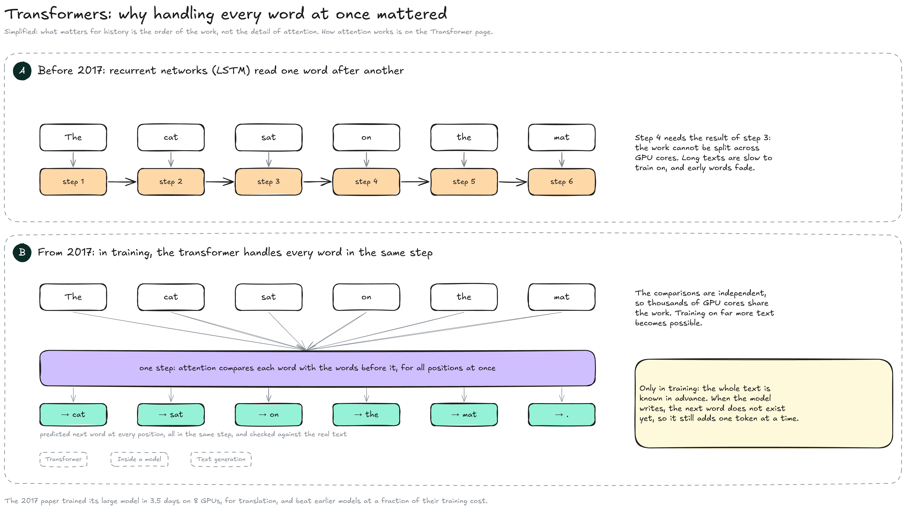
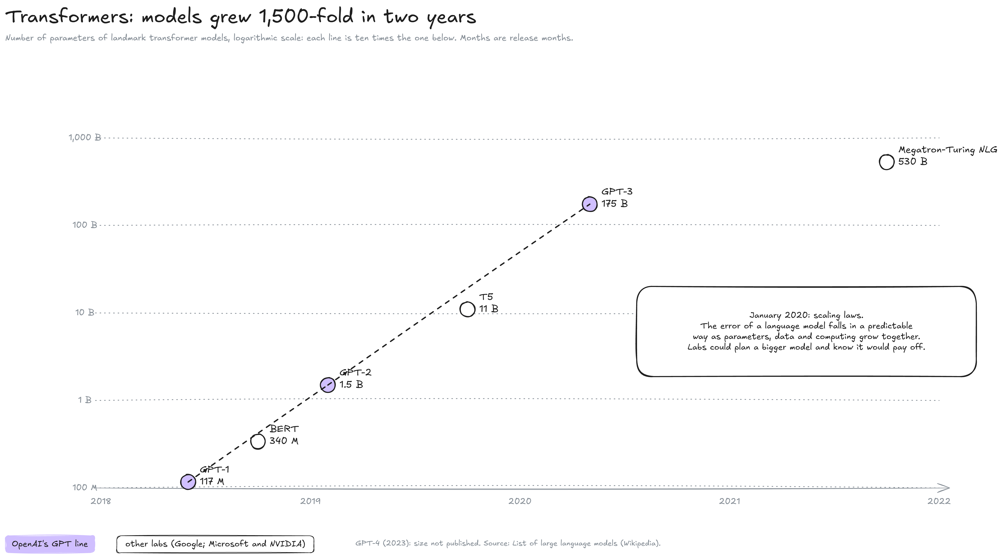

---
layout:
  width: default
  title:
    visible: true
  description:
    visible: false
  tableOfContents:
    visible: true
  outline:
    visible: true
  pagination:
    visible: true
  metadata:
    visible: true
  tags:
    visible: true
  actions:
    visible: true
  anchors:
    visible: true
---

# Transformers (2017–2021)

This page zooms on the fourth band of the History map, from the transformer paper in June 2017 to the eve of ChatGPT. One architecture replaced the others for text, then spread to images and proteins, and language models grew 1,500-fold in two years.


**The transformer handles all the words of a text in the same step, so its training splits across thousands of GPU cores.** Labs could train on far more text than before, and from 2020 they knew that a bigger model, trained on more data with more computing power, would be predictably better.


#### Handling every word at once, in training

The diagram compares how networks were trained on text before and after 2017. It shows the order of the work, not how attention computes.

<figure><figcaption></figcaption></figure>

* **A, recurrent networks:** Before 2017, the best language networks were recurrent networks such as LSTM. They read a sentence word by word, and each step needs the result of the previous one. In the words of the 2017 paper, this "inherently sequential nature precludes parallelization": the work cannot be shared among the thousands of cores of a GPU, so training on long texts is slow, and the start of a long text tends to fade.
* **B, the transformer:** In June 2017, a team of Google researchers published _Attention Is All You Need_. Their architecture relies on **attention**: each word is compared with the words before it, and these comparisons are independent of each other, so they all run at the same time. In training, the whole text is known in advance, so the model predicts the next word at every position in one step ("The" → cat, "The cat" → sat, and so on) and checks each guess against the real text. Their large model trained in about 3.5 days on one machine with 8 GPUs and beat the best translation systems of the time.

This parallel work happens in training only. When a model writes an answer, the next word does not exist yet, so it still adds one token at a time, each one computed from everything written before it (see Text generation). What runs in parallel at each of those steps is the arithmetic inside the model: thousands of multiplications of the model's tables, shared among the GPU's cores (see GPU & memory).

How attention compares words will be explained on a **Transformer** page; the tables a transformer stores are on Inside a model. For history, what matters is the consequence: the bottleneck moved from the architecture to the amount of data and computing power a lab could afford.

#### Models grew 1,500-fold in two years

Once training could be spread over many GPUs, labs scaled models up. The chart uses a logarithmic scale: each grid line is ten times the one below.

<figure><figcaption></figcaption></figure>

* **GPT-1 (June 2018, 117 million parameters):** OpenAI pre-trained a transformer to predict the next word on a large body of text, then adapted it to specific tasks. "GPT" stands for generative pre-trained transformer.
* **BERT (October 2018, 340 million):** Google's model reads a text in both directions to understand it rather than write it. From October 2019, Google Search used it to understand what a query means.
* **GPT-2 (February 2019, 1.5 billion):** OpenAI first held back the full model, citing the risk of spam and fake news, then released it in stages; the complete model came out in November 2019 after OpenAI said it had "seen no strong evidence of misuse so far".
* **T5 (October 2019, 11 billion):** Google turned every language task into "text in, text out".
* **Scaling laws (January 2020):** Researchers at OpenAI measured that the error of a language model falls in a predictable way as parameters, data and computing power grow together. A lab could now plan a bigger model and know in advance that it would pay off.
* **GPT-3 (May 2020, 175 billion):** It did tasks it had never been trained for from a few examples written in its prompt. OpenAI opened it to developers through an API, in beta, from June 2020.
* **Megatron-Turing NLG (October 2021, 530 billion):** Microsoft and NVIDIA's model shows that the race was not limited to OpenAI.

From GPT-1 to GPT-3, the number of parameters was multiplied by about 1,500 in under two years. Money followed: Microsoft invested $1 billion in OpenAI in 2019. Labs also became more secretive: GPT-4 (2023) was released without its size.

#### Beyond text

The transformer was built for translation, but the same architecture, or attention inside other designs, spread across the field:

* **Proteins (November 2020):** DeepMind's AlphaFold 2 predicted the 3D shape of proteins with an accuracy far ahead of every other group at the CASP14 competition. Demis Hassabis and John Jumper shared the 2024 Nobel Prize in Chemistry for it.
* **Images and text together (January 2021):** OpenAI presented DALL·E, which drew images from a sentence, and CLIP, which learned to match images with their descriptions from pairs found on the web.
* **Companies:** Anthropic was founded in 2021 by former OpenAI researchers, with safety research as part of its mission (see **Labs**).

#### What came next

GPT-3 could write almost anything, but it continued text rather than following instructions, and only developers could reach it. Training it to follow instructions, and opening it to everyone in a chat window, started the Generative AI era.

#### Resources

* Papers: [Attention Is All You Need](https://arxiv.org/abs/1706.03762) (2017) | [BERT](https://arxiv.org/abs/1810.04805) (2018) | [Scaling Laws for Neural Language Models](https://arxiv.org/abs/2001.08361) (2020) | [Language Models are Few-Shot Learners](https://arxiv.org/abs/2005.14165) (GPT-3, 2020)
* Models: [List of large language models](https://en.wikipedia.org/wiki/List_of_large_language_models) | [GPT-2](https://en.wikipedia.org/wiki/GPT-2) | [DALL-E](https://en.wikipedia.org/wiki/DALL-E) | [AlphaFold](https://en.wikipedia.org/wiki/AlphaFold) (Wikipedia)
* BERT in Search: [Google brings in BERT to improve its search results](https://techcrunch.com/2019/10/25/google-brings-in-bert-to-improve-its-search-results/) (TechCrunch, 2019)
