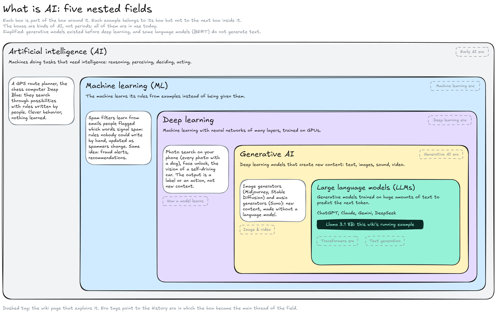
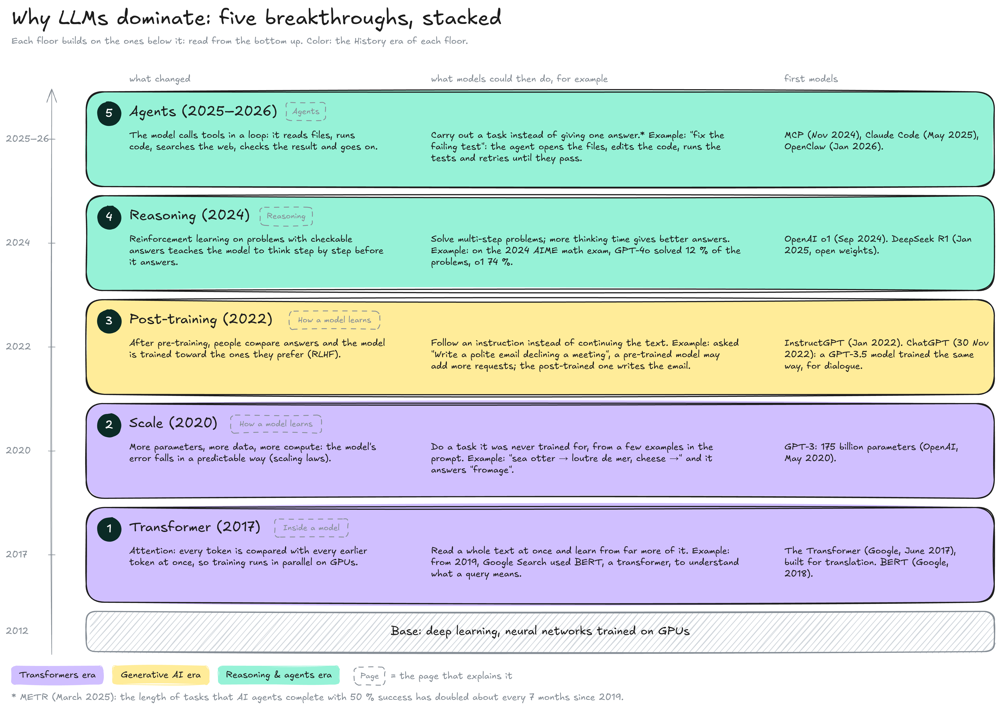
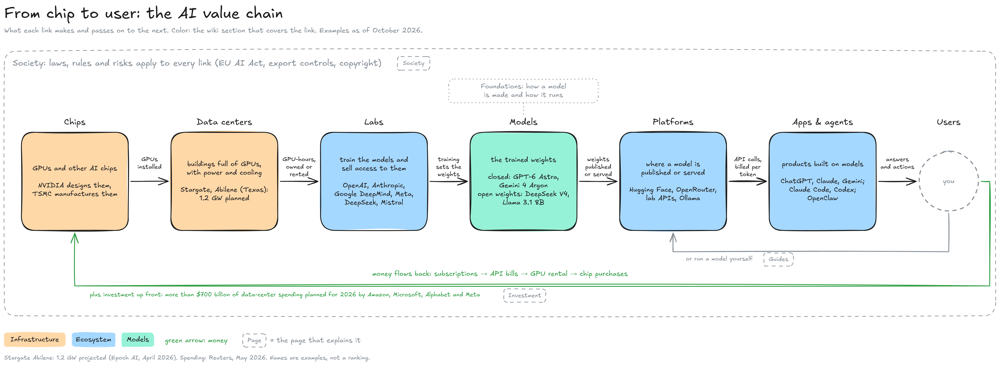
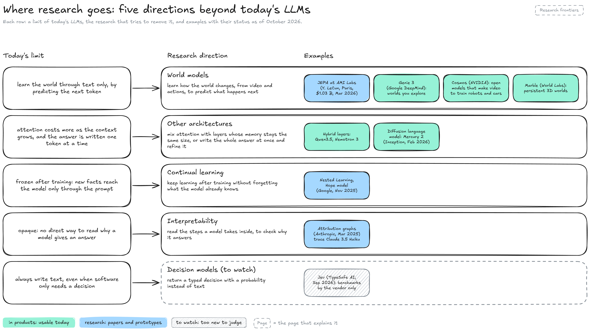

# What is AI

Artificial intelligence (AI) is a field of research, not a product: it covers every method that makes a machine do a task that needs intelligence. This page places today's chat assistants and agents inside that field, shows the five breakthroughs that made them possible, follows the chain from chip to user, and maps where research is going. Each part links to the section of the wiki that covers it in detail.


**Large language models are one family inside AI, the one that has driven the field since 2022.** They rest on five breakthroughs stacked since 2017: the transformer, scale, post-training, reasoning and agents.


#### The field in one view

AI contains machine learning, which contains deep learning, which contains generative AI, which contains large language models. The boxes are kinds of AI, not periods: each keeps branches of its own that are in use today.

<figure><figcaption></figcaption></figure>

* **Artificial intelligence (AI):** Any method that makes a machine reason, perceive, decide or act. The field was named at a workshop at Dartmouth College in 1956. A system counts as AI because of the task it does, not because it learns: a GPS route planner, or the chess computer Deep Blue, which beat world champion Garry Kasparov in 1997 by checking 200 million positions per second, search through possibilities using rules and knowledge written by people.
* **Machine learning (ML):** The machine learns its rules from examples instead of being given them. A spam filter learns from emails people flagged which words signal spam. This makes possible rules nobody could write by hand (a filter weighs thousands of words at once) and rules that update themselves when the data changes, as spammers change their wording. Fraud alerts and recommendations work the same way.
* **Deep learning:** Machine learning with **neural networks** of many layers: stacks of simple calculations whose strengths, the **parameters**, are set by training (see [How a model learns](foundations/model/how-a-model-learns.md)). It took over the field in 2012, when a network trained on GPUs won an image-recognition contest. Photo search on a phone, face unlock and the vision of a self-driving car are deep learning that recognises or decides: the output is a label ("dog") or an action ("brake").
* **Generative AI:** Deep learning models that create new content: text, images, sound, video. Image generators such as Midjourney and Stable Diffusion, or music generators such as Suno, are generative without being language models (see [Image & video](foundations/inference/image-and-video.md)).
* **Large language models (LLMs):** Generative models trained on huge amounts of text to predict the next **token**, a word or a piece of a word (see [Text generation](foundations/inference/text-generation/)). ChatGPT, Claude, Gemini and DeepSeek are built on LLMs, and so is Llama 3.1 8B Instruct, the running example of [Foundations](https://app.gitbook.com/s/iUMPfk400nthXXrIMRa7/foundations).

The line between deep learning and generative AI is the kind of output, not the kind of network. Both predict: a photo classifier predicts one label, once; an LLM predicts the next token, adds it to the text and repeats, so the result is a new piece of text that did not exist before. In everyday use, "AI" now often means an assistant built on an LLM; this wiki uses the word for the whole field. The dashed tags on the diagram point to the **History** era in which each box became the main thread of the field. The nesting is simplified: generative models existed before deep learning (statistical models that predicted the next word from the previous few), and some language models, such as Google's BERT (2018), read text to classify it without generating any.

#### Why LLMs dominate

LLMs took over the field because five breakthroughs stacked on top of deep learning, each one making the next possible. Each floor of the diagram gives what changed, what models could then do with a concrete example, and the first models that did it.

<figure><figcaption></figcaption></figure>

1. **Transformer (2017):** A design of neural network built on **attention**: each token is compared with all the earlier tokens in one step, instead of reading the text word after word. The work splits across thousands of GPU cores, so a model can learn from far more text. Google published it in _Attention Is All You Need_ (June 2017), for translation; from 2019, Google Search used BERT, a transformer, to understand what a query means. [Inside a model](foundations/model/inside-a-model.md) shows the tables of a transformer; a **Transformer** page will explain attention.
2. **Scale (2020):** Researchers at OpenAI measured that a model's error falls in a predictable way as its parameters, its training data and its computing power grow: the **scaling laws**. GPT-3 (May 2020, 175 billion parameters) showed what scale brings: it could do a task it was never trained for from a few examples written in its prompt, without any retraining. The GPT-3 paper shows it with English-to-French prompts such as "sea otter → loutre de mer, cheese →", which the model completes with "fromage".
3. **Post-training (2022):** After pre-training on raw text, the model is trained further on human judgements: people compare its answers, and the model is pushed toward the ones they prefer (**RLHF**, reinforcement learning from human feedback; see [pre-training and post-training](foundations/model/how-a-model-learns.md#pre-training-and-post-training)). A model trained only on raw text continues whatever it is given: asked to write an email, it may add more requests to the list. After post-training it follows the instruction. With OpenAI's InstructGPT (January 2022), people preferred the answers of a 1.3-billion-parameter model to those of the 175-billion-parameter GPT-3. ChatGPT, released on 30 November 2022, was neither of them: it ran on a model of the GPT-3.5 series, post-trained the same way for dialogue, and it made LLMs a public product.
4. **Reasoning (2024):** **Reinforcement learning**, training by trial and reward instead of by example answers, is applied to problems whose answers can be checked, such as math and code. The model learns to write out its thinking before it answers, and more thinking time gives better results on hard problems: on the 2024 AIME, a US high-school math competition, GPT-4o solved 12 % of the problems and o1 74 %. OpenAI o1 (September 2024) introduced it; DeepSeek R1 (January 2025) reached a comparable level with **open weights**, files anyone can download. A **Reasoning** page will cover thinking tokens and their cost.
5. **Agents (2025–2026):** The model calls **tools** in a loop: it reads files, runs code or searches the web, reads the result and decides the next step, so it carries out a task instead of giving one answer: told to fix a failing test, a coding agent opens the files, edits the code, runs the tests and tries again until they pass. Anthropic's Model Context Protocol (MCP, November 2024) standardised how tools plug into a model; coding agents such as Claude Code (generally available in May 2025) and personal agents such as OpenClaw (January 2026) made the loop common. METR measured that the length of tasks agents complete with 50 % success doubled about every seven months from 2019 to early 2025. The **Agents** pages of Foundations explain the loop.

The floors do not replace each other: a 2026 agent is a transformer, trained at scale, post-trained, able to reason, and given tools.

#### From chip to user

The AI industry is a chain: each link makes something and passes it on to the next. Each link has its section in the wiki, shown by the colors of the diagram.

<figure><figcaption></figcaption></figure>

* **Chips:** GPUs and other AI chips do the math of training and running models. NVIDIA, for example, designs GPUs that TSMC manufactures, mainly in Taiwan (**Infrastructure**; how a GPU runs a model is on [GPU & memory](foundations/inference/gpu-and-memory.md)).
* **Data centers:** Buildings full of GPUs, with the power and cooling they need, now planned in gigawatts: OpenAI's Stargate site in Abilene, Texas, is projected at 1.2 GW.
* **Labs:** Companies that train models and sell access to them, such as OpenAI, Anthropic, Google DeepMind, Meta, DeepSeek and Mistral (**Labs**, in Ecosystem). Training runs on GPU-hours they own or rent.
* **Models:** What a lab ships: the trained weights. Closed models, such as GPT-6 Astra and Gemini 4 Argon, are reachable only through the lab's service; open-weight models, such as DeepSeek V4 and Llama 3.1 8B, can be downloaded (**Models** section).
* **Platforms:** Where a model is published or served: Hugging Face for downloads, APIs billed per token (a lab's own, or a router such as OpenRouter), and apps such as Ollama that run a model on your own machine (**Platforms**, in Ecosystem).
* **Apps & agents:** Products built on models: assistants (ChatGPT, Claude, Gemini), coding agents (Claude Code, Codex), personal agents (OpenClaw) (**Apps**, in Ecosystem).
* **Users:** People and companies who use these products, or who skip the end of the chain and run a model themselves (**Guides**).

Money flows the other way: subscriptions pay for API calls, which pay for GPU time, which pays for chips. On top of that, Amazon, Microsoft, Alphabet and Meta plan more than $700 billion of data-center spending for 2026, the subject of **Investment**. **Society** covers the laws and risks that apply to every link.

#### Where research goes

Today's LLMs learn the world through text, stop learning when training ends, and are hard to inspect. Each row of the map pairs one of these limits with the research direction that tries to remove it. This map will also open the **Research frontiers** page, which covers each direction in detail.

<figure><figcaption></figcaption></figure>

* **World models:** Models that learn how the world changes, from video and actions, to predict what happens next. The bet is contested. Yann LeCun, Meta's former chief AI scientist, argues that LLMs alone will not reach human-level intelligence and that machines must learn from observation; his company AMI Labs, based in Paris, raised $1.03 billion in March 2026 to build world models on **JEPA**, an architecture that predicts in an abstract space instead of pixel by pixel. Most large labs instead keep scaling LLMs and add reasoning, tools, and image and video input. Generative world models are already usable: Google DeepMind's Genie 3 generates worlds you move through in real time, NVIDIA's Cosmos models generate video to train robots and self-driving cars, and World Labs' Marble builds persistent 3D scenes.
* **Other architectures:** Hybrid models mix attention with layers whose memory stays the same size however long the text, which lowers the cost of long contexts; Qwen3.5 and NVIDIA's Nemotron 3 use them. Diffusion language models write the whole answer at once and refine it over several passes, as image models do; Inception's Mercury 2 (February 2026) is one.
* **Continual learning:** Today's models stop learning when training ends, and new facts reach them only through the prompt. Continual learning aims to keep training a deployed model without erasing what it already knows, a problem called catastrophic forgetting. Google's Nested Learning (November 2025) is a research example.
* **Interpretability:** Reading what happens inside a model, to check why it gives an answer. Anthropic's attribution graphs (March 2025) traced intermediate steps inside Claude 3.5 Haiku.
* **Decision models (to watch):** Models that return a typed decision with a probability instead of text, for software that only needs a choice. Jev (TypeSafe AI, September 2026) is the first one announced. Its benchmarks come from the vendor only and score agreement with other models' answers, so its value is not established yet.

The status tags on the map (in products, research, to watch) are as of October 2026.

#### Resources

* Early AI and machine learning: [Deep Blue](https://www.ibm.com/history/deep-blue) (IBM) | [Some Plan(s) for Spam](https://blog.codinghorror.com/some-plans-for-spam/) (Coding Horror, on Bayesian spam filters)
* Breakthroughs: [Attention Is All You Need](https://arxiv.org/abs/1706.03762) | [Scaling Laws for Neural Language Models](https://arxiv.org/abs/2001.08361) | [Google brings in BERT to improve its search results](https://techcrunch.com/2019/10/25/google-brings-in-bert-to-improve-its-search-results/) (TechCrunch) | [Language Models are Few-Shot Learners](https://arxiv.org/abs/2005.14165) (GPT-3) | [Aligning language models to follow instructions](https://openai.com/index/instruction-following/) (InstructGPT) | [Learning to reason with LLMs](https://openai.com/index/learning-to-reason-with-llms/) (o1) | [DeepSeek-R1](https://arxiv.org/abs/2501.12948) | [ChatGPT](https://en.wikipedia.org/wiki/ChatGPT) (Wikipedia) | [Introducing the Model Context Protocol](https://www.anthropic.com/news/model-context-protocol) | [Measuring AI Ability to Complete Long Tasks](https://arxiv.org/abs/2503.14499) (METR)
* Industry: [OpenAI Stargate: where the US sites stand](https://epoch.ai/blog/openai-stargate-where-the-us-sites-stand) (Epoch AI, April 2026) | [Hyperscalers hit $700 billion in 2026 AI spending plans](https://finance.yahoo.com/sectors/technology/articles/hyperscalers-hit-700-billion-2026-111243744.html) (Yahoo Finance, May 2026)
* Research directions: [AMI Labs raises $1.03 billion](https://thenextweb.com/news/yann-lecun-ami-labs-world-models-billion) (The Next Web) | [Genie 3](https://techcrunch.com/2025/08/05/deepmind-reveals-genie-3-a-world-model-that-could-be-the-key-to-reaching-agi) (TechCrunch) | [Cosmos](https://techcrunch.com/2025/01/06/nvidia-releases-its-own-brand-of-world-models) (TechCrunch) | [Marble](https://radiancefields.com/world-labs-formally-launches-marble-a-generative-world-model) (Radiance Fields) | [Hybrid attention](https://sebastianraschka.com/llm-architecture-gallery/hybrid-attention/) (Sebastian Raschka) | [Mercury 2](https://rits.shanghai.nyu.edu/ai/inception-launches-mercury-2-diffusion-powered-reasoning-at-1000-tokens-per-second/) (NYU Shanghai) | [Nested Learning](https://research.google/blog/introducing-nested-learning-a-new-ml-paradigm-for-continual-learning) (Google Research) | [On the Biology of a Large Language Model](https://transformer-circuits.pub/2025/attribution-graphs/biology.html) (Anthropic) | [What is Jev?](https://www.sanity.io/glossary/jev-typesafe-ai-model) (Sanity)
