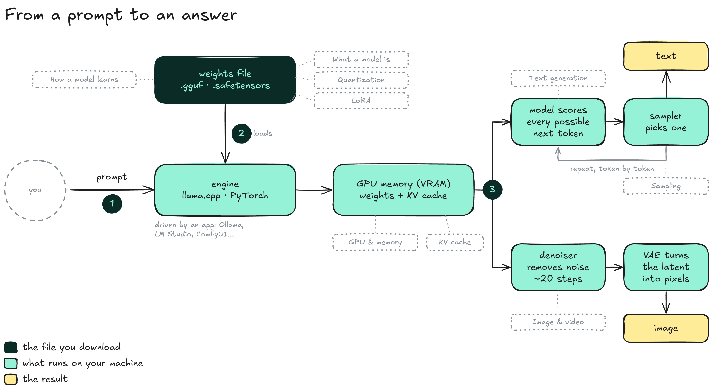

# Overview

This section covers the mechanics behind local AI: what a model file contains, the hardware that holds it, and how text and images are generated from it. Each page explains one concept around its diagrams.


**A model is a file of numbers.** Every other part, from the engine to the GPU and the sampler, exists to load that file and read it fast enough.


### The map

A prompt goes to an engine, which loads the weights file into GPU memory. The model then either writes text, one token at a time, or removes noise until an image is left.

<figure><figcaption></figcaption></figure>

* **Weights file:** The model itself, downloaded once: billions of numbers in a `.gguf` or `.safetensors` file.
* **Engine:** The program that loads the file and does the math: [llama.cpp](https://github.com/ggml-org/llama.cpp) for most local text models, [PyTorch](https://pytorch.org) for images and video. Apps such as Ollama or [ComfyUI](https://github.com/Comfy-Org/ComfyUI) are built on top of them.
* **GPU memory (VRAM):** Holds the weights and, for text models, the memory of the conversation (the KV cache). On a Mac, the same role is played by unified memory.
* **Text:** The model scores every possible next token, a sampler picks one, and the loop repeats.
* **Image:** A diffusion model removes noise over about 20 steps, then a VAE turns the result into pixels.

### Pages in this section

1. **What a model is**: the file, the engine, what a parameter is, how a number is stored, and how big a model is.
2. **How a model learns**: neurons, layers as matrices, and the training loop that sets the weights.
3. **GPU & memory**: why AI runs on GPUs, why memory matters more than raw power, and how software reaches the chip.
4. **Quantization**: why and how a 16 GB model becomes a 5 GB file, block by block.
5. **Quantization formats**: reading names like Q4\_K\_M or IQ3\_M, and what each format costs in quality.
6. **Text generation**: tokens, the generation loop and the context window.
7. **Sampling**: the settings that pick each token (temperature, top-k, top-p, min-p, penalties).
8. **KV cache**: the memory of a conversation, and why long contexts are expensive.
9. **Image & video generation**: diffusion, the latent space, CFG and video.
10. **LoRA**: specializing a model with a small file instead of a full copy.

Terms that have several names (parameter and weight, VRAM and GPU memory…) are gathered in the **Glossary**.

The pages build on each other in this order, but each one can be read on its own.
