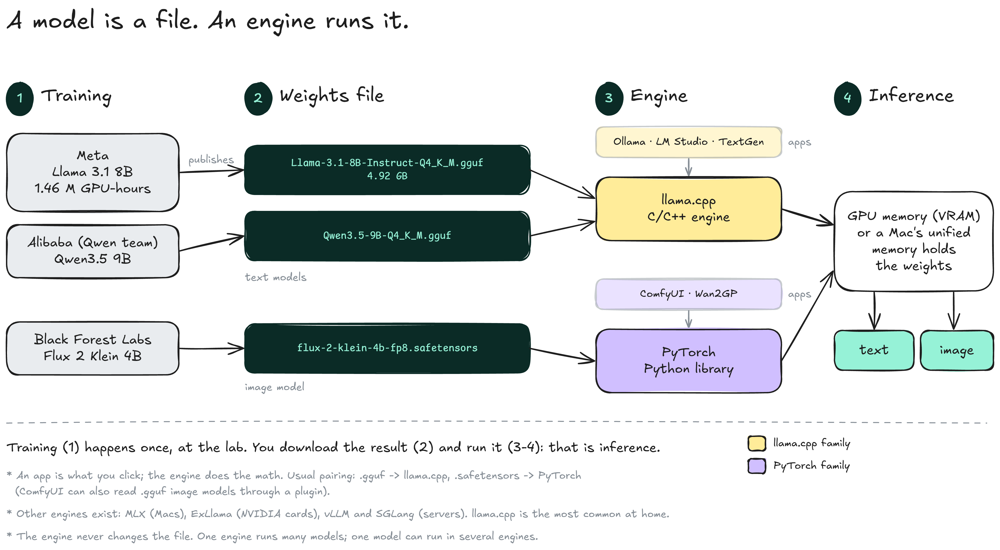
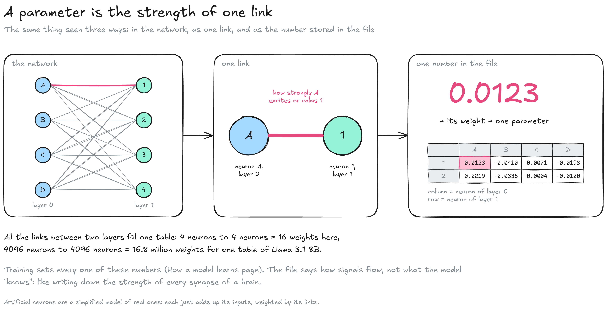
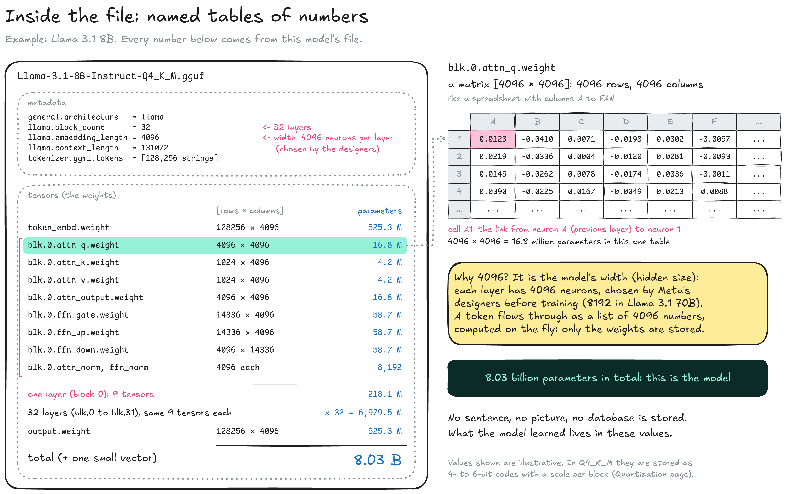
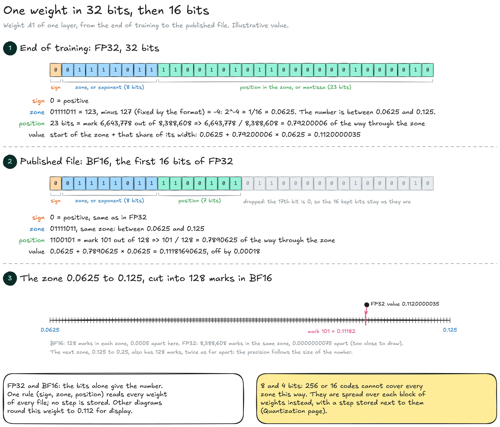
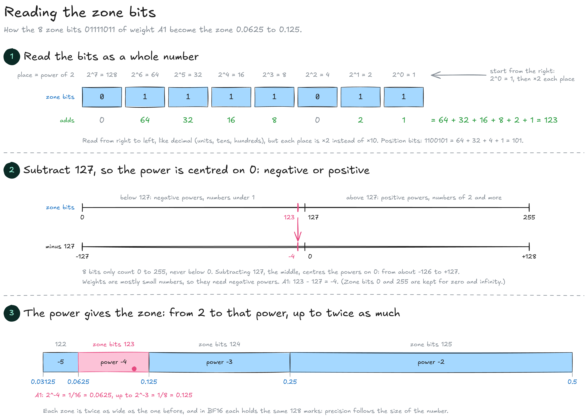
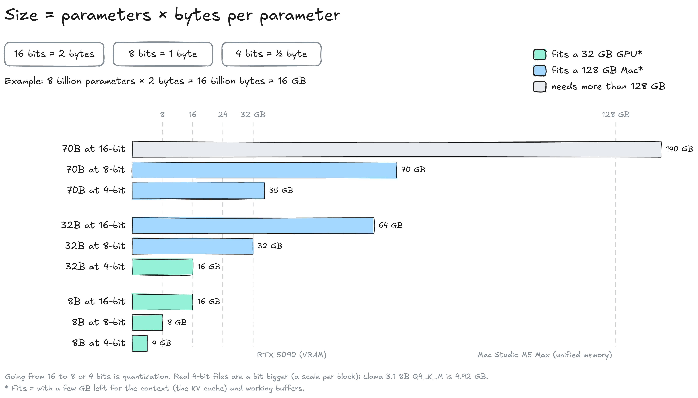

# What a model is

## What a model is

An AI model is a data file, not an application. It holds billions of numbers learned during training, and a separate program, the engine, reads them to produce text or images. This page uses **Llama 3.1 8B** as its example: every number in it comes from that model. Terms with several names are listed in the Glossary.


**A model is a file of numbers.** Its size is the number of parameters times the space each one takes: 8 billion parameters at 2 bytes each = 16 GB.


### A file and an engine

A model goes through two separate phases: training, done once by a lab, and inference, which is every use of the finished file.

<figure><figcaption></figcaption></figure>

* **Training:** A lab adjusts the model's numbers over huge datasets. Meta made Llama (1.46 million GPU-hours on H100s for Llama 3.1 8B), Alibaba's Qwen team made Qwen, Black Forest Labs made Flux.
* **Weights file:** The result of training, published as a file. The same model often exists in several files, at different precisions (see Bits and bytes below).
* **Engine:** The program that loads the file and does the math. Two families dominate at home: [llama.cpp](https://github.com/ggml-org/llama.cpp), written in C/C++, for text models in GGUF format; [PyTorch](https://pytorch.org), a Python library, for image and video models and most research code. Others exist for specific cases: MLX on Macs, ExLlama on NVIDIA cards, vLLM and SGLang on servers.
* **Apps:** What you actually click. [Ollama](https://ollama.com), [LM Studio](https://lmstudio.ai) and [TextGen](https://github.com/oobabooga/textgen) are built on llama.cpp; [ComfyUI](https://github.com/Comfy-Org/ComfyUI) and [Wan2GP](https://github.com/deepbeepmeep/Wan2GP) are built on PyTorch.
* **Inference:** Running the file on your own hardware, with the weights held in the GPU's memory (VRAM) or in a Mac's unified memory.

Model and engine are independent: a new model runs in the same engine as long as its format is supported, and updating the engine does not change the model. Why there are two engine families, and why it matters on a Mac, is covered in two software stacks.

### A parameter is the strength of a link

A model is a network of artificial **neurons** arranged in layers, each neuron linked to the neurons of the next layer. Every link has a strength, and that strength is one number in the file.

<figure><figcaption></figcaption></figure>

* **Neuron:** A tiny calculation: it takes numbers in, multiplies each one by the strength of its link, and adds them up.
* **Weight:** The strength of one link: how much neuron A pushes neuron 1 up or down. 0.0123 is a weak push; a negative weight calms instead of excites.
* **Parameter:** Another name for a weight: one number of the file, set by training. Llama 3.1 8B has 8.03 billion of them.
* **Table:** All the links between two layers fill one table, with one column per neuron of the first layer and one row per neuron of the second.

How training sets these numbers, and why the tables are multiplied rather than read, is explained on How a model learns. The file says how signals flow through the network, not what the model "knows": it is like writing down the strength of every synapse in a brain.

### What is inside the file

A weights file is like a spreadsheet workbook: a short header (the **metadata**) and hundreds of named sheets of numbers (the **tensors**).

<figure><figcaption></figcaption></figure>

* **Metadata:** The model's design, written down: 32 layers, a width of 4096, a context length of 131,072 tokens, and the vocabulary of 128,256 tokens.
* **Tensor:** A named table of weights. Most are **matrices**, written \[rows × columns]: `blk.0.attn_q.weight` is \[4096 × 4096], so 16.8 million weights.
* **Layer:** The network is a stack of 32 identical blocks, `blk.0` to `blk.31`. Each block holds the same 9 tensors with different values.
* **Width (hidden size):** 4096 neurons per layer. Meta's designers chose it before training, like the number of layers; training only fills in the values. Llama 3.1 70B is wider (8192). Every file of Llama 3.1 8B, at any precision, has the same width and the same tensor shapes.
* **Token vs parameter:** A token is a piece of text from the model's fixed vocabulary. Training texts, your prompt and the model's answers are all cut into tokens. While the model reads a token, it becomes a list of 4096 numbers, one per neuron, computed on the fly and then discarded. Only the weights are in the file.
* **No stored content:** The file holds no sentences, pictures or database. The only words in it are the metadata and the vocabulary.

Where 8.03 billion parameters come from (Llama 3.1 8B)

| Part                               | \[rows × columns]            | Parameters        |
| ---------------------------------- | ---------------------------- | ----------------- |
| Attention: query and output        | \[4096 × 4096], twice        | 33.6 M per layer  |
| Attention: key and value           | \[1024 × 4096], twice        | 8.4 M per layer   |
| Feed-forward: gate, up, down       | \[14336 × 4096], three times | 176.2 M per layer |
| One layer (with two small vectors) |                              | 218.1 M           |
| 32 layers                          |                              | 6.98 B            |
| Token table + output table         | \[128256 × 4096], twice      | 1.05 B            |
| **Total**                          |                              | **8.03 B**        |

Every size here is a design choice: 4096 is the width, 1024 the size of keys and values (8 groups of 128, see the KV cache page), 14336 the width of the feed-forward part, and 128,256 the number of tokens in the vocabulary.

### Bits and bytes

A computer stores every number as a row of **bits**, switches that are either 0 or 1. The number of bits given to each weight is its **precision**, and it is the same for every weight of the file.

<figure><figcaption></figcaption></figure>

* **Codes:** N bits make 2^N different patterns, called codes: 4 bits give 16 codes, 16 bits give 65,536, 32 bits about 4.3 billion.
* **Format:** The rule that turns a pattern of bits into a number. FP32, BF16 or INT8 are format names; the digits are the number of bits.
* **Byte:** 8 bits. A weight stored on 16 bits takes 2 bytes, on 8 bits 1 byte, on 4 bits half a byte.
* **Bits are not decimals:** 16 bits do not mean 16 decimals. They mean 65,536 possible numbers, and a weight is stored as the closest one.
* **Why 16 bits:** Training computes in 16 bits with a 32-bit master copy of the weights. The finished model works as well in 16 bits as in 32, for half the space, so labs publish it in BF16: Llama 3.1 8B is released as a 16 GB file. In local AI, "full precision" usually means this original 16-bit file; strictly, 32 bits is full precision and 16 bits is half precision.

#### One weight in 32 and 16 bits

FP32 and BF16 write a number the way scientific notation does, in powers of 2. The rule is fixed by the format and the same for every file, so the bits alone are enough to know the number: no step or other value is stored next to them. Example: weight A1 of one layer (an illustrative value), from the end of training to the published file.

<figure><figcaption></figcaption></figure>

<figure><figcaption></figcaption></figure>

**Reading binary.** Binary is read from right to left, like decimal (units, tens, hundreds), but each place is worth twice the one on its right instead of ten times: 2^0 = 1, 2^1 = 2, 2^2 = 4, then 8, 16, 32, 64, 128 (2^7). A number in binary is the sum of the places whose bit is 1.

* `01111011` = 64 + 32 + 16 + 8 + 2 + 1 = **123**
* `1100101` = 64 + 32 + 4 + 1 = **101**

**Sign (1 bit).** 0 for positive, 1 for negative. A1's sign bit is 0.

**Zone (8 bits, called the exponent).** The range the number falls in. Zones run from one power of 2 to the next, each twice as wide as the one before:

| Zone bits | Minus 127 | Zone                |
| --------- | --------- | ------------------- |
| 122       | −5        | 0.03125 to 0.0625   |
| **123**   | **−4**    | **0.0625 to 0.125** |
| 124       | −3        | 0.125 to 0.25       |
| 127       | 0         | 1 to 2              |
| 128       | 1         | 2 to 4              |

* **Why minus 127:** 8 bits can only count from 0 to 255, never below 0, but the power of 2 must be able to be negative as well as positive. Subtracting 127, the middle of that range, centres the powers on 0: zone bits below 127 give negative powers (numbers under 1), 127 gives power 0 (the zone 1 to 2), above 127 positive powers. Weights are mostly small numbers, so they use negative powers. (Zone bits 0 and 255 are kept for special values such as zero and infinity.)
* **A1:** zone bits 123, minus 127 = −4. 2^−4 = 1/2 × 1/2 × 1/2 × 1/2 = 1/16 = **0.0625**: the start of the zone.
* **End of the zone:** the next power of 2, 2^−3 = 1/8 = **0.125**, twice the start. So A1 is between 0.0625 and 0.125.

**Position (the other bits, called the mantissa).** Where the number sits inside its zone, counted in equal marks from the start of the zone. FP32 has 23 position bits, so 2^23 = 8,388,608 marks per zone; BF16 has 7, so 128 marks.

**Value.** Start of the zone + the position's share of the zone's width (here the width is 0.125 − 0.0625 = 0.0625).

* **FP32, at the end of training:** mark 6,643,778 of 8,388,608 = 0.79200006 of the way, so 0.0625 + 0.79200006 × 0.0625 = **0.1120000035**.
* **BF16, in the published file:** BF16 keeps the first 16 bits of FP32, rounded: the same sign, the same zone, and the first 7 position bits, `1100101` = mark 101 of 128. 0.0625 + (101 / 128) × 0.0625 = **0.11181640625**.
* **What BF16 costs:** 0.00018 on this weight, with half the space. Models work as well in BF16 as in FP32, which is why they are published in it.

**Precision follows the size.** Every zone has the same number of marks, so marks are closer together for small numbers. In A1's zone, BF16 marks are 0.0005 apart; in the zone 0.125 to 0.25, 0.001 apart.

Other diagrams of this wiki round A1 to 0.112 for display. No file holds exactly 0.112: like 1/3 in decimal, 0.112 cannot be written exactly in binary.

8-bit and 4-bit files work differently. 256 or 16 codes cannot cover every zone this way, so the codes are spread over each block of weights, with a step stored next to them: that is quantization.

### How big a model is

Every weight takes the same space, so the size of a model is a multiplication: number of parameters × bytes per parameter.

<figure><figcaption></figcaption></figure>

* **Example:** 8 billion parameters × 2 bytes (16 bits) = 16 billion bytes = 16 GB.
* **16 bits:** How most models are published. A 70B model takes 140 GB.
* **8 and 4 bits:** Quantized versions of the same model: 70 GB and 35 GB for a 70B model.
* **Real files:** A little bigger than the formula. Quantized files also store one scale per block of weights, as explained in what 4 bits means: Llama 3.1 8B at Q4\_K\_M is 4.92 GB, not 4 GB.
* **Memory to plan:** The file must fit in the GPU's VRAM, or in a Mac's unified memory, with 1 to 3 GB more for the conversation, which grows with its length. Where that memory sits is covered on the GPU & memory page.

### Resources

* Model card: [Meta Llama 3.1](https://huggingface.co/meta-llama/Llama-3.1-8B) (training compute, architecture, BF16 release)
* Formats: [GGUF specification](https://github.com/ggml-org/ggml/blob/master/docs/gguf.md) | [safetensors documentation](https://huggingface.co/docs/safetensors)
